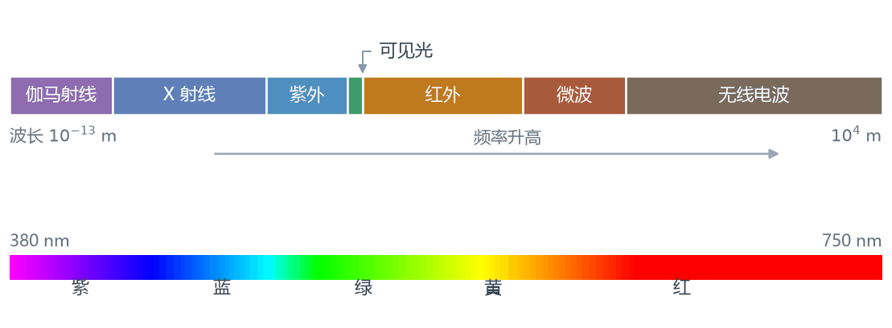
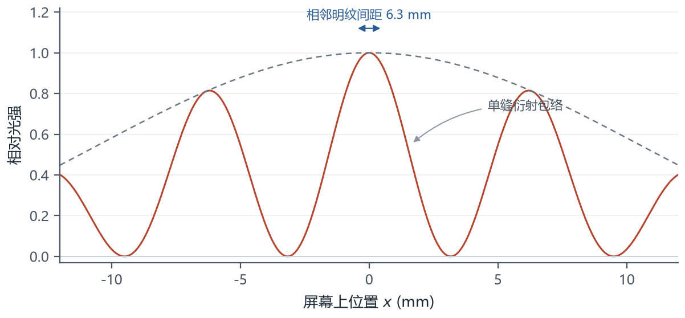
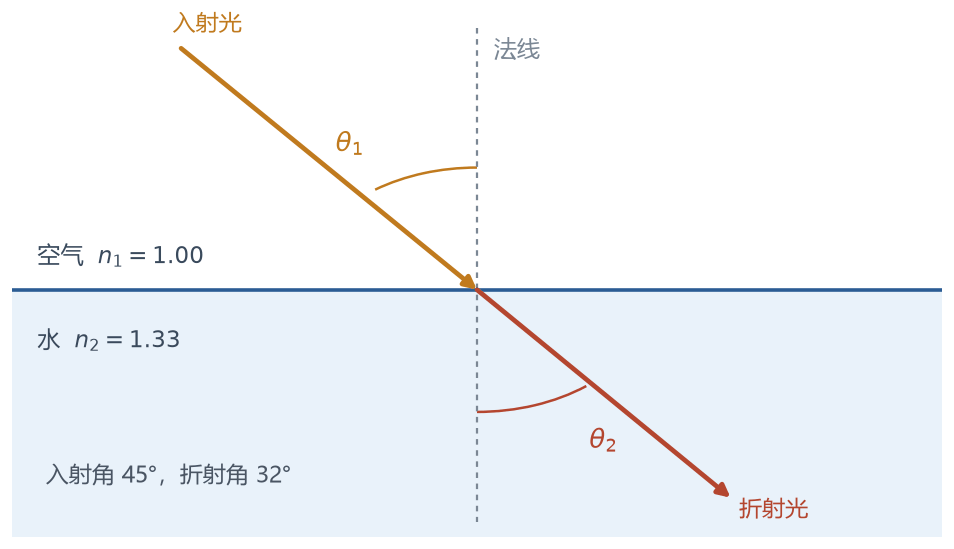

# 第 1 章　光是什么

夜里关掉房间的灯，眼睛需要几分钟才能勉强看清家具的轮廓。打开手电筒，光柱里浮着灰尘。走到窗边，远处的路灯把树影投在墙上。这些每天都在发生的事，背后藏着一个从牛顿时代吵到今天的问题：光到底是个什么东西。

这个问题看起来幼稚，其实是整本书的起点。量子力学不是从某个天才的头脑里凭空冒出来的，它是被一连串关于光的实验逼出来的。所以第一章不急着谈量子，先把光讲清楚，讲到一个十九世纪末的物理学家会满意的程度，然后再看这份满意是怎么被打破的。

## 1.1 光把能量送到你手上

先说一件最实在的事。站在太阳底下，皮肤会热。把手放在白炽灯泡旁边，也会热。这些热量是光带过来的，光和热一样，能传递能量。

光的能量有多大，可以用功率来量。晴天正午的阳光，垂直照在地面上，每平方米大约接收一千瓦的能量。这个数字不算小，一个一平方米的太阳能板，如果转换效率是百分之二十，晴天正午能发出两百瓦的电，够点亮三盏 LED 灯。

光还能被挡住。挡一块木板，墙上就有影子。影子的边缘如果是硬邦邦的一条线，说明光走的是直线；可如果仔细看，影子边缘总有一圈模糊的过渡带，光斑的边缘也不像刀切的那样干净。这一圈模糊，后来成了否定“光是粒子”的第一条线索。

不同颜色的光，能量也不一样。太阳光看起来是白的，用棱镜一散，就分成红橙黄绿蓝靛紫。红外线看不见，但能感觉到热；紫外线看不见，却能把皮肤晒伤。这些不同颜色的光，用同一个量可以排出一条整齐的队，那就是波长。可见光的波长在 380 纳米到 750 纳米之间，红外线更长，紫外线更短，再往两头延伸，就是无线电波和伽马射线。它们本质上是同一种东西，只是波长不同。

图 1-1　电磁波谱。可见光只占很窄的一段，波长从 380 纳米到 750 纳米

## 1.2 微粒还是波

十七世纪，关于光的本性有两派说法。牛顿主张微粒说，认为光是一颗一颗极小的弹丸，从光源飞出来，打到眼睛里引起视觉。这个说法能解释不少事，光走直线，光被挡住就有影子，光从镜面弹回来就像小球撞墙。牛顿在光学上的地位太高，微粒说在英国流行了一百多年。

惠更斯主张波动说，认为光像水波一样在一种看不见的介质里传播。波动说解释反射和折射也很顺手，光进入水中速度改变，方向就偏折。可它有个麻烦，波要传播得有介质，光从太阳到地球要经过真空，真空里没有水也没有空气，那波在什么里面振动。于是人们假设了一种叫以太的东西，充满整个宇宙，透明、无重量、处处都在。

两派吵了很久，谁也说服不了谁。真正的判决来自一个简单的实验。

## 1.3 双缝把光劈成两半

1801 年，英国的托马斯·杨做了一个实验。他在一块不透明的板上刻两条很窄的缝，让一束单色光先穿过一条缝，再穿过这两条缝，最后落在后面的屏幕上。如果光是微粒，屏幕上应该是两条亮纹，各自对应一条缝。实际看到的是许多条明暗相间的条纹，中间最亮，两边逐渐变暗。

这个图案只有波才能给出。光穿过两条缝，变成两个新的波源，两个波在屏幕上叠加。波峰遇到波峰，振动加强，出现亮纹；波峰遇到波谷，振动抵消，出现暗纹。两条缝到屏幕上某一点的路程差如果是波长的整数倍，那一点就亮；如果是半波长的奇数倍，那一点就暗。

用 $d$ 表示两条缝的间距，$L$ 表示缝到屏幕的距离，$\lambda$ 表示波长，屏幕上相邻两条亮纹的间距近似为

$$
\Delta x = \frac{\lambda L}{d}
$$

这个式子很好用。取 $\lambda = 633$ 纳米（氦氖激光器的红光），$d = 0.12$ 毫米，$L = 1.2$ 米，算出来相邻亮纹相距 6.3 毫米。这个距离肉眼就能分辨，所以在实验室里，拿一支激光笔和一片刻好双缝的卡片，就能在墙上看到条纹。

图 1-2　双缝干涉的光强分布，按 $\lambda = 633$ nm、$d = 0.12$ mm、$L = 1.2$ m、缝宽 0.03 mm 计算。包络来自单缝衍射，细密起伏来自双缝干涉

图上那条虚线是单缝衍射造成的包络。真实的缝有宽度，光穿过一条缝时自己就会散开，所以远处的条纹会被压暗。缝越窄，包络越宽，能看到的条纹越多。这也是为什么做这个实验的缝必须很细。

## 1.4 麦克斯韦给光算了速度

波动说在杨氏之后占了上风，但还缺一个关键证据，光到底是什么波。

1865 年，麦克斯韦整理电磁学的实验规律，写出四个方程。这四个方程描述电场和磁场如何互相激发，他从中推出一个结论，电磁场的扰动会以波的形式向外传播，速度等于 $1/\sqrt{\varepsilon_0 \mu_0}$，其中 $\varepsilon_0$ 和 $\mu_0$ 分别是真空的介电常数和磁导率。把当时测得的数值代进去，得到大约每秒三十万公里，正好是当时已经测出的光速。

这个巧合太惊人了。麦克斯韦由此断言，光就是电磁波。二十二年后，赫兹用火花隙产生电磁波，用天线接收，测出它的波长和频率，证明电磁波确实以光速传播，也能被反射、折射、聚焦。光的波动说从此有了坚实的根基，以太的假设也随之变得可疑，因为电磁波似乎不需要介质。

到十九世纪末，物理学家手里有了一套很漂亮的图像。光是横波，振动方向垂直于传播方向；光有波长和频率，两者乘积是光速；光有偏振，可以用一片偏振片改变它的振动方向；光有相位，两束相干光叠在一起会干涉。用这套图像，透镜、棱镜、光栅、薄膜，全都能算得清清楚楚。

## 1.5 相位是波的核心

理解后面的量子内容，需要先把相位这个概念捏在手里。

想象水面上有两个石子同时落下去，各自激起一圈圈波纹。两圈波纹相遇的地方，有的地方水面起伏得更高，有的地方反而平静，这就是干涉。决定加强还是抵消的，不是两个波各自有多高，而是它们到达同一点时“走到哪一步”是否一致。这个“走到哪一步”就是相位。

相位差来自路程差。两束光从同一个源出发，走不同的路径到达同一点，路径长度之差除以波长，再乘以 $2\pi$，就是相位差。路程差是波长的整数倍，两束光同相，叠加后变亮；路程差是半波长的奇数倍，两束光反相，叠加后变暗。

这个规则在后面会反复出现。双缝实验里，两条缝到屏幕的距离不同，所以相位差随位置变化，屏幕上就出现明暗条纹。迈克尔逊干涉仪里，两面镜子到分束器的距离差一点点，干涉条纹就移动一格，用这个办法可以测出比波长还小的长度变化，引力波探测器就是这么工作的。

## 1.6 光进入水里为什么会拐弯

把一根筷子斜插进一杯水，从侧面看，筷子在水面处像是折断了。这不是错觉，光从空气进入水中时确实改变了方向。

原因还是波。光在水里的速度比在空气里慢，大约是空气中的四分之三。一束斜着射向水面的光，波前先碰到水的那一侧先减速，后碰到的一侧还在快跑，整个波前就转了个角度，光的传播方向随之偏折。这个规律写成公式就是斯涅尔定律

$$
n_1 \sin\theta_1 = n_2 \sin\theta_2
$$

其中 $n_1$、$n_2$ 是两种介质的折射率，$\theta_1$、$\theta_2$ 是光线与法线的夹角。空气的折射率约为 1，水约为 1.33，光从空气以 45 度入射，进入水中后与法线的夹角变成大约 32 度，光线向法线靠拢。

图 1-3　光从空气斜射入水中，折射角小于入射角。图中角度按斯涅尔定律计算

折射率还跟波长有关。蓝光的折射率比红光略大，所以不同颜色的光偏折的角度略有差别。一束白光穿过棱镜，各色光被分开，形成一条彩带，这就是色散。雨后的彩虹是同一个道理，阳光进入水滴，折射一次，在水滴背面反射一次，再折射出来，不同颜色散开，最后进入眼睛。

## 1.7 一次著名的自信

1900 年前后，物理学界的气氛相当乐观。力学有牛顿的体系，电磁学有麦克斯韦的方程，热学有统计力学，三套理论各管一摊，彼此不打架。开尔文在一次演讲里说，物理学的天空已经基本晴朗，只剩两朵小小的乌云。

一朵乌云是迈克尔逊和莫雷的实验，他们想测地球在以太中运动的速度，结果怎么测都是零。这个零后来长成了相对论。

另一朵乌云是黑体辐射，一个烧红的物体发出的光，颜色随温度变化的规律，用当时的理论怎么算都不对。当时没人想到，这朵乌云会带来一场彻底的革命，把“能量连续变化”这个看起来天经地义的假设掀翻。

下一章就从那个烧红的物体说起。
