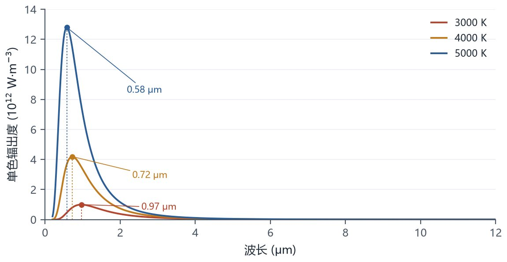
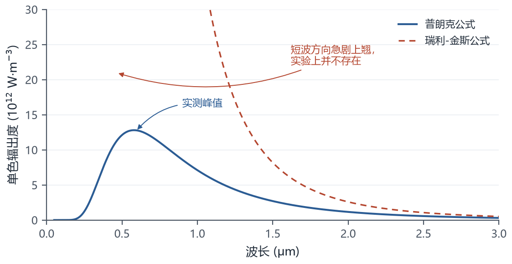
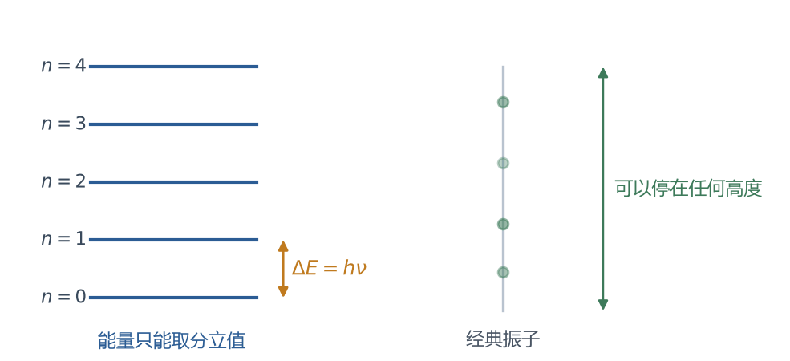

# 第 2 章　量子概念的诞生

铁匠打铁的时候，看火色就知道温度。暗红大约六百度，橘红接近一千度，发白就到了一千三百度以上。颜色和温度之间有这么稳定的对应关系，自古以来就是一门手艺人的经验。到了十九世纪末，物理学家想把这条经验变成公式，结果撞上了一堵墙。墙的裂缝里，掉出了量子这个概念。

## 2.1 什么都在发光

任何有温度的物体都在向外辐射电磁波，温度越高，辐射越强，颜色越偏蓝。这个现象叫热辐射。人体三十七度，发出的主要是十微米左右的红外线，夜视仪就是靠这个看见人的。一杯热水也在辐射，只是强度太低，肉眼看不到。

为了把问题简化，物理学家想出了一个理想模型，叫黑体。黑体能吸收照到它身上的所有电磁波，一点也不反射。一个封闭的金属盒子，内壁涂黑，只留一个小孔，从小孔看进去就是黑的，因为进入小孔的光要在里面弹很多次才可能出来。这个盒子就是很好的黑体。把它加热，小孔里就会射出光，这束光的颜色和强度只跟温度有关，跟盒子的材料无关。

黑体之所以重要，是因为它排除了材料的干扰。任何真实的物体，辐射能力都介于黑体和完美反射体之间，而黑体给出了一个只由温度决定的标准答案。物理学家要解释的，就是这个标准答案。

## 2.2 两条经验规律

实验数据积累到一定程度，规律就浮出来了。

第一条是斯特凡在 1879 年从测量中总结、玻尔兹曼在 1884 年从热力学推出的定律。黑体单位面积向外的总辐射功率与温度的四次方成正比

$$
P = \sigma T^4
$$

其中 $\sigma = 5.67\times 10^{-8}\ \mathrm{W\cdot m^{-2}\cdot K^{-4}}$。温度翻一倍，辐射功率变成十六倍。这条定律解释了很多事，比如为什么炉子烧到发白时烫得那么厉害，也解释了恒星表面温度的一点差别为什么会带来亮度的巨大差别。

第二条是维恩在 1893 年得到的位移定律。黑体辐射的峰值波长与温度成反比

$$
\lambda_{\max} T = 2.898\times 10^{-3}\ \mathrm{m\cdot K}
$$

太阳表面约 5800 K，代进去算出峰值在 0.5 微米，正好落在可见光的黄绿区，人眼对这个波段最敏感，这不是巧合。人体 310 K，峰值在 9.3 微米，远红外。宇宙微波背景 2.7 K，峰值在 1 毫米左右，属于微波。这两条定律互为补充，一条管总量，一条管颜色，都能跟实验对上。

麻烦出在第三条，也就是整条曲线的形状。

图 2-1　黑体辐射谱随温度的变化，曲线按普朗克公式计算，圆点标出各温度的峰值位置

图上的每条曲线都从零升起，到一个峰值，然后向长波方向缓缓下落。峰值随温度升高向短波方向移动，曲线下面的总面积随温度升高迅速变大，这正是前面两条定律的内容。问题在于，怎么用理论把这整条曲线算出来。

## 2.3 紫外灾难

十九世纪末的物理学家手里有一件好工具，叫能量均分定理。它说，在一个处于热平衡的系统里，每一种独立的振动模式平均分到的能量都是 $\frac{1}{2}k_BT$，跟这个模式的性质无关。这个定理在气体分子运动论里非常成功，算出的比热、扩散系数都跟实验吻合。

把它用到黑体上，做法是把空腔里的电磁场看成无数个驻波，每个驻波是一个振动模式。波长越短，能塞进去的驻波越多，数目正比于 $1/\lambda^2$。每个模式分到 $\frac{1}{2}k_BT$ 的能量，乘起来就得到辐射强度

$$
I(\lambda) = \frac{2ck_BT}{\lambda^4}
$$

这就是瑞利-金斯公式。它在长波方向跟实验对得很好，可到了短波方向，$1/\lambda^4$ 让它一路飙升，波长趋于零时强度趋于无穷。这意味着一个热的物体会在紫外和更短的波段放出无穷大的能量，任何有温度的物体都会瞬间把周围的黑暗照亮，也会瞬间把自己冻僵。

实验上根本没有这回事。这个荒谬的结论被称为紫外灾难。

图 2-2　同样在 5000 K 下，瑞利-金斯公式在短波方向发散，普朗克公式与实验相符

灾难的根源不在数学，而在假设。能量均分定理默认每个模式可以取任意小的能量，连续地取。这个默认太自然了，以至于一百年里没人怀疑过它。普朗克怀疑了。

## 2.4 普朗克的分法

1900 年，普朗克在柏林做了一件当时看起来很像技术性妥协的事。他假设腔壁上的振子，能量不能连续变化，只能是一份一份的

$$
E = nh\nu,\qquad n = 0, 1, 2, \dots
$$

其中 $\nu$ 是振子的频率，$h$ 是一个新的常数。这样一份最小的能量 $\varepsilon = h\nu$ 就叫能量子。

这个假设本身很朴素。他想的是，如果能量是一份一份的，那么在高频也就是短波的情况下，一份能量 $h\nu$ 会变得很大，而热运动能提供的平均能量只有 $k_BT$ 那么多，大多数振子连一份都凑不出来，只能待在最低的那一级上，根本没法参与辐射。于是高频模式被“冻住”了，短波方向的发散自然消失。

用这个假设重新做统计，普朗克得到了一个公式

$$
I(\lambda, T) = \frac{2hc^2}{\lambda^5}\frac{1}{e^{hc/\lambda k_BT}-1}
$$

这个公式跟当时的实验数据吻合得惊人。在长波极限下，它退化成瑞利-金斯公式；在短波方向，指数因子把强度压下去，曲线自动归零；对全波段积分，得到斯特凡-玻尔兹曼定律；求极值，得到维恩位移定律。两条经验规律都成了它的推论。

拟合出这个公式以后，普朗克花了很长时间想把它纳回经典框架，试过各种办法，都不成功。他后来承认，那次假设是一次“绝望之举”。他自己并不喜欢能量子的想法，觉得它像是数学上的权宜之计。

图 2-3　普朗克假设振子的能量只能取分立值，相邻两级相差 $h\nu$；经典振子则可以停在任意高度

## 2.5 一份一份意味着什么

能量子这个假设，看起来只是把连续的线换成一串点，实际上动摇了整个物理学的根基。

在经典力学里，一个单摆的能量可以取任意值。你推它一下，它摆起来，能量是多少就是多少，连续可变。普朗克说，腔壁上的带电振子不是这样，它的能量只能是一份一份的，像一个只能停在整数层的电梯，没有中间楼层。

这个限制带来的第一个后果是，能量的交换也必须一份一份地进行。振子从 $n$ 级跳到 $n+1$ 级，吸收一份 $h\nu$；从 $n+1$ 跳回 $n$，放出一份 $h\nu$。辐射的产生和吸收变成了跳跃式的过程，而不是连续的流动。

第二个后果是，这份能量的大小跟频率成正比。低频的一份很小，热运动很容易凑够，所以低频模式照常参与，长波方向的辐射跟经典理论一致。高频的一份很大，热运动凑不够，高频模式被压住，短波方向不再发散。一条简单的规则，同时管住了两个极端，这是普朗克公式最漂亮的地方。

普朗克常数 $h$ 的数值很小，大约 $6.63\times 10^{-34}$ 焦耳·秒。用日常尺度去看，一份能量的数值小得可笑。一个频率为 500 太赫兹的绿光光子，能量约 $3.3\times 10^{-19}$ 焦耳。一盏一瓦的绿灯每秒放出大约三千亿亿个这样的光子，所以光看起来是连续的，就像远看人群是模糊的一片。

可是在微观尺度上，这个“小”就变成了“大”。一个电子在原子核周围运动，它涉及的能量尺度是电子伏特，大约 $1.6\times 10^{-19}$ 焦耳，跟单个光子的能量同量级。这时候一份一份的限制就没法忽略了。

## 2.6 从无奈到认真

普朗克自己把能量子当成一种计算技巧，爱因斯坦在 1905 年把它当真了。他进一步提出，不只是腔壁振子的能量量子化，光本身在传播过程中就是由一份一份的能量组成的，每一份的能量是 $h\nu$。这个想法比普朗克走得更远，也更难接受，因为如果光是一份一份的，那么一百年前杨氏双缝实验里看到的干涉条纹又怎么解释。

这个问题悬了很多年，直到单光子实验做出来才有了清楚的答案。而光的粒子性最直接的证据，来自一个跟颜色有关的实验，下一章就讲它。
