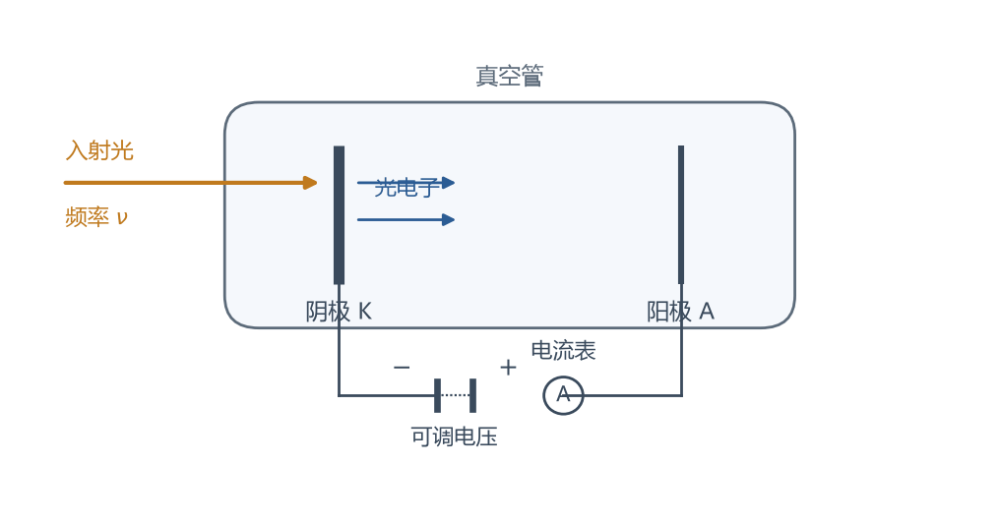
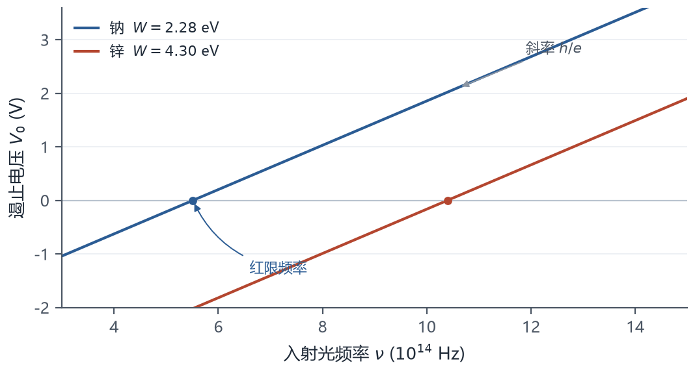
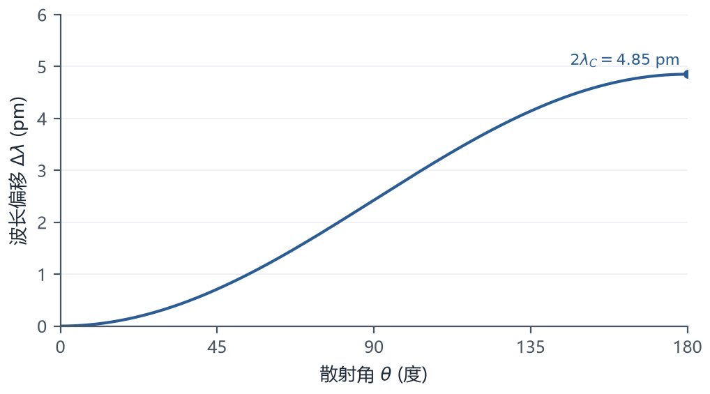

# 第 3 章　光的粒子性

普朗克把能量子当成了计算技巧，爱因斯坦却把它当成了真实的物理。1905 年，他在一篇题为《关于光的产生和转化的一个试探性观点》的论文里提出，光在传播过程中就是由一份一份的能量组成的。这个说法在当时听起来近乎荒唐，因为干涉和衍射的实验证据摆在那里，光是波这件事看起来已经没有疑问。

此后十多年，勒纳德和密立根用阴极射线管做了一系列实验，把这件事推到了一个必须做出选择的位置。

## 3.1 一根管子里的事

把一块金属放在真空中，用光照它，金属表面会飞出电子。这个现象叫光电效应，是赫兹在 1887 年研究火花放电时偶然注意到的，后来勒纳德用它做了系统的测量。

实验的装置很朴素。一个抽成真空的玻璃管里放着两块金属板，一块受光照，叫阴极，另一块收集电子，叫阳极。两块板之间接一个可调电压和一块电流表。光从石英窗口照进来，打在阴极上，逃出来的电子在电场作用下飞向阳极，形成电流。

图 3-1　光电效应实验装置。光照射阴极，逸出的电子被阳极收集，形成光电流

如果这套装置只服从经典波动理论，结果应该不难预料。光的强度越大，电场越强，电子受到的力越大，飞出来的动能就越大。光的频率只影响颜色，跟电子飞出得快慢无关。只要光足够强，照得足够久，电子总能攒够能量跑出来。

实验做出来，四条结果全都不对。

## 3.2 四条反常

第一条，光的强度只影响电子数目，不影响电子能量。把光调亮一倍，光电流大一倍，说明每秒飞出的电子多了一倍，可每个电子的最大动能一点没变。

第二条，电子的能量只跟频率有关。频率越高，电子跑得越快。用蓝光照，电子比用红光照跑得快，哪怕红光强得多。

第三条，每一种金属都有一个红限频率。频率低于这个值，光再强，照再久，一个电子也不会飞出来。钠的红限大约在 540 太赫兹，对应波长 555 纳米，也就是绿光。用黄光或红光去照钠，无论多亮都没有电流。

第四条，几乎不需要延迟。只要频率高于红限，即使光弱到每秒只有几个光子打上去，电子也会立刻出现，延迟不超过十的负九次方秒。

用波动说去解释第一条，很难。如果光波的能量是连续分布在整个波前上的，那么一个电子要跑出来，需要从波前上慢慢吸收能量，光越弱，攒够能量需要的时间越长。按当时的估算，弱光下这个时间会到几分钟甚至几小时，可实验里几乎立刻就有电子出来。

更要命的是第二条和第三条。波的频率只决定振动快慢，不该决定能量的大小。红限的存在更是无从谈起，红光再强也是红光。

## 3.3 一份一份地吸收

爱因斯坦的做法是把光看成由能量为 $h\nu$ 的粒子组成。一个电子吸收一个光子，一次性拿到这个光子的全部能量。能量到手以后，一部分用来挣脱金属表面的束缚，剩下的变成动能

$$
K_{\max} = h\nu - W
$$

其中 $W$ 是这种金属的逸出功，也就是把电子从金属里拉出来所需的最低能量。

这个式子把四条反常一次说清了。

光变强，指的是单位时间打上去的光子变多，每个光子还是那么点能量，所以飞出的电子变多，单个电子的能量不变。这解释了第一条。

频率变高，单个光子的能量 $h\nu$ 变大，扣除固定的逸出功以后，电子剩下的动能就变大。这解释了第二条。

频率低于红限，单个光子的能量还不够付逸出功，电子拿不到足够的能量，自然出不来，光再强也没用，因为一个电子只吸收一个光子。这解释了第三条。

吸收是一次性完成的，不需要积累时间，所以几乎立刻有电子出来。这解释了第四条。

光的强度在这个图像里变成了光子数目的多少，而不再决定能量的大小。这个说法跟日常经验冲突，因为日常光源太强，光子太多，我们感觉不到颗粒感。可在弱光下，颗粒感就显出来了。

## 3.4 用一个电压把电子拦下来

要定量检验这个公式，需要测出电子的最大动能。办法是在阳极上加一个反向电压，让电场把电子往回推。电压逐渐加大，光电流逐渐减小，当电压刚好把最快的那批电子拦住时，电流降到零。这个电压叫遏止电压，记作 $V_0$。

电子在反向电场里损失的能量是 $eV_0$，所以

$$
eV_0 = h\nu - W
$$

把 $V_0$ 对 $\nu$ 画图，应该是一条直线，斜率是 $h/e$，横轴截距是 $W/h$，也就是红限频率。不同金属的直线平行，只是截距不同。

密立根起初并不相信爱因斯坦的光量子假说，他花了十年时间改进实验，想把这条直线否掉。他把装置放进真空，把金属表面刮干净，用不同频率的单色光测量，最后得到的结果跟公式吻合到百分之一的精度。他用光电效应测出的普朗克常数，跟黑体辐射得到的值一致。1923 年他因为这项工作拿了诺贝尔物理学奖，此后也不再反对光量子假说。

图 3-2　遏止电压随频率线性变化，斜率是 $h/e$，与金属种类无关，直线与横轴的交点是红限频率。曲线按钠和锌的逸出功计算

这张图还给出一个很有用的技巧。由于斜率是 $h/e$，只要精确测出直线的斜率，就能算出普朗克常数。密立根就是这么做的，他得到的 $h$ 值是 $6.57\times 10^{-34}$ 焦耳·秒，跟今天公认的值相差不到百分之一。

## 3.5 康普顿散射

光量子的图像在 1923 年又得到了一次更加直接的证实。

康普顿让一束 X 射线打在石墨上，测量散射出来的 X 射线的波长。按波动理论，散射光的频率应该跟入射光一样，因为电子在入射波的驱动下以同样的频率振荡，再以同样的频率辐射。可实验发现，散射光里除了原来波长的成分，还有一条波长更长的成分，而且散射角越大，波长偏移越多。

康普顿用光子和电子的弹性碰撞来解释。把光子看成一个能量为 $h\nu$、动量为 $h\nu/c$ 的粒子，撞上静止的电子，像两个台球相撞一样交换能量和动量。写出能量守恒和动量守恒，解出散射光子的波长变化

$$
\Delta \lambda = \lambda' - \lambda = \frac{h}{m_ec}\left(1-\cos\theta\right)
$$

其中 $m_e$ 是电子质量，$\theta$ 是散射角，$\frac{h}{m_ec} = 2.43$ 皮米，叫电子的康普顿波长。

这个公式的预言非常精确。散射角 90 度时波长偏移 2.43 皮米，180 度时偏移 4.85 皮米。实验数据与公式吻合，而且偏移量只跟角度有关，跟入射波长无关，这一点也被证实。

图 3-3　散射光的波长偏移随散射角变化，按康普顿公式计算

波动理论在这里彻底没话说。一个波被电子散射，不可能改变频率，除非电子本身在运动。康普顿的实验等于给光子发了一张身份证，上面写着能量 $h\nu$ 和动量 $h/\lambda$。

## 3.6 一个粒子，也是一种波

到 1923 年，物理学家面对的局面相当尴尬。光的干涉、衍射、偏振，只能用波来解释；光电效应、康普顿散射，只能用粒子来解释。两套实验都很硬，两套解释都很成功，可它们互相矛盾。

这个矛盾在很长一段时间里让人不舒服。玻尔在 1927 年提出互补原理，说光和电子这样的微观客体，波动性和粒子性都是它们的属性，只是在不同的实验安排下表现出来，两种描述不会在同一次测量里同时出现。这个说法在哲学上四平八稳，但当时没有人能说清楚，为什么同一个东西能有两副面孔。

真正把这件事变得可以计算的是量子电动力学。它把光看成量子化的电磁场，场的激发态就是光子。干涉条纹来自场的相位关系，光电效应来自场与电子的能量交换。两种现象在一套理论里共存，不再矛盾。这个理论在 1940 年代由费曼、施温格和朝永振一郎建立，跟实验的吻合精度到了小数点后十几位。

不过对初学者来说，先接受一个粗糙的图像就够了。光在传播的时候像波，有波长、频率、相位，会干涉会衍射；光在跟物质交换能量的时候像一个粒子，一份一份地给，一份一份地收。这两种描述不是互相替代，而是同一个对象的两个侧面。

这个图像马上要遇到一个更大的挑战。1924 年，一个法国贵族出身的研究生提出了一个听起来更荒唐的想法，既然光这个“波”能表现得像粒子，那么电子这个“粒子”，为什么不能表现得像波。
