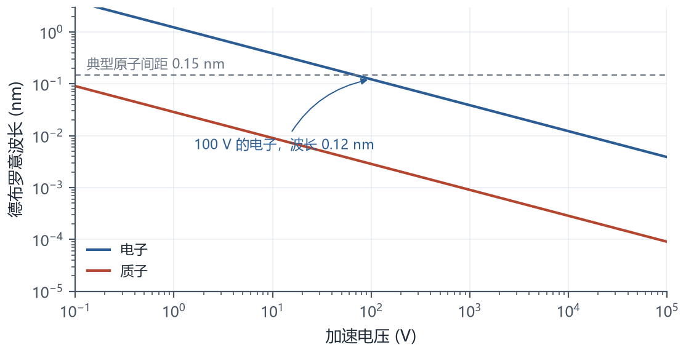
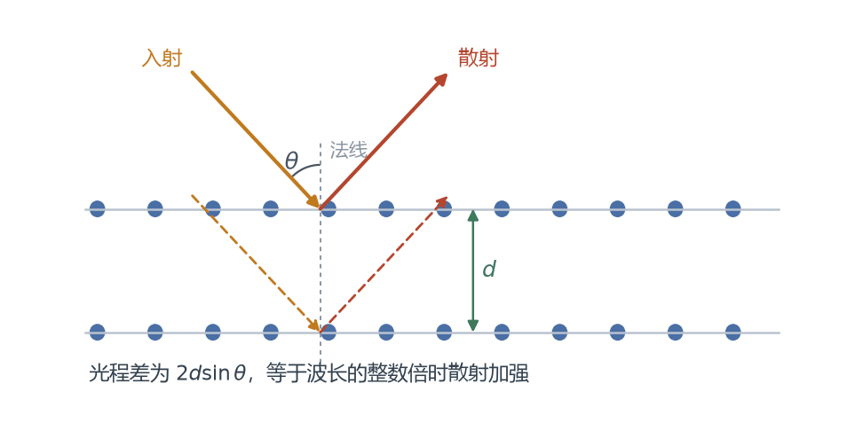
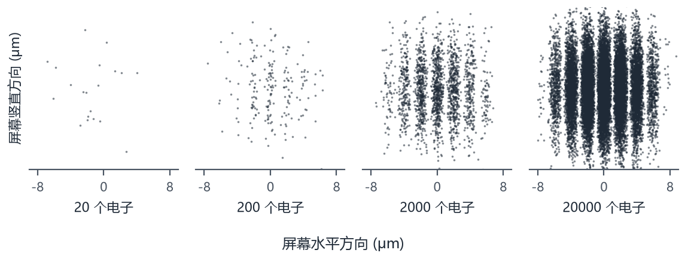

# 第 4 章　物质也是波

1924 年，巴黎大学文学院的墙上贴出了一份博士论文答辩公告，题目是关于量子理论的研究，作者是路易·德布罗意。他的哥哥是实验物理学家，做过 X 射线方面的研究，兄弟俩在战后讨论过光的波粒二象性。德布罗意从这些讨论里抽出一个大胆的猜想，如果光这个一直被认为是波的东西，在跟物质交换能量时表现得像粒子，那么电子这个一直被当成粒子的东西，会不会在传播时表现得像波。

论文答辩委员会里有朗之万和佩兰，佩兰当场问了一个问题，这个波怎么用实验看到。德布罗意回答说，可以让电子穿过晶体，看它会不会像 X 射线那样衍射。三年后，这个预言被两个独立的实验证实。

## 4.1 一个简单的类比

德布罗意的推理是这样的。相对论里，光子的能量和动量满足 $E = pc$，而光子的能量又是 $E = h\nu$，波长和频率满足 $c = \lambda\nu$。把这三条串起来，就得到

$$
\lambda = \frac{h}{p}
$$

对光子来说，这个关系是现成的。德布罗意假设，对电子、质子、原子乃至任何有动量的物体，同一个关系都成立。一个质量为 $m$、速度为 $v$ 的粒子，动量是 $p = mv$，波长就是

$$
\lambda = \frac{h}{mv}
$$

这个假设没有任何实验依据，纯粹是类比。它之所以值得认真对待，是因为它跟玻尔的原子模型能对上。玻尔在 1913 年为了让氢原子的光谱线对上实验，硬性规定电子的角动量只能是 $h/2\pi$ 的整数倍，可他说不出为什么。德布罗意把电子看成绕着核传播的波，只有当圆周长度正好是波长的整数倍时，波才能形成稳定的驻波，不至于自己跟自己抵消。这个条件算出来，正好就是玻尔的规定。

一个假设同时解释了两件看似无关的事，这通常意味着它碰到了什么真东西。

## 4.2 波长有多短

波长公式里的 $h$ 太小，所以日常物体的波长小得离谱。一个七十公斤的人以一米每秒走路，波长是 $9.5\times 10^{-36}$ 米，比原子核还小二十个数量级。这样的波长，任何实验都测不出来，所以人走路不会表现出波动性。

电子就不一样了。电子质量是 $9.11\times 10^{-31}$ 千克，用一百伏的电压加速，速度大约是 $5.9\times 10^6$ 米每秒，动量是 $5.4\times 10^{-24}$ 千克·米每秒，代进公式得波长 0.12 纳米。这个数字跟原子的尺寸、跟 X 射线的波长在同一个量级。

这意味着，如果电子真是波，它应该像 X 射线一样，在晶体上产生衍射。晶体里的原子排列整齐，间距在零点几个纳米，正好是天然的衍射光栅。

图 4-1　德布罗意波长随加速电压的变化，按 $\lambda = h/\sqrt{2mE}$ 计算。水平虚线标出典型原子间距

## 4.3 镍片上的意外

1927 年，美国的戴维孙和革末在贝尔实验室做实验。他们本来在研究电子被镍表面散射的规律，想为电子管技术积累数据。一次意外中，液氮把真空系统弄炸了，镍靶在高温下氧化，他们只好把镍靶放在氢气里长时间加热还原。这一加热，多晶的镍变成了几块大的单晶。

重新测量时，他们发现散射电子的强度随角度出现了明显的峰谷，峰的位置跟入射电子的能量有关。把电子加速电压取 54 伏，波长按德布罗意公式算出来是 0.167 纳米，用镍的晶格常数 0.215 纳米代入布拉格条件 $2d\sin\theta = n\lambda$，算出的衍射角跟实验测到的峰位完全一致。

同一年，英国的汤姆孙用高速电子穿过金箔、铝箔等薄膜，在底片上拍到了同心圆环。这个图案跟 X 射线穿过晶体粉末得到的德拜环一模一样。汤姆孙用的电子能量更高，波长更短，衍射环更密。他还发现，把电压调高，波长变短，圆环的半径随之变大，定量关系跟公式吻合。

小汤姆孙是发现电子的 J.J. 汤姆孙的儿子。父亲证明了电子是粒子，儿子证明了电子是波，这件事在物理学界传为趣谈。

图 4-2　晶面散射的光程差为 $2d\sin\theta$，等于波长整数倍时散射加强

## 4.4 一个电子，两条缝

晶体衍射只能说明电子的集体行为像波。真正让人不安的问题是，单个电子会怎么样。

把电子束的强度降到极低，低到一次只有一个电子通过装置，再让它穿过双缝，落到一块能记录单个电子位置的探测器上。这就是 1960 年代以来一系列实验做的事情。最早是 1956 年默伦施泰特用电子双棱镜做的实验，后来是 1989 年外村彰等人的实验，用电子双棱镜配上高灵敏度的二维探测器，可以一个电子一个电子地记录下来。

结果分成两部分，两部分都很怪。

先说单个电子。每个电子到达屏幕时，只在一个很小的点上产生一个信号，不会摊开成一整片。它落点随机，无法预测，跟扔骰子一样。这说明单个电子在探测的瞬间是局域的，它确实“打”在了一个地方。

再说累积。把几万个电子的落点叠在一起，随机点逐渐排成了明暗相间的条纹。电子少的时候，只是零星几点，看不出规律；电子多了，条纹越来越清楚；到十万个以上，条纹的对比度跟用强电子束一次照出来的图样没有区别。

图 4-3　按双缝干涉的强度分布抽样得到的单电子落点，从 20 个累积到两万个，条纹逐渐显现

这件事的诡异之处在于，每个电子都是独自通过装置的，它没有同伴可以“干涉”。如果它是粒子，它只能穿过其中一条缝，那另一条缝对它没有影响，屏幕上应该只有两条亮带。如果它是波，它会同时通过两条缝，自己跟自己干涉，可为什么最后只在一个点被探测到。

## 4.5 概率幅

为了把这件事说清楚，需要换一套语言。这套语言用了一个叫波函数的量，通常写成 $\psi$。波函数不是电子本身，也不是电子的密度，它是一个复数的函数，分布在空间里。

波函数不回答“电子在哪里”，它回答的是“在哪里找到电子的概率幅”。把波函数取模平方，得到概率密度

$$
P(x) = |\psi(x)|^2
$$

在双缝实验里，电子通过装置时，两条缝各产生一个波函数，分别记作 $\psi_1$ 和 $\psi_2$。到达屏幕某一点时，总的波函数是两个的叠加

$$
\psi(x) = \psi_1(x) + \psi_2(x)
$$

概率是

$$
|\psi_1 + \psi_2|^2 = |\psi_1|^2 + |\psi_2|^2 + 2\,\mathrm{Re}(\psi_1^*\psi_2)
$$

前两项是“走左缝”和“走右缝”各自的概率，最后一项是干涉项。干涉项可正可负，所以某些位置概率变大，某些位置概率变小，条纹就是这么来的。如果电子真的只走了一条缝，干涉项就不存在，屏幕上只有两项之和，是一条模糊的亮带。

关键在于，干涉项在电子通过双缝的整个过程中一直存在，只在探测的那一刻消失。探测把叠加态“压”成了一个确定的位置。

这个说法让人不舒服，因为它在描述一个我们看不见的过程。可它跟所有的实验都对得上，而且能算出条纹的精确位置和对比度。量子力学的整套形式体系，就是围绕这个波函数建立起来的。

## 4.6 为什么桌子不会衍射

看到这里，很多人会问，如果电子是波，原子是波，那桌子、椅子、人为什么没有衍射，为什么不会同时出现在两个地方。

答案在波长。

波长跟动量成反比。动量越大，波长越短。桌子的质量是几十公斤，随便一点热运动的速度就让它动量巨大，波长小到 $10^{-35}$ 米这个量级。这么短的波长，要观察到衍射，需要跟它尺寸相当的“缝”，也就是 $10^{-35}$ 米的缝。这个尺度比普朗克长度大一些，但远远小于任何原子核，没有任何材料能做出这样的缝，也没有任何探测器能分辨这么细的条纹。

所以宏观物体的波动性不是不存在，而是被压缩到了无法观测的尺度。量子力学的规则对桌子同样适用，只是这些规则在宏观尺度上的效应小到可以忽略。

这个“小到可以忽略”有一个前提，就是物体跟环境完全隔离。桌子放在房间里，空气分子不停地撞它，光子不停地照它，这些相互作用不断地“探测”它的位置，把它的量子叠加破坏掉。这个现象叫退相干，是理解为什么日常世界看起来如此确定的关键。

要把这套语言用起来，先得把波函数的数学讲清楚，然后再回头处理测量和退相干。
