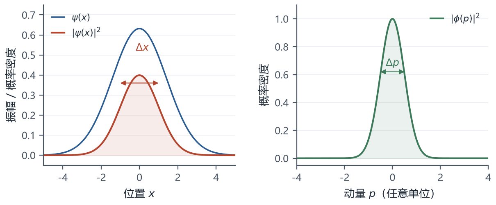
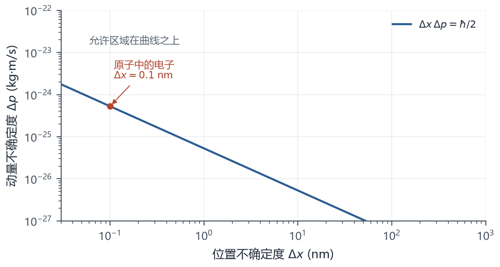
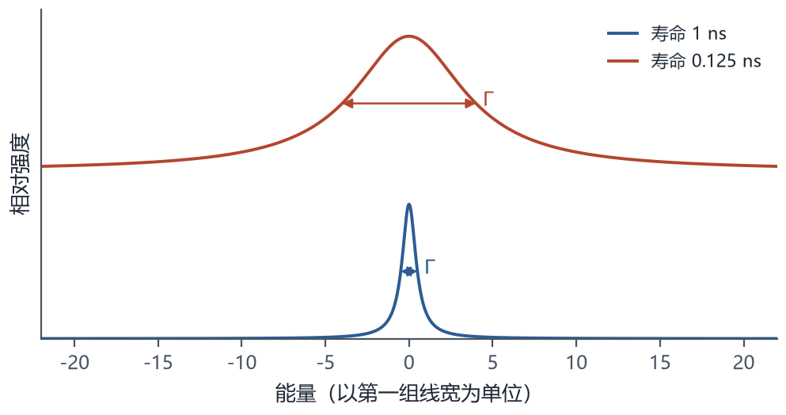

# 第 5 章　波函数与不确定性

上一章留下的问题是，电子通过双缝时既没有走左边的缝，也没有走右边的缝，而是以一种奇怪的方式同时涉及两条缝。要描述这种状态，需要用一个新的数学对象，波函数。这一章把它讲清楚，顺便把量子力学里最容易被误读的一条关系讲明白。

## 5.1 一个函数描述一个电子

在经典力学里，描述一个粒子的运动，需要给出它的位置和速度，两者都是确定的数。知道这两个数，再加上受力情况，就能算出它以后每一时刻的位置，这是牛顿力学的核心。

量子力学换了一种描述方式。它不给出位置，而是给出一个遍布全空间的函数，记作 $\psi(x)$。这个函数可以是复数，有实部也有虚部，每个位置对应一个复数。它不告诉你电子在哪里，它给出的是电子出现在各处的可能性。

这个函数叫波函数。它的名字来自它的行为，在空间里它像波一样起伏，有峰有谷，会干涉，会衍射。电子的双缝图样，正是两条缝产生的两个波函数在屏幕上叠加的结果。

波函数本身没有直接的物理意义，测量不到它。能测量的是它的模平方

$$
\rho(x) = |\psi(x)|^2 = \psi^*(x)\psi(x)
$$

这里的星号表示复共轭。$\rho(x)$ 是一个非负实数，它的含义是概率密度，也就是在 $x$ 附近单位长度内找到电子的概率。

概率密度这个概念需要习惯一下。它并不表示“电子有一部分在这里”，它说的是“如果在这里放一个探测器，测到电子的可能性有多大”。把 $\rho(x)$ 在一个区间上积分，得到的就是电子落在该区间的概率。整个空间积分起来必须等于一，因为电子总要在某个地方被找到

$$
\int_{-\infty}^{\infty} |\psi(x)|^2\,dx = 1
$$

这个条件叫归一化。它看起来是个技术细节，实际上限定了波函数的整体幅度，让概率的解释自洽。

## 5.2 波包

一个自由电子不会均匀地铺满整个宇宙，它总在某个范围里。描述这样的电子，要用一个局域在有限范围内的波函数，叫波包。

最简单也最常用的波包是高斯波包

$$
\psi(x) = \frac{1}{(2\pi\sigma^2)^{1/4}}\exp\left(-\frac{x^2}{4\sigma^2}\right)
$$

它的概率密度是一个高斯钟形曲线，中心在原点，宽度由 $\sigma$ 决定。$\sigma$ 越小，电子被限制得越紧，位置越确定。

图 5-1　高斯波包的波函数与概率密度（左），以及它在动量空间的分布（右）

这里出现了一个关键问题。波包描述的是“位置不确定”的状态，那么它的动量是什么样的。

## 5.3 动量藏在起伏里

波的动量跟波长挂钩，这一点从德布罗意关系就能看出来。一个波包不是单一波长的波，它是许多不同波长的波叠加起来的。叠加的波长范围越宽，波包在空间上越窄。

这个关系可以用傅里叶变换写出来。把位置空间的波函数变换到动量空间

$$
\phi(p) = \frac{1}{\sqrt{2\pi\hbar}}\int_{-\infty}^{\infty}\psi(x)\,e^{-ipx/\hbar}\,dx
$$

$|\phi(p)|^2$ 就是在动量上找到电子的概率密度。

对高斯波包做这个变换，得到的结果还是高斯形，只是宽度反过来了。位置上的宽度 $\sigma_x = \sigma$，动量上的宽度 $\sigma_p = \hbar/(2\sigma)$。一个变窄，另一个必然变宽。

这不是高斯波包的特殊性质，而是所有波函数的共性。任何函数和它的傅里叶变换，都不可能同时无限窄。这个纯数学的事实，落到物理上就是不确定性关系。

## 5.4 不确定性关系

海森堡在 1927 年提出，位置和动量的不确定度满足

$$
\Delta x\,\Delta p \geq \frac{\hbar}{2}
$$

其中 $\hbar = h/2\pi$ 是约化普朗克常数，约 $1.05\times 10^{-34}$ 焦耳·秒。

这个式子的意思是，位置定得越准，动量就越模糊，反之亦然。两者的乘积有一个下限，不可能同时为零。高斯波包刚好取到等号，是最“规矩”的量子态。

举个具体数字。把一个电子限制在 0.1 纳米的范围里，相当于把它关在一个原子里，$\Delta x = 10^{-10}$ 米，那么 $\Delta p \geq 5.3\times 10^{-25}$ 千克·米每秒。这个动量对应的速度不确定度是 $5.8\times 10^5$ 米每秒，也就是每秒五百多公里。对原子里的电子来说，这是一个很大的速度，说明电子在原子内部绝不是静止的。

反过来，一个宏观物体，比如一颗直径一毫米的尘埃，位置可以测到 $10^{-9}$ 米，那么速度的不确定度只有 $5\times 10^{-26}$ 米每秒。这个数值比任何测量精度都小，完全可以忽略。

图 5-2　不确定性关系给出的下限，曲线上方是允许的区域，两个点对应原子中的电子与电子束中的电子

## 5.5 它不是测量技术的限制

不确定性关系最常被误解成“测量会扰动被测对象”。这个说法有历史渊源，海森堡最初确实用“用光子照电子，光子会踢电子一脚”来解释。这个解释直观，但不够准确，容易让人以为电子本来有确定的位置和动量，只是我们测不准。

现代的理解是，电子在测量之前就没有同时确定的位置和动量。这不是知识不足，而是状态本身的性质。波函数描述的就是一个位置弥散、动量也弥散的状态，不是“有一个确定值但我们不知道”。

这个区别可以用一个类比说明。一个正弦波没有“开始”和“结束”，不是因为我们不知道它从哪里开始，而是它本来就没有起点。波包的宽度和它的波长成分之间的关系，也是同一类性质。

实验上，这一点已经被检验得非常严格。中子干涉仪、原子干涉仪的实验结果都表明，不确定性关系不是仪器的局限，而是量子态的内在约束。

## 5.6 能量与时间

不确定性关系还有另一个版本，涉及能量和时间

$$
\Delta E\,\Delta t \geq \frac{\hbar}{2}
$$

这个式子的含义比位置动量那一对更微妙，因为时间在量子力学里不是一个算符，而是一个参数。它通常被理解为，一个状态如果只能维持 $\Delta t$ 这么久，它的能量就有 $\Delta E$ 的不确定度。

这个关系解释了一个很实际的现象，光谱线的宽度。一个原子处在激发态，平均寿命是 $\tau$，那么它的能量就有 $\Gamma = \hbar/\tau$ 的宽度。寿命越短，谱线越宽。寿命一纳秒的跃迁，线宽约 0.16 赫兹，换成波长大约是 $10^{-7}$ 纳米，窄得难以想象；寿命十皮秒的跃迁，线宽大两个数量级，谱线明显变宽。

图 5-3　激发态寿命与谱线宽度的关系，短寿命对应宽谱线

反过来，这个关系也被用来测量极短的寿命。在粒子物理里，很多粒子的寿命只有 $10^{-23}$ 秒，任何钟表都测不出来，但它们的质量有一个宽度，从宽度反推寿命，是常规手段。Z 玻色子的宽度对应寿命约 $3\times 10^{-25}$ 秒，这个数字就是这么来的。

## 5.7 零点能

不确定性关系还有一个后果，一个被关起来的粒子不可能完全静止。

把粒子关在一个宽度为 $L$ 的盒子里，位置不确定度最多是 $L$，动量不确定度至少是 $\hbar/(2L)$。动量不为零，动能就不为零。粒子在最低能态上也有一个不可消除的动能，叫零点能。

这个效应在微观世界里处处可见。液氦在常压下无论怎么降温都不会凝固，就是因为氦原子质量小，零点能大，原子之间的吸引力锁不住它们。金属里的电子即使在绝对零度也有很高的运动速度，费米能级对应的速度在 $10^6$ 米每秒量级，这也是零点能的体现。

真空也有零点能。电磁场的每个模式都至少有一份 $\frac{1}{2}\hbar\omega$ 的能量，把所有模式加起来得到无穷大。这个无穷大在计算里会造成麻烦，物理学家用重整化的办法把它减掉，减掉之后剩下的部分可以被测量到，这就是卡西米尔效应。两块靠得很近的金属板之间，能容纳的电磁模式比外面少，板内外压力的差把两块板推向一起。1948 年卡西米尔预言了这个效应，1997 年被实验证实，距离在微米量级时，这个力已经可以测量。

## 5.8 从状态到测量

到这里，描述量子态的工具已经有了。波函数给出概率分布，不确定性关系限定它不能太“尖”，薛定谔方程决定它怎么随时间变化。下一个问题是，测量的时候到底发生了什么。为什么测量之前是弥散的波，测量之后变成一个确定的点。
