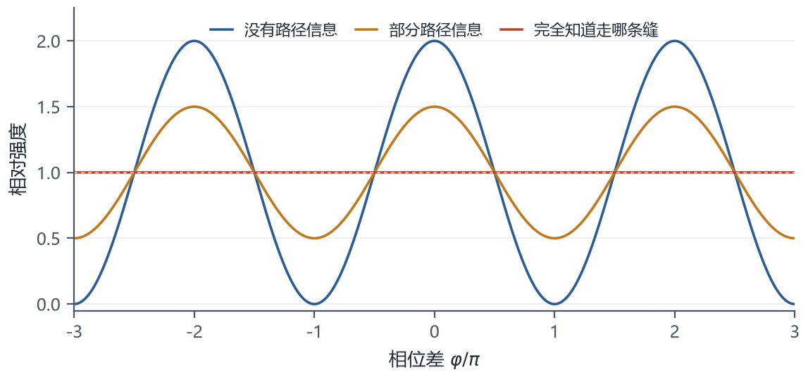
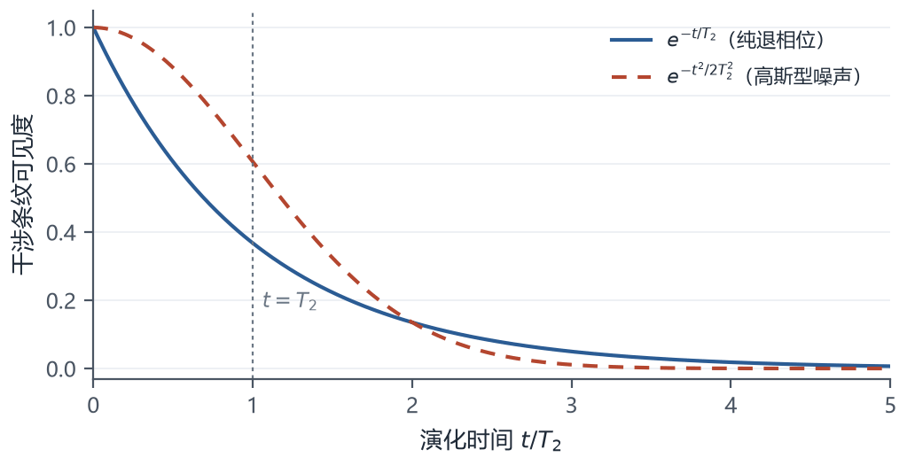

# 第 6 章　测量与叠加

量子力学里最让人睡不着的部分，偏偏在最简单的地方，测量。一套精确到小数点后十几位的方程，在测量的那一刻突然失效，被一条概率规则取代。方程说电子在哪里都有可能，测量说它就在这里。中间发生了什么，一百年过去，仍然是争论的焦点。

这一章把这件事拆开讲。先说清楚测量的规则是什么，再说清楚哪些流传很广的说法是误读，最后看看物理学家现在怎么处理这个问题。

## 6.1 一条简单到粗暴的规则

一个量子态如果是若干本征态的叠加

$$
|\psi\rangle = c_1|\phi_1\rangle + c_2|\phi_2\rangle
$$

测量这个态对应的物理量，得到的结果只能是某一个本征值，比如 $\phi_1$ 对应的值，概率是 $|c_1|^2$；或者 $\phi_2$ 对应的值，概率是 $|c_2|^2$。所有概率加起来等于一，$|c_1|^2+|c_2|^2 = 1$。

测量一旦发生，态就变成所得到的那个本征态。这一步叫波函数坍缩，是量子力学里唯一一个不可逆的过程。薛定谔方程描述的一切演化都可以倒放，坍缩不行。

这条规则不需要推导，它是量子力学的公设之一。所有实验都符合它，精确到令人不安的程度。问题是，它跟薛定谔方程描述的东西看起来不兼容。方程说态按规律连续演化，公设说测量让它瞬间跳变。两者之间有一条裂缝，裂缝的位置就在“什么算测量”这个问题上。

## 6.2 叠加不是“既死又活”

很多科普文章说，叠加态就是“电子既在这里又在那里”，“猫既死又活”。这个说法省事，但容易造成误解。

叠加态的真正含义是，这个态不是任何一个确定位置的本征态，它是两个本征态的线性组合。测量的结果一定是某一个确定位置，不会测到“半个电子在这里”。在测量之前，说电子“在哪里”这个问题本身没有确定答案，不是因为答案藏起来了，而是因为这个态不拥有这个属性。

打个比方，一个偏振方向为 45 度的光子，通过一个竖直偏振片，有一半概率通过，一半概率被挡住。在通过之前，这个光子的偏振不是“竖直或水平但我不确定”，它的偏振方向就是 45 度，这是一个确定的状态，只是不是竖直也不是水平。测量把 45 度的态投影到竖直或水平两个方向上，概率由投影的长度决定。

这个图像比“既死又活”准确得多。叠加态是一个确定的态，只是它不对应我们要测量的那个量的确定值。

## 6.3 猫的本来用意

1935 年，薛定谔写了一篇讽刺性的文章，提出一个思想实验。把一只猫关在铁箱里，箱子里有一小块放射性物质，一小时内有百分之五十的概率衰变。如果衰变，一个计数器被触发，放下锤子，打碎一瓶氢氰酸，猫就死了。如果不衰变，猫就活着。

按照量子力学的规则，放射性原子的态是“衰变”和“未衰变”的叠加，那么这个叠加会传递到整个装置，最后传到猫身上，猫就处在“死”和“活”的叠加态。

薛定谔写这段话不是为了让人们相信猫真的既死又活，恰恰相反，他是想说明这套理论在宏观尺度上推出了荒谬的结论，一定有哪里不对。这个思想实验后来被无数科普文章当成量子力学的招牌，反而模糊了它原本的批判意味。

真正的问题在于，从原子到猫，中间隔着大量的粒子、分子、光子。这个链条上任何一环与环境发生作用，叠加就会被破坏。

## 6.4 环境在不停地偷看

1980 年代以来，物理学家逐渐清楚，退相干是理解这件事的关键。

一个量子系统不可能完全孤立。它总在跟环境打交道，空气分子撞它，光子照它，热辐射烘它。每一次相互作用，都会把系统的部分信息带到环境里去。信息一旦离开系统，系统内部的干涉就做不成了。

用一个简单的模型说明。系统处在两个态的叠加 $c_1|1\rangle + c_2|2\rangle$，环境初始处在 $|E_0\rangle$。相互作用以后，整个系统的态变成

$$
c_1|1\rangle|E_1\rangle + c_2|2\rangle|E_2\rangle
$$

其中 $|E_1\rangle$ 和 $|E_2\rangle$ 是环境在两种情况下所处的态。如果这两个环境态几乎正交，也就是环境“记住”了系统走的是哪条路，那么系统的约化密度矩阵里，交叉项就衰减到接近零。干涉项没了，条纹也就没了。

注意这里没有用到坍缩。整个系统加环境仍然是一个纯态，按照薛定谔方程正常演化。消失的只是系统内部的相干性，它转移到了系统与环境的关联里。这个过程不违反任何一条量子力学规则。

## 6.5 干涉去哪了

退相干解释了一个很实际的现象，为什么加了探测器的双缝实验看不到条纹。

在双缝后面放一个探测器，看电子走了哪条缝。探测器一旦测到电子的路径信息，它就跟电子发生了纠缠。电子的态跟探测器的态绑在一起，屏幕上的干涉项被“记录”这个动作抹掉了。条纹消失，只剩下两条模糊的亮带。

图 6-1　路径信息越明确，干涉项越弱，条纹对比度越低

如果探测器的信息不完整，比如它只能分辨百分之五十的情况，那么条纹不会完全消失，只是对比度降低。这个连续过渡在实验上被精确验证过，用的是分束器加探测器，可以连续调节“知道多少”。

退相干的时间尺度在宏观物体上短得惊人。一个直径一微米的尘埃，在空气中，叠加态只能维持 $10^{-20}$ 秒量级，比任何实验的时间分辨率都短。这就是为什么我们从来没见过宏观物体处在位置叠加态。

图 6-2　干涉条纹可见度随演化时间的衰减。实线是指数衰减模型，虚线是高斯噪声模型，两者都在 $T_2$ 附近降到约三分之一

## 6.6 裂缝还在

退相干解释了为什么宏观世界看不到叠加，但它没有解决那个最基本的问题，为什么测量只得到一个结果。

退相干把纯态变成了混合态，也就是说，系统处于“以某个概率处在态 1，以某个概率处在态 2”的状态。可是混合态在数学上仍然是一个确定的描述，它不告诉你这一次测量会得到哪个结果。从“可能”到“实际”这一步，退相干没有提供答案。

围绕这个问题，形成了几个不同的立场。

哥本哈根解释是最早也最常用的说法。它把量子力学看成一套计算工具，用来预言测量结果的概率，不追问测量背后发生了什么。玻尔强调，测量装置必须用经典语言描述，量子世界和经典世界之间有一条不可逾越的界线。这套说法在教学中非常成功，因为它把麻烦挡在了门外。

多世界解释走另一条路。它认为坍缩根本不存在，每次测量，宇宙分裂成若干分支，每个结果都在某个分支里实现。这个说法在数学上很干净，薛定谔方程永远成立，不需要额外的公设。代价是要接受一个不断分叉的宇宙。

还有自发定域理论，它修改薛定谔方程，让波函数在系统足够大时自动坍缩。这类理论可以被实验检验，目前的结果把它们限制得很紧，但还没有完全排除。

除此之外还有玻姆力学、关系性量子力学、量子贝叶斯主义等等。它们对同样的实验给出同样的预言，区别在于怎么讲述背后的故事。

对学习量子技术的人来说，这些争论重要，但不紧急。所有解释都同意同一套计算规则，都同意退相干的存在，都同意测量结果的统计分布。工程上需要的是这套规则和这些分布，至于“为什么”，可以放在心里慢慢想。

## 6.7 一个更奇怪的实验

1980 年代，物理学家做了一个更让人难受的实验，叫量子擦除。

在双缝实验里加上探测器，知道电子走了哪条缝，条纹消失。这很正常，信息被记录了。可如果在电子已经通过双缝、快要打到屏幕之前，把探测器的信息“擦掉”，也就是让路径信息变得无法分辨，条纹会重新出现。

这件事的诡异之处在于，擦除的动作发生在电子已经通过双缝之后。看上去，电子像是“事后”才决定自己当初走的是哪条路。但严格的分析表明，这里没有超光速通信，也没有因果倒置。干涉图样只能通过符合计数得到，也就是把“被擦除”和“未被擦除”的两组事件分开统计，而分组本身需要用到后来的信息。

这个实验说明，干涉是否出现，取决于整个实验装置能否原则上提供路径信息，而不取决于人是否真的去看了那个信息。物理学家惠勒把这个性质叫做延迟选择，它把量子力学里“信息”这个概念的分量提得很高。

后面讲到量子计算时，这套语言会变得非常实用。量子比特的相干性、量子门的保真度、量子纠错的阈值，全都是在跟退相干打交道。
