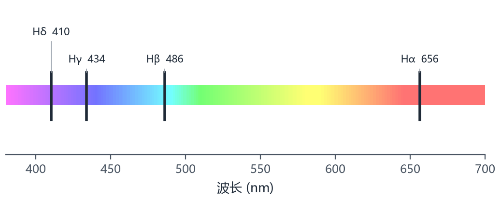
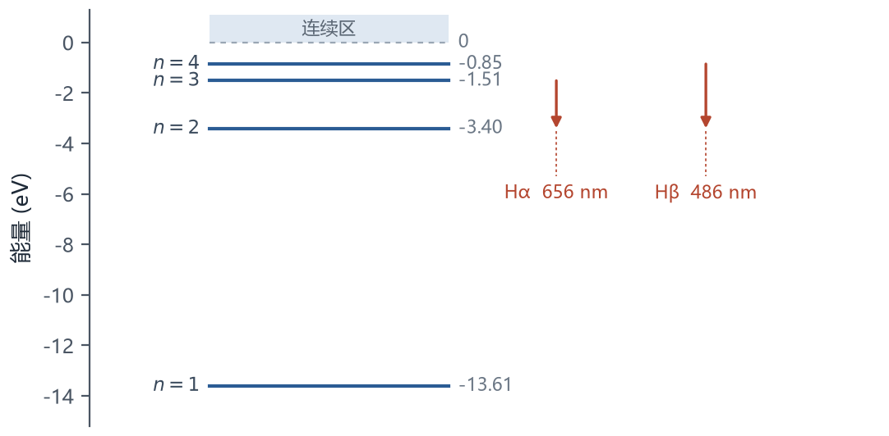
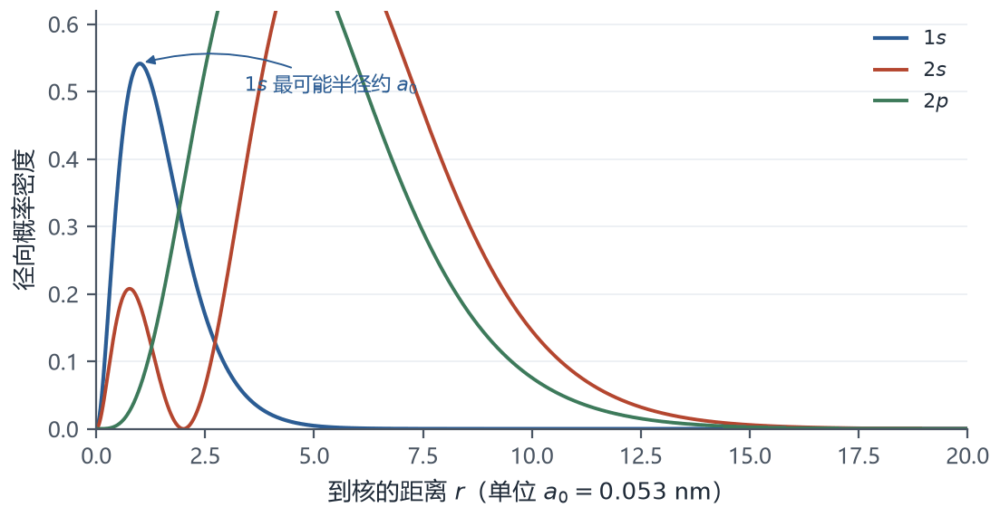

# 第 7 章　原子、能级与光谱

十九世纪的化学家发现，把不同的物质放进火焰里烧，会看到不同的颜色。钠盐让火焰变黄，钾盐变紫，铜盐变绿。把这些光通过棱镜分开，看到的不是连续的彩带，而是一条条孤立的亮线，位置固定，宽度极窄。每种元素都有一套自己的线，像指纹一样不会认错。

这件事在当时的物理学里无法解释。按照经典理论，电子绕着核转，应该连续辐射，光谱应该是一条连续彩带，而且电子会因为不断辐射能量而迅速掉进核里。可原子稳定得不可思议，光谱又是分立的。这两件事把物理学逼到了一个新的关口。

## 7.1 四条线

氢原子最简单，只有一个电子，光谱也最简单。1885 年，瑞士的一位中学教师巴尔末发现，氢原子在可见光区的四条谱线，波长可以用一个简单的公式算出来

$$
\lambda = 364.56\ \mathrm{nm}\times\frac{n^2}{n^2-4},\qquad n = 3,4,5,6
$$

代进 $n=3$ 得 656 纳米，$n=4$ 得 486 纳米，$n=5$ 得 434 纳米，$n=6$ 得 410 纳米。这四条线后来被命名为 Hα、Hβ、Hγ、Hδ，正好对上了实验测到的四个值，误差在千分之一以内。

这个公式没有任何理论依据，纯属凑出来的。可它准得离谱，这提示背后有一个简单的规律。

图 7-1　氢原子巴尔末系的四条可见谱线，位置按巴尔末公式计算

里德伯把公式改写成波数的形式，规律就更清楚了。波数是波长的倒数，代表单位长度里有多少个波。氢原子的所有谱线都可以写成

$$
\frac{1}{\lambda} = R_H\left(\frac{1}{n_1^2}-\frac{1}{n_2^2}\right)
$$

其中 $R_H = 1.097\times 10^7\ \mathrm{m^{-1}}$ 叫里德伯常数，$n_1$ 和 $n_2$ 是两个正整数，且 $n_2 > n_1$。$n_1 = 2$ 给出一组线，就是巴尔末系。$n_1 = 1$ 给出紫外区的莱曼系，$n_1 = 3$ 给出红外区的帕申系。每一组都在实验中被找到了。

## 7.2 玻尔的三条假设

1913 年，玻尔把普朗克和爱因斯坦的量子概念搬到了原子内部。他提出三条假设。

第一，电子只能在若干条特定的圆轨道上运动，这些轨道对应一系列分立的能量，叫定态。在定态上，电子不辐射能量。

第二，电子在两条轨道之间跳跃时，吸收或放出一个光子，光子的能量等于两条轨道能量之差

$$
h\nu = E_{n_2} - E_{n_1}
$$

第三，允许的轨道由角动量量子化条件决定，角动量只能是 $\hbar$ 的整数倍。这条假设加上库仑力提供向心力，可以解出轨道半径和能量

$$
E_n = -\frac{13.6\ \mathrm{eV}}{n^2}
$$

$n=1$ 是基态，能量负十三点六电子伏特。$n=2$ 是负三点四，$n=3$ 是负一点五一，随着 $n$ 增大，能级越来越密，最后趋近于零。零以上是连续区，电子已经脱离原子核的束缚，成为自由电子。

把这两个能级代进第二条假设，算出的谱线位置跟里德伯公式完全一致，而且里德伯常数可以用更基本的常数表示出来。玻尔一举解决了光谱线的来源问题，还顺带解释了原子为什么稳定，因为基态以下没有别的能级，电子无处可掉。

图 7-2　氢原子的能级，按 $E_n = -13.6/n^2$ eV 计算。箭头标出巴尔末系的两条跃迁

玻尔的模型有它的局限。它只能处理氢和类氢离子，多一个电子就不准。它也解释不了谱线的强度，更解释不了谱线的精细结构。更要紧的是，它把电子想象成一颗沿轨道运动的小球，这个图像跟后来的实验结果冲突。

## 7.3 轨道变成了概率云

1926 年，薛定谔写下他的方程，把氢原子重新算了一遍。这一次没有轨道，只有波函数。

方程的解是一组函数，每个函数对应一个能级，用三个整数标记，分别记作 $n$、$l$、$m$。$n$ 是主量子数，决定能量；$l$ 是角量子数，决定角动量的大小；$m$ 是磁量子数，决定角动量在某个方向上的投影。这三个数的取值有严格的限制

$$
n = 1,2,3,\dots;\qquad l = 0,1,\dots,n-1;\qquad m = -l,\dots,l
$$

每一组 $(n,l,m)$ 对应一个波函数，叫做原子轨道。这个名字容易引起误会，它跟行星轨道不是一回事。它不是电子运动的路径，而是电子在空间里的概率分布。

以氢原子的基态为例，波函数是

$$
\psi_{1s}(r) = \frac{1}{\sqrt{\pi a_0^3}}e^{-r/a_0}
$$

其中 $a_0 = 0.053$ 纳米是玻尔半径。这个函数在核的位置最大，向外指数衰减。概率密度是它的平方，也是一个中心最亮的球状分布。

把概率密度对角度积分，得到径向概率密度，也就是在半径 $r$ 附近的球壳里找到电子的概率

$$
P(r) = 4\pi r^2|\psi(r)|^2
$$

这个量在 $r = a_0$ 处取最大值。也就是说，电子最可能出现在距离核一个玻尔半径的地方，这跟玻尔模型的圆轨道半径刚好对上。这不是巧合，量子力学在大量重复测量的平均意义上，重现了玻尔的结果。

图 7-3　$1s$、$2s$、$2p$ 三个态的径向概率分布，横坐标以玻尔半径为单位

图上还能看出一些玻尔模型没有的东西。$2s$ 有两个峰，中间有一个概率为零的球面，叫节点。$2p$ 在核处的概率为零，峰值在 $4a_0$ 附近。这些结构在光谱实验里都能间接看到。

## 7.4 能级为什么会分裂

如果氢原子只有上面这些，光谱应该只有一套线。可实际测到的谱线，在高分辨率下会分裂成几条靠得很近的线。

第一层分裂来自电子的自旋。电子有一个内禀的角动量，只有两个取值，向上和向下，习惯上叫自旋向上和自旋向下。自旋跟轨道角动量耦合，让同一个 $n$、$l$ 的能级裂成两个，这叫精细结构。分裂的量级是 $10^{-4}$ 电子伏特，对应波长差在零点几纳米。

第二层分裂来自相对论修正和真空极化，量级更小，叫兰姆位移。1947 年，兰姆和卢瑟福用微波技术测出了 $2s_{1/2}$ 和 $2p_{1/2}$ 两个能级的差，约 1058 兆赫，这个结果直接推动了量子电动力学的建立。

第三层分裂来自原子核的自旋。核自旋跟电子耦合，产生超精细结构。氢原子的基态超精细分裂对应 1420 兆赫，波长 21 厘米。这条谱线在天文上极其重要，射电望远镜靠它测量银河系里氢气的分布，也靠它测量星系的自转。

一条看起来简单的谱线，背后叠着三四层物理。分辨率越高，看到的细节越多，这是光谱学一百多年来的常态。

## 7.5 选择定则

不是任意两个能级之间都能发生跃迁。跃迁要遵守选择定则，最常见的一条是角量子数只能改变一

$$
\Delta l = \pm 1
$$

这条规则的来源是角动量守恒。光子带走的角动量是 $\hbar$，所以原子的角动量必须相应改变一个单位。$s$ 态（$l=0$）不能直接跳到另一个 $s$ 态，$p$ 态（$l=1$）可以跳到 $s$ 态。

选择定则决定了哪些谱线强，哪些谱线弱，哪些根本不出现。在天文光谱里，正是靠这些强度比，才能推断出恒星大气的温度和成分。

## 7.6 原子为什么有大小

把电子往核的方向压，位置不确定度变小，动量不确定度变大，动能随之上升。这个上升的速度比库仑势能下降的速度快，所以总能量会升高。能量最低的状态，就是这两种趋势平衡的地方。

这个平衡点给出了原子的尺度。用不确定性关系估算，把电子限制在半径 $r$ 的范围内，动能约 $\hbar^2/(2mr^2)$，势能是 $-e^2/(4\pi\varepsilon_0 r)$，两者相加对 $r$ 求极小，得到

$$
r \approx \frac{4\pi\varepsilon_0\hbar^2}{me^2} = a_0
$$

正好是玻尔半径。这个估算说明，原子的尺寸不是随便定的，它由普朗克常数、电子质量和电荷共同决定。把这三个常数换成别的值，化学性质会完全不同，物质的形态也会完全不同。

同样，原子之间不能无限靠近，也是这个道理。两个原子的电子云重叠时，泡利不相容原理不允许它们占据同一个量子态，电子被迫往更高的能级挤，能量急剧上升，表现为排斥力。这个排斥力撑起了固体的体积，也让你坐在椅子上不会陷进地板。

下一章讲一种把原子的能级利用到极致的技术，激光。
