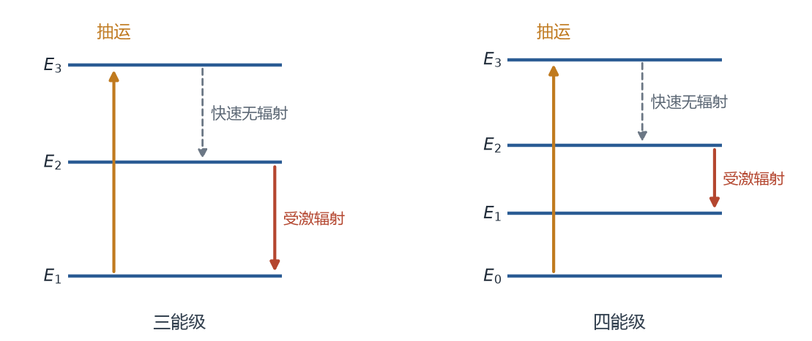
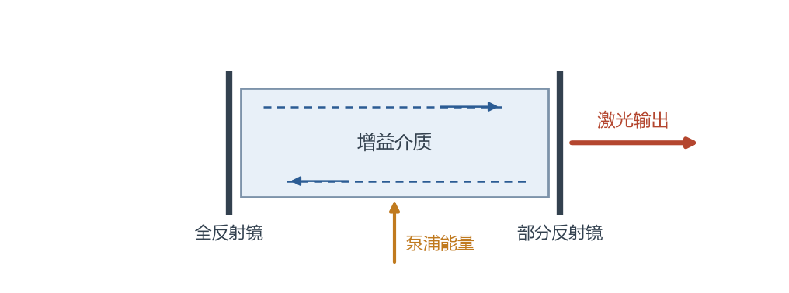
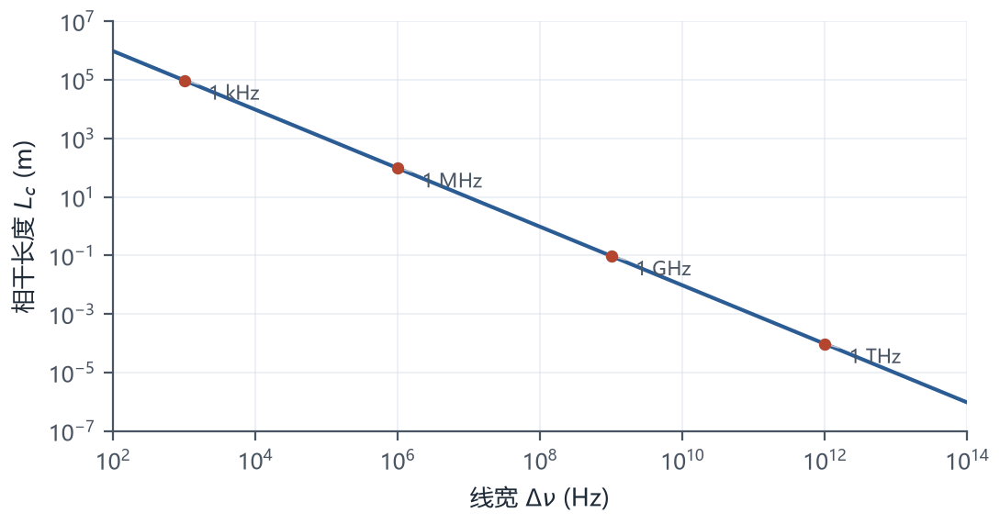

# 第 8 章　激光

1960 年 5 月，休斯研究所的梅曼点亮了一根手指长的红宝石棒，一束深红色的光从棒端射出，方向集中，颜色纯粹。这是人类造出的第一台激光器。当时的报纸把它称为“一种寻找问题的解决方案”，因为没人知道这东西能干什么。六十多年过去，激光成了光纤通信、激光切割、视力矫正、超市扫码、引力波探测的共同基础，问题早就多得做不完。

激光的工作原理，说起来只有三步，受激辐射、粒子数反转、光学谐振。三步都建立在前面几章的能级概念上。

## 8.1 三种跃迁

1917 年，爱因斯坦在研究黑体辐射时，把原子与光场的相互作用分成三种过程。

第一种是吸收。原子处在低能级 $E_1$，遇到一个能量正好是 $h\nu = E_2 - E_1$ 的光子，把它吸收，跳到高能级 $E_2$。

第二种是自发辐射。原子处在高能级，即使没有外来光子，也会在某个随机时刻自己跳回低能级，放出一个光子。这个光子的方向、相位、偏振都是随机的，跟其他原子发出的光子没有关联。普通灯泡、火焰、太阳发的光，主要来自这个过程。

第三种是受激辐射。原子处在高能级，遇到一个能量正好等于能级差的光子，会被这个光子“诱导”，立刻跳回低能级，放出一个跟入射光子完全相同的光子。同频率，同方向，同相位，同偏振。一个变两个，两个变四个，这就是光放大的机制。

爱因斯坦证明，这三种过程的系数之间有严格的关系。自发辐射和受激辐射的比例，取决于周围光场的模式密度。在热平衡下，高能级的原子数总是少于低能级，因为玻尔兹曼分布偏爱低能态。这时候吸收总是压过受激辐射，介质表现为吸收，不会放大。

要让介质放大光，必须让高能级的原子数多于低能级，这个状态叫粒子数反转。它不是一个平衡态，必须靠外界不断输入能量维持。

## 8.2 粒子数反转

把原子从低能级搬到高能级，需要泵浦。泵浦可以是光，可以是放电，可以是电流。

最简单的想法是两能级系统，直接用光把原子从 $E_1$ 抽到 $E_2$。这个想法行不通。当上下两个能级的原子数接近相等时，吸收和受激辐射的速率也接近相等，净效果为零。光越强，这个饱和越彻底，永远达不到反转。

三能级方案绕开了这个限制。把原子从基态 $E_1$ 抽到更高的 $E_3$，$E_3$ 上的原子很快通过无辐射跃迁落到 $E_2$。如果 $E_2$ 的寿命足够长，原子就会在这里堆积。$E_1$ 上的原子被抽走，$E_2$ 上的原子越积越多，反转就出现了。梅曼的红宝石激光器就是三能级。

三能级的缺点是效率低。基态上原本挤满了原子，要把一半以上的原子搬到上面，需要很大的泵浦功率。四能级方案更省力。激光下能级不是基态，而是一个很快排空的中间能级，它的粒子数本来就接近零，稍微抽一点就能实现反转。常见的钕玻璃激光、掺铒光纤激光器都是四能级。

图 8-1　三能级与四能级的泵浦路径。三能级要把基态粒子搬空一半以上，四能级的下能级天然接近空

## 8.3 光学谐振腔

有了反转介质，光穿过它会被放大。可一次放大的倍数很小，通常只有百分之几。要得到强光，必须让光在介质里来回走很多趟。

办法是把介质放在两面镜子之间。一面镀高反膜，反射率接近百分之百；另一面部分透射，让一部分光漏出去，这部分就是输出。这个结构叫法布里-珀罗腔，也叫光学谐振腔。

光在腔内往返，每经过一次介质就被放大一次，同时因为有透射、散射、吸收而损失一点。当增益大于损耗时，腔内光强指数增长，形成激光振荡。这个过程叫起振，需要泵浦功率超过一个阈值。

腔还起到选频的作用。光在腔内往返一周，相位必须与原来一致，才能形成稳定的驻波。这个条件要求腔长是半波长的整数倍

$$
L = q\frac{\lambda}{2}
$$

$q$ 是一个很大的整数，通常在上百万量级。满足条件的波长叫纵模。腔长 30 厘米的激光器，相邻纵模的频率间隔约 500 兆赫。如果增益介质的带宽比这个间隔宽，就会同时有若干个纵模起振，输出是多频的。要得到单频输出，需要在腔内加选频元件，比如标准具或者光栅。

图 8-2　激光器的基本结构。增益介质放在两面镜子之间，泵浦提供能量，部分透射的镜子输出激光

## 8.4 激光的四个特点

跟普通光源比，激光有四个突出的性质。

单色性好。普通光源的谱线很宽，太阳光的带宽覆盖整个可见区。激光的线宽可以窄到几千赫兹，甚至一赫兹以下。线宽窄意味着相干长度长，用 $L_c = c/(\pi\Delta\nu)$ 估算，一千赫兹的线宽对应近百公里的相干长度。

方向性好。普通灯泡向四面八方发光，激光沿腔轴方向输出，发散角可以小到毫弧度。把激光打到月球上，光斑直径只有几公里，而月球距离地球三十八万公里。

亮度高。方向集中意味着能量集中在很小的立体角里，等效亮度可以比太阳表面高很多个数量级。正是这个性质让激光能切割钢板、点燃聚变靶丸。

相干性好。受激辐射产生的光子相位一致，所以激光是高度相干的光。两束激光相遇能产生稳定的干涉条纹，这是全息摄影、激光干涉仪的基础。

图 8-3　线宽与相干长度的对应关系，按 $L_c = c/(\pi\Delta\nu)$ 计算

## 8.5 从气体到半导体

激光器的种类多到可以单独写一本书，这里只挑几类有代表性的。

氦氖激光器是最经典的气体激光，工作物质是氖，氦负责传递能量，输出 632.8 纳米的红光。它的光束质量极好，常用于教学和干涉测量，缺点是效率低、体积大。

半导体激光器是产量最大的一类。它的增益来自半导体 PN 结里的电子和空穴复合，体积可以小到零点几毫米，直接用电驱动，效率高，成本低。光盘、激光笔、光纤通信、激光雷达，用的都是它。

光纤激光器把增益介质做成掺稀土的光纤，散热好，光束质量高，功率可以做到千瓦甚至万瓦，工业切割和焊接的主力。

自由电子激光器用相对论电子束在周期磁场里摆动产生辐射，波长可以连续调节，从微波一直到 X 射线。上海、汉堡、斯坦福的 X 射线自由电子激光装置，用它研究单分子结构和超快过程。

## 8.6 激光冷却

激光除了能加热材料，还能把原子冻住。这个用法看起来反直觉，原理却不复杂。

原子在运动，迎面而来的激光光子频率会因为多普勒效应略微变高。如果激光频率略低于原子的共振频率，那么只有迎着光运动的原子才会“看到”共振频率，吸收光子。吸收以后，原子的动量减少了一个光子的动量。之后原子自发辐射，放出的光子方向随机，平均起来动量变化为零。反复多次，原子的速度就被一路减下来。

这个办法可以把原子气体冷却到微开尔文，再用蒸发冷却降到纳开尔文。冷原子是原子钟、原子干涉仪、量子模拟的基础。2018 年定义国际单位制的秒，用的就是铯原子在激光冷却下的跃迁频率。

朱棣文、科昂-塔诺季和菲利普斯因为激光冷却的工作获得 1997 年诺贝尔物理学奖。他们的方法后来发展出光晶格、光镊、玻色-爱因斯坦凝聚等一整套技术，这些技术在后面的量子计算平台里还会反复出现。

## 8.7 一束光里的量子

前面把激光当成经典的电磁波来描述，这对大多数应用已经够用。可如果要研究单个光子的行为，就必须把光场量子化。

量子化以后，光场的能量也是一份一份的，每一份是 $h\nu$。激光处在所谓的相干态，它是不同光子数态的叠加，光子数的分布服从泊松分布。平均光子数越大，分布越接近经典描述，相位也越确定。

这个图像在第三篇还会展开。现在只需要记住一件事，经典激光和单光子源是两种不同的光源。激光的光子数服从泊松分布，有时候会同时出现两个、三个光子；单光子源则保证每次只出一个。量子密钥分发、线性光学量子计算，需要的都是后者。

把光衰减到一次只有一个光子，你会发现它比激光更难对付。
