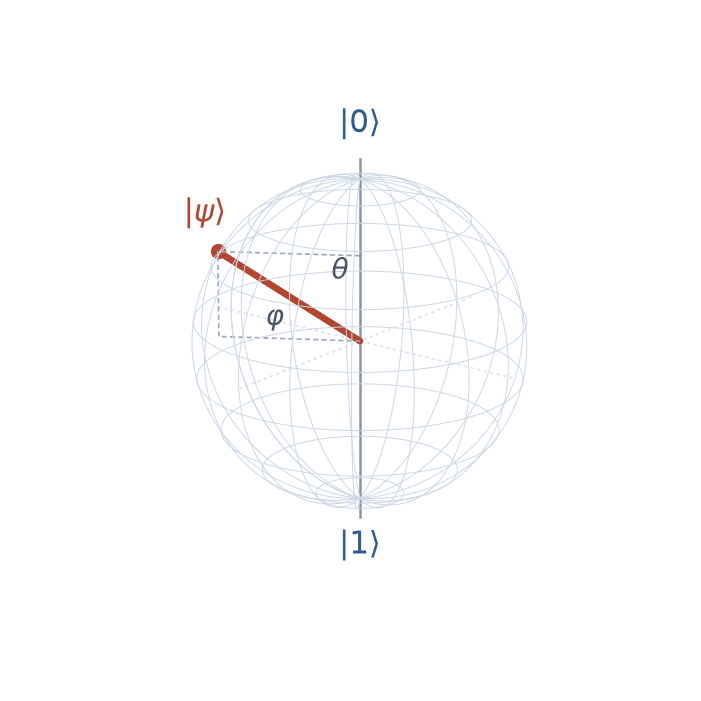
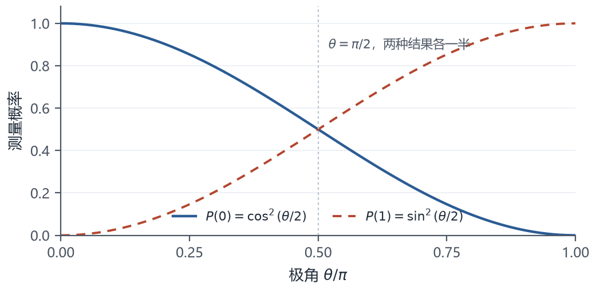

# 第 10 章　量子比特

经典计算机里的比特，是一个只能取零或一的开关。把它想象成硬币，硬币正面朝上是 1，反面朝上是 0，中间没有别的状态。所有的程序，最后都化成一串对零和一的搬弄。

量子比特不一样。它也有 0 和 1 两个基准状态，但它还可以处在两者的任意叠加里。这一章把这套描述讲清楚，它是整个第二篇的起点。

## 10.1 用向量表示状态

量子力学的标准语言是狄拉克符号。一个量子态写成一个右矢

$$
|\psi\rangle = \begin{pmatrix}\alpha\\ \beta\end{pmatrix}
$$

其中 $\alpha$ 和 $\beta$ 是复数。这两个数叫概率幅，它们的模平方分别是测量得到 0 和 1 的概率

$$
P(0) = |\alpha|^2,\qquad P(1) = |\beta|^2
$$

归一化要求 $|\alpha|^2+|\beta|^2 = 1$。

两个基准态写成

$$
|0\rangle = \begin{pmatrix}1\\0\end{pmatrix},\qquad |1\rangle = \begin{pmatrix}0\\1\end{pmatrix}
$$

任何单比特态都可以写成它们的线性组合

$$
|\psi\rangle = \alpha|0\rangle + \beta|1\rangle
$$

这套写法的好处是，叠加、测量、演化都能用线性代数处理。加一个相位、过一个门、测一个概率，全是矩阵乘法。

左矢是右矢的共轭转置，记作 $\langle\psi| = (\alpha^*,\beta^*)$。两个态的内积写成 $\langle\phi|\psi\rangle$，它是一个复数。内积的模平方给出两个态之间的“重叠程度”，如果为零，两个态正交，测量可以完全区分它们。

## 10.2 两个角就够了

单比特态有两个复系数，四个实数。归一化去掉一个，整体相位不可观测再去掉一个，剩下两个实数。用这两个数做球坐标，就得到布洛赫球

$$
|\psi\rangle = \cos\frac{\theta}{2}|0\rangle + e^{i\varphi}\sin\frac{\theta}{2}|1\rangle
$$

$\theta$ 是极角，从 0 到 $\pi$；$\varphi$ 是方位角，从 0 到 $2\pi$。北极是 $|0\rangle$，南极是 $|1\rangle$，赤道上是等权重叠加的各种相位。

图 10-1　单比特态的布洛赫球表示，极角决定测量概率，方位角是相对相位

这个球把抽象的两维复向量变成了看得见的空间方向，是量子计算里最常用的可视化工具。要记住一点，球面上任意一点都对应一个纯态，球内任意一点也对应一个合法的状态，那是混合态，第三篇讲密度矩阵时会用到。

站在球面上想一想，经典比特只能待在南北两极，量子比特可以在整个球面上跑。这个差别听起来不大，可当比特数变多，差别会指数放大。

## 10.3 相位看不见，但很重要

极角决定测量概率。$\theta = 0$ 时测到 0 的概率是 1，$\theta = \pi$ 时是 0，$\theta = \pi/2$ 时各一半。

图 10-2　测量概率随极角的变化，$\theta = \pi/2$ 时两种结果各占一半

方位角 $\varphi$ 在单比特测量里完全看不出来。态 $\frac{1}{\sqrt2}(|0\rangle+|1\rangle)$ 和 $\frac{1}{\sqrt2}(|0\rangle-|1\rangle)$，在 $Z$ 基下测量的结果都是各一半，无法区分。它们在球面上分别位于赤道的两端，是完全不同的两个态。

要区分它们，必须换一个测量基。用 $X$ 基测量，也就是测 $\frac{1}{\sqrt2}(|0\rangle\pm|1\rangle)$，两个态给出的结果正好相反。

这件事在量子计算里非常关键。所有的量子算法，本质上都是在操纵相位。Hadamard 门把 $|0\rangle$ 变成叠加态，后续的门在叠加态上累积不同的相位，最后通过干涉把相位差变成概率差。如果只看测量概率，中间过程完全不透明，这正是量子计算难以调试的原因，也是它难以被经典计算机模拟的原因。

## 10.4 多个比特

两个比特的态空间是四维的

$$
|\psi\rangle = \alpha_{00}|00\rangle + \alpha_{01}|01\rangle + \alpha_{10}|10\rangle + \alpha_{11}|11\rangle
$$

四个概率幅，归一化条件是一个。$n$ 个比特就有 $2^n$ 个概率幅，这个指数增长是量子计算的力量来源，也是它难以模拟的原因。

描述两个比特的态，不能简单地把两个单比特态乘起来。有些态可以写成乘积形式

$$
|\psi\rangle = (\alpha_1|0\rangle+\beta_1|1\rangle)\otimes(\alpha_2|0\rangle+\beta_2|1\rangle)
$$

这种态叫可分离态。有些态写不成乘积形式，比如

$$
|\Phi^+\rangle = \frac{1}{\sqrt2}(|00\rangle+|11\rangle)
$$

这个态叫纠缠态，第十三章专门讲它。

## 10.5 物理上怎么实现

量子比特不是抽象概念，它在实验室里是一个具体的物理系统。任何有两能级的量子系统都可以当比特用，只要能把它跟环境隔离开，能对它做操作，能读出来。

超导量子比特用约瑟夫森结构成的电路，两个能级是电路的基态和第一激发态，频率在微波波段。它的操控用微波脉冲，读出用谐振腔。特点是速度快，门时间在几十纳秒，缺点是要在十毫开尔文的稀释制冷机里工作。

离子阱用量子比特的是离子的两个内态，用激光或者微波操控，相干时间长，保真度高，缺点是门速度慢，在微秒量级。

中性原子用光镊抓住单个原子，用里德堡态做相互作用，可以排成很大的阵列，适合做量子模拟。

光子用偏振或者路径编码，室温工作，传输距离远，缺点是不容易做两比特门。

半导体量子点用电子的自旋，跟现有的芯片工艺兼容，是产业界看好的方向。

这些平台的物理细节差别很大，可它们在抽象层面完全一样，都是一个两能级系统，都用布洛赫球描述，都遵守同一套门操作规则。这种“底层不同、上层相同”的结构，正是量子计算作为一门独立学科的基础。

## 10.6 一个常见的误会

初学者常常把量子比特想成一个“同时是 0 和 1 的比特”，然后推论说 $n$ 个量子比特能同时存 $2^n$ 个数，所以量子计算机一次能做 $2^n$ 次运算。

这个说法有一半对，一半错。

对的部分是，$n$ 个比特的态确实有 $2^n$ 个概率幅，这些幅值在演化中同时参与运算，这就是所谓的量子并行性。

错的部分是，测量的时候你只能得到一个结果，得到某一个 $n$ 位二进制串，概率由对应的幅值决定。你没法把 $2^n$ 个幅值一次全部读出来。

量子算法的巧妙之处，在于设计一套操作，让所有错误的答案在测量前互相抵消，只有正确答案的概率被放大。这个设计过程叫干涉，它是量子算法设计的核心技巧。Grover 搜索和 Shor 分解都是这么做的。

所以量子计算机不是“更快的经典计算机”，它是一台能做干涉的机器。对某些问题，干涉能把指数级的搜索压成多项式级；对另一些问题，它一点优势都没有。判断哪些问题适合量子计算，是这门学科里最实际的问题之一。
