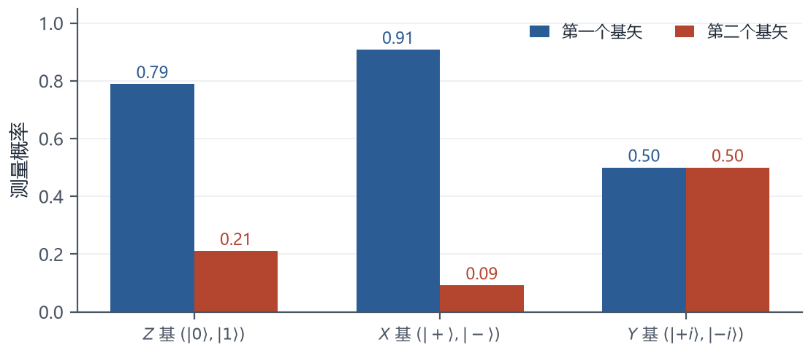
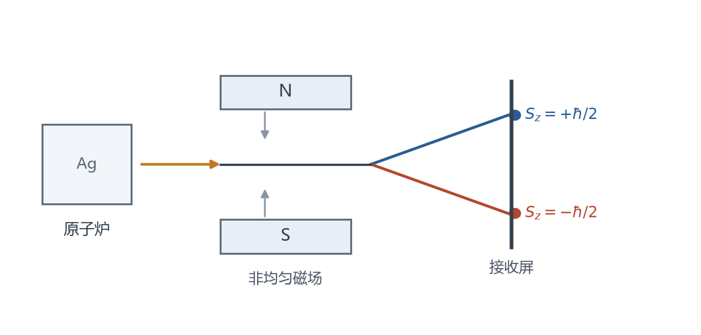

# 第 11 章　算符与测量

有了描述状态的语言，接下来的问题是，怎么描述“测量一个物理量”这件事。在经典物理里，位置和动量就是两个数。在量子力学里，它们变成了作用在态空间上的算符。

这一章讲清楚三件事，算符是什么，本征值为什么是测量结果，不同算符之间的关系为什么会决定不确定性。

## 11.1 可观测量就是算符

一个算符是一个线性映射，把一个向量变成另一个向量。在有限维的态空间里，它可以写成一个矩阵。

物理量的算符不是随便写的矩阵，它必须是厄米矩阵。厄米的意思是，矩阵等于自己的共轭转置

$$
A^\dagger = A
$$

其中 $A^\dagger = (A^*)^T$。这个要求有两个直接的后果，本征值是实数，本征向量可以选成正交的。第一条保证了测量结果是一个实数，符合物理量的要求。第二条保证了对同一个算符的不同结果，可以完全区分。

位置、动量、能量、角动量，这些量在量子力学里都有对应的厄米算符。以动量为例，在位置表象里它写成微分算符

$$
\hat{p} = -i\hbar\frac{d}{dx}
$$

对它作用在波函数上，得到的是另一个函数。这个算符的本征函数是平面波 $e^{ikx}$，本征值是 $\hbar k$，也就是动量。

## 11.2 本征方程

本征方程写成

$$
A|\phi\rangle = a|\phi\rangle
$$

意思是，算符作用在某个特定的态上，结果只是把这个态乘上一个数，方向不变。这个数 $a$ 叫本征值，这个态叫本征态。

举个具体的例子。泡利 $Z$ 矩阵

$$
\sigma_z = \begin{pmatrix}1&0\\0&-1\end{pmatrix}
$$

作用在 $|0\rangle$ 上得到 $|0\rangle$，作用在 $|1\rangle$ 上得到 $-|1\rangle$。所以它的本征值是 $+1$ 和 $-1$，本征态是 $|0\rangle$ 和 $|1\rangle$。在物理上，这对应自旋沿 $z$ 方向的分量，两个可能值。

一个算符的所有本征态构成一组完备基，任何态都可以写成它们的线性组合。这一点很重要，它保证了对任意态做测量，总有结果。

## 11.3 泡利矩阵

单比特的算符空间由四个矩阵张成，单位矩阵和三个泡利矩阵

$$
\sigma_x = \begin{pmatrix}0&1\\1&0\end{pmatrix},\quad
\sigma_y = \begin{pmatrix}0&-i\\i&0\end{pmatrix},\quad
\sigma_z = \begin{pmatrix}1&0\\0&-1\end{pmatrix}
$$

这三个矩阵有很好的性质。它们的平方都是单位矩阵，本征值都是 $\pm1$，迹都是零，两两反对易

$$
\sigma_i\sigma_j + \sigma_j\sigma_i = 2\delta_{ij}I
$$

它们跟布洛赫球的三个方向一一对应。$\sigma_z$ 的本征态是南北极，$\sigma_x$ 的本征态是赤道上东西两个点，$\sigma_y$ 的本征态是赤道上另外两个点。

任何单比特的厄米算符都可以写成

$$
A = a_0 I + a_x\sigma_x + a_y\sigma_y + a_z\sigma_z
$$

其中四个系数都是实数。这个展开式把“任意物理量”和“布洛赫球上的一个方向”对应起来，是单比特情形下最实用的工具。

## 11.4 测量公设

测量的规则可以这样表述。

对一个处于 $|\psi\rangle$ 的态测量物理量 $A$，可能的结果只能是 $A$ 的某个本征值 $a_n$。得到 $a_n$ 的概率是

$$
P(a_n) = |\langle\phi_n|\psi\rangle|^2
$$

其中 $|\phi_n\rangle$ 是对应的本征态。测量之后，态塌缩到 $|\phi_n\rangle$。

把这个式子用在单比特上，如果 $A = \sigma_z$，本征态是 $|0\rangle$ 和 $|1\rangle$，那么测量得到 $+1$ 的概率就是 $|\alpha|^2$，得到 $-1$ 的概率是 $|\beta|^2$。这跟前面用波函数讲的完全一致。

换一个基，结果就不同。同一个态在 $X$ 基下测量，得到 $+1$ 的概率是 $|\langle+|\psi\rangle|^2$，这个数值一般不等于 $|\alpha|^2$。

图 11-1　同一个态在 $Z$、$X$、$Y$ 三个基下的测量概率。基不同，结果的分布也不同

这说明，“测量得到什么”不只取决于态，还取决于你选了哪个物理量去测。实验装置决定了测的是什么，态只在给定的测量下给出概率分布。

## 11.5 期望值与不确定度

对同一个态做很多次同样的测量，结果的平均值叫期望值

$$
\langle A\rangle = \langle\psi|A|\psi\rangle
$$

这个量可以用矩阵直接算，不需要真的做实验。对纯态 $|\psi\rangle = \alpha|0\rangle+\beta|1\rangle$，如果 $A = \sigma_z$，那么

$$
\langle\sigma_z\rangle = |\alpha|^2 - |\beta|^2
$$

正好是布洛赫矢量在 $z$ 方向的投影。

测量的分散程度用标准差描述

$$
\Delta A = \sqrt{\langle A^2\rangle - \langle A\rangle^2}
$$

这个量在对易关系里扮演重要角色。

## 11.6 对易子

两个算符的乘积一般不对易，$AB \neq BA$。它们的差

$$
[A,B] = AB - BA
$$

叫对易子。如果对易子为零，两个算符对易，它们有共同的本征态，可以同时确定。

位置和动量的对易子是

$$
[\hat{x},\hat{p}] = i\hbar
$$

这个不为零的结果，正是不确定性关系的来源。可以证明，对任意两个厄米算符

$$
\Delta A\,\Delta B \geq \frac{1}{2}\left|\langle[A,B]\rangle\right|
$$

代进位置动量，就得到 $\Delta x\,\Delta p \geq \hbar/2$。

这个推导比“测量扰动”的说法更根本，它说明不确定性不是技术问题，而是算符代数的直接结果。两个量如果不对易，就没有共同的完备本征态，也就不存在同时确定两者的态。

自旋的三个分量之间也不对易

$$
[\sigma_x,\sigma_y] = 2i\sigma_z
$$

以及它的循环置换。这意味着，$x$ 方向和 $y$ 方向的自旋不能同时确定。这个性质后来成了量子密钥分发的物理基础，因为窃听者不可能同时精确知道两个不对易的量。

## 11.7 斯特恩-格拉赫实验

1922 年，斯特恩和格拉赫做了一个实验，第一次直接看到了空间量子化。

他们把银原子加热成束，让原子束穿过一个非均匀磁场，最后打在玻璃板上。银原子最外层有一个未配对的电子，自旋为二分之一，就像一个极小的磁针。

在经典物理里，磁针在非均匀磁场中受力，力的方向取决于磁针与磁场的夹角。原子束里各原子的取向应该随机，所以玻璃板上应该出现一条连续的痕迹。

实际结果是两条清晰的斑。原子束被劈成两束，一束向上偏，一束向下偏，中间没有原子。

图 11-2　银原子束穿过非均匀磁场后分裂成两束，对应自旋的两个取向

这个结果只有量子力学能解释。自旋沿磁场方向的分量只有两个取值，$+\hbar/2$ 和 $-\hbar/2$，所以偏转也只有两个角度。空间的方向被量子化了。

这个实验还有后续。如果把向上偏的那一束单独取出来，再让它通过一个同样方向的磁场，它不会再分裂，还是向上偏。可如果让它通过一个沿 $x$ 方向的磁场，它会重新分裂成两束，强度各一半。

原因很清楚。经过第一次测量，原子的态已经是 $\sigma_z$ 的本征态。$\sigma_z$ 的本征态不是 $\sigma_x$ 的本征态，在 $X$ 基下写成两个本征态的等权叠加，所以再测 $x$ 方向，得到两个结果各一半。

这个“测量改变状态、换基就重新分裂”的现象，是量子测量最直观的演示。它没有用到任何复杂的数学，却把整套规则的骨架暴露了出来。
