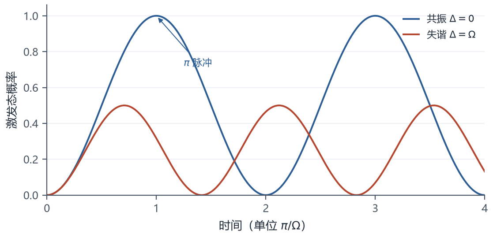
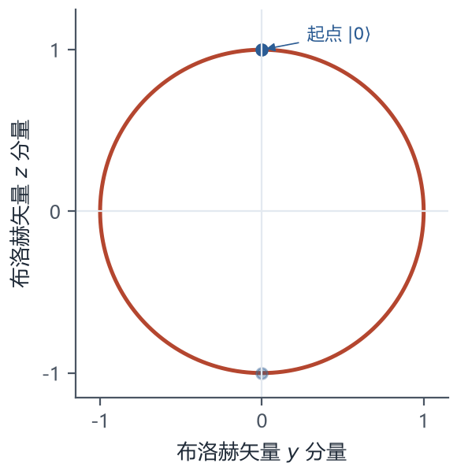

# 第 12 章　时间演化

量子态不是静止的。给出一个初始态，再给出系统的能量结构，就能算出它在任意时刻的样子。这套计算由一个方程统一描述，写法跟经典波动方程很像，含义却不同。

这一章讲三件事，薛定谔方程怎么用，哈密顿量代表什么，二能级系统在驱动下的行为是什么样。

## 12.1 一个线性方程

含时薛定谔方程写成

$$
i\hbar\frac{\partial}{\partial t}|\psi(t)\rangle = H|\psi(t)\rangle
$$

$H$ 是哈密顿量，代表系统的能量，它是一个厄米算符。方程左边是态随时间的变化率，右边是能量算符作用在态上。这个方程是线性的，态的叠加在演化中保持叠加，这一点是量子计算能成立的前提。

如果 $H$ 不显含时间，方程可以直接解出来

$$
|\psi(t)\rangle = e^{-iHt/\hbar}|\psi(0)\rangle
$$

这个指数是一个矩阵指数，定义成泰勒级数的形式

$$
e^{-iHt/\hbar} = \sum_{n=0}^{\infty}\frac{1}{n!}\left(-\frac{iHt}{\hbar}\right)^n
$$

把它作用在 $H$ 的本征态上，结果很简单。如果 $|\phi_n\rangle$ 是 $H$ 的本征态，本征值是 $E_n$，那么

$$
e^{-iHt/\hbar}|\phi_n\rangle = e^{-iE_nt/\hbar}|\phi_n\rangle
$$

本征态在演化中只改变一个相位，形状不变。这个性质叫定态，原子能级之所以稳定，原因就在这里。

## 12.2 哈密顿量是什么

哈密顿量就是能量算符。对自由粒子

$$
H = \frac{\hat{p}^2}{2m}
$$

在位置表象里，$\hat{p} = -i\hbar\,d/dx$，所以

$$
H = -\frac{\hbar^2}{2m}\frac{d^2}{dx^2}
$$

代进薛定谔方程，就得到我们在教科书里常见的形式。

对氢原子，哈密顿量加上库仑势

$$
H = -\frac{\hbar^2}{2m}\nabla^2 - \frac{e^2}{4\pi\varepsilon_0 r}
$$

解这个方程，就得到第七章的那些能级和轨道。

对二能级系统，哈密顿量可以写成 $2\times2$ 的矩阵。最一般的形式是

$$
H = \frac{\hbar}{2}\begin{pmatrix}\Delta & \Omega\\ \Omega & -\Delta\end{pmatrix}
$$

$\Delta$ 是两个能级的失谐，$\Omega$ 是两者之间的耦合强度。这个形式在后面会反复出现，超导量子比特、离子阱、核磁共振，写的都是这个矩阵。

## 12.3 拉比振荡

假设系统初始在 $|0\rangle$，哈密顿量如上，没有失谐 $\Delta = 0$。解出来，处在 $|1\rangle$ 的概率是

$$
P_1(t) = \sin^2\frac{\Omega t}{2}
$$

概率在 0 和 1 之间来回摆，周期是 $2\pi/\Omega$。这个现象叫拉比振荡，$\Omega$ 叫拉比频率。

图 12-1　二能级系统在共振驱动下的拉比振荡，失谐时振荡幅度下降、频率变快

这个解的用处很大。控制振荡的时间，就能把态转到任意想要的位置。振荡到 $\Omega t = \pi$ 时，$P_1 = 1$，态完全翻转到 $|1\rangle$，这个操作叫 $\pi$ 脉冲。振荡到 $\Omega t = \pi/2$ 时，$P_1 = 1/2$，态变成等权叠加，叫 $\pi/2$ 脉冲。

所以一个量子门，本质上就是一段精确计时的驱动。

如果失谐不为零，解会变成

$$
P_1(t) = \frac{\Omega^2}{\Omega^2+\Delta^2}\sin^2\frac{\sqrt{\Omega^2+\Delta^2}\,t}{2}
$$

振荡频率变快，幅度变小，最大值只有 $\Omega^2/(\Omega^2+\Delta^2)$。失谐越大，越难把态完全翻转。这就是为什么量子门要求驱动频率精确对准跃迁频率，误差要控制在千分之一以内。

## 12.4 布洛赫球上的旋转

把二能级系统的演化画在布洛赫球上，会看到一个很干净的图像。

哈密顿量里的 $\Delta$ 对应绕 $z$ 轴的旋转，$\Omega$ 对应绕 $x$ 轴的旋转。共振驱动时，布洛赫矢量绕着 $x$ 轴转圈，从北极出发，沿着一个大圆转到南极，再转回来。

图 12-2　共振驱动下布洛赫矢量在 $y$-$z$ 平面内的旋转轨迹

这个图像的用处在于，任何单比特操作都可以分解成绕三个轴的旋转。绕 $z$ 轴的旋转只改相位，绕 $x$ 轴和 $y$ 轴的旋转改变叠加的比例。三个角度一共三个参数，正好对应三维空间里的任意旋转。

这也是量子门设计的基本思路。要实现的幺正操作，先分解成三个旋转，再用对应的脉冲序列去实现。

## 12.5 旋转波近似

推导拉比振荡的时候，用了一个近似，叫旋转波近似。

驱动场的写法是 $\cos(\omega t)$，展开成两个指数项，一项以 $\omega$ 旋转，一项以 $-\omega$ 旋转。在共振附近，其中一项与系统的固有频率同向旋转，另一项反向，转得很快。快速旋转的项在时间上平均掉，贡献可以忽略。

这个近似在 $\Omega \ll \omega$ 时非常准，在超导量子比特和离子阱里都成立，因为驱动频率在吉赫兹量级，耦合强度在兆赫兹量级，差三个数量级。它把复杂的时间依赖方程变成了一个常系数矩阵，让解析求解成为可能。

## 12.6 受控演化

要让量子态按设计好的方式演化，需要精确控制哈密顿量。

在超导电路里，控制手段是微波脉冲。改变脉冲的幅度、频率、相位、持续时间，就能改变 $\Omega$ 和 $\Delta$，从而控制旋转轴和旋转角。脉冲的形状也要设计，方波简单，但频谱宽，容易激发不该激发的能级；高斯形或者 DRAG 脉冲频谱窄，泄漏小，是现在的标准做法。

在离子阱里，控制手段是激光。激光的相位、频率、强度决定离子内部态的演化，也决定离子运动状态的耦合。

在光量子计算里，控制手段是波片、相位调制器和分束器。它们对偏振和路径做幺正变换，不需要时间演化，走完光路就完成了计算。

三种手段差别很大，但抽象层面都是同一个东西，一个酉算符 $U$。量子线路图里的每一个门，对应的就是这样一个算符。

## 12.7 一个容易忽略的细节

薛定谔方程里的时间是一维的，方向只有一个，方程本身对时间反演是对称的。把 $t$ 换成 $-t$，同时把态取复共轭，方程不变。这意味着，微观过程在原则上可以倒放。

可实际世界里，时间之箭非常明显。鸡蛋打碎了不会自己合起来，热量从高温流向低温不会反过来。这个不对称来自统计，来自系统的自由度太多，来自初始条件的特殊。

退相干是同一类现象。一个量子态演化到混合态，信息跑到了环境里，从系统的角度看，这个过程不可逆。第三篇会专门讲这件事，它是量子技术面对的最实际的敌人。

两个比特放在一起，会多出一种单个比特怎么都凑不出来的性质。
