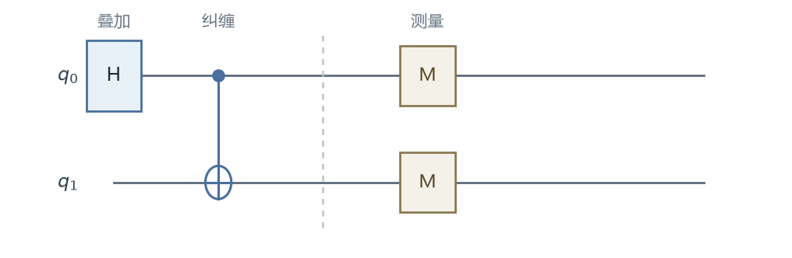
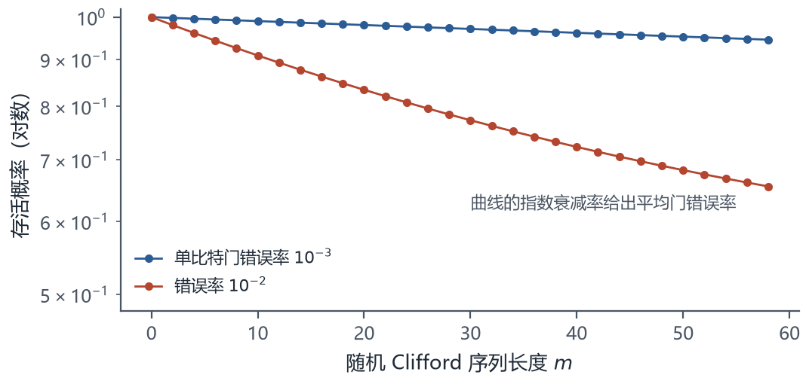

# 第 15 章　量子门与线路

有了比特，有了演化，接下来要能把演化拼成程序。量子计算里的基本操作叫门，一串门排在一起叫线路。这套语言跟经典电路很像，规则却不同。

## 15.1 门必须是幺正的

量子门对应一个幺正算符，满足

$$
U^\dagger U = I
$$

这个要求有两个来源。第一，演化要保概率，态矢量的模长必须保持为一，只有幺正变换能做到这一点。第二，量子演化在原则上可逆，幺正算符总有逆，$U^{-1} = U^\dagger$。经典的门大多不可逆，与门把两个比特变成一个，信息丢了；量子门不能这样，输入几个比特，输出就得几个比特。

不可逆的操作在量子线路里也有，测量就是，但它不是幺正演化，它是把量子信息变成经典信息的过程。

## 15.2 单比特门

最重要的几个单比特门列在下表。

| 门 | 矩阵 | 作用 |
|---|---|---|
| $X$ | $\begin{pmatrix}0&1\\1&0\end{pmatrix}$ | 翻转，$0\leftrightarrow 1$ |
| $Z$ | $\begin{pmatrix}1&0\\0&-1\end{pmatrix}$ | 给 $1$ 加 $\pi$ 相位 |
| $Y$ | $\begin{pmatrix}0&-i\\i&0\end{pmatrix}$ | 翻转同时加相位 |
| $H$ | $\frac{1}{\sqrt2}\begin{pmatrix}1&1\\1&-1\end{pmatrix}$ | 造叠加 |
| $S$ | $\begin{pmatrix}1&0\\0&i\end{pmatrix}$ | 加 $\pi/2$ 相位 |
| $T$ | $\begin{pmatrix}1&0\\0&e^{i\pi/4}\end{pmatrix}$ | 加 $\pi/4$ 相位 |

$H$ 门最常用。它把 $|0\rangle$ 变成 $|+\rangle$，把 $|1\rangle$ 变成 $|-\rangle$，做两次回到原态。它把 $Z$ 基和 $X$ 基互相转换，是几乎所有量子算法的第一步。

$T$ 门看起来不起眼，只加一个 $\pi/4$ 的相位，可它是“魔法门”之一。只有 Clifford 门（$H$、$S$、CNOT）的线路，经典计算机可以高效模拟；加上 $T$ 门，才具备量子优势。这一点在第十六章会细说。

除了这几个离散的门，还有连续的旋转门

$$
R_x(\theta) = e^{-i\theta X/2},\quad R_y(\theta) = e^{-i\theta Y/2},\quad R_z(\theta) = e^{-i\theta Z/2}
$$

它们在布洛赫球上分别对应绕三个坐标轴的旋转，角度由参数给定。

## 15.3 两比特门

单比特门只能各自转各自的球，要让两个比特产生关联，必须用两比特门。

最常用的是受控非门，CNOT。它有两个输入，一个控制比特，一个目标比特。控制比特为 0 时什么都不做，为 1 时对目标比特做 $X$ 翻转。矩阵形式是

$$
\mathrm{CNOT} = \begin{pmatrix}1&0&0&0\\0&1&0&0\\0&0&0&1\\0&0&1&0\end{pmatrix}
$$

另一个常用的是受控 $Z$ 门，CZ。它对 $|11\rangle$ 加一个负号，其余不变。CZ 跟 CNOT 只差目标比特上的两个 $H$ 门，在超导电路里 CZ 更容易实现，所以很多硬件直接用 CZ 作为原生两比特门。

SWAP 门交换两个比特的状态，在需要把量子信息搬到相邻比特时用到。它可以用三个 CNOT 拼出来。

## 15.4 读线路图

线路图从左到右读。每条横线是一个比特，线上的方框是门，竖线连接的是多比特门。

图 15-1　制备贝尔态的两比特线路，H 门造叠加，CNOT 门造纠缠

这张图上有三个部分。第一个比特先过 $H$ 门，从 $|0\rangle$ 变成 $\frac{1}{\sqrt2}(|0\rangle+|1\rangle)$。然后一个 CNOT，控制比特是第一个，目标是第二个。最后两个比特都测量。

把整个过程算一遍。初始态是 $|00\rangle$。过 $H$ 门以后

$$
\frac{1}{\sqrt2}(|0\rangle+|1\rangle)\otimes|0\rangle = \frac{1}{\sqrt2}(|00\rangle+|10\rangle)
$$

过 CNOT，第二项的控制比特是 1，目标翻转，变成 $|11\rangle$

$$
\frac{1}{\sqrt2}(|00\rangle+|11\rangle)
$$

这就是贝尔态 $|\Phi^+\rangle$。测量两个比特，结果只能是 00 或者 11，各一半概率，从不出 01 或 10。

这条线路只有两个门，可它包含了量子计算的两个核心要素，叠加和纠缠。后面所有的算法，都是在这个基础上加东西。

## 15.5 通用门集

一个门集如果能以任意精度逼近任意幺正操作，就叫通用门集。

一个常见的通用门集是 $H$、$T$、CNOT。这三个门足以构造任何量子线路。$H$ 和 $T$ 生成单比特的任意旋转，CNOT 提供两比特的纠缠。这个结论叫 Solovay-Kitaev 定理的实用版本，它保证了任何算法都可以用有限的门集实现，代价是门数会增加。

不同的硬件有不同的原生门集。超导量子比特原生的是 $R_z$、$\sqrt{X}$ 和 CZ；离子阱原生的是任意角度的单比特旋转和 Mølmer-Sørensen 门；光量子计算原生的是分束器和相位延迟。编译器的任务，就是把算法写成的高层门，翻译成硬件能直接执行的原生门序列。

这个翻译过程叫门分解，是量子编译的核心。分解的质量直接影响线路深度，而深度又直接决定在退相干之前能算多少步。

## 15.6 任意单比特门怎么分解

任意一个单比特幺正矩阵，可以分解成三个旋转

$$
U = R_z(\alpha)R_y(\beta)R_z(\gamma)
$$

只差一个全局相位。这个分解叫 ZYZ 分解，它的存在意味着，只要硬件能实现绕 $z$ 和 $y$ 的任意角度旋转，就能实现任意单比特门。

两比特门的情况复杂得多。任意两比特幺正操作需要三个 CNOT 加若干单比特门才能精确实现，这个结论在 1995 年由 Barenco 等人证明。实际编译时还要考虑硬件的连接拓扑，如果两个比特之间没有直接的耦合，需要用 SWAP 把态搬过去，代价是更多的门和更深的线路。

## 15.7 保真度与基准测试

衡量门的好坏用保真度，定义为实现的操作与理想操作之间的重叠程度。

测量保真度的标准方法是随机基准测试。做法是随机生成一串 Clifford 门，让它们整体上等于恒等操作，然后测量实际执行后回到初始态的概率。序列越长，错误累积越多，存活概率按指数衰减

$$
P(m) = A p^m + B
$$

$p$ 是每次操作的保真度，从衰减率反推出来。

图 15-2　随机基准测试的存活概率随序列长度的衰减，衰减率给出平均门错误率（模型曲线）

这个方法的优点是不受制备和测量误差的影响，因为它们被吸收到 $A$ 和 $B$ 里。它已经成为量子处理器性能报告的标准项目。

## 15.8 一个门的物理实现

回到硬件层面，一个 CNOT 门在超导电路里怎么做。

两个超导量子比特通过一个耦合器连接。要执行 CZ，把其中一个比特调到特定频率，让它跟另一个比特的频率接近，两者发生相互作用，累积一个条件相位，然后调回来。整个过程几十纳秒，靠磁通脉冲或者微波脉冲控制。

在离子阱里，两比特门靠共享的振动模式。激光把离子的内部态和振动耦合起来，两个离子通过交换声子产生相互作用。这个过程慢一些，在几十到几百微秒。

在光量子计算里，两比特门靠干涉。两个光子在分束器上相遇，发生洪-欧-曼德尔干涉，后选择测量其中一个光子，剩下的光子就带上了两比特操作的效应。这种门是概率性的，成功概率有限，需要靠额外的光子或者纠错来弥补。

同一个 CNOT，三种完全不同的物理过程，抽象层面是同一个矩阵。这就是量子计算作为一门独立学科的意义，它把物理细节封装在门后面，让算法设计者可以专注于线路结构。
