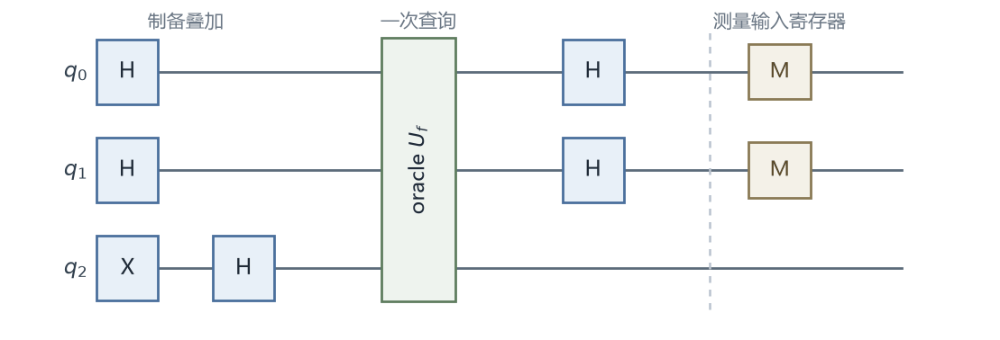
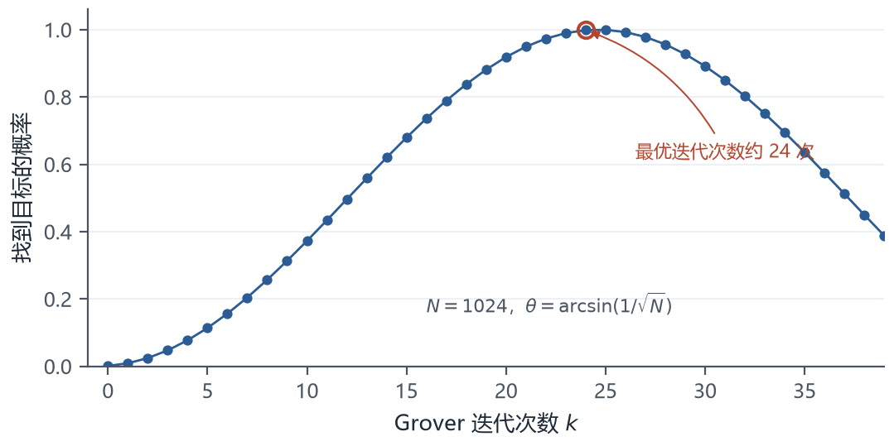

# 第 16 章　量子算法

量子计算机比经典计算机快在哪里，这个问题没有一句话的答案。有些问题上有指数级的加速，有些问题上有平方级的加速，有些问题上一点优势都没有。这一章讲两个最经典的例子，它们分别展示了两种不同的加速机制。

## 16.1 查询模型

为了公平比较，理论计算机科学常用一种叫查询模型的框架。

把一个函数 $f(x)$ 装进一个黑箱，你给它输入 $x$，它给你 $f(x)$，但你看不到内部实现。计数的标准是你调用了几次黑箱。这个黑箱叫 oracle。

经典计算机要判断一个函数是不是常数函数，最坏情况需要问一半加一个输入。量子计算机用 Deutsch-Jozsa 算法，只需要问一次。

## 16.2 Deutsch-Jozsa 算法

问题的设定是这样的。有一个函数 $f:\{0,1\}^n\to\{0,1\}$，它要么是常函数，对所有输入都返回同一个值；要么是平衡函数，一半输入返回 0，一半返回 1。问它是哪一种。

经典的最坏情况要问 $2^{n-1}+1$ 次。量子算法只需要一次。

线路分四步。先把 $n$ 个输入比特制备成均匀叠加

$$
|0\rangle^{\otimes n}\xrightarrow{H^{\otimes n}}\frac{1}{\sqrt{2^n}}\sum_{x}|x\rangle
$$

辅助比特制备成 $|-\rangle = \frac{1}{\sqrt2}(|0\rangle-|1\rangle)$。然后调用 oracle，它实现

$$
|x\rangle|y\rangle\to|x\rangle|y\oplus f(x)\rangle
$$

接着对输入寄存器再做一次 $H^{\otimes n}$，最后测量。

图 16-1　Deutsch-Jozsa 线路。输入寄存器制备成叠加，辅助比特制备成 $|-\rangle$，一次 oracle 查询后干涉，再测量

关键在于 $|-\rangle$ 的使用。当目标比特是 $|-\rangle$ 时，oracle 的作用变成

$$
|x\rangle|-\rangle \to (-1)^{f(x)}|x\rangle|-\rangle
$$

函数的值没有写到目标比特上，而是变成了 $|x\rangle$ 前面的一个相位。这个技巧叫相位回踢。

于是查询后的态是

$$
\frac{1}{\sqrt{2^n}}\sum_x(-1)^{f(x)}|x\rangle
$$

如果 $f$ 是常函数，所有相位相同，这个态就是均匀叠加，再做 $H^{\otimes n}$ 回到 $|0\rangle^{\otimes n}$，测量得到全零。

如果 $f$ 是平衡函数，相位有一半是正的，一半是负的，这个态跟均匀叠加正交，再做 $H^{\otimes n}$ 后完全避开 $|0\rangle^{\otimes n}$，测量一定得到某个非零结果。

一次查询，就能区分。这个结果在数学上很漂亮，但它依赖一个前提，oracle 必须能一次处理所有输入的叠加。这正是量子并行的含义。

## 16.3 相位回踢

相位回踢是量子算法里最重要的技巧之一，值得单独说一下。

它的作用是，把目标比特上的“结果”转换成控制比特上的“相位”。因为相位看不见，所以不消耗量子信息；因为相位会影响后续的干涉，所以可以被利用。

这个技巧在很多算法里出现。量子相位估计把酉算符的本征值转成相位，Grover 搜索把解的位置转成相位，量子纠错里的综合征测量也是靠相位回踢把错误信息搬到辅助比特上。

理解了这个技巧，量子算法的很多设计思路就通了。量子计算机不是“同时算很多次”，它是“把答案编码进相位，再用干涉把答案放大”。

## 16.4 Grover 搜索

第二个例子是无序数据库搜索。

有一个大小为 $N$ 的数据库，里面有一个目标项，用经典方法找，平均要查 $N/2$ 次，最坏 $N$ 次。Grover 算法用大约 $\frac{\pi}{4}\sqrt{N}$ 次查询就能找到，这是平方级加速。

算法的结构很简单，两个步骤反复迭代。

第一步是 oracle，它把目标项的相位翻转，其他项不变。用记号表示，如果 $|w\rangle$ 是目标，那么

$$
|x\rangle \to (-1)^{[x=w]}|x\rangle
$$

第二步是扩散算符，它把所有项相对平均值翻转

$$
D = 2|\psi\rangle\langle\psi| - I
$$

其中 $|\psi\rangle$ 是均匀叠加。这个操作的作用是把低于平均的幅值抬上去，把高于平均的压下来，效果是放大目标项。

两个步骤合起来，相当于在二维平面里做一次旋转。

## 16.5 几何图像

用一个二维平面来理解 Grover。

初始态 $|\psi\rangle$ 可以分解成两个正交分量，目标项 $|w\rangle$ 和其余项的均匀叠加 $|s\rangle$

$$
|\psi\rangle = \sin\frac{\theta}{2}|w\rangle + \cos\frac{\theta}{2}|s\rangle
$$

其中 $\sin(\theta/2) = 1/\sqrt{N}$，所以 $\theta \approx 2/\sqrt{N}$。

每次迭代，态在这个平面里旋转一个固定的角度 $\theta$。迭代 $k$ 次以后，态与 $|s\rangle$ 的夹角变成 $(2k+1)\theta/2$，测到目标的概率是

$$
P(k) = \sin^2\left(\frac{(2k+1)\theta}{2}\right)
$$

要让它接近 1，需要 $(2k+1)\theta/2 \approx \pi/2$，也就是 $k \approx \frac{\pi}{4}\sqrt{N}$。

图 16-2　$N = 1024$ 时成功概率随迭代次数的变化，最优迭代次数约 24 次

这个曲线有一个要注意的地方，继续迭代下去，概率会下降。原因是旋转是持续的，转过最优角度以后会继续转过去。所以 Grover 必须知道什么时候停，这也意味着它需要知道解的大致数量。如果解的个数未知，需要用量子计数先估一下。

## 16.6 平方加速的意义

平方加速听起来不如指数加速诱人，可它的适用范围很广。

任何可以用黑箱判定的搜索问题，都可以套用 Grover。密码破解是最直接的例子。一个 $n$ 比特的对称密钥，经典暴力搜索要试 $2^n$ 次，Grover 只要 $2^{n/2}$ 次。这意味着 AES-128 的等效安全强度降到 64 比特，所以后量子密码的标准建议把对称密钥长度翻倍。

不过 Grover 的实际加速受限于一个事实。搜索过程要串行迭代，每次迭代都要调用一次 oracle，而 oracle 在真实硬件上要花时间。如果单次 oracle 的时间是 $T$，总时间就是 $T\sqrt{N}$，而经典并行搜索可以用 $N$ 台机器同时跑，时间还是 $T$。所以 Grover 的优势只在单机串行的场景下成立。

## 16.7 量子优势从哪来

两个算法展示了两种机制。

Deutsch-Jozsa 用的是全局干涉。一次查询就把函数的所有取值编码进相位，再用一次变换把“常数还是平衡”这个全局性质提取出来。经典计算机必须逐个检查，因为它只能看到局部。

Grover 用的是振幅放大。每次迭代把目标项的振幅抬一点，$O(\sqrt{N})$ 次以后抬到可观测量级。这个加速来自振幅的相干叠加，不是来自并行。

两个机制都不是“同时试所有可能”。量子计算机只有一套硬件，一次只能演化一个态。它的力量来自态的维度随比特数指数增长，而操作可以一次性作用在所有分量上，最后通过干涉筛选出想要的答案。

这个力量有边界。哈密顿量模拟、因式分解、无序搜索，这些问题有已知的量子算法。一般的优化问题、机器学习训练，量子优势还在研究中，有些宣称的加速在仔细分析后消失了。判断一个问题适不适合量子计算，需要看它的结构能不能被编码成干涉。
