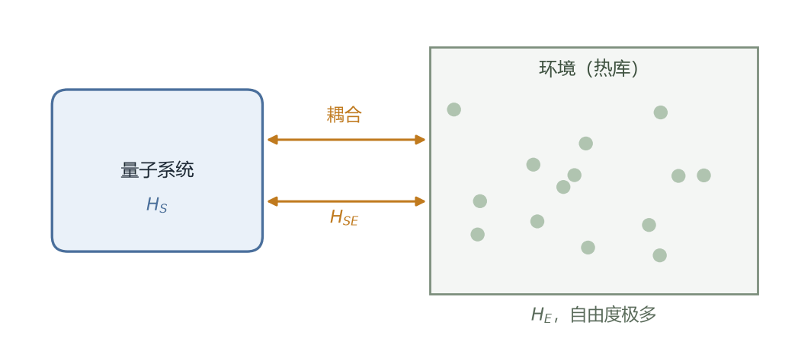
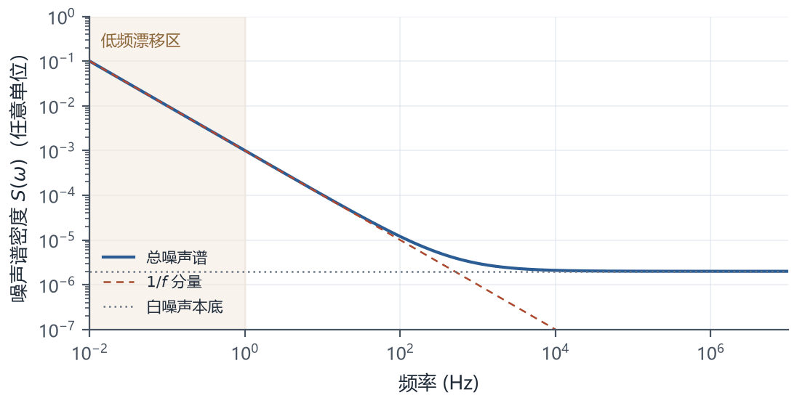

# 第 19 章　开放量子系统

前两篇的讨论里，量子系统都是孤立的。一个比特，一个态，一套幺正演化，算得干干净净。真实世界不是这样。任何量子系统都泡在环境里，空气分子在撞它，光子照它，材料里的缺陷在抖动。这些相互作用把系统的相干性一点点带走。

这一章讲怎么把环境的影响写进方程。

## 19.1 一个系统，一个环境

把整个世界分成两部分，我们关心的系统 $S$，和其余的一切，环境 $E$。

总哈密顿量是三项之和

$$
H = H_S + H_E + H_{SE}
$$

$H_S$ 是系统自身的能量，$H_E$ 是环境的能量，$H_{SE}$ 是两者的耦合。

整个宇宙按薛定谔方程演化，是幺正的，可我们只能观测系统 $S$。对 $E$ 求偏迹，得到系统的约化密度矩阵

$$
\rho_S(t) = \mathrm{Tr}_E\left[|\Psi(t)\rangle\langle\Psi(t)|\right]
$$

这个 $\rho_S$ 一般不再是纯态，它的演化也不再是幺正的。系统看起来“损失”了信息，信息跑到了环境里。

图 19-1　量子系统与环境的耦合，环境自由度极多，任何耦合都会带走系统的部分信息

## 19.2 林德布拉德方程

在几个假设下，约化密度矩阵的演化可以写成一个漂亮的方程

$$
\frac{d\rho}{dt} = -\frac{i}{\hbar}[H,\rho] + \sum_k\left(L_k\rho L_k^\dagger - \frac{1}{2}\left\{L_k^\dagger L_k,\rho\right\}\right)
$$

这个方程叫林德布拉德主方程，也叫 GKSL 方程，1965 年前后由 Gorini、Kossakowski、Sudarshan 和 Lindblad 各自独立得到。

第一项是幺正演化，跟薛定谔方程一样。第二项是耗散项，$L_k$ 叫跳跃算符，描述不同的噪声通道。

跳跃算符的形式决定了噪声的类型。最基本的两个例子是。

振幅阻尼，$L = \sqrt{\gamma}\,\sigma_-$，描述能量从 $|1\rangle$ 泄漏到 $|0\rangle$，对应 $T_1$ 过程。

纯退相位，$L = \sqrt{\gamma_\varphi}\,\sigma_z$，描述相位随机漂移，不改变能级布居，对应 $T_\varphi$ 过程。

这两个通道合起来，就给出了 $T_2$ 与 $T_1$、$T_\varphi$ 的关系

$$
\frac{1}{T_2} = \frac{1}{2T_1} + \frac{1}{T_\varphi}
$$

## 19.3 三个时间尺度

量子比特的性能通常用三个数字概括。

$T_1$ 是能量弛豫时间。它决定比特能保存信息多久。超导比特的 $T_1$ 在几十到几百微秒，最好的样品能到毫秒量级。离子阱的 $T_1$ 可以到秒甚至更长，因为离子的内态跟环境的耦合极弱。

$T_2$ 是相干时间。它决定叠加态能维持多久。超导比特的 $T_2$ 跟 $T_1$ 在同一量级，因为 $T_1$ 过程本身就会破坏相干。

$T_2^*$ 是考虑低频漂移后的相干时间。它通常比 $T_2$ 短，因为实验中的磁场、电场、温度都在缓慢漂移，这些漂移在单次实验里表现为相位的随机偏移。

这三个数字的关系，决定了量子处理器能跑多复杂的算法。一个门要二十纳秒，$T_2$ 是一百微秒，那么相干时间内可以做五千个门。这个数字叫量子体积的物理基础。

## 19.4 噪声谱

同样的 $T_2$，背后的噪声可能完全不同。要区分它们，需要看噪声的频谱。

噪声谱密度 $S(\omega)$ 描述单位带宽内的噪声功率。测量方法是给比特施加一系列脉冲，看相干性怎么衰减，反推出谱的形状。

图 19-2　典型噪声谱的形状，低频段以 $1/f$ 为主，高频段趋于白噪声本底（示意模型）

低频段通常是 $1/f$ 噪声，功率随频率下降。在超导电路里，它主要来自材料表面的两能级缺陷，这些缺陷的翻转速率分布很宽，叠加起来就是 $1/f$ 谱。$1/f$ 噪声造成 $T_2^*$ 的衰减，也造成比特频率的漂移。

高频段趋于平坦，是白噪声，来自热噪声和量子涨落。白噪声造成指数型的退相干，决定了 $T_2$ 的上限。

在比特的工作频率附近，还可能有窄带的噪声峰，来自特定的杂散模式或者电源干扰。这些峰如果正好落在比特频率上，会造成严重的退相干。

## 19.5 马尔可夫近似

林德布拉德方程用了一个关键假设，环境没有记忆。

意思是，环境被系统扰动以后，很快恢复到平衡，不会把之前的信息带回来。这个假设叫马尔可夫近似，它在环境自由度极多、耦合极弱、温度不太低时成立。

如果不满足这个条件，就出现非马尔可夫效应。信息从系统流到环境，过一段时间又流回来，表现为相干性的部分恢复。这种现象在光子晶体、腔电动力学、低温声子环境里都能观察到。

非马尔可夫动力学的研究是当前的热点，因为它涉及量子信息在环境中的存储与回收，对量子存储和量子中继有直接意义。

## 19.6 误差模型

做量子纠错的时候，需要把连续演化的噪声简化成离散的误差模型。

最常用的是三个。

比特翻转，以概率 $p$ 施加一个 $X$ 门。它对应环境的扰动导致 $|0\rangle$ 和 $|1\rangle$ 互换。

相位翻转，以概率 $p$ 施加一个 $Z$ 门。它对应相位的随机跳变。

去极化，以概率 $p$ 施加 $X$、$Y$、$Z$ 中的一个，各三分之一。它是最对称的模型，把态推向完全混合态。

这三个模型都可以从主方程在短时间极限下推出，误差率 $p$ 跟 $T_1$、$T_2$ 和门时间有关。纠错码的设计只要针对这三个模型有效，就能对付一大类真实噪声。

## 19.7 抑制噪声

工程上有几类办法。

材料与工艺。超导比特的 $T_1$ 主要受限于衬底表面的缺陷和界面氧化层。改进薄膜生长、清洗表面、封装屏蔽，都能显著提升 $T_1$。这方面的进步在过去十年里把 $T_1$ 提高了一个数量级。

屏蔽与滤波。宇宙射线、放射性同位素衰变、外部电磁干扰，都会造成突发错误。地下实验室、铅屏蔽、红外滤波，都是常规手段。

动力学解耦。给比特施加一系列快速脉冲，让它在噪声中“翻转”，把低频噪声平均掉。简单的自旋回波能把 $T_2^*$ 延长到 $T_2$，复杂的脉冲序列能把 $T_2$ 再延长几倍。

实时反馈。测量比特的状态，根据结果施加校正。这对测量保真度和反馈延迟都有很高要求，是纠错的基础。

这些手段加在一起，把超导比特的相干时间从 2000 年的纳秒级，推到了今天的百微秒级。这个进步是量子计算从实验室走向工程的前提。
