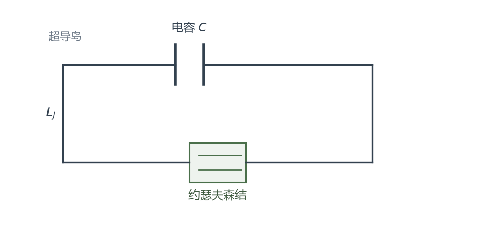
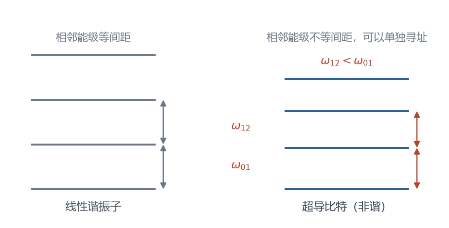

# 第 21 章　超导量子比特

在所有量子计算平台里，超导电路走得最快。它用半导体工艺制造，用微波操控，速度在纳秒量级，可以集成到芯片上。谷歌、IBM、亚马逊的量子处理器，用的都是这条路。

这一章讲它的物理，一个 LC 电路怎么做成量子比特，以及为什么必须用约瑟夫森结。

## 21.1 从 LC 电路说起

一个电感加一个电容，构成 LC 振荡电路。电流在两者之间来回流动，能量在电感和电容之间转换，这跟弹簧振子一模一样。

把电感换成约瑟夫森结，电路就变成非线性。这一点是关键，也是超导量子比特跟其他谐振系统的根本区别。

为什么需要非线性。如果电路是线性的，能级等间距，那么驱动 $|0\rangle\to|1\rangle$ 的脉冲，也会同时驱动 $|1\rangle\to|2\rangle$，因为两个跃迁的频率相同。这样一来，我们没办法把量子比特限制在前两个能级里，它就是一个谐振子，不是一个比特。

有了非线性，能级间距不再相等。$|1\rangle\to|2\rangle$ 的频率比 $|0\rangle\to|1\rangle$ 低一点，差值叫非谐性。只要脉冲的频谱足够窄，就能只驱动第一个跃迁，不碰第二个。这样前两个能级就构成了一个干净的二能级系统。

图 21-1　超导量子比特的基本电路，一个电容与一个约瑟夫森结并联

## 21.2 约瑟夫森结

约瑟夫森结是两块超导体中间夹一层极薄的绝缘层，厚度在纳米量级。

超导电子成对存在，叫库珀对。库珀对可以通过隧穿穿过绝缘层，形成超导电流。这个电流跟两边的相位差有关

$$
I = I_c\sin\varphi
$$

$I_c$ 是临界电流，$\varphi$ 是两侧超导波函数的相位差。

这个关系是非线性的，正是它给了电路非谐性。把约瑟夫森结的能量展开，得到

$$
E(\varphi) = -E_J\cos\varphi \approx -E_J + \frac{E_J}{2}\varphi^2 - \frac{E_J}{24}\varphi^4 + \cdots
$$

二次项给出一个等效电感，四次项就是非谐性的来源。$E_J$ 叫约瑟夫森能量，跟结的临界电流成正比。

布赖恩·约瑟夫森在 1962 年预言了这个效应，当时他22岁，还是个研究生。1973 年他因此获得诺贝尔物理学奖。

## 21.3 库珀对盒与 transmon

最早的超导量子比特是库珀对盒，1999 年由中村泰信和蔡兆申在 NEC 实现。

它把一个超导岛通过约瑟夫森结连接到储库，岛上库珀对的数量是量子化的。调控栅极电压，可以改变岛上能量的分布。当栅极电荷是奇数个电子电荷时，两个相邻的电荷态简并，形成比特。

库珀对盒的问题是，它对电荷噪声极其敏感。一个电子的电荷涨落就能让频率漂移很多，相干时间只有纳秒量级。

2007 年，耶鲁的 Koch 等人提出了 transmon。做法是把 $E_J/E_C$ 的比值大幅提高，从 1 提到 50 以上。这样做的效果是，电荷色散指数衰减，比特频率对栅极电荷几乎不敏感，相干时间从纳秒级跳到微秒级。

代价是非谐性变小，从几百兆赫兹降到两百兆赫兹左右。这个代价可以接受，因为门操作的带宽通常只有几十兆赫兹，两百兆赫兹的非谐性足够区分。

图 21-2　线性谐振子的能级等间距，超导比特的能级间距随能级升高而变小，非谐性让前两个能级可以被单独寻址

transmon 成了主流。现在几乎所有的超导量子处理器，用的都是 transmon 或者它的变体。

## 21.4 参数与性能

一个典型的 transmon 比特，参数大致如下。

频率在 4 到 8 吉赫兹之间，属于微波波段。这个频率范围的选择有讲究，太低会被热噪声激发，太高则微波器件的损耗变大。

非谐性在 200 兆赫兹左右，对应 $E_C$ 约 200 兆赫兹。

$T_1$ 在几十到几百微秒，最好的样品超过 500 微秒。

$T_2$ 跟 $T_1$ 在同一量级，最好的样品接近 $2T_1$，说明退相位已经被压得很低。

单比特门时间在 20 到 50 纳秒，错误率在 $10^{-3}$ 到 $10^{-4}$。

两比特门时间在 100 到 300 纳秒，错误率在 $10^{-3}$ 量级，最好的结果已经进入 $10^{-4}$。

读出时间在几百纳秒，保真度在百分之九十九以上。

这些数字放在一起，能算出相干时间内可以执行的门数，在几千的量级。这个数字决定了能跑多深的线路。

## 21.5 怎么操控

操控靠微波脉冲。

单比特门用共振微波脉冲，频率对准比特的 $|0\rangle\to|1\rangle$ 跃迁。脉冲的相位决定旋转轴，脉冲的面积决定旋转角。要做一个 $\pi/2$ 门，就让脉冲面积等于 $\pi/2$。

脉冲的形状很重要。方波的频谱是 sinc 函数，旁瓣很宽，会激发 $|2\rangle$ 能级，造成泄漏。高斯脉冲的频谱窄，泄漏小，但时间长。现在常用的是 DRAG 脉冲，在高斯包络上加一个导数项，可以同时抑制泄漏和相位误差。

两比特门用频率调制或者磁通调制。以 CZ 门为例，把两个比特的频率临时调到接近，让它们通过耦合器发生相互作用，累积一个条件相位，再调回来。整个过程一百多纳秒，需要精确控制时序和频率轨迹。

读出用色散方法。每个比特耦合一个读出行谐振器，谐振器再耦合到一条公共的传输线。测量时向传输线发送微波，测量反射信号的相位，就能判断比特的状态。多个比特可以共用一条读出线，用频分复用的方式区分。

## 21.6 芯片与布线

一颗超导量子芯片，看起来像一块指甲盖大小的硅片或者蓝宝石片，表面镀着铝或者铌的薄膜，刻着各种谐振器、传输线和控制线。

比特排成二维阵列，相邻比特之间有耦合器。读出谐振器排在阵列的一侧，控制线从芯片边缘引到每个比特。

芯片装在稀释制冷机的最底层，温度约十毫开尔文。上面几层分别是 4K、1K、100mK 的冷板，中间用同轴线连接，线上装着衰减器和滤波器，用来降低热噪声和红外辐射。

从室温到芯片，一条控制线要经过几十级衰减，总衰减在 60 分贝以上。这是为了保证到达芯片的微波信号里，热光子数远小于一。

布线是工程上的大难题。每个比特需要几条控制线，一千个比特就是几千条线，制冷机的空间和冷量都不够。解决办法是频分复用，让一条线控制多个比特，或者在低温端集成多路复用器。这是当前超导量子计算最实际的瓶颈之一。

## 21.7 现状

2020 年代，超导处理器的规模从几十个比特增长到一千多个。

谷歌在 2019 年用 53 个比特的 Sycamore 演示了量子优越性，完成了一个特定采样任务。2023 年，谷歌用 70 个比特演示了表面码纠错，逻辑错误率随码距增加而下降，越过了阈值。

IBM 走模块化路线，用多个小芯片通过耦合器连接，2023 年发布了 1121 个比特的 Condor，同时公布了以纠错为核心的路线图。

中国科学技术大学、浙江大学、清华大学、本源量子等单位也在推进，先后做出了几十到几百比特的处理器。

规模不是唯一的指标。比特多了，串扰、控制精度、读出保真度都会变差。从几百比特到几万比特，需要的不只是堆数量，还需要架构上的改变。

下一章看另外两条路线，离子阱和中性原子。
