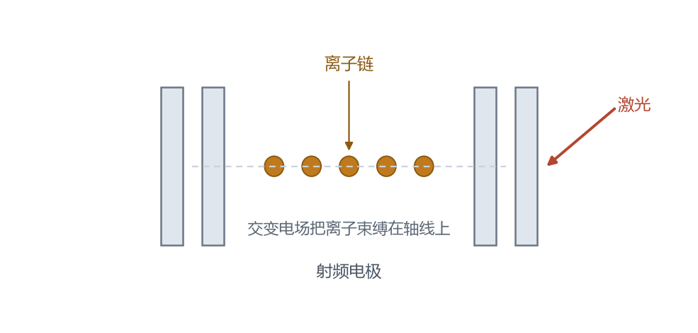
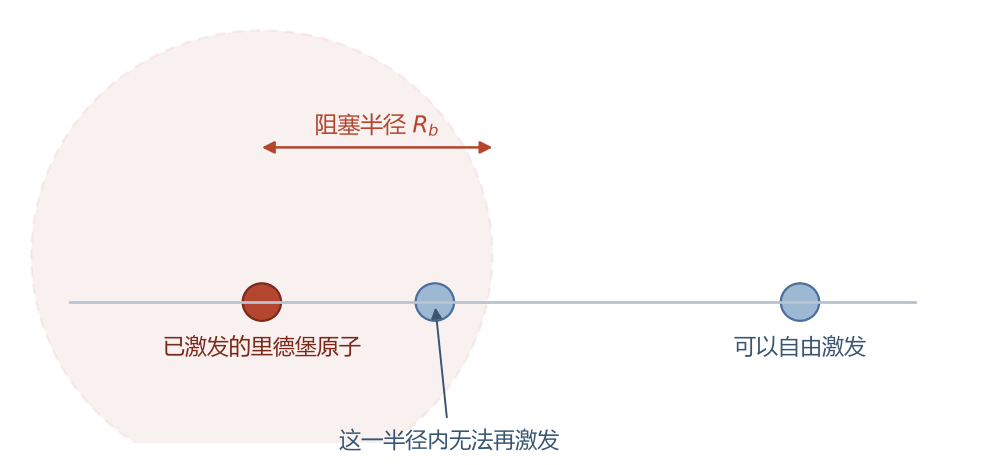

# 第 22 章　离子与原子

超导电路把量子比特刻在芯片上，离子阱和中性原子走的是另一条路，用电磁场把单个原子悬在空中，用激光读写它们的状态。这条路线的保真度更高，速度更慢，规模扩展的方式也完全不同。

## 22.1 把离子悬在空中

离子带电，可以用电场抓住。可静态电场有个问题，叫恩绍定理，它说单靠静电场不可能在三维空间里形成稳定的势阱，总有一个方向会跑掉。

保罗阱的办法是用交变电场。四个电极围成一个鞍形，加上射频电压，电场的方向快速翻转。离子在每个方向上都被交替推拉，净效果是被推回中心。这个机制叫射频束缚，保罗在 1953 年提出，1989 年获得诺贝尔奖。

图 22-1　保罗阱的电极结构与离子链，交变电场把离子束缚在轴线上排成一列

离子被束缚以后，因为库仑排斥，会沿着轴线排成一列，间距几微米。一条链上可以放几十个离子，每个离子就是一个量子比特。

## 22.2 内态与运动

离子的量子比特编码在内部能级上。常用的是基态的两个超精细能级，或者基态和亚稳态之间的光频跃迁。

以镱离子为例，两个超精细能级之间的跃迁频率是 12.6 吉赫兹，用微波操控。以钙离子为例，可以用 729 纳米的激光驱动基态到亚稳态的跃迁，也可以用 397 纳米的激光做冷却和读出。

离子还有运动自由度。在阱里，整条链有若干个集体振动模式，频率在兆赫兹量级。这些模式可以被激光冷却到基态，冷却以后，离子的位置涨落小于一个波长，这时运动和内部态可以纠缠起来，成为两比特门的媒介。

## 22.3 激光门

单比特门用激光或者微波，把两个能级耦合起来，做拉比振荡。激光的相位决定旋转轴，脉冲时长决定旋转角。

两比特门需要一个让两个离子相互作用的中介。最常用的方案是 Mølmer-Sørensen 门，1999 年提出。

原理是这样的。用两束激光同时照射整条离子链，频率分别对称地偏离离子的跃迁，形成双色驱动。这个驱动把离子的内态和集体振动模式耦合起来，经过一段时间演化，振动模式回到初始状态，而两个离子的内态之间累积了一个与初始状态无关的相位，效果等价于一个 XX 门。

这个门的好处是不依赖于振动模式的具体温度，只要求激光的相位稳定。实验上，两比特门的保真度已经做到 99.9% 以上，是所有平台里最高的。

## 22.4 优点与瓶颈

离子阱的优点很突出。

相干时间长，秒级，比超导比特长四个数量级。保真度高，单比特门和两比特门都在 99.9% 以上。全连接，同一条链上的任意两个离子都可以做两比特门，不需要像超导那样受拓扑限制。工作在室温或者液氮温度，不需要稀释制冷机。

瓶颈同样明显。

速度慢。两比特门要几十到几百微秒，比超导慢三个数量级。门速度受限于振动模式的频率和激光的功率。

扩展难。一条链上放几十个离子还行，放到几百个，振动模式变得密集，谱线重叠，门的保真度迅速下降。解决办法是分模块，用光子互联把多个小阱连起来，但这会引入光子损耗和效率问题。

激光系统复杂。每个离子需要多束激光，波长、相位、功率都要稳定。一套几十个离子的系统，光学平台能占满一个房间。

## 22.5 中性原子与光镊

中性原子不带电，不能用电场抓，但可以用光抓。

一束聚焦的激光，在焦点处形成强度梯度，原子会被拉向强度最大的地方。这个力叫偶极力，形成的光阱叫光镊。2000 年代，光镊技术成熟到可以抓住单个原子，2018 年，哈佛的 Lukin 小组做出了由几十个原子组成的一维阵列，随后扩展到二维，规模做到几百个。

原子排成阵列以后，用激光把每个原子激发到里德堡态，就能实现两比特门。

## 22.6 里德堡阻塞

里德堡态是主量子数很大的激发态，$n$ 在 50 到 100 之间。这种态的轨道半径很大，几百纳米，偶极矩极大，两个相邻的里德堡原子之间有很强的范德瓦尔斯相互作用。

相互作用带来一个效应，叫里德堡阻塞。当一个原子被激发到里德堡态，它周围的能级被移动，附近的原子就无法被同一束激光激发。这个“附近”的范围叫阻塞半径，几微米到十几微米。

图 22-2　一个原子被激发到里德堡态后，阻塞半径内的其他原子无法同时被激发

阻塞半径内有且只有一个原子能被激发，这个“要么全不、要么只有一个”的约束，正好是量子逻辑门需要的那种非线性。用两束激光分别寻址两个原子，控制脉冲的时长和相位，就能实现一个 CZ 门或者 CNOT 门。

这种门的保真度现在做到了 99.5% 左右，速度快，在微秒量级。

## 22.7 阵列与模拟

中性原子最大的优势是规模。

光镊阵列可以做到几千个原子，每个原子都是一个量子比特，排成任意的几何形状。原子之间的连接由激光束决定，可以动态重构，不需要固定的拓扑。

这让它特别适合量子模拟。模拟一个二维晶格上的量子磁体，只需要把原子排成同样的晶格，调节相互作用的强度和范围，就能让系统按目标哈密顿量演化。2017 年以来，多个小组用这种方法研究了量子相变、多体局域化、格点规范理论。

通用量子计算方面，中性原子的挑战在读出和单比特寻址。原子在光镊里会随机丢失，需要不断地重新装载；每个原子的读出要单独成像，速度慢；两比特门的保真度还没有达到纠错阈值以上。

## 22.8 三条路线的比较

把超导、离子阱、中性原子放在一起看，各有各的位置。

超导最快，最容易集成，工程化程度最高，适合做通用量子计算，缺点是相干时间短，需要极低温。

离子阱最精确，相干时间最长，适合做量子网络节点、精密测量、小规模的容错演示，缺点是慢，扩展难。

中性原子规模最大，构型最灵活，适合做量子模拟和专用计算，缺点是保真度和读出还在提升。

这三条路线不是互相替代的关系，更像三种工具，适合不同的任务。产业界的选择已经分化，谷歌、IBM 押注超导，IonQ、Quantinuum 押注离子阱，Pasqal、QuEra 押注中性原子，还有 PsiQuantum、Xanadu 押注光子。

还有一条路，用光来做这些事，它跟前面三条都不一样。
