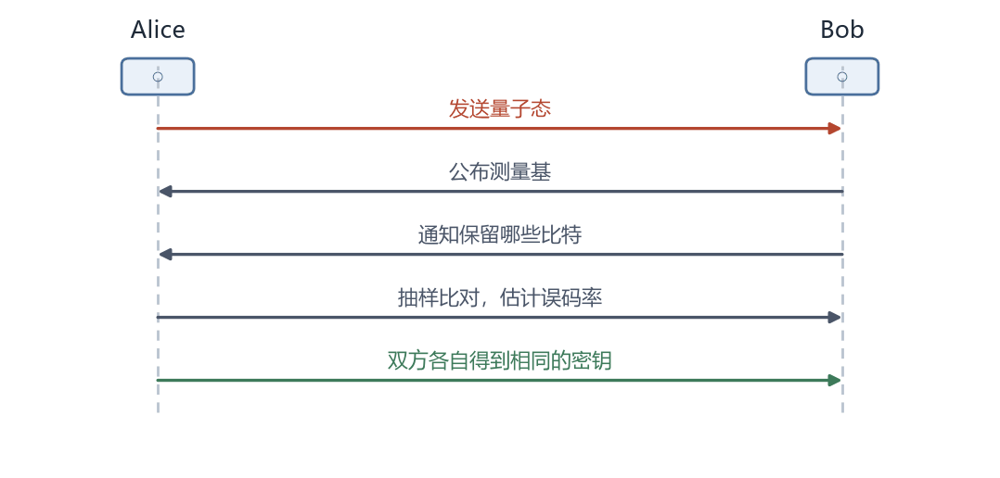
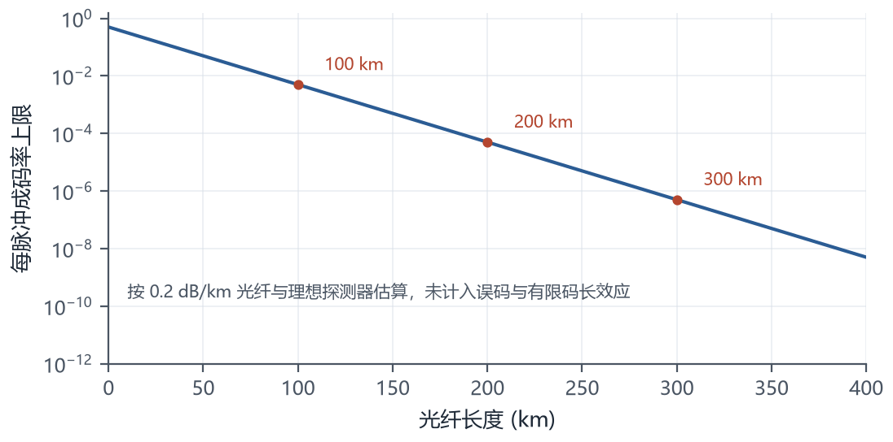

# 第 25 章　通信、测量与产业

量子技术不只有计算。有些方向已经商用，有些方向正在走出实验室，它们对产业的影响可能比通用的量子计算机来得更早。这一章讲三件事，量子通信怎么保证安全，量子测量怎么提高精度，整个行业的格局是什么样。

## 25.1 BB84 协议

量子密钥分发解决的是密钥交换问题。两个人要在一条可能被监听的信道上，商定一串只有他们知道的随机数。

1984 年，Bennett 和 Brassard 提出了第一个方案，后来叫 BB84。

流程分五步。Alice 随机选一串比特，每个比特随机选一个基，用光子发给 Bob。基有两种，圆偏振和线偏振，或者更简单地用 $\{|0\rangle,|1\rangle\}$ 和 $\{|+\rangle,|-\rangle\}$。Bob 收到每个光子，随机选一个基去测，记录结果。

图 25-1　BB84 协议的交互流程，量子态只传输一次，基的比对通过经典信道完成

发完以后，Bob 通过经典信道告诉 Alice 他每个光子用了什么基。Alice 告诉他哪些位置基一致。双方只保留基一致的那些比特，其余丢掉。这个过程叫筛选，筛掉大约一半。

然后双方从剩下的比特里随机抽一部分公开比对，算误码率。如果误码率低于阈值，说明没有窃听，剩下的比特可以做密钥；如果误码率异常高，说明有人在偷听，放弃这次通信。

## 25.2 安全性从哪来

安全性不来自数学难题，来自物理规律。

窃听者 Eve 要获取密钥，必须测量光子。可她不知识别基，只能猜。猜错了基，就会改变光子的状态。Alice 和 Bob 通过误码率能发现这一点。

更严格地说，Eve 的窃听必然引入扰动，这是不可克隆定理和不确定性关系的直接后果。她不能复制光子，因为不可克隆；她不能同时精确测量两个不对易的量，因为不确定性关系。任何试图获取信息的行为都会留下痕迹。

这个性质让量子密钥分发有了“信息论安全”的保证，不依赖于攻击者的计算能力。这是它跟 RSA 之类的根本区别。

## 25.3 从理论到工程

实际系统要处理很多不理想的情况。

光源用的是衰减的激光，算不上理想的单光子源，有时会同时发出两个光子。Eve 可以利用这一点做光子数分离攻击，把多余的光子截获，等基公布后再测量。

解决办法是诱骗态。Alice 随机改变脉冲的强度，在信号态和诱骗态之间切换。Eve 无法区分两者，她的攻击会在不同强度的脉冲上留下不同的统计特征，Bob 通过对比就能发现。这个方法在 2005 年提出，让实际的弱相干光源也能达到接近理想的成码率。

探测器的漏洞更麻烦。雪崩管的死时间、效率不匹配，都可能被 Eve 利用，做成“探测器致盲攻击”。

解决办法是测量设备无关协议。它的思路是把测量交给一个不受信任的第三方，Alice 和 Bob 只发送纠缠光子或者制备态，测量由第三方做。即使第三方被 Eve 控制，只要他不能把两边的信息合起来用，安全性仍然成立。这个协议在 2012 年被演示，把探测器的安全性从信任清单里划掉了。

## 25.4 距离的限制

光子在光纤里会丢，这是量子通信的最大障碍。

标准光纤的损耗是每公里 0.2 分贝。一百公里损耗 20 分贝，只剩百分之一。四百公里损耗 80 分贝，只剩一亿分之一。成码率随距离指数下降。

图 25-2　成码率上限随光纤长度的衰减，按 0.2 分贝每公里和理想探测器估算

两条路可以突破。

一条是可信中继。在中间设节点，密钥一段一段地传，每段都在可信的机房里解密再加密。这个方案已经在骨干网里使用，京沪干线两千公里就是这么做成的。缺点是节点必须可信，安全性打了折扣。

另一条是量子中继。用纠缠交换把多段纠缠连起来，中间不需要解密。原理上可以突破距离限制，工程上极难，需要量子存储器、纠缠纯化、频率转换一整套技术。2020 年代有一批进展，离实用还有距离。

卫星是另一条路。大气层的等效厚度只有几公里，光子穿过大气损耗很小。2016 年，墨子号卫星发射，实现了千公里级的星地量子密钥分发和纠缠分发。这是中国在这个领域最有显示度的成果。

## 25.5 量子精密测量

测量的精度受量子噪声限制，突破这个限制，是另一个重要的应用方向。

最典型的例子是干涉仪。LIGO 用四公里长的臂测量引力波造成的长度变化，变化量是 $10^{-19}$ 米，比质子半径还小三个数量级。这个精度已经接近量子噪声限制，所以 LIGO 用压缩真空注入来降低噪声。

原子钟是另一个例子。铯原子钟的精度决定了秒的定义，现在的光钟精度已经到了 $10^{-18}$ 量级，相当于宇宙年龄内误差不到一秒。这种精度可以测出厘米级的高度差，用于重力测量和大地测量。

原子干涉仪可以测重力、测转动、测磁场。潜艇导航、矿产资源勘探、地震监测，都在用或者试用这类设备。

超导量子干涉仪是灵敏度最高的磁强计，可以测到 $10^{-15}$ 特斯拉的磁场，用于脑磁图、地质勘探、材料表征。

## 25.6 产业的格局

量子技术的产业格局，可以按成熟度分三层。

第一层是已经商用的，量子密钥分发、量子随机数发生器、部分量子传感器。这一层有明确的客户和收入，虽然规模不大。

第二层是正在工程化的，量子计算硬件、量子纠错、量子网络设备。这一层投入巨大，收入很少，靠投资和政府采购支撑。

第三层是研究阶段的，通用容错量子计算、量子中继、量子模拟的产业化。这一层只有论文和原型。

投入的规模很可观。各国的国家量子计划加起来的公共投入在数百亿美元，私人投资在 2021 年的高峰超过二十亿美元一年，之后回落。

技术路线上，超导、离子阱、中性原子、光子四条路线各有代表企业。应用上，药物研发、材料设计、金融优化、密码安全是主要的落地方向。

## 25.7 怎么读新闻

这个领域的新闻，水分很多。有几个判断标准。

看它说的是物理比特还是逻辑比特。物理比特的数量容易堆，逻辑比特才代表可用的算力。

看错误率，不看门数。一个百万门的演示，如果错误率是百分之一，结果没有意义。

看有没有同行评议，有没有独立复现。预印本上的结果，经常在几个月后被修正。

看它解决的是什么问题。很多“量子优势”演示，解决的是人为构造的采样问题，没有实用价值。这不代表工作不重要，它证明的是原理，不是产品。

看它有没有公布完整的数据和代码。可复现性是科学的底线。

最后一条，凡是把量子跟保健、水杯、鞋垫联系起来的，可以直接跳过。
