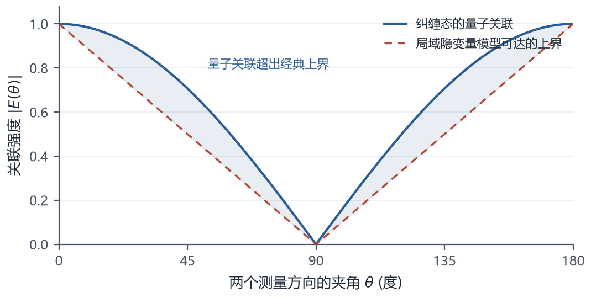
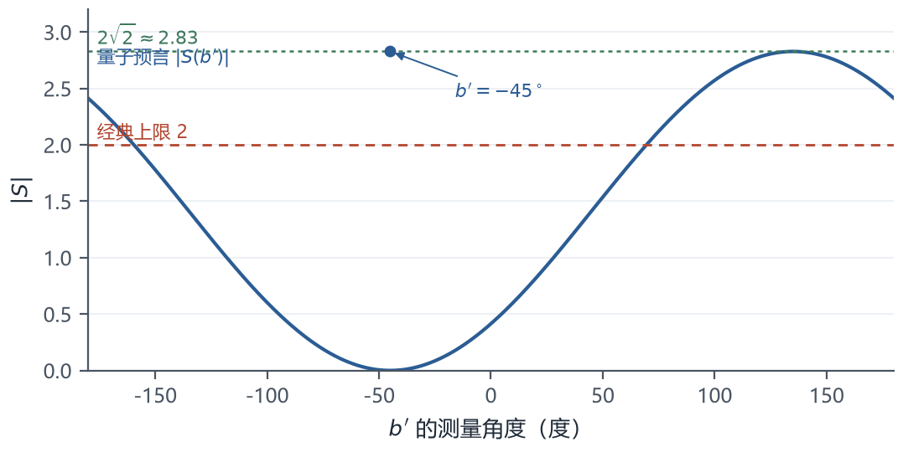

# 第 4 章　纠缠

两个量子比特放在一起，态空间从二维变成四维。这个升级带来的不只是更大的空间，还有一种全新的关联方式。这种关联强到无法用任何“事先约定好”的机制解释，它是量子技术里最核心的资源，也是最难讲清楚的概念。

## 4.1 张量积

两个系统拼在一起，态空间是各自空间的张量积。单比特是二维，两比特就是四维，$n$ 比特是 $2^n$ 维。

计算上用克罗内克积。两个向量

$$
|a\rangle = \begin{pmatrix}a_0\\a_1\end{pmatrix},\qquad |b\rangle = \begin{pmatrix}b_0\\b_1\end{pmatrix}
$$

的张量积是

$$
|a\rangle\otimes|b\rangle = \begin{pmatrix}a_0b_0\\a_0b_1\\a_1b_0\\a_1b_1\end{pmatrix}
$$

基矢写成 $|00\rangle$、$|01\rangle$、$|10\rangle$、$|11\rangle$，第一个数字属于第一个比特，第二个属于第二个比特。

算符也做同样的扩展。作用在第一个比特上的门 $A$，在两比特空间里写成 $A\otimes I$；作用在第二个比特上的门写成 $I\otimes B$。这个规则让“对某一个比特做操作”变得非常清楚。

## 4.2 可分与纠缠

有些两比特态可以写成两个单比特态的乘积

$$
|\psi\rangle = |a\rangle\otimes|b\rangle
$$

这种态叫可分态，也叫直积态。它的性质很朴素，两个比特各自处在确定的状态里，测量一个不影响另一个。如果 $|a\rangle = |0\rangle$，$|b\rangle = |+\rangle$，那么第一个比特测出来一定是 0，第二个比特测出来一半一半，两者互不干扰。

有些态写不成乘积。最典型的是

$$
|\Phi^+\rangle = \frac{1}{\sqrt2}\left(|00\rangle+|11\rangle\right)
$$

这个态不属于任何乘积形式。它有一个奇怪的性质，单独看第一个比特，测到 0 和 1 各一半；单独看第二个比特，也是各一半。可一旦测了第一个，得到 0，第二个立刻也变成 0；得到 1，第二个立刻变成 1。两个比特的结果完全关联，尽管每个单独看都是随机的。

这种关联不是“事先约好”的那种。事先约好的情况是，两个比特在产生的时候各自带了一个隐藏的标签，比如都是“红”或者都是“蓝”，测量只是把标签读出来。贝尔不等式就是用来区分这两种情况的，下面会讲。

## 4.3 四个贝尔态

两比特空间里有一组正交完备的纠缠基，叫贝尔态

$$
|\Phi^\pm\rangle = \frac{1}{\sqrt2}(|00\rangle\pm|11\rangle),\qquad
|\Psi^\pm\rangle = \frac{1}{\sqrt2}(|01\rangle\pm|10\rangle)
$$

它们可以用一个 Hadamard 门加一个 CNOT 门从 $|00\rangle$ 造出来，这是量子线路里最基础的操作之一。

图 4-1　纠缠态的关联强度与局域隐变量模型可达上界的比较，两者在大部分角度上不重合

四个态都是最大纠缠态，任意一个都可以通过局域操作变成另一个。它们在量子隐形传态、量子密钥分发、纠错码里反复出现。

## 4.4 EPR 佯谬

1935 年，爱因斯坦、波多尔斯基和罗森写了一篇短文，提出一个论证，试图说明量子力学不完备。

他们的推理是这样的。制备一对处于 $|\Psi^-\rangle$ 的粒子，让它们飞到相距很远的两地。测量 A 粒子的位置，就能推断出 B 粒子的位置；测量 A 粒子的动量，就能推断出 B 粒子的动量。由于两个粒子相距很远，对 A 的测量不可能影响 B。那么 B 粒子的位置和动量在测量之前就应该都是确定的，否则“推断”就无从谈起。

可量子力学说，一个粒子不可能同时有确定的位置和动量。EPR 由此得出结论，量子力学对物理实在的描述不完备，一定存在更深一层的理论，用隐藏变量补上缺失的信息。

这个论证的逻辑很严密，前提也很自然。它把问题从“量子力学奇不奇怪”变成了“量子力学完不完备”，逼着后人去找实验上的判决。

## 4.5 贝尔不等式

1964 年，贝尔想出了一个办法，把 EPR 的争论变成可以测量的不等式。

设想两个粒子各自被测量一个二值量，测量方向可以选。A 端选方向 $a$ 或 $a'$，B 端选 $b$ 或 $b'$。定义关联函数 $E(a,b)$ 为两端结果乘积的平均值，取值在 $-1$ 到 $1$ 之间。

如果存在局域隐变量，也就是说每个粒子在离开源的时候就带好了所有方向的“预设答案”，那么可以证明

$$
|E(a,b)-E(a,b')+E(a',b)+E(a',b')| \leq 2
$$

这个不等式对任何局域隐变量理论都成立，跟具体的模型无关。

量子力学给出的值不一样。对 $|\Phi^+\rangle$ 这样的最大纠缠态，关联函数是

$$
E(a,b) = -\cos(a-b)
$$

选 $a = 0$，$a' = 90^\circ$，$b = 45^\circ$，$b' = -45^\circ$，代进去得到

$$
|S| = 2\sqrt2 \approx 2.83
$$

这个值超过了 2。

图 4-2　固定三个角度、扫描第四个角度时，CHSH 组合量的量子预言，峰值达到 $2\sqrt2$

于是判决变得很清楚。做实验，测出 $|S|$ 的值。如果不超过 2，爱因斯坦对了；如果超过 2，局域隐变量理论错了。

## 4.6 从思想实验到精密测量

从 1970 年代开始，一系列实验做出来了。

早期的实验用原子级联辐射产生的偏振纠缠光子，用偏振片做测量。结果超出 2，但实验有漏洞，探测效率不够高，可能漏掉了一些事件；两个粒子之间的距离不够远，不能用“局域性”的假设。

此后五十年，实验物理学家一直在堵漏洞。2015 年，三个小组几乎同时发表了无漏洞的贝尔实验，用不同的物理系统，同时堵住了探测效率漏洞和 locality 漏洞。其中一个小组用的是金刚石里的氮空位色心，两个节点相距一公里以上；另一个用的是超导电路，效率极高；还有一个用的是铌酸锂调制器做快速随机切换。

2017 年，中国的墨子号卫星把贝尔实验做到了千公里尺度，用的是自由空间的光子。

所有实验的结果都一致，$|S|$ 超过 2，与量子力学的预言吻合，误差在统计范围内。局域隐变量理论被实验排除，这不是哲学争论，是测量结果。

## 4.7 纠缠不能超光速

贝尔实验的结果让很多人第一反应是，能不能用它来做超光速通信。两端各拿一个粒子，一边测量，另一边的结果立刻“确定”，这不是可以传信息吗。

不行。

原因在于，单看任何一端的结果，都是随机的，跟对方做了什么完全无关。A 端测出来的序列是一串 0 和 1 的随机串，B 端也是。把两串放在一起对比，才能看出关联，可对比需要把两边的数据传到一起，这个传递不能超过光速。

所以纠缠不能用来发送信号。这一点被形式化为无信号定理，它是量子信息理论的基石之一。任何试图用纠缠超光速通信的方案，都会在细节上失败。

纠缠提供的是一种“预先建立的关联”，它可以用来做密钥分发，因为窃听会破坏关联；可以用来做隐形传态，但传态需要先发送两个经典比特；可以用来做密集编码，把两个经典比特编码到一个量子比特里，但解码仍需要经典通信。

## 4.8 纠缠是一种资源

在量子信息里，纠缠被当成一种可以量化、可以分配、可以消耗的资源。

量化用熵。对一个两体纯态，把其中一个子系统约化掉，得到另一个子系统的密度矩阵，它的冯·诺依曼熵就是纠缠熵。贝尔态的纠缠熵是 1 比特，可分态是 0。

消耗的例子很多。量子隐形传态消耗一个贝尔态，传过去一个量子比特。密集编码消耗一个贝尔态，传过去两个经典比特。量子密钥分发里，纠缠被用来检测窃听。

分配是工程上的难点。纠缠在光纤里传输会退化，距离越远越差。量子中继的想法是分段建立纠缠，再用纠缠交换把它们连起来。这个方向在 2020 年代有了实质进展，但离实用还有距离。

下一章处理一个更现实的问题，真实系统从来不是完美孤立的，噪声会让纯态变成混合态，这时需要一个新的描述工具。
