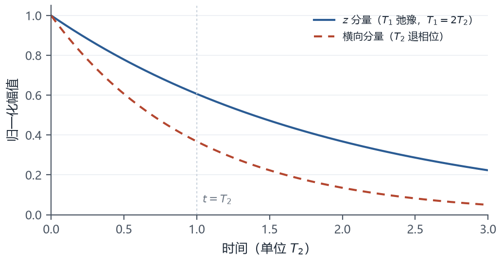
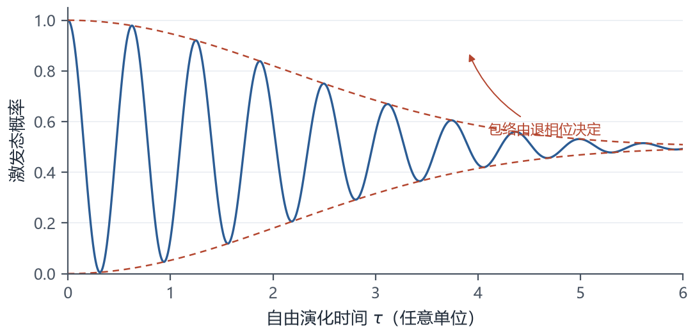

# 第 5 章　密度矩阵与噪声

前面的章节默认系统处在纯态，一个已知的波函数，或者一个精确的态矢量。这个默认在真实世界里站不住脚。一个量子比特总在跟环境打交道，它的状态会变得不确定，衰减，混乱。描述这种状态需要一个新的工具。

## 5.1 为什么态矢量不够用

想象一个场景。有人制备了一个量子比特，但没有告诉你制备的过程。他可能以一半的概率制备了 $|0\rangle$，也可能以一半的概率制备了 $|+\rangle$。你手上这个比特，处在什么状态。

用态矢量写不出来。它不是 $|0\rangle$，也不是 $|+\rangle$，也不是两者的叠加。它是一个经典的概率混合，一半概率是这个态，一半是那个态。这种状态叫混合态。

另一种情况更常见。系统本来处在纯态，与环境的相互作用把信息泄漏出去，系统自身就变成了混合态。这个过程是连续的，系统从纯态慢慢变成混合态，退相干就是这个过程的名字。

描述混合态的工具是密度矩阵。

## 5.2 定义与性质

一个系统以概率 $p_i$ 处在纯态 $|\psi_i\rangle$，它的密度矩阵定义为

$$
\rho = \sum_i p_i|\psi_i\rangle\langle\psi_i|
$$

其中 $\sum_i p_i = 1$。如果只有一个态，概率为 1，$\rho = |\psi\rangle\langle\psi|$，这时叫纯态。

密度矩阵有几条基本性质。

它的迹等于一，$\mathrm{Tr}\rho = 1$，这对应概率归一化。

它是厄米的，$\rho^\dagger = \rho$，这保证它的本征值是实数。

它的本征值非负，因为它们是概率。

纯态满足 $\mathrm{Tr}\rho^2 = 1$，混合态满足 $\mathrm{Tr}\rho^2 < 1$。这个量叫纯度，衡量状态有多“纯”。

对单比特，密度矩阵可以写成

$$
\rho = \frac{1}{2}\left(I + \vec{r}\cdot\vec{\sigma}\right)
$$

$\vec{r}$ 是布洛赫矢量，$|\vec{r}| \leq 1$。纯态在球面上，$|\vec{r}| = 1$；混合态在球内，$|\vec{r}| < 1$；完全混合态在球心，$\vec{r} = 0$，对应 $\rho = I/2$，两个结果各一半，没有任何偏向。

## 5.3 约化密度矩阵

密度矩阵最实用的地方，是处理复合系统的一部分。

有一个两比特的纯态 $|\psi\rangle_{AB}$，只看 A 比特，它的状态是什么。办法是对 B 求偏迹

$$
\rho_A = \mathrm{Tr}_B\,|\psi\rangle\langle\psi|
$$

这个操作把 B 的自由度平均掉，留下 A 的密度矩阵。

以贝尔态 $|\Phi^+\rangle$ 为例。整个系统是纯态，可对 B 求偏迹，得到

$$
\rho_A = \frac{1}{2}\left(|0\rangle\langle0| + |1\rangle\langle1|\right) = \frac{I}{2}
$$

A 自己处在完全混合态。这个结果很有意思，整体的状态是确定的，可任何一个局部看都是完全随机的。纠缠的“信息”不在任何一边，它在两边的关联里。

## 5.4 T1 与 T2

真实量子比特的两个主要参数是 $T_1$ 和 $T_2$。

$T_1$ 叫能量弛豫时间。系统从激发态 $|1\rangle$ 掉回基态 $|0\rangle$，把能量交给环境，这个过程是指数衰减的，时间常数就是 $T_1$。超导量子比特的 $T_1$ 在几十到几百微秒，离子阱可以到秒级。

$T_2$ 叫退相位时间。系统处在 $|0\rangle$ 和 $|1\rangle$ 的叠加，两者的相位差会随机漂移，叠加态逐渐变成混合态。这个过程的时间常数是 $T_2$。

两者的关系是

$$
\frac{1}{T_2} = \frac{1}{2T_1} + \frac{1}{T_\varphi}
$$

其中 $T_\varphi$ 是纯粹的退相位时间。能量弛豫本身会破坏相位，因为它让叠加的两个分量以不同速率衰减；除此之外，还有纯粹由环境噪声引起的相位漂移。如果 $T_2 = 2T_1$，说明只有能量弛豫，没有额外的退相位。

图 5-1　纵向分量按 $T_1$ 衰减，横向分量按 $T_2$ 衰减，图中取 $T_1 = 2T_2$

$T_1$ 和 $T_2$ 决定了量子比特能算多久。一个门操作要几十纳秒，$T_2$ 是一百微秒，那么相干时间内可以做几千个门。这个比例叫相干时间与门时间的比，是评估量子处理器的重要指标。

## 5.5 拉姆齐条纹

测量 $T_2$ 的标准方法是拉姆齐干涉。

先给一个 $\pi/2$ 脉冲，把 $|0\rangle$ 变成 $|+\rangle$。然后让系统自由演化一段时间 $\tau$，相位按 $\omega\tau$ 累积。再给一个 $\pi/2$ 脉冲，把相位差变成布居数差。最后测量 $|1\rangle$ 的概率。

结果是一条振荡曲线

$$
P_1 = \frac{1}{2}\left[1 + e^{-\tau/T_2}\cos(\Delta\omega\,\tau)\right]
$$

振荡的频率给出失谐，包络的衰减给出 $T_2$。

图 5-2　拉姆齐条纹。振荡的周期由失谐决定，包络的衰减由退相位决定

如果噪声是高斯型的，包络变成高斯形，不再是指数，时间常数记作 $T_2^*$。$T_2^*$ 通常比 $T_2$ 短，因为它包含了低频漂移的贡献。用自旋回波或者动态解耦脉冲序列，可以把低频噪声抵消掉，测到更长的 $T_2$。

## 5.6 退相干怎么抹掉干涉

回到双缝实验。如果环境记录了电子走哪条缝，干涉就消失。用密度矩阵的语言，这个过程很清楚。

初始态是

$$
|\psi\rangle = \frac{1}{\sqrt2}\left(|L\rangle+|R\rangle\right)
$$

密度矩阵是

$$
\rho = \frac{1}{2}\begin{pmatrix}1&1\\1&1\end{pmatrix}
$$

非对角元是干涉项的来源。环境与系统纠缠后，非对角元被乘上一个衰减因子

$$
\rho = \frac{1}{2}\begin{pmatrix}1&e^{-\gamma t}\\e^{-\gamma t}&1\end{pmatrix}
$$

$\gamma$ 是退相干速率。非对角元趋近于零时，矩阵变成对角

$$
\rho = \frac{1}{2}\begin{pmatrix}1&0\\0&1\end{pmatrix}
$$

这就是完全混合态，干涉项没有了，屏幕上只剩两条亮带的和。

这个过程不需要坍缩假设，它只是系统与环境纠缠以后，对系统求偏迹的自然结果。信息没有消失，它跑到了环境里，只是我们没法把它取回来。

## 5.7 噪声的谱

不同的噪声对量子比特的影响不一样，可以用噪声谱密度 $S(\omega)$ 来描述。

白噪声在所有频率上功率相同，它造成指数衰减的退相干。低频噪声功率随频率下降，叫 $1/f$ 噪声，它造成高斯型的包络，也造成参数漂移。在超导量子比特里，$1/f$ 噪声主要来自材料里的两能级缺陷，是 $T_2^*$ 的主要限制。

对噪声谱的了解直接决定了纠错的策略。如果噪声是白噪声，简单的重复码就能起作用；如果噪声有强的时间相关性，需要用动态解耦把噪声平均掉；如果噪声是突发的，需要设计针对性的编码。

## 5.8 从噪声到错误率

工程上更关心的量是错误率。

单比特门的错误率，现在的水平在 $10^{-3}$ 到 $10^{-4}$ 之间，最好的实验结果已经进入 $10^{-4}$ 以下。两比特门差一些，在 $10^{-3}$ 量级。读出错误率在百分之一左右。

这些数字决定了量子纠错能不能工作。表面码的阈值大约在百分之一，意思是，只要物理错误率低于这个值，增加编码的规模就能把逻辑错误率指数压低。现在的实验已经越过了这个门槛，2023 年以来，几个小组演示了逻辑比特比物理比特更可靠的结果。

把这些抽象的东西拼成可以运行的电路，靠的是量子门和量子线路。
