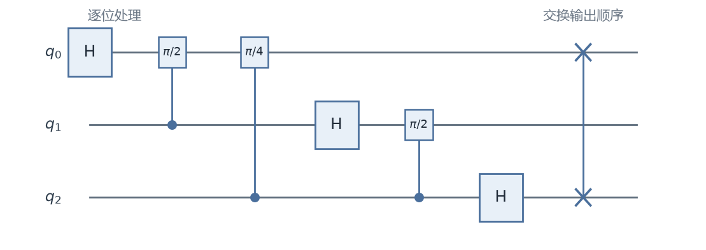
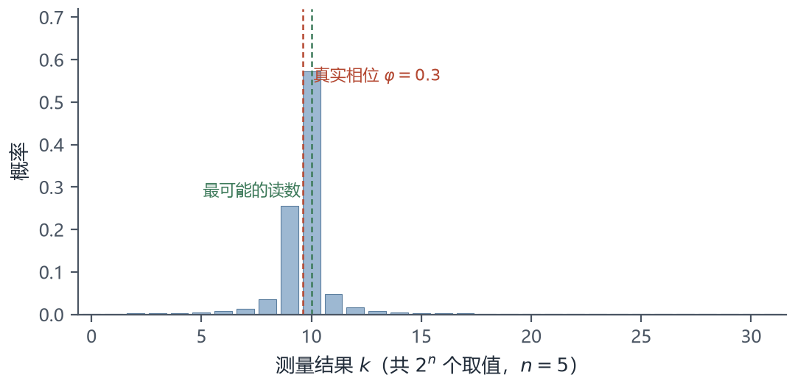

# 第 8 章　傅里叶变换与因式分解

在经典计算里，快速傅里叶变换是最重要的算法之一，信号处理、图像压缩、求解微分方程，都靠它。量子计算里有一个对应物，叫量子傅里叶变换，它在 Shor 因式分解算法里扮演核心角色。

这一章讲三件事，量子傅里叶变换怎么做，相位估计怎么用它，因式分解怎么变成周期寻找。

## 8.1 离散傅里叶变换

对长度为 $N = 2^n$ 的序列 $x_j$，离散傅里叶变换定义为

$$
y_k = \frac{1}{\sqrt{N}}\sum_{j=0}^{N-1}x_j\,e^{2\pi ijk/N}
$$

经典快速傅里叶变换的复杂度是 $O(N\log N)$。当 $N = 2^n$ 时，这是 $n2^n$，随比特数指数增长。

量子傅里叶变换作用在 $n$ 个比特的态上，把基矢 $|j\rangle$ 映射成

$$
|j\rangle \to \frac{1}{\sqrt{N}}\sum_{k=0}^{N-1}e^{2\pi ijk/N}|k\rangle
$$

对叠加态，它同时作用在所有分量上。复杂度是 $O(n^2)$ 个门，随比特数只有多项式增长。

这个加速看起来违背直觉。要知道，输出的 $2^n$ 个幅值如果真要写出来，需要指数时间。可量子傅里叶变换并不输出这些幅值，它把结果留在量子态里，后续的操作只能从这个态里提取有限的信息。这个限制在相位估计和 Shor 算法里被巧妙地绕开了。

## 8.2 线路实现

量子傅里叶变换的线路很整齐，是分治结构的典型。

对 $n$ 个比特，从最低位开始，依次做 Hadamard 门和受控相位门。

第一个比特做 $H$，然后接受来自后面每个比特的受控相位，角度依次是 $\pi/2$、$\pi/4$、……、$\pi/2^{n-1}$。

第二个比特做 $H$，接受来自它后面比特的受控相位，角度从 $\pi/2$ 开始。

依次类推，最后一个比特只做 $H$。最后把比特顺序颠倒，用 SWAP 交换。

图 8-1　三比特量子傅里叶变换的线路，每个比特依次经过 Hadamard 门和受控相位门，最后交换顺序

门的数目是 $n(n+1)/2$，随 $n$ 平方增长。这个线路的关键是受控相位门，它的角度决定了精度，角度越小，需要的相位分辨率越高。

在超导硬件上，小角度的受控相位门比较难做，误差也大，所以实际实现时会把 QFT 拆成更基础的门，或者改用不需要 QFT 的算法变体。

## 8.3 相位估计

相位估计是量子计算里最常用的子程序。

问题是这样的。有一个酉算符 $U$，一个本征态 $|u\rangle$，满足

$$
U|u\rangle = e^{2\pi i\varphi}|u\rangle
$$

已知 $U$ 和 $|u\rangle$，求相位 $\varphi$，精度到 $n$ 个比特。

做法如下。准备 $n$ 个辅助比特，全部制备成 $|0\rangle$，做 Hadamard 变成均匀叠加。然后用受控 $U^{2^j}$ 把相位信息搬到辅助比特上

$$
|0\rangle|u\rangle \to \frac{1}{\sqrt{2^n}}\sum_{j=0}^{2^n-1}e^{2\pi i j\varphi}|j\rangle|u\rangle
$$

这个态的形式跟量子傅里叶变换的输出很像。对它做逆傅里叶变换，相位信息就集中到一个基矢上，测量就能读出来。

图 8-2　五比特相位估计的读数分布，真实相位 $\varphi = 0.3$，最可能的读数落在最近的格点上

读数的精度是 $1/2^n$。要更高精度，加更多辅助比特。这个子程序在量子化学、量子模拟、Shor 算法里都要用。

## 8.4 周期寻找

Shor 算法的核心是把因式分解转化成周期寻找。

给定一个合数 $N$，要找一个因子。选一个随机数 $a$，跟 $N$ 互质。考虑函数

$$
f(x) = a^x \bmod N
$$

这个函数是周期的，周期 $r$ 是最小的正整数，使得 $a^r \equiv 1 \pmod N$。如果能找到 $r$，就可以用最大公约数算出因子

$$
\gcd(a^{r/2}-1, N),\qquad \gcd(a^{r/2}+1, N)
$$

如果 $r$ 是偶数，且 $a^{r/2} \not\equiv -1 \pmod N$，这两个最大公约数中就有一个是非平凡因子。

问题变成，怎么找 $r$。经典算法要试 $r = 1, 2, 3, \dots$，最坏情况是指数时间。量子算法用相位估计，一次就能求出 $r$。

## 8.5 Shor 算法的流程

完整流程分五步。

第一步，选随机数 $a$，检查它与 $N$ 互质，用欧几里得算法，这一步是经典的。

第二步，准备两个寄存器，第一个放 $x$ 的叠加，第二个放 $f(x)$。用模幂运算的量子线路实现，这一步需要 $O(n^3)$ 个门。

第三步，测量第二个寄存器，得到一个值 $f(x_0)$。由于函数是周期的，第一个寄存器塌缩成

$$
\sum_{k}|x_0 + kr\rangle
$$

这是一个周期为 $r$ 的梳状叠加。

第四步，对第一个寄存器做量子傅里叶变换。梳状叠加变换后，只剩下 $r$ 的整数倍的频率分量，测量得到 $s/r$ 的近似值，$s$ 是随机整数。

第五步，用连分数展开从 $s/r$ 的近似值恢复出 $r$。多试几次，取最小公倍数，就得到 $r$。

有了 $r$，代回前面的公式，算出因子。

整个算法的复杂度是 $O(n^3)$ 个门，多项式时间。对 2048 位的 RSA 密钥，需要的逻辑量子比特数在几千到几万之间，取决于具体的线路优化和纠错方案。

## 8.6 对密码学的冲击

这个结果在 1994 年发表时，震动了整个密码学界。

RSA 的安全性建立在“大数分解很难”这个假设上。经典计算机分解一个 2048 位的数，需要的时间远超宇宙年龄。量子计算机用 Shor 算法，几小时到几天就能完成，取决于硬件规模。

椭圆曲线密码、Diffie-Hellman 密钥交换，同样依赖离散对数问题，同样被 Shor 算法攻破。

对称密码受的影响小一些。AES 不受 Shor 影响，只受 Grover 影响，等效安全强度减半。哈希函数也一样。

应对的办法已经出来了，叫后量子密码。它的安全性建立在格问题、编码问题、多变量方程这些量子算法也没有高效解的问题上。2024 年，美国国家标准与技术研究院发布了第一批后量子密码标准，包括基于格的密钥封装和签名方案。

## 8.7 现实的距离

从 1994 年到现在，Shor 算法在真实硬件上还只分解过很小的数。

2001 年，IBM 用核磁共振量子计算机分解了 15，用了 7 个量子比特。2012 年，有人用光子量子计算机分解了 21。2020 年代，一些演示分解了几十位的数，但用的是混合算法，量子部分只负责一小段。

要分解 2048 位的 RSA 密钥，需要几百万个物理量子比特，因为每个逻辑比特要用上千个物理比特做纠错。现在的硬件有几百到一千多个物理比特，差距在两三个数量级。

这个差距不是不可逾越的。纠错码的效率在提升，硬件的错误率在下降，模块化的架构在探索。但要说清楚什么时候能造出来，没人敢给准确的时间表。

对学习者来说，Shor 算法的价值不在于它马上能破解什么，而在于它展示了一件事，量子计算机确实能在某些问题上改变复杂度的量级。这件事已经足够支撑一个产业投入几千亿美元去研发。

算法讲到这里。可算法再漂亮，结果最后都要靠测量拿出来。下一章从测量讲起，看看怎么把一台设备的真实状态和真实性能测出来。
