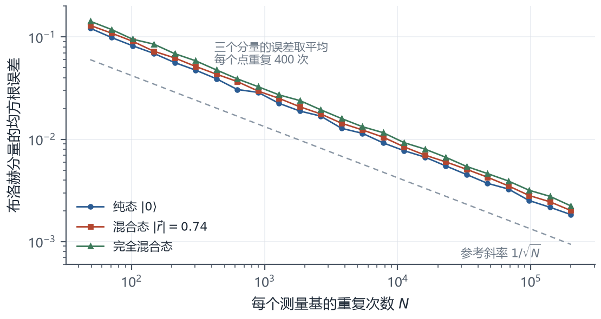
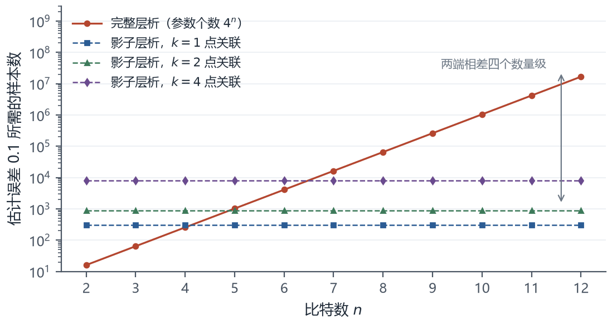

# 第 9 章　量子测量与态层析

前面几章讲算法怎么设计，把初态变成末态，干涉、相位、纠缠讲得很细。可真正动手的时候，能拿到手的只有测量结果。量子计算机跑完线路，做的是把每个比特投影到 $|0\rangle$ 或 $|1\rangle$，读出零和一。这个动作决定了量子计算最终能提取多少信息。

测量还有另一个用法，反过来用。手上有一台机器，它制备的态什么样，它执行的门有没有做对，只能靠测量回答。这类问题叫层析，意思是像切片一样把对象一层层看清楚。这一章先讲测量的几种形式，再讲怎么用一堆结果反推一个态、一个门、一台机器。

## 9.1 投影测量与换基

第 2 章讲过测量的公设，这里写成算符形式，方便推广。

一个可观测量对应厄米算符 $M$，按本征值分解成

$$
M = \sum_m m\, P_m
$$

$P_m$ 是本征值 $m$ 对应的投影算符。对状态 $\rho$ 测量 $M$，得到结果 $m$ 的概率是 $p(m) = \mathrm{Tr}(P_m\rho)$。测到之后状态变成

$$
\rho' = \frac{P_m \rho P_m}{p(m)}
$$

第一个式子给统计规律，第二个式子说测量动了手。一个本来处在叠加态的比特，测一次 $Z$ 就落到某个本征态上，叠加没了。

对单比特，$Z$ 测量的两个投影是 $|0\rangle\langle0|$ 和 $|1\rangle\langle1|$，概率是

$$
p(0) = \frac{1+z}{2},\qquad p(1) = \frac{1-z}{2}
$$

$z$ 是布洛赫矢量的第三个分量。一次测量只给一个比特的信息，而且带噪声。想估 $z$，得把同一个态制备很多次，用频率代替概率，测一千次的统计误差约三十分之一。

硬件通常只会做一件事，把比特投影到 $|0\rangle$ 和 $|1\rangle$ 上。要测 $X$ 或者 $Y$，就在测量之前加一个门，把要测的方向转到 $z$ 轴上。设可观测量 $O$ 的本征基是 $\{|u_i\rangle\}$，找一个幺正操作满足 $U|u_i\rangle = |i\rangle$，那么先做 $U$ 再测 $Z$，结果分布跟直接测 $O$ 一样。测 $X$ 用哈达玛门，因为 $H|+\rangle = |0\rangle$。测 $Y$ 用一个 $S^\dagger$ 接一个 $H$，因为 $S^\dagger|{+}i\rangle = |+\rangle$。

在真实设备上，换基门有误差，读出也有串扰。测一个量从来不是"读一下"，而是小线路加大量重复。

## 9.2 POVM 把测量放宽

投影测量有硬限制，只有 $d$ 个结果，$d$ 是空间维数。实验里常常需要更多结果，或者需要容忍不完美的探测。这时用 POVM，正算子值测度。

一组算符 $\{E_i\}$ 满足半正定、求和等于单位算符

$$
E_i \geq 0,\qquad \sum_i E_i = I
$$

测到第 $i$ 个结果的概率是 $p(i) = \mathrm{Tr}(E_i\rho)$。这里没有给测量后的状态，因为很多 POVM 把原系统和辅助系统一起卷进去，塌缩后的原状态没有意义。

投影是 POVM 的特例，取 $E_i = P_i$。POVM 能做投影做不到的事。

最实用的一类是探测器效率有限。一个单光子探测器，光子到了有 $\eta$ 的概率被记录，也可能什么都没记到。这用三个算符描述

$$
E_0 = \eta|0\rangle\langle0|,\qquad E_1 = \eta|1\rangle\langle1|,\qquad E_{?} = (1-\eta)I
$$

第三个结果代表"没探到"，它对任何态都给同一个概率。用真实探测器做的实验，数据里都有这一部分。

另一类用处是无歧义区分。三个对称分布在赤道上的态，靠一次投影测量没法做到既不出错又不含糊，用 POVM 加一个辅助维度能让错误率为零，代价是有一定概率回答"说不清"，成功率上限是 $1/2$。

任何 POVM 都能实现成"加辅助系统，做幺正演化，再对整体投影"，这叫 Neumark 扩张。所以 POVM 没有超出量子力学框架，只是把"一组正交投影"放宽成"一组半正定算符"，让描述贴近实验。

## 9.3 一个比特需要三个数

有人递给你一个量子比特，不说它是怎么制备的，能不能把状态测出来。

单比特的状态由密度矩阵决定

$$
\rho = \frac{1}{2}\left(I + xX + yY + zZ\right)
$$

三个实数就是布洛赫矢量的分量。分别在 $X$、$Y$、$Z$ 三个基下测量，每个基测 $N$ 次，用频率差估期望值

$$
\hat{x} = \frac{N_+ - N_-}{N}
$$

测出三个数，态就完全知道了。这就是单比特态层析，能换基、能重复就够。

代价在统计上。每个分量的误差约 $1/\sqrt{N}$，想降到百分之一，$N$ 要一万，三个基三万次测量，按每次二十微秒算不到一秒。可要是每天监测上百个比特的漂移，开销就上来了。

图 9-1　布洛赫分量的均方根误差随测量次数的变化。三种状态的曲线几乎重合，说明精度主要由重复次数决定。按每个分量的估计方差 $(1-\langle P\rangle^2)/N$ 抽样计算，每个点重复 400 次

图 9-1 里三条曲线贴得很近。精度几乎跟被测的态无关，只跟你愿意花多少时间有关。纯态并不比混合态好测，这跟直觉相反。

还有一个技术麻烦。用上面的公式直接算出来的 $\hat\rho$，本征值可能是负的。测量次数少时尤其常见，三个分量的估计各带噪声，合成出来的矢量长度超过一，跑到布洛赫球外面。工程上的做法是用最大似然估计，在所有合法状态里找最可能产生这组数据的那个，输出天然落在球内，代价是要解一个优化问题，次数很少时还会带来不可忽略的偏差。

## 9.4 两个比特需要十五个数

两个比特的密度矩阵是 $4\times4$ 的，厄米、迹为一，独立实参数有 $4^2-1=15$ 个。要定出这十五个数，得测九个量，从 $XX$ 一直到 $ZZ$。每一个都是联合测量，在两个比特上各做一次换基后同时读出。

九个基，每个测两万次，一共十八万次，按二十微秒一次算不到四秒。实际要慢得多，换基要改线路、重新校准、等热漂移稳定，做完一个两比特态的层析通常得几分钟。

十五个数里只有一部分是局域信息，三个描述第一个比特，三个描述第二个，剩下九个描述关联。态如果可分，这九个能由前六个推出来；如果纠缠，它们就带上独立的信息，层析因此常被用来判定纠缠。不过判定纠缠不必用完整密度矩阵，做实验的人更关心少数几个量，比如贝尔不等式里的关联函数，每个只要一两个测量基。

## 9.5 保真度用一个数概括

十五个数不好逐个比较，最常用的概括方式是保真度

$$
F(\rho,\sigma) = \left(\mathrm{Tr}\sqrt{\sqrt{\rho}\,\sigma\sqrt{\rho}}\right)^2
$$

定义看着吓人，实用时往往退化成一个简单式子。其中一个态是纯态时

$$
F(\rho,|\psi\rangle) = \langle\psi|\rho|\psi\rangle
$$

就是实验态在目标态上的期望值，一次测量就能估。

保真度等于一时两个态相同，等于零时正交。它跟迹距离有关系，$1-\sqrt{F} \le T(\rho,\sigma) \le \sqrt{1-F}$，是个可靠的度量。

用的时候要留神两件事。约定不统一，有的文献把上面的量叫保真度，有的叫它的平方根。另外对接近纯的态，保真度对误差不敏感，一个保真度百分之九十九的态，离目标态还有百分之十左右的迹距离，因为 $1-F$ 大致正比于误差的平方。报告"保真度 99.9%"时最好说清误差来源。

## 9.6 过程层析测的是门

态层析测的是态。想测一个门，就把一组已知的输入态送进去，对每个输出做层析，反推这个门对应的映射，这叫过程层析。

单比特门是完全正的迹保持映射，用 Choi 矩阵表示，十六个实参数里迹保持占掉四个，剩十二个。实验上准备四个线性无关的输入态，通常选 $|0\rangle$、$|1\rangle$、$|+\rangle$、$|{+}i\rangle$，每个输出测三个基，一共十二种设置，数据齐了解一个线性方程组就得到 Choi 矩阵。

这套流程有个绕不过去的坑。制备输入态和测量输出都有误差，两种误差一起混进反推结果，没法分开。你测出来的"门"，其实是"制备加门加测量"这一整条链的性质，误差要是比门本身还大，结果就没法看。

解决办法叫门集层析。它不单独测一个门，而是把一组门放在一起，假设每个门有未知误差，找一组参数让所有实验数据同时最吻合。制备和测量的误差被当成未知量一起拟合，不再污染门的估计。代价是要做多得多的实验，还要处理若干组参数给出相同预测的规范自由度。这种办法最能暴露系统误差。

## 9.7 随机基准测试

过程层析给出完整的错误图像，代价高。工程上更常用平均门错误率，测它的标准方法叫随机基准测试。

从 Clifford 群里随机抽一串门，长度 $m$，末尾补一个门使乘积等于恒等。理想情况下跑完一定回到初态。实际设备有误差，回到初态的概率随 $m$ 指数衰减

$$
P(m) = A p^m + B
$$

$A$ 和 $B$ 吸收了制备与测量的不完美，$p$ 是每一级操作的平均保真度。测几个不同的 $m$，拟合出 $p$，就得到平均错误率

$$
r = \frac{d-1}{d}(1-p)
$$

单比特时 $d=2$，$r=(1-p)/2$，$p=0.999$ 对应万分之五的错误率。这两个量差一个因子二，常让人算错。

随机化的聪明之处在于平均。某个门转角偏了百分之二，这种具体错误会在随机序列里被摊平，只剩一个与门无关的平均值。这也是它的局限，平均值看不出最差的门有多差。想测特定门，用交错随机基准测试，把待测门夹在随机序列中间比较衰减。想区分相干误差和非相干误差，用纯度基准测试，它测布洛赫矢量长度的衰减，不吃相干误差的亏。

还有一个盲区是泄漏。比特跑到 $|2\rangle$ 上去的错误，在只看 $|0\rangle$ 和 $|1\rangle$ 的读出里表现为"没回来"，会被算进衰减，但模型不对。专门的泄漏基准测试要把 $|2\rangle$ 也读出来。

## 9.8 影子层析

完整层析的参数个数随比特数指数增长，二十个比特就是 $4^{20}$，约一万亿个数，测不完。可任务往往只需要若干个观测量。能不能用远少于完整层析的数据，估出很多个观测量。

2020 年，Huang、Kueng、Preskill 提出了一个办法，叫经典影子。每次测量只做一件很便宜的事，在每个比特上随机选 $X$、$Y$、$Z$ 中的一个方向，测完记下结果，再把这个结果反推成一个经典描述

$$
\hat{\rho} = \bigotimes_{i=1}^{n}\left(3|s_i\rangle\langle s_i| - I\right)
$$

$|s_i\rangle$ 是第 $i$ 个比特测到的方向态，系数三来自三个方向等概率。$\hat\rho$ 不是真实状态，本征值可以是负的，但它有一个好性质，对任何观测量 $O$，$\mathrm{Tr}(O\hat\rho)$ 的期望等于真实期望。把很多次快照平均，就得到 $O$ 的估计。

要多少样本，取决于单次快照的方差。对作用在 $k$ 个比特上的泡利串，方差上界是 $3^k$，误差 $\epsilon$ 需要约 $3^k/\epsilon^2$ 个样本，这个数跟总比特数 $n$ 无关。

图 9-2　估计一个观测量到误差 0.1 所需的样本数。影子层析按 $3^k/\epsilon^2$ 计算，完整层析取下限 $4^n$（每个参数至少一次测量）

图 9-2 把两件事并排看就清楚了。估一个两点关联，影子层析要千把个样本，跟比特数无关；完整层析按 $4^n$ 涨，十二个比特就到一千万。

优势有边界。要估的量如果涉及全部 $n$ 个比特，$k=n$，$3^n$ 跟 $4^n$ 同一个量级，便宜就没了。它省下的是"不关心的地方"，不是指数墙本身。经典后处理也不便宜，每个快照都要跟待估观测量做内积，观测量多了计算量会顶上来。

这套方法在 2021 年之后被大量用在中性原子和超导设备上，估纠缠熵、交叉关联、拓扑序参量。意义不止省时间，更在于换了思路。以前是先决定测什么再设计测量，现在是先做一批与问题无关的随机测量，事后再决定算什么。

测量这一侧的事情讲完了。知道了怎么把设备的状态和门的性能量出来，接下来是另一个工程问题，线路怎么落到具体硬件上，比特之间不连通怎么办，门的时间对不上怎么办。下一章讲编译。
