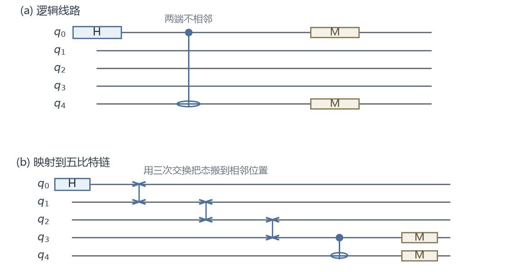
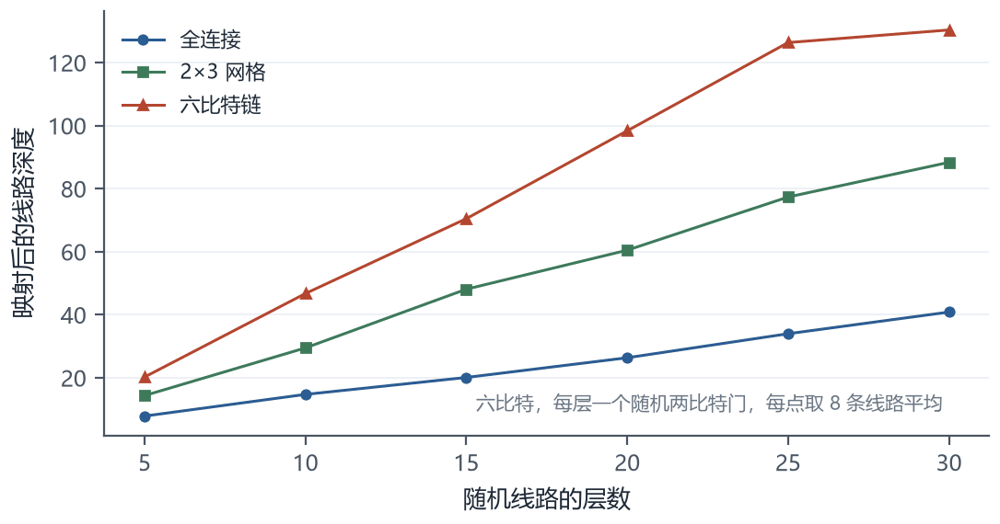

# 第 10 章　线路编译与硬件映射

算法写出来是一串门，硬件能执行的却是另一串门。中间这一步叫编译。它要解决的问题很具体，设备只认识少数几种操作，许多比特之间根本没有耦合，门的执行时间还有快有慢。同一个算法，编译得好和编译得差，跑出来的结果可能差一个数量级。

这一章从最基础的一步讲起，先把任意矩阵拆成设备认识的门，再看怎么把这些门搬到真实连接图上，然后讲调度和脉冲层，以及怎么评价一个编译器。

## 10.1 编译要做的四件事

现实的量子处理器，物理上能做的操作很有限。超导芯片上通常只有两种单比特门，绕 $z$ 轴的任意角旋转和绕某个固定轴的 $\pi/2$ 脉冲，两比特门往往只有一种，比如 CZ 或者 iSWAP。算法里写的那些门，绝大多数在硬件上没有对应物。

编译的第一件事是分解，把任意门写成硬件门集的乘积。第二件事是映射，把线路里的逻辑比特分配到具体的物理比特上，让需要相互作用的两比特门尽量落在有耦合的比特对上。第三件事是调度，决定每个门在什么时刻执行，让能并行的门并行起来。第四件事是脉冲化，把门翻译成微波包络或者磁通波形，还要保证波形经过校准。

四件事互相牵连。分解方式变了，映射难度跟着变；映射引入交换门，调度空间也跟着变。编译器是个反复迭代的流程，每一步都要看前一步的结果调整策略。

## 10.2 任意单比特门只需要三个角

第 6 章提过 ZYZ 分解，这里把公式写全，因为它是编译器的第一块砖。

任意的 $2\times2$ 幺正矩阵 $U$ 都可以写成

$$
U = e^{i\alpha} R_z(\varphi) R_y(\theta) R_z(\lambda)
$$

三个角度 $\varphi$、$\theta$、$\lambda$ 加一个全局相位 $\alpha$。全局相位在单个比特上没有物理意义，可以扔掉，真正需要的只有三个角。

从矩阵元反推这三个角，有一套现成的公式。设 $u_{ij}$ 是 $U$ 的四个元素，那么

$$
\theta = 2\arctan\frac{|u_{10}|}{|u_{00}|},\qquad
\varphi+\lambda = \arg u_{11} - \arg u_{00}
$$

$$
\varphi-\lambda = 2\arg u_{10} - \arg u_{00} - \arg u_{11}
$$

前两式给出 $\theta$ 与两个角之和，第三式给出两个角之差，联立就得到 $\varphi$ 和 $\lambda$。写进代码时还要处理 $u_{00}$ 为零的退化情形，通常用 $\arctan2$ 避免除零。

这个分解的意义在于，只要硬件能做绕 $z$ 和绕 $y$ 的任意角旋转，就能做任意单比特门。绕 $z$ 的旋转在超导硬件上又是免费的，它不是脉冲，而是改变后续脉冲的参考相位，叫虚 Z。需要真正打出去的只有绕 $y$ 的旋转。

由此得到一个推论，任何单比特门都能拆成一次旋转加一个相位，而相位可以事后补。单比特门于是在感觉上几乎不花钱。这个感觉在单比特层面成立，到两比特层面就不成立了。

## 10.3 两比特门怎么凑出来

硬件只有 CZ，算法需要 CNOT，这两者差两个哈达玛门

$$
\mathrm{CNOT} = (I\otimes H)\,\mathrm{CZ}\,(I\otimes H)
$$

作用在目标比特上的两个 $H$ 把 $|1\rangle$ 与 $|-\rangle$ 互换，把条件相位翻译成条件翻转。反过来，用 CNOT 加单比特门也能凑出 CZ，道理一样。

更一般的问题是这样。给定一个任意的两比特幺正操作，需要几个 CNOT 才能实现。

答案是最多三个。1995 年 Barenco 等人给出了构造，2004 年 Vatan 和 Williams 证明三个就是下界，不能再少。构造的形状是一个卡当分解

$$
U = (A\otimes B)\;e^{i(c_1 XX + c_2 YY + c_3 ZZ)}\;(C\otimes D)
$$

两边的 $A$、$B$、$C$、$D$ 都是单比特门，中间那个指数项是三个非局域相互作用的组合，三个系数 $c_1,c_2,c_3$ 决定这个门"有多纠缠"。这个分解叫 KAK 分解，跟李群里的卡当分解是同一回事。

三个 CNOT 各自负责一个方向。如果某个 $c_i$ 恰好是零，需要的 CNOT 就少一个；如果三个都是零，这个门其实是两个单比特门的张量积，一个 CNOT 都不用。CNOT 本身对应 $c_1 = \pi/4$，另外两个系数为零，是最省的一种。

这个结论对编译很重要，任意两比特门的成本有了上限，最坏三个 CNOT。真实硬件的门集更窄，可能是 $\sqrt{\mathrm{iSWAP}}$ 之类，换算关系不同，但封顶的量级不变。

## 10.4 硬件只跟邻居说话

分解完之后，每个门都合法了，可还有个问题，它们能不能落在正确的位置上。

芯片上的比特排成二维阵列，每个比特只跟几个邻居有耦合。这种连接关系叫耦合图，编译器的术语叫耦合映射。如果线路里有一个 CNOT 要作用在两个不相邻的比特上，就得先把其中一个的态搬到另一个旁边。

搬运的工具是 SWAP，它交换两个比特的态，自己也要分解，三个 CNOT 是最省的实现

$$
\mathrm{SWAP}_{ij} = \mathrm{CNOT}_{ij}\,\mathrm{CNOT}_{ji}\,\mathrm{CNOT}_{ij}
$$

沿着一条长度为 $d$ 的路径搬运，需要 $d-1$ 次 SWAP，也就是 $3(d-1)$ 个 CNOT。图 10-1 给了一个最小的例子。五比特链上，$q_0$ 和 $q_4$ 之间的距离是四，一个 CNOT 变成九个 CNOT 加三次交换。

图 10-1　同一条线路在逻辑层面和映射之后的形态。五比特链上，$q_0$ 与 $q_4$ 之间的 CNOT 需要三次交换，等价于九个额外的 CNOT

这个代价会累积。一条随机线路里，两比特门连接的比特对是随机的，平均距离随芯片边长增长。按随机线路的统计，在只允许最近邻耦合的方形网格上，两比特门数会膨胀到原来的三倍左右，深度膨胀得更多，因为交换门彼此串行。这就是为什么早期的超导芯片只有五到二十个比特时，算法跑不了几步就散了。

缓解的办法有几个方向。换拓扑，把芯片做成全连接或者近似全连接，离子阱和中性原子天然如此。加耦合器，在网格内部埋可调耦合支路，让不相邻的比特直接相互作用。改算法，把线路设计成局部的，让两比特门只作用在邻居上。再就是让编译器聪明一点，不只搬控制比特，也可以搬目标比特，或者把两个态都搬到中间的空比特上做门再搬回去。

还有一个小技巧。目标比特旁边如果恰好有个空闲比特，可以拿它当桥，用桥接门把两端连起来，代价是两个 CNOT 而不是一串交换。这类优化收益能到百分之二三十。

## 10.5 调度把深度压下来

映射完成以后，每个门都有了一个物理位置，接下来决定执行顺序。

约束来自数据依赖。一个门必须在它涉及的所有比特的上一个门执行完之后才能开始。除此之外没有别的约束，不相干的门可以同时做。调度的任务就是在这个偏序关系下，把门塞进尽可能少的时间槽。

深度和门数是两个指标。门数决定总的错误累积，深度决定在相干时间内能不能做完。一条门数很少但全串行的线路，深度可能比门数多却大量并行的线路还深。量子算法的评估通常两个都报。

图 10-2　随机线路映射到三种连接方式后的深度。六比特，每层一个随机两比特门，每点取 8 条线路平均，映射按最近邻交换贪心搬运

图 10-2 把拓扑的影响摆出来了。全连接时深度基本等于逻辑深度，一条直线上的深度是它的三倍多，$2\times3$ 网格居中。层数到三十的时候，链上线路的深度一百三十，全连接只有四十一。这个差距在含噪声设备上是致命的，因为相干时间只够做几百个门。

调度还要考虑串扰。相邻的两个比特同时被驱动，微波会互相串，门误差随之上升。硬件厂商会给一份串扰表，编译器据此禁止某些门同时执行。这条约束让深度增加多少取决于线路形状，很难预估。读出也有约束，多个比特共用一条读出线，不能同时读，只能频分复用或者排队，通常按顺序读出所有比特再算总时间。

## 10.6 再往下是脉冲

到门这一层，编译器的工作还没结束。门是抽象，硬件执行的是波形。

一个单比特门在超导芯片上是一段微波脉冲，频率对准比特的跃迁，包络形状决定泄漏和相位误差。方波的频谱是 sinc 函数，旁瓣会激发 $|2\rangle$；高斯脉冲干净但慢。工程上用 DRAG 脉冲，在高斯包络上加一路正比于包络导数的正交分量，把泄漏压下去，同时保持速度。

虚 Z 是另一个巧妙之处。绕 $z$ 的旋转不需要脉冲，只改变后续脉冲的参考相位。这意味着 Z 门在硬件上是零成本的，而且没有误差。编译器如果能多用 Z 门，就能省下大量时间。这也是为什么现在主流的门集都写成 $R_z$ 加一个固定的 $\pi/2$ 脉冲，而不是用三个欧拉角。

两比特门的情况更复杂。超导平台上最常用的是交叉共振门，把一个比特用微波持续驱动，频率对准另一个比特，两者通过耦合器产生等效的 $ZX$ 相互作用。这个过程的保真度对驱动幅度、频率失谐和耦合强度都很敏感，参数要一点点校准。校准数据会漂移，通常几小时到几天要重新标一次。

脉冲级编程就是跳过门这一层直接写波形，IBM 的 OpenPulse、Qiskit Pulse 都提供这类接口。做门集层析需要自定义波形，做最优控制可以让编译器直接搜索波形。代价是可移植性差，一套波形换一块芯片就作废。

## 10.7 怎么判断一个编译器好坏

评价编译器不能只看门数。常用的指标有四类。

第一类是资源，包括门数、深度、额外插入的两比特门数。这些数好测，也容易比较，缺点是假设所有门一样贵，而不同比特、不同方向的门误差能差三倍。

第二类是保真度估计。把每个门的错误率乘起来，得到整条线路的成功概率。这个估计过于悲观，因为错误会部分抵消，但它是一个可比较的上界。更好的做法是用错误模型做蒙特卡洛，把线路跑几百遍，看输出的分布。

第三类是端到端指标。量子体积把比特数和可执行深度打包成一个数，取两者的较小值 $n$，报 $2^n$。这个指标的好处是难以作弊，要提升就必须同时改善比特数和保真度。缺点是它对具体应用没有指导意义。

第四类是速度。CLOPS 衡量每秒能执行多少层操作，把编译时间、校准时间和执行时间一起算进去。它对云服务有意义，对物理研究意义不大。

一个常见的坑是优化档位。多数编译器提供零到三档优化，档位越高编译越慢、门数越少，但不一定划算。有实验发现，最高档下编译时间从毫秒涨到分钟，门数只降了百分之十几，而保真度这时主要受读出误差限制，看不出改善。另一个坑是优化器的假设，有的假设任意两比特门都能做，把三个 CNOT 化简成两个；换到只做 CZ 的硬件上，反而要多加单比特门。看编译结果时，拿几个已知的基准线路跑一跑，比看文档可靠。

编译这一层讲完了。它把算法与硬件之间的鸿沟填上，填得好不好直接决定了算法能不能跑出结果。下一章换个角度，谈一谈量子计算到底在什么意义上比经典计算强，以及这个"强"的边界在哪里。
