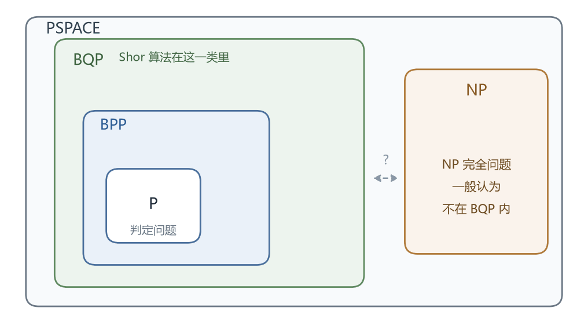
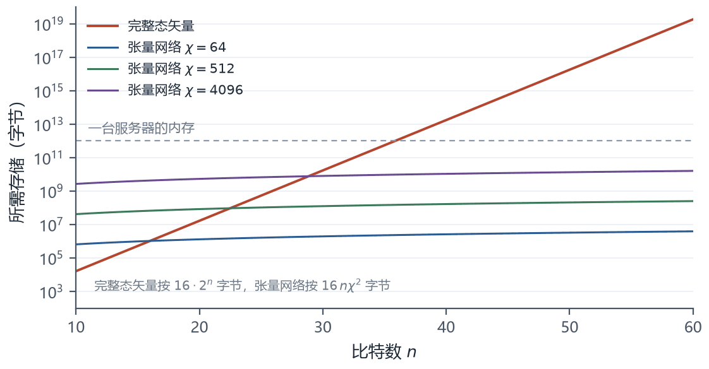

# 第 11 章　计算复杂度与量子优势的边界

"量子计算机比经典计算机快"，这句话在新闻里出现得太多，已经失去了限定词。快在什么问题上，快多少，凭什么相信它快，这三件事决定了这句话有多少内容。

这一章不打算给一个干脆的结论，而是把"量子优势"这个说法拆开来看。先看它在复杂度理论里站在哪个位置，再看为什么很多优势实验根本不属于判定问题，然后看经典模拟这一侧还剩多少空间，以及那些年被"去量子化"掉的一批算法。

## 11.1 复杂度类怎么摆

复杂度理论用类来划分问题的难度。一个类是一批问题的集合，同一类里的问题在同一个资源模型下有相同量级的成本。

$\mathrm{P}$ 是确定型图灵机在多项式时间内能判定的问题。排序、最短路、素数判定都在里面。

$\mathrm{BPP}$ 允许算法抛硬币，错误概率不超过三分之一。人们相信它跟 $\mathrm{P}$ 是同一类，只是没人证得出来。

$\mathrm{BQP}$ 是量子版本，允许用多项式规模的量子线路，测量结果以至少三分之二的概率正确。Shor 算法把因式分解放进了这一类。

$\mathrm{NP}$ 是另一回事。它要求的是，给定一个候选答案，能在多项式时间内验证它对不对。判定一个图有没有哈密顿回路属于这一类，验证一条候选回路只要顺着走一遍。$\mathrm{NP}$ 完全问题是这一类里最难的一批。

$\mathrm{PSPACE}$ 是多项式空间能解决的问题，比上面几个都大。

已知的包含关系是这样。$\mathrm{P}\subseteq\mathrm{BPP}\subseteq\mathrm{BQP}\subseteq\mathrm{PP}\subseteq\mathrm{PSPACE}$，中间的 $\mathrm{PP}$ 是一个允许错误概率接近一半的类，包含关系更宽松。$\mathrm{BQP}$ 与 $\mathrm{NP}$ 的关系完全不清楚，一般认为 $\mathrm{NP}$ 完全问题不在 $\mathrm{BQP}$ 里，但这只是猜想。1997 年 Bennett 等人构造了一个 oracle，相对于这个 oracle，$\mathrm{NP}$ 确实不包含在 $\mathrm{BQP}$ 里，这是目前最接近证明的结果。

图 11-1　几个复杂度类的相对位置。嵌套的部分是已知的包含关系，$\mathrm{BQP}$ 与 $\mathrm{NP}$ 之间的区域尚无定论

图 11-1 里最容易被误读的地方，是把 $\mathrm{BQP}$ 当成"$\mathrm{NP}$ 的量子版"。它不是。$\mathrm{BQP}$ 定义的是量子计算机能高效判定的问题，跟"答案能否快速验证"没有关系。因式分解在 $\mathrm{BQP}$ 里，可它既不知道在 $\mathrm{P}$ 里，也不知道是 $\mathrm{NP}$ 完全的，位置相当孤立。这也是为什么 Shor 算法虽然惊人，却不能推出量子计算机能解所有 $\mathrm{NP}$ 问题。

另一个误读是把 $\mathrm{BQP}$ 想得比实际大。它只含多项式时间的量子算法，而优势实验里的大部分任务，严格说都不在这个框架内。

## 11.2 判定问题不够用

复杂度类是为判定问题设计的，答案只有是或否。可现实里的量子优势实验，做的往往不是判定问题。

一类叫 promise 问题。给定一个输入，保证它满足某个条件，再要求判定另一件事。因式分解其实是个 promise 问题，输入的 $N$ 保证是两个素数的乘积。Simon 问题也一样。promise 的意义在于，算法只需在满足保证的输入上正确，其他输入可以随便，这让复杂度类的比较变得微妙。

另一类是采样问题。它的输出不是一个比特，而是一串比特，要求这串比特服从某个分布。玻色采样属于这一类，把 $n$ 个光子送进一个干涉网络，测量输出端每个端口有几个光子。随机线路采样也属于这一类，跑一条随机线路，测量全部比特，得到一个比特串。

采样问题没法用判定问题的框架衡量，因为没有"正确答案"可以核对，能做的只有比较分布。玻色采样之所以被提出，是因为它的输出分布有一个可证明的性质，如果存在一个多项式时间的经典算法能从这个分布里采样（在某种近似意义下），那么多项式谱系会坍缩，而人们相信它不会坍缩。这个论证是间接的，靠的是反证。

麻烦在于近似。真实的实验有噪声，得到的分布一定偏离理想分布。要证明"从带噪声的分布采样也难"，需要更强的假设，而这方面的结论一直在变。2019 年之后，好几篇论文把原来需要的假设削弱了，也有几篇指出原来的论证有漏洞。这类工作专业性很强，读者只需要记住一点，采样问题的优势声明建立在未证明的假设上，而且这些假设会被后来的工作修正。

## 11.3 经典模拟能走多远

量子优势的另一侧是经典模拟。要说清楚量子计算机在某件事上超过了经典计算机，就得知道经典计算机在这件事上的极限在哪里。这个极限过去十年一直在往外推。

最直接的方法是存下整个态矢量。$n$ 个比特的态有 $2^n$ 个复振幅，每个十六字节，四十个比特就要十七太字节，六十个比特是这个数的一千万倍。这条路在三十到五十个比特之间就断了，断在哪里取决于你有多少内存。

图 11-2　模拟 $n$ 个比特所需的存储。完整态矢量按 $16\cdot2^n$ 字节计算，张量网络按 $16n\chi^2$ 字节估计，$\chi$ 是键维

第二条路是张量网络。它把态写成一堆小张量缩并的形式，键维 $\chi$ 衡量每个连接上保留多少信息。图 11-2 里三条平缓的曲线就是张量网络的成本，跟比特数是线性关系，跟 $\chi$ 是平方关系。六十个比特配 $\chi=4096$ 只要十六吉字节，比完整态矢量省了九个数量级。

代价在 $\chi$ 上面。要精确表示任意态，$\chi$ 得取到 $2^{n/2}$ 量级，省下的全赔回去。真正能省的是纠缠有结构的态。一维系统的基态满足面积定律，纠缠熵有上界，$\chi$ 取几百就够，密度矩阵重正化群因此能在几十个格点的自旋链上算出精确结果。二维系统、或者演化时间很长的过程，纠缠铺满整个系统，$\chi$ 指数增长，张量网络就撑不住了。

第三条路利用线路本身的结构。Gottesman 和 Knill 在 1998 年证明，只由 Clifford 门组成的线路，经典计算机可以多项式时间模拟，因为这类线路把稳定子态映到稳定子态，而稳定子态只要 $O(n^2)$ 个比特就能描述。天花板也很清楚，加进一个非 Clifford 门，比如 $T$ 门，模拟成本就随 $T$ 门个数指数增长。所以一条线路的经典可模拟性，可以用它的"魔法"含量来衡量。

这三条路都在进步。2023 年之后出现了一批基于泡利路径的方法，把噪声线路的模拟成本压下来不少，谷歌自己 2019 年的采样数据，后来被经典方法在几小时里复现了。这类进展说明一件事，量子优势不是一个静态的门槛，它是一个移动的靶子。声明优势的时候，比的不是"经典计算机完全做不到"，而是"目前最好的经典算法做不到"。

## 11.4 优势实验在争什么

2019 年，谷歌用 53 个比特的超导处理器做随机线路采样，声称经典计算机要一万年才能算出同样的结果，而他们的设备用了两百秒。

这个声明很快遭到质疑。IBM 的研究组指出，谷歌对经典算法的估计过于保守，如果充分利用 Summit 超级计算机的存储和并行，同样的任务两天半就能算完。两天半跟两百秒仍然差三个数量级，可"一万年"这个数字没了。

2023 年，争论又推进了一轮。谷歌把比特数加到 70，声称在新的估计下经典计算需要的时间更长。同年，IBM 发布了 127 个比特上的伊辛模型模拟结果，用量子硬件加误差缓解，得到的关联函数与张量网络计算的结果一致。这个结果的意义有点微妙，它同时证明了量子硬件能算大规模问题，也证明了张量网络能算同样的问题。

2020 年，中国科学技术大学用光子做玻色采样，76 个光子，声称经典模拟需要二十五亿年。后续的工作把光子数推到一百以上，也把经典算法的效率提上去了。

这些争论里有个规律。量子一侧的声明总带一个大数字，经典一侧的回应总能把数字缩小，但很少能缩到零。到目前为止，还没有哪个优势声明被彻底推翻，可也没有哪个优势声明被公认为"有用"。

## 11.5 去量子化

有一类工作比优势争论更让算法设计者紧张，叫去量子化。它的做法是，把一个量子算法的核心思想翻译成经典算法，证明原来的"量子加速"其实不需要量子。

最著名的一个例子是推荐系统。2016 年，Kerenidis 和 Prakash 提出了一个量子推荐算法，声称有指数加速。它的前提是数据已经存进量子随机存取存储器，可以在 $O(\log N)$ 时间里取出任意一项的叠加。2018 年，当时十八岁的 Ewin Tang 证明了同样的任务有经典算法，复杂度几乎一样，办法是用 $L^2$ 范数采样代替量子态的振幅采样。

这个结果震动了领域。那个量子算法真正用到的不是量子力学的深层特性，而是"按数据的重要性采样"这个能力，而经典计算机也有这个能力，只是要用不同的数据结构实现。

之后几年，一批类似的量子机器学习算法被去量子化，包括低秩矩阵的线性方程组、主成分分析、聚类、部分凸优化问题。共同的特征是，它们都假设了某种快速的量子数据读入，而那个假设本身就是免费的午餐。

去量子化不是否定量子计算。Shor 算法没有被去量子化，Grover 也没有，因为它们不依赖数据读入的假设。去量子化清掉的是一批"看起来很美，实际靠假设"的算法。这对领域是好事，它逼着算法设计者说清楚，加速到底来自哪里。

## 11.6 优势该看什么

判断一个量子优势的声明，有几个问题值得追问。

第一，对比的是哪个经典算法。不是随便一个，而是目前最好的。这一点在快速演进的领域里很难做到，去年最好的算法今年可能就不是了。

第二，结果能不能验证。采样问题给出的是一串比特，你没法直接检查它对不对，只能检查它的统计性质是否符合预期。如果统计性质也能被经典方法伪造，那么"优势"就只剩一个说法。

第三，代价在哪里。优势声明常常忽略了数据读入、误差缓解、后处理的成本。把这些算进去，指数加速可能退化成多项式加速，甚至变成劣势。

第四，有没有硬性假设。任何复杂度结论都建立在假设上，说清楚假设是什么，比给一个惊人的数字更重要。

带着这四个问题回头看这一册前面讲过的算法，会发现它们的处境差别很大。Shor 算法的假设最少，只要求量子门能精确执行；Grover 的假设也不多，但要真正用起来需要知道解的个数；量子机器学习的假设最多，往往要求一个能瞬间读出任意数据的存储器。假设越多，被去量子化的风险越大。

算法设计这一侧的规律，下一章做一个总结。三种套路，各有各的适用边界，也各有各的坑。
