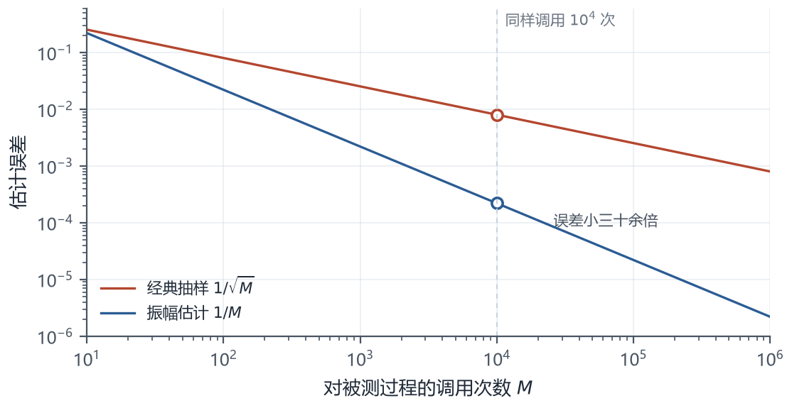
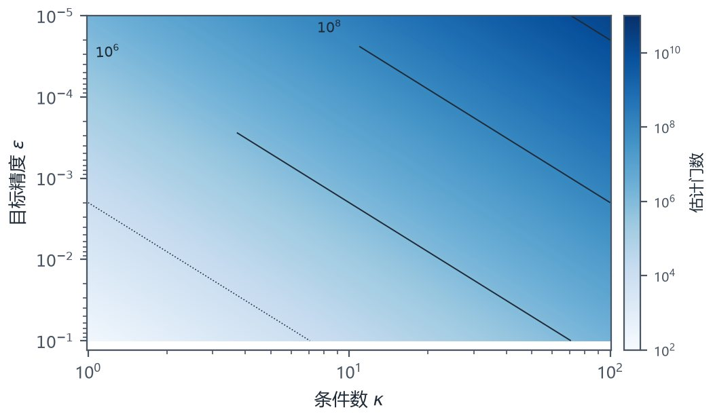

# 第 12 章　算法设计的三种套路

前面几章的算法看起来五花八门，问题不同，线路不同，可拆开看，核心的机关只有三个。

一个机关把答案变成相位，让相位在干涉里起作用。另一个机关把概率抬起来，让本来很小的成功概率接近一。第三个机关把一个矩阵装进一个幺正操作，于是一切关于矩阵的运算都能用线路完成。这一章把三个套路分别讲清楚，再讲各自的边界和最容易踩的坑。

## 12.1 三个套路的分工

相位回踢处理的是"精确值"问题。它把某个量编码进本征值的相位，然后用干涉把这个相位读出来。精度可以做到很高，代价是要有本征态，还要能做受控演化。

振幅放大处理的是"稀有事件"问题。它不关心具体数值，只关心找到或者放大一个目标。它给出的是平方加速，适用范围比相位回踢宽。

块编码处理的是"矩阵"问题。它把矩阵变成可执行的门，然后把求解线性方程组、求本征值、解微分方程这些任务都化成对矩阵的函数逼近。它是三者里最抽象的一个，也是近十年进展最快的一个。

三种套路不是互斥的。Shor 算法用相位回踢做周期寻找，中间用了一次量子傅里叶变换，而傅里叶变换本身可以看成一种振幅重排。理解一个算法，往往就是识别它用了哪个套路，在哪一步付出了代价。

## 12.2 相位回踢

第 7 章已经用过这个技巧，这里把它写成一般形式。

设 $U$ 是一个幺正操作，$|\phi\rangle$ 是它的本征态，本征值是 $e^{i\phi}$。控制比特处在 $|+\rangle$，受控的 $U$ 作用之后，整个态变成

$$
\frac{1}{\sqrt2}\left(|0\rangle + e^{i\phi}|1\rangle\right)|\phi\rangle
$$

本征值从靶比特上"踢"回了控制比特，变成一个相对相位。控制比特再做一个哈达玛门，相位就转成概率

$$
p(0) = \cos^2\frac{\phi}{2},\qquad p(1) = \sin^2\frac{\phi}{2}
$$

一次测量只能告诉你 $\phi$ 偏在哪一边，要定量就得重复。想要高精度，得把 $U$ 连续作用 $2^k$ 次，把相位放大 $2^k$ 倍，这就是量子相位估计。$t$ 个辅助比特能把 $\phi$ 定到 $1/2^t$ 的精度，代价是 $t$ 个受控演化和一次逆傅里叶变换。

这个套路的力量在于精度。经典方法测频率，误差按 $1/T$ 下降，$T$ 是观测时长。相位估计的误差按 $1/2^t$ 下降，$t$ 是比特数，而深度只随 $t$ 线性增长，误差随资源指数下降。这是量子计量最根本的加速来源。

边界也很清楚。

第一，要有本征态。输入必须是 $U$ 的本征态，否则输出的是一堆本征值的概率混合。Shor 算法绕开了这一点，它用的不是单个本征态，而是所有本征态的均匀叠加，因为模乘法的本征态恰好是 $\frac{1}{\sqrt r}\sum_k |x_0 + kr\rangle$ 这种梳状态。

第二，相位是模 $2\pi$ 的。$\phi$ 和 $\phi+2\pi$ 分不开，相位估计给出的永远是个小数，整数部分要靠额外线路去定，Shor 算法里这一步用连分数展开补上。

第三，受控 $U$ 未必便宜。要相位估计到 $t$ 位，得实现 $U^{2^{t-1}}$，如果 $U$ 本身就是一大段线路，这个幂次化的成本可能盖过所有收益。模幂运算的线路之所以被反复优化，原因就在这里。

## 12.3 振幅放大与振幅估计

Grover 搜索是振幅放大的特例，这里讲一般形式。

设有一个过程 $A$，把 $|0\rangle$ 变成

$$
A|0\rangle = \cos\theta\,|\text{坏}\rangle + \sin\theta\,|\text{好}\rangle
$$

$|\text{好}\rangle$ 是我们想要的子空间，$\sin^2\theta$ 是成功概率。如果 $\theta$ 很小，直接测量几乎必然失败。

振幅放大构造一个算符

$$
Q = A\left(2|0\rangle\langle0| - I\right)A^\dagger\left(2P_{\text{好}} - I\right)
$$

右起第一个因子把 $|\text{好}\rangle$ 的相位翻转，第二个因子把态相对 $|0\rangle$ 翻转。两个反射合成一次旋转，每迭代一次，平面里的角度转过 $2\theta$，$k$ 次之后成功概率是 $\sin^2((2k+1)\theta)$。

这也解释了为什么量子搜索只是平方加速。旋转是连续的，$\theta$ 每次只加一点，转到位需要 $O(1/\theta)$ 步，而 $1/\theta$ 是 $\sqrt{N}$ 量级，光靠反射做不到更快。

振幅放大的用处不止搜索，它能把任何"成功概率很小但可以验证"的过程提速，比如解约束满足问题，比如在数据库里找一条满足条件的记录。

把 $Q$ 的迭代次数当成一个连续变量去估，就得到振幅估计。它比经典抽样快在精度上。经典方法要估一个概率到 $\epsilon$，需要 $1/\epsilon^2$ 次抽样；振幅估计用相位估计读 $\theta$，只需要 $1/\epsilon$ 次调用。

图 12-1　估计一个概率的误差随调用次数的变化。经典抽样按 $1/\sqrt{M}$，振幅估计按 $1/M$，两条曲线按理想标度绘制

同样调用一万次，误差差三十多倍。这个差距在金融里很值钱，蒙特卡洛定价的精度直接决定风险估计的可靠性。

陷阱有几个。

振幅放大要求知道 $\theta$，否则不知道该迭代几次。迭代过头，概率会掉下来，第 7 章的图上看得清楚。如果解的个数未知，得先估出 $\theta$ 再做一轮。

标记算符不便宜。$2P_{\text{好}} - I$ 要求能判定一个态是不是"好"的，这个判定往往就是原问题，它要花多少门，得算进总账。

相干误差的影响更坏。振幅放大靠精确的旋转角累积，每次偏一点，误差随迭代次数线性增长，转着转着就错过了最优点。随机错误只是让曲线变平，相干误差会把曲线推歪。

## 12.4 块编码

第三种套路最抽象，也最有一般性。

量子线路只能做幺正操作，可我们想处理的是任意矩阵 $A$，它可能是哈密顿量，可能是线性方程组的系数矩阵，也可能是微分方程离散化之后的算子。怎么把非幺正的矩阵塞进幺正的框架。

块编码的做法是把 $A$ 放进一个大幺正矩阵的左上角

$$
U = \begin{pmatrix} A/\alpha & \cdot \\ \cdot & \cdot \end{pmatrix}
$$

$\alpha$ 是归一化常数，取得足够大使得 $A/\alpha$ 的奇异值不超过一，空白处补上别的元素，把整个矩阵补成幺正。这样一来，只要在辅助比特处在 $|0\rangle$ 时作用 $U$，得到的就是 $A/\alpha$ 作用在数据上的结果。

构造 $U$ 的常用办法叫线性组合。把 $A$ 拆成一批容易实现的幺正矩阵的加权和

$$
A = \sum_j c_j U_j
$$

然后准备一个辅助寄存器编码系数，用受控操作依次作用每个 $U_j$，再把辅助寄存器投影回 $|0\rangle$，剩下的就是 $A/\alpha$。$\alpha$ 是系数绝对值之和或者矩阵的谱范数，取决于构造。

有了块编码，很多问题变成同一个问题的不同版本。想求 $A^{-1}|b\rangle$，就是对 $A$ 做函数 $1/x$；想求 $e^{-iAt}|b\rangle$，就是做函数 $e^{-ixt}$。这些函数都能用同一种技术实现，叫量子奇异值变换。做法是在块编码两侧插入一串单比特旋转，角度按切比雪夫多项式排布，整体效果就是把 $A$ 的奇异值按某个多项式变换。

好处是把算法设计变成了函数逼近。不必为每个问题重新想线路，只要问，我要的函数能不能用低次多项式逼近，逼近到误差 $\epsilon$ 需要多少次。答案通常跟 $\kappa$ 和 $1/\epsilon$ 有关，跟矩阵维数只有对数关系。

代价在 $\alpha$ 上。它至少是矩阵的谱范数，范数一大，所有奇异值都被压到很小的区间里，分辨起来就费劲。这也是条件数 $\kappa$ 会反复出现的原因，它就是最大奇异值与最小奇异值之比，直接决定了需要多精细的分辨率。

## 12.5 数据读入的账

三种套路都有一个共同的隐藏成本，数据怎么进去。

量子算法处理经典数据，得先把数据编码成量子态。最常用的是振幅编码，把一个 $N$ 维向量 $x$ 变成

$$
|x\rangle = \frac{1}{\|x\|}\sum_{i=1}^{N} x_i |i\rangle
$$

这个态制备起来并不便宜。通用的态制备线路需要 $O(N)$ 个门，因为 $N$ 个振幅是 $N$ 个独立参数，每个都要用门转出来。$N = 2^{20}$ 的向量，就要一百万个门。按千分之一的门错误率，一百万个门会产生一千个错误，结果完全不可信。

有人会说，用量子随机存取存储器，读入可以做到 $O(\log N)$。QRAM 把数据存在一棵树的叶子上，用地址的叠加去寻址，一次查询就取出所有地址对应数据的叠加。线路深度确实是 $O(\log N)$，可这棵树有 $N$ 个节点，每个都要有物理实现。成本从线路转移到了硬件，没有消失。

更麻烦的是，算法通常不只读一次数据。迭代算法反复查询同一个矩阵，每次都要走一遍 QRAM，深度累加起来。真实设备的相干时间只够几百到几千个门，$O(\log N)$ 乘上迭代次数，很快就超了。

这就是输入问题，也是量子机器学习一批算法被去量子化的根本原因，第 11 章讲过。数据读入的假设一旦放松，指数加速往往退化成多项式加速，甚至变成劣势。

判断一个算法时，看输入模型比看加速倍数有用。论文如果假设了 QRAM 或者稀疏访问 oracle，就得追问，这个假设在目标硬件上怎么实现，实现之后成本还剩多少。

## 12.6 条件数与精度

线性方程组是这些套路最经典的应用，也是坑最集中的地方。

问题是解 $A|x\rangle = |b\rangle$，$A$ 是 $N\times N$ 的厄米矩阵。经典的最好方法，比如共轭梯度，复杂度是 $O(Ns\sqrt\kappa\log(1/\epsilon))$，$s$ 是稀疏度，$\kappa$ 是条件数，$\epsilon$ 是精度。

量子算法（HHL 及其后续）的复杂度大致是 $O(\kappa^2\log N/\epsilon)$ 量级。注意 $\log N$ 取代了 $N$，这是指数加速的来源；同时多出了 $\kappa^2$ 和 $1/\epsilon$，这是代价。

两个式子放在一起，什么时候量子占优就清楚了。$N$ 要大到 $\log N$ 能压过 $\kappa^2/\epsilon$；$\kappa$ 要适中，条件数一万的病态矩阵，$\kappa^2$ 就是一亿，什么优势都没了。

图 12-2　估计门数随条件数与目标精度的变化。按 $O(\kappa^2\log N/\varepsilon)$ 的量级估算，取 $N=2^{20}$，颜色越深门数越多

图 12-2 是这张账的地图。左下角条件数小、精度要求低，几十万个门就够；右上角门数上亿，任何设备都跑不动。等值线的斜率说明，精度每提高一个数量级，代价涨一个数量级；条件数每涨十倍，代价涨两个数量级。

还有一个更隐蔽的坑，输出。

算法给出的不是 $x$ 的每个分量，而是一个量子态 $|x\rangle$。要读出全部分量得测 $N$ 次，指数优势立刻归零。真正能用的是只需要少数统计量的任务，比如求 $\langle x|M|x\rangle$，或者判断 $x$ 与某个参考向量的相似度。应用如果要每个分量，量子线性代数帮不上忙。

这个领域里有一句话，重要的不是算法能算什么，而是结果能不能用。设计者没想清楚读出方式，很容易做出纸面上指数加速、应用上一无是处的东西。

## 12.7 三个套路怎么挑

回到设计层面。遇到一个新问题，可以先问三个问题。

答案是一个数还是一个解。需要高精度的数，相位回踢和相位估计是首选，精度随资源指数提升；要的是一个组合优化意义上的解，振幅放大更合适。

这个问题里有没有矩阵。如果核心是一个线性算子，块编码加奇异值变换是通用框架，代价是归一化常数和条件数。

数据从哪来。如果数据本来就在量子态里，比如量子模拟的输出，前面的加速都成立。如果数据是经典文件，读入成本必须先算清楚。

三个问题的答案合起来，大致能判断一条技术路线值不值得走。这比记住几个算法的名字有用，名字会过时，套路不会。

算法这一侧讲到这里。可这些算法大多需要纠错，需要百万级的物理比特。在没有纠错的机器上，量子计算还能先做出什么，下一章看这件事。
