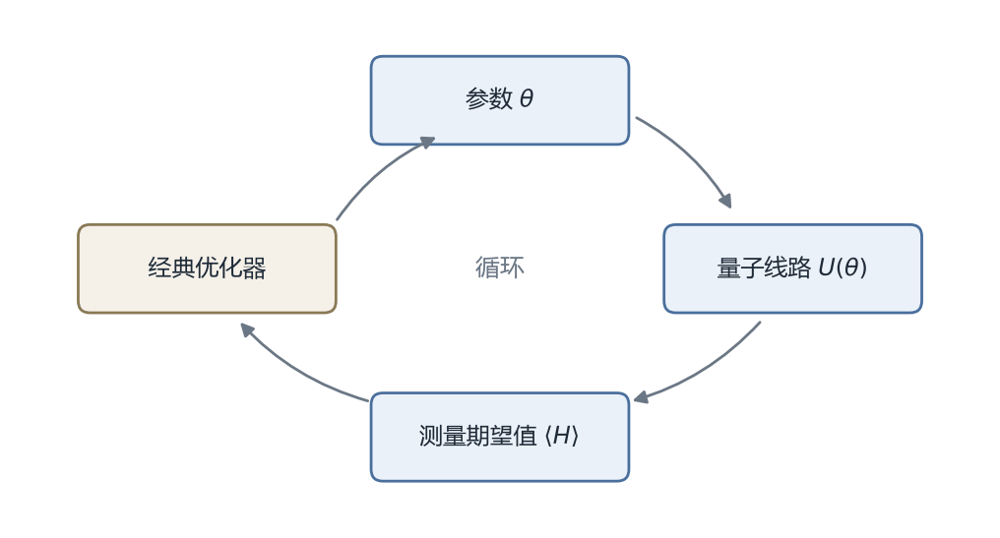

# 第 13 章　近期路线与量子模拟

前八章讲的算法，大多需要容错。

Shor 算法要分解一个 2048 位的数，需要几千个逻辑比特，每个逻辑比特由上千个物理比特编码，总共几百万个物理比特。这个规模不是现在能造出来的。

在容错机器到来之前，量子计算能做什么。这一章讲两条路线，一条是把量子计算机当成模拟器，一条是把浅线路和经典优化器结合起来。

## 13.1 模拟量子系统

费曼在 1982 年提出，用量子系统模拟量子系统。

经典计算机描述 $n$ 个量子比特需要 $2^n$ 个复数，三十个比特就是十亿个数，五十个比特超过一千万亿。存储和运算都跟不上。

量子计算机本身就是量子系统，$n$ 个比特自然就有 $2^n$ 维的状态空间，不需要额外编码。把待研究的哈密顿量映射到量子比特上，让系统按这个哈密顿量演化，再测量，就得到基态能量、关联函数这类信息。

最直接的应用是量子化学。一个分子的电子结构决定了它的性质，药物分子、催化剂、电池材料，都依赖精确的电子结构计算。经典方法用近似，比如密度泛函理论，精度受限于近似的形式。量子模拟原则上可以做到精确。

另一个方向是凝聚态物理。 Hubbard 模型、自旋液体、拓扑序，这些系统在经典计算机上难以模拟，用量子模拟器可以直接“长”出一个来。中性原子阵列在这方面特别合适，因为它可以排成任意几何形状，相互作用强度可调。

## 13.2 变分算法

变分算法的思路是，把量子计算机当成一个参数化的态制备器，把优化交给经典计算机。

流程是这样的。设计一个带参数的浅线路 $U(\theta)$，作用在初始态上得到 $|\psi(\theta)\rangle$。测量某个哈密顿量的期望值 $\langle\psi(\theta)|H|\psi(\theta)\rangle$。把期望值送给经典优化器，调整参数，再测。反复迭代，直到期望值收敛。

这个方法最早由 Peruzzo 等人在 2014 年提出，用于求分子基态能量，叫变分量子特征求解器。它的好处是线路浅，对相干时间要求低，适合当前的设备。

另一个变体叫量子近似优化算法，用来解组合优化问题。它把问题编码成哈密顿量，用交替的单比特旋转和两比特门构造试探态，调整角度逼近最优解。

## 13.3 贫瘠高原

变分算法有一个严重的障碍，叫贫瘠高原。

当线路的比特数增加，代价函数的梯度会指数级地变小。优化器拿到的信号几乎为零，无法判断往哪个方向调整参数。这不是优化器不好，是地形本身太平。

2018 年，McClean 等人系统地分析了这个现象，指出在随机线路和全局测量下，梯度的方差随比特数指数衰减。

缓解的办法有几个。用局部测量代替全局测量，用问题相关的线路结构，用更好的初始化，用层间训练。这些办法能缓解，但不能根除。这也是变分算法前景有争议的主要原因。

图 13-1　变分算法的迭代流程，量子线路制备参数化态，经典优化器更新参数

## 13.4 两条路线的比较

量子模拟是“用另一台量子机器去模仿”，变分算法是“用量子机器加经典机器合作”。

量子模拟的优势是目标明确，只要把哈密顿量映射对了，结果就是可信的，不依赖优化。劣势是每种问题需要专门的硬件和映射，通用性差。

变分算法的优势是通用，一套框架可以处理很多问题。劣势是结果的可信度依赖优化过程，而优化过程没有保证。一个变分算法给出的能量，如果高于真实基态，那是变分原理的正常结果；如果低于，说明实验有错误。

工程上，两条路线都在推进。谷歌、IBM 在超导平台上做量子模拟和变分；中性原子平台在模拟晶格模型上做出了一批结果；离子阱平台在全连接问题上做小规模演示。

## 13.5 什么时候算“有用”

“有用的量子计算”这个说法需要定义。

一个标准是，量子设备算出的结果无法用经典方法在合理时间内得到，而且这个结果本身有价值。随机线路采样满足前半条，不满足后半条。

另一个标准是，量子设备在某项实际任务上超过了经典方法，哪怕优势不大。量子化学的基态能量是一个候选，因为经典方法在强关联体系上确实吃力。

目前还没有公认的“有用”案例。有一些接近的，比如小分子的能量计算，但经典方法也能算，只是慢一些。真正的分水岭，要等到量子设备能处理经典方法算不动的体系。

## 13.6 这一册的收束

这一册从量子比特讲到算法。

态矢量描述状态，算符描述可观测量，薛定谔方程描述演化，密度矩阵描述噪声，门和线路描述计算，干涉描述加速。这一套语言是后面所有内容的基础。

算法部分给了三个层次，有确定指数优势的、有平方加速的、有还在研究中的。判断一个算法值不值得研究，看它解决的问题有没有实际价值，看它的加速是不是真的，看它的资源需求能不能实现。

量子计算不是万能加速器。它是一台能做干涉的机器，只有在问题结构适合编码成干涉的时候，它才有优势。认清这一点，比记住几个算法名字重要得多。
