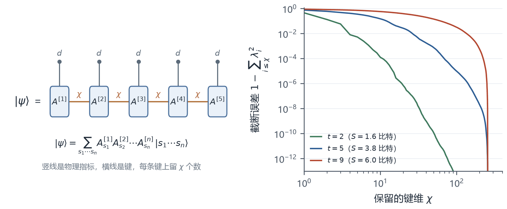
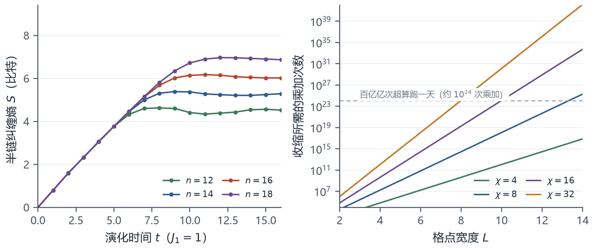

# 第 14 章　张量网络与经典模拟

要判断一台量子计算机做出了什么，得先知道经典计算机做不到什么。这句话反过来也成立，经典模拟每前进一步，量子优势的门槛就抬高一次。过去十年里，推动这条线的主要工具是张量网络。

第 11 章提过一句，张量网络把态写成一堆小张量的缩并。这一章把它讲成能算账的东西，键维是什么，它和纠缠是什么关系，收缩顺序为什么决定代价，以及一张网络图怎样换算成“这台机器能不能被模拟”的结论。

## 14.1 把态切成小块

$n$ 个比特的态有 $2^n$ 个复振幅，这些数彼此独立，看起来没有压缩余地。可真实的物理态不是随便挑的，它们由局域的相互作用生成，结构上有大量冗余。

压缩的入口是施密特分解。把比特分成左右两半，任意态都能写成

$$
|\psi\rangle=\sum_{i=1}^{r}\lambda_i\,|u_i\rangle_A|v_i\rangle_B,\qquad \lambda_i\geq 0
$$

$|u_i\rangle$ 与 $|v_i\rangle$ 分别是两边的一组正交基，$\lambda_i$ 是施密特系数，$r$ 叫施密特秩。$r=1$ 时态是两边的直积，没有任何关联；$r$ 越大，两边的关联越复杂。因为两边各只有 $2^{n/2}$ 个基矢，$r$ 最多取到 $2^{n/2}$。

把这件事递归地做下去，每次只在相邻两个比特之间切一刀，就得到矩阵乘积态

$$
|\psi\rangle=\sum_{s_1\cdots s_n}A^{[1]}_{s_1}A^{[2]}_{s_2}\cdots A^{[n]}_{s_n}\,|s_1\cdots s_n\rangle
$$

每个 $A^{[k]}$ 是三阶张量，一个指标是物理指标 $s_k$（取 $d$ 个值），另外两个连到左右邻居。键上保留的维数叫键维 $\chi$，图 14-1 左边画的就是这条链。每个张量的元素数是 $d\chi^2$，整条链的参数量是 $nd\chi^2$，跟 $n$ 是线性关系。

写成这样还没有用，因为 $\chi$ 可能很大。真正让 MPS 好用的一点是规范自由度。相邻两个张量之间可以插入任意可逆矩阵 $X$ 和 $X^{-1}$，态不变，分解却变了。挑一个合适的 $X$，可以让每个张量满足正交条件，此时 $\chi$ 恰好等于该切口上的施密特秩，没有多余的自由度。做截断时只保留前 $\chi$ 个施密特值，丢掉的部分就是误差，这个误差可以精确算出来，不必和别的近似混在一起。

对一维系统，这套表示几乎是标准工具。密度矩阵重正化群在 1992 年提出时就是这个结构，后来被改写成张量网络的语言，才有了现在这套统一说法。

## 14.2 键维量的就是纠缠

施密特系数和纠缠熵直接挂钩。约化密度矩阵的本征值就是 $\lambda_i^2$，所以

$$
S=-\sum_i \lambda_i^2\log\lambda_i^2\leq \log\chi
$$

键维是纠缠熵的指数上界。要让 $S$ 达到 $k$ 比特，$\chi$ 至少要 $2^k$。这条不等式是整章的核心，它把“这个态难不难表示”换成了一个可以测量的量。

三种态可以对照着看。

随机态的施密特谱几乎是平的，$2^{n/2}$ 个系数大小相当，$\chi$ 必须取到 $2^{n/2}$，一点都省不下来。这正是态矢量模拟的处境。

一维有能隙系统的基态满足面积定律。切口只有一条，穿过切口的关联被能隙压住，纠缠熵随系统尺寸收敛到一个常数，$\chi$ 取几百就能把误差压到 $10^{-10}$ 以下。$n$ 到几千个格点也不成问题。

一维临界系统的熵按对数增长，$S=\frac{c}{6}\log n$，$c$ 是共形场论的中心荷，伊辛模型取 $0.5$。对数增长意味着 $\chi$ 按 $n^{c/6}$ 增长，多项式而不是指数，仍然可以算到很大的尺寸。

二维就不一样了。切口是一条线，长度按 $L$ 增长，熵按 $L$ 增长，$\chi$ 按 $e^{L}$ 增长。这就是二维张量网络难做的根本原因，也是下一节那张代价图的来源。

图 14-1　左：矩阵乘积态的张量链，竖线是物理指标，横线是键，键维为 $\chi$。右：16 比特海森堡链淬火后在三个时刻的施密特谱累积尾部，横轴是保留的键维，纵轴是丢弃的权重

图 14-1 右边是用一维海森堡链算出来的。初始态取奈尔态，让它按含次近邻耦合的哈密顿量演化，在 $t=2$、$5$、$9$ 三个时刻切断中间，统计丢弃的权重。$t=2$ 时熵只有 1.6 比特，$\chi$ 取 20 就能把误差压到 $10^{-8}$；$t=9$ 时熵涨到 6.0 比特，同样的精度要 $\chi$ 到 200 左右。曲线右侧的陡降是满秩的情形，$\chi$ 到了 $2^8=256$ 就没有截断，误差归零。

这张图说明一件事，键维不是自由参数，它由态的纠缠决定。想模拟到更晚的时刻，就得付更大的 $\chi$。

## 14.3 收缩顺序决定代价

一个张量网络是一张图，顶点是张量，边是被缩并的指标。算一个标量，比如某个期望值，要把所有指标缩掉。缩并的代价取决于先后顺序，而顺序的差别可以是指数级的。

拿一维链举例。从左往右缩，每一步把当前的 $\chi\times\chi$ 矩阵和下一个张量合成新的矩阵，代价是 $O(d\chi^3)$ 或者更低，总共 $O(nd\chi^3)$。这个数字很温和，$\chi=1000$、$n=100$ 也就 $10^{14}$ 量级。

二维格点没有这么便宜。取一个 $L\times L$ 的格子，每一列有 $L$ 个张量，相邻列之间有 $L$ 条键相连。把一列缩成一个张量，这个中间张量带着 $2L$ 条开放键，元素数是 $\chi^{2L}$。下一列再缩进来，规模不降反升，一路涨下去。

图 14-2　左：四个尺寸的一维链在淬火后的半链纠缠熵，线性增长后饱和，饱和值随尺寸上升。右：$L\times L$ 格点按列收缩所需的乘加次数，按 $\chi^{2L}$ 估算

图 14-2 右边画的是这条代价曲线。$\chi=8$、宽度 10 的格子要 $8^{20}$ 次乘加，约 $10^{18}$；$\chi=32$、宽度 12 要 $10^{36}$。指数在宽度上，不在总面积上，所以二维系统的可算尺寸被死死卡在十几个格点。虚线标的是百亿亿次超算跑一天的量级，$\chi=8$ 的曲线在宽度 13 附近就越过它了。

顺带说一个常见的误解。二维格点的张量网络不是“比一维慢一点”，而是慢在指数上。把宽度从 10 加到 12，工作量涨四个数量级，这跟多算两个格点的直觉完全相反。

找最优收缩顺序本身是个难问题。它等价于求张量网络对应图的树宽，而树宽的计算是 NP 难的。实践中用的都是启发式，先缩度数小的顶点，或者用贪心把大张量留到最后，工具里叫 contraction path 优化。同一个网络，不同工具给出的顺序，代价常常差几个数量级，这一项在报结果时应当写清楚。

## 14.4 低纠缠为什么可模拟

有了表示和收缩，模拟的算法就顺理成章。以时间演化为例，把 $e^{-iHt}$ 按 Trotter 拆成一批局域门，每个门只作用在少数几个比特上，作用完立刻把键维截断回 $\chi$。这套流程叫 TEBD，2003 年前后被提出，至今仍是 quench 动力学的主力方法。

它的误差有两个来源，Trotter 误差和截断误差。前者随步长平方下降，后者随 $\chi$ 指数下降，两个都可以单独控制。真正的限制不在精度，在于 $\chi$ 要跟着纠缠涨。

一维系统的纠缠熵怎么涨，图 14-2 左边给了答案。四个尺寸的链从奈尔态出发，熵先以差不多同样的斜率线性上升，每单位时间涨半比特左右，到某个时刻拐弯饱和。饱和值随 $n$ 上升，12 比特到 4.6 比特，18 比特到 7.0 比特，接近半链上限 $n/2$。这就是体积律，热化之后的态几乎把允许的纠缠用满了。

线性增长这一段直接给出了可模拟的时间尺度。要有 $\chi$ 覆盖熵 $S$，需要 $\chi\approx 2^{S}$，而 $S$ 随 $t$ 线性涨，于是 $\chi$ 随 $t$ 指数涨。能算到多晚，取决于内存能装下多大的 $\chi$。$\chi=10^4$ 对应 13 比特熵，按半比特每单位时间算，就是 26 个单位时间，跟链长关系不大。链再长也只是多算些格点，晚时刻的模拟照样塌。

有能隙的系统是例外之花。熵饱和在一个与尺寸无关的常数，$\chi$ 从头到尾不变，可以一直算下去。这也是为什么一维有能隙材料能被 DMRG 算得极准，而一维临界系统的长时间行为至今还是要靠共形场论这类解析工具。

## 14.5 张量网络怎么界定优势

现在可以把这套东西放到“量子优势”的语境里。

经典一侧有几条基线。态矢量模拟最直接，能到 50 比特上下，取决于内存。张量网络模拟能到几百比特，前提是纠缠有结构。稳定子模拟能到几千比特，前提是线路里几乎没有非 Clifford 门。泡利路径方法针对带噪声的线路，把演化展开成一堆泡利串的权重和，噪声越大，高权重项衰减得越快，成本反而越低。

这四条基线合起来，给量子设备划了一条必须越过的线。声明优势的时候，比的不是“经典计算机理论上做不到”，而是“当前最好的经典方法做不到”。这条线一直在移动，2019 年之后动得尤其快。

反过来，张量网络也说明了另一件事，纠缠熵低的那部分量子态没有优势可言。一个面积定律的基态，$\chi$ 几百就能表示到十位有效数字，量子设备再快也只是重复经典已经能做的事。量子优势只能出现在纠缠足够多、结构足够乱的地方。

这两句话合起来，就是“上限”的两层含义。经典模拟的成本是量子设备的下界门槛，纠缠熵是量子设备的价值上限。真正有优势的区间被夹在中间，左边是经典能算的，右边是量子也造不出来或者噪声先把它毁掉的。噪声在这里扮演了一个反直觉的角色，它让纠缠衰减，把态推回可模拟的区域。这也是为什么很多优势实验的结果后来被经典方法复现，噪声越大，复现越容易。

2023 年有一个耐人寻味的例子。IBM 在 127 比特的超导芯片上做二维伊辛模型的模拟，用量子硬件加误差缓解算出关联函数，同时用量子硬件之外的张量网络方法算同一个量，两者对上了。这个结果同时说明量子硬件能跑大规模线路，也说明张量网络能算同样的问题。优势在哪里，得看具体的时间、精度和系统，不能只看比特数。

## 14.6 这条线的边界

张量网络不是万能的，它的失效处也值得讲清楚。

二维强关联系统是第一个难点。PEPS 是二维的对应物，键维一涨，收缩代价就指数爆炸，现在能做的还是十几个格点、$\chi$ 到十几的水平，精度和三维问题都谈不上。

阻挫和费米子符号是第二个难点。阻挫系统的基态纠缠不小，面积定律的常数因子偏大；费米子系统要做 Jordan-Wigner 变换，长程的宇称串把局域性破坏掉，二维费米子的张量网络至今没有统一的好办法。

长时间演化是第三个难点，前面已经算过账。热化之后熵到体积律，任何固定 $\chi$ 的方法都会失效。

这三个难点，恰好也是量子模拟最有希望的地方。一台足够好的量子设备，在二维阻挫磁体或者长时间动力学上，确实有可能给出经典算不出的结果。判断这种可能有多大，需要两边都算一遍，而不是只报一边的数字。

经典这一侧的尺子讲到这里。接下来该看量子这一侧怎么把哈密顿量搬上比特，搬上去之后误差怎么控制，资源怎么算。下一章从 Trotter 分解开始，把模拟算法的几条路线摊开比较。
