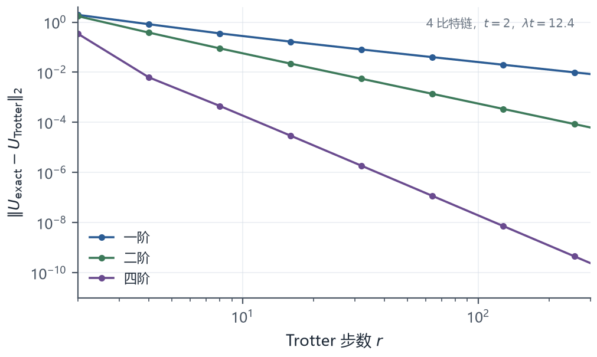
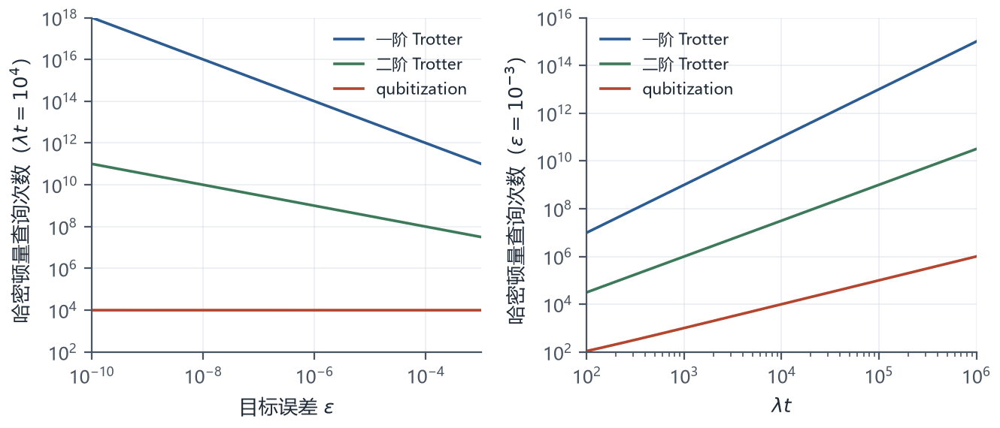

# 第 15 章　量子模拟的算法

第 13 章说量子模拟是眼下最有希望的方向，可只说了“让系统按哈密顿量演化”，没说这个演化怎么在门电路上实现。

$\mathrm{e}^{-\mathrm{i}Ht}$ 是一个 $2^n\times 2^n$ 的矩阵，写下来就有天文数字个元素，直接做矩阵指数没有意义。所有方法都在绕开这一件事，用少数几个能实现的操作逼近它。这一章把三条主要路线的代价算清楚，Trotter 分解、qubitization、线性组合幺正，最后放在一张表里比较。这些内容比第 13 章的轮廓细一档，读者会看到误差从哪里来，资源花在哪里。

## 15.1 问题的三个参数

先把输入写清楚。哈密顿量拆成一批局域项

$$
H=\sum_{j=1}^{L}h_j,\qquad \lambda=\sum_{j=1}^{L}\|h_j\|
$$

每一项 $h_j$ 是一个泡利串，作用在少数几个比特上，所以 $\mathrm{e}^{-\mathrm{i}h_j\tau}$ 容易实现。$\lambda$ 是系数绝对值之和，叫一项范数，它衡量整个哈密顿量的“总强度”。

目标是制备 $\mathrm{e}^{-\mathrm{i}Ht}|\psi\rangle$，误差不超过 $\varepsilon$。误差用算子范数或者迹距离衡量，两者在讨论标度时可以互换。

代价由四个量决定。比特数 $n$ 决定态有多大，项数 $L$ 决定每一步要处理多少东西，$\lambda t$ 是演化积累的总相位，$\varepsilon$ 是精度。四项里 $\lambda t$ 最容易被忽略，它才是真正的“工作量”，因为演化时间越长，需要的相位分辨率越高，门数就越多。

两条路线的分野也在这里。乘积公式类的误差关于 $\varepsilon$ 是多项式的，想精细十倍就要多花十倍到一百倍的门；相位估计类的误差关于 $\varepsilon$ 是对数的，精细十倍只多几个门，可它要求线路深得多，还得有本征态。

## 15.2 Trotter 分解与它的误差

最朴素的想法是把指数拆开。因为 $h_j$ 之间不对易，$\mathrm{e}^{-\mathrm{i}Ht}$ 不等于 $\prod_j\mathrm{e}^{-\mathrm{i}h_jt}$，但时间切短以后差别变小。一阶乘积公式是

$$
S_1(\tau)=\prod_{j=1}^{L}\mathrm{e}^{-\mathrm{i}h_j\tau},\qquad
\left\|\mathrm{e}^{-\mathrm{i}Ht}-S_1(t/r)^r\right\|\leq \frac{(\lambda t)^2}{r}
$$

误差按 $1/r$ 下降。要达到 $\varepsilon$，步数取 $r=(\lambda t)^2/\varepsilon$，每步 $L$ 个指数，总门数按 $L(\lambda t)^2/\varepsilon$ 增长。这个式子里精度在分母上，一次方，这就是所有 Trotter 类方法的软肋。

界是从对易子来的。两个算子不对易时，$\mathrm{e}^{A}\mathrm{e}^{B}$ 和 $\mathrm{e}^{A+B}$ 差一个二阶项，量级是 $[A,B]/2$。把时间切成 $r$ 段，每一段的这个差别是 $([h_j,h_k]t/r)^2$ 量级，累加 $r$ 段，总误差正比于 $t^2/r$ 乘上对易子的和。对易子的和不超过 $2\lambda^2$，于是有了上面那个界。实际误差常常比界小一到两个数量级，因为各项之间的对易子会互相抵消，但这个抵消没有保证，写资源估算时还是按界来算稳妥。

对称化能提高一阶。把每一项切成两半，正着走一遍再倒着走一遍

$$
S_2(\tau)=\prod_{j=L}^{1}\mathrm{e}^{-\mathrm{i}h_j\tau/2}\prod_{j=1}^{L}\mathrm{e}^{-\mathrm{i}h_j\tau/2}
$$

误差变成 $(\lambda t)^3/r^2$，步数取 $r=(\lambda t)^{3/2}/\varepsilon^{1/2}$。同样精度下门数从 $\varepsilon^{-1}$ 降到 $\varepsilon^{-1/2}$，代价是每步的指数个数翻倍。

继续往上还有 Suzuki 递推，$2k$ 阶公式的误差是 $(\lambda t)^{2k+1}/r^{2k}$。听上去阶数越高越好，实际不是。递推里每升一阶，系数按指数增长，四阶公式的常数已经很吓人，六阶以上往往比二阶还慢。工程上常用的是二阶和四阶。

图 15-1　四比特横场伊辛链上 Trotter 误差随步数的变化，三条线的斜率分别是 $-1$、$-2$、$-4$，与一阶、二阶、四阶的标度一致

图 15-1 是在四比特链上直接算出来的。取演化时间 $t=2$、$\lambda t=12.4$，把精确的矩阵指数和三种乘积公式逐一对比，取差的最大奇异值。一阶的斜率是 $-1.05$，二阶 $-2.02$，四阶 $-3.96$，跟理论对得上。注意纵轴是对数，斜率 $-4$ 意味着步数翻倍误差降到十六分之一，四阶公式在 $r=256$ 时已经到 $10^{-10}$，一阶同样步数还停在 $10^{-2}$。两条线之间的差距接近八个数量级。

Trotter 有一个变体值得单独提。随机化 Trotter 不按固定顺序走，每一步按概率从 $L$ 项里抽一项，抽中 $j$ 的概率正比于 $\|h_j\|$。这样做的误差不再是所有对易子的和，而是一个平均意义上的界，成本是 $(\lambda t)^2/\varepsilon$，跟一阶一样，但常数小，而且不随 $L$ 增长。项数很大、单项很弱的哈密顿量，用这个变体常常比二阶乘积公式还划算。

## 15.3 块编码与 qubitization

另一条路线不靠乘积逼近，而是把 $H$ 装进一个幺正操作里，再用量子相位估计读它的本征值。

第 12 章讲过块编码。取 $\lambda$ 使 $H/\lambda$ 的谱落在 $[-1,1]$，构造一个幺正 $U$ 使得

$$
U=\begin{pmatrix}H/\lambda & \cdot\\ \cdot & \cdot\end{pmatrix}
$$

左上角就是归一化后的哈密顿量。再定义 walk 算子

$$
W=\left(2|0\rangle\langle 0|\otimes I-I\right)U
$$

这个式子里的反射只作用在辅助寄存器上。$W$ 在由 $|0\rangle|\phi_k\rangle$ 张成的二维子空间里是一个转动，转过的角度满足 $\cos\theta_k=E_k/\lambda$，$E_k$ 是 $H$ 的本征值。也就是说，$W$ 的本征相位编码了能量。

接下来的事就是相位估计。要让相位精度到 $\varepsilon$，需要 $O(\lambda/\varepsilon)$ 次 $W$ 的调用，看起来跟 Trotter 一样差。关键在于演化时间。$W$ 每作用一次，相位前进 $\arccos(E/\lambda)\approx E/\lambda$，要让相位累计到 $Et$，需要 $E t/(E/\lambda)=\lambda t$ 次。这个数跟精度无关，精度只决定相位估计要多少位辅助比特，是 $\log(1/\varepsilon)$。

合起来，查询次数是

$$
O\!\left(\lambda t+\log\frac{1}{\varepsilon}\right)
$$

线性于 $\lambda t$，对数于精度。这是 qubitization 的全部价值所在，它把 Trotter 方法里那个讨厌的 $\varepsilon^{-1}$ 换成了 $\log\varepsilon^{-1}$。

这个转动图像值得停一下。$U$ 把 $|0
angle|\phi_k
angle$ 送到某个带辅助分量的态上，$2|0
angle\langle0|\otimes I-I$ 把辅助部分翻个符号，两步复合之后，$|0
angle|\phi_k
angle$ 转到了 $|0
angle$ 与另一个正交态的线性组合上，转角正好是 $rccos(E_k/\lambda)$。两个反射合成一个转动，这个几何事实是 qubitization 名字的由来，也是它比朴素相位估计省因子的原因。

代价转到别处。块编码本身要花门，制备 $U$ 的成本取决于 $H$ 的结构，化学哈密顿量用线性组合幺正构造时，这个成本是 $O(L)$。相位估计要一串辅助比特和一段逆傅里叶变换，线路深度随 $\lambda t$ 线性增长，深到没法在近期的设备上跑。

还有一个隐性要求，相位估计要输在本征态上，或者至少有一个跟目标本征态重叠足够大的初始态。化学里这一点通常能满足，Hartree-Fock 态跟基态的重叠在 0.9 以上，剩下的部分只影响成功概率，不影响精度。

## 15.4 线性组合幺正

块编码怎么造，最通用的办法是线性组合幺正。

把 $H$ 写成一批幺正矩阵的加权和

$$
H=\lambda\sum_{j=1}^{L}\frac{\|h_j\|}{\lambda}\,\sigma_j
$$

$\sigma_j$ 是泡利串，本身是幺正的。构造两个操作，PREPARE 在辅助寄存器上制备系数态 $\sum_j\sqrt{\|h_j\|/\lambda}\,|j\rangle$，SELECT 按辅助寄存器的值受控作用 $\sigma_j$。三步合起来

$$
\left(\langle 0|\otimes I\right)\mathrm{SELECT}\cdot\mathrm{PREPARE}\left(|0\rangle\otimes I\right)=\frac{H}{\lambda}
$$

左边是作用在数据寄存器上的算子，正是我们要的。辅助寄存器承担了“非幺正”这件事，代价是它必须回到 $|0\rangle$，否则测量会破坏叠加。

单次应用的成本是 $O(L)$ 个受控操作。总成本乘上 $\lambda t$ 次调用，得到 $O(L\lambda t)$ 个门。这个式子里没有 $\varepsilon$，因为 LCU 只负责构造块编码，精度由外层的相位估计或奇异值变换决定。

$L$ 是这里的关键数字。化学哈密顿量的项数按自旋轨道数的四次方增长，二十个轨道就是十几万项，$L$ 一大，$\log$ 的优势就被线性因子吃掉一半。于是有一条独立的技术线专门压缩 $L$，用对称性约化、稀疏化、张量超收缩之类的办法把项数从 $O(N^4)$ 降到 $O(N^3)$ 甚至更低。这几年的进展大多来自这里，而不是算法框架本身。

还有一类取舍值得说。$\lambda$ 里包含所有系数的绝对值，符号相反的项也往里加，实际演化中它们会抵消，可 $\lambda$ 不管这个。这就是所谓“符号问题”的算法版本。对电子结构，$\lambda$ 通常是几百到几千哈特里，而能量尺度只有几个哈特里，差了两个数量级，这部分浪费只能靠更好的分解方式压下来。

## 15.5 三条路线的资源比较

下面把三种方法放在一起看。表 15-1 里的标度都是主导项，常数因子略去。

| 方法 | 门数标度 | 额外比特 | 适用场合 |
|---|---|---|---|
| 一阶 Trotter | $L(\lambda t)^2/\varepsilon$ | $O(\log L)$ | 短时演化、局域模型 |
| 二阶 Trotter | $L(\lambda t)^{3/2}/\varepsilon^{1/2}$ | $O(\log L)$ | 中等精度、几何局域 |
| 随机化 Trotter | $(\lambda t)^2/\varepsilon$ | $O(\log L)$ | 项数极大、系数均匀 |
| 线性组合幺正 | $L\lambda t$ | $O(\log L)$ | 作为块编码的构造 |
| qubitization | $L\lambda t+L\log(1/\varepsilon)$ | $O(\log L)+\lceil\log_2(1/\varepsilon)\rceil$ | 高精度、容错机器 |

图 15-2　三条路线的哈密顿量查询次数。左：随目标误差 $\varepsilon$ 变化，取 $\lambda t=10^{4}$；右：随 $\lambda t$ 变化，取 $\varepsilon=10^{-3}$。按表中标度估算

图 15-2 把这张表画成了曲线。左图固定 $\lambda t=10^{4}$，横轴是精度。一阶 Trotter 从 $10^{18}$ 一路降到 $10^{13}$，二阶低一半，qubitization 是一条水平线，因为它的查询次数跟精度只有对数关系，在这个范围里几乎不变。右图固定精度，横轴是 $\lambda t$。这里的差别更明显，Trotter 的成本按平方涨，qubitization 按一次方涨，$\lambda t$ 越过 $10^{4}$ 之后两者的差距迅速拉开。

这解释了为什么容错机器的资源估算几乎都采用 qubitization。化学问题的 $\lambda t$ 动辄 $10^{5}$ 以上，精度要求到 $10^{-6}$，Trotter 在这个区间里要 $10^{16}$ 量级的门，任何机器都撑不住。

这条路线在文献里的演进很能说明问题。以固氮酶的活性中心 FeMoco 为例，2017 年的一份估算给出的门数在 $10^{11}$ 量级，需要上百万物理比特。之后几年，张量超收缩把项数压下来，块编码的构造也变紧凑，同类估算的门数降了两三个数量级，机器规模减了一半。算法框架没变，变的是常数和分解方式。资源估算这件事，与其记住某个数字，不如记住它在几年里能被改进多少。

可 qubitization 不是无条件更好。它的线路深，相位估计的辅助比特多，单次操作的实现复杂。近期的设备相干时间只有几百微秒，深度上千的门序列就已经跑不动了。所以早期容错阶段的算法设计反而往回走，用更少的比特、更浅的线路，接受更多的重复次数，这叫“少比特多轮次”的取舍。

## 15.6 怎么挑一条路线

回到实际的判断。给定一个哈密顿量和一台设备，选哪条路线，可以先看四件事。

看精度要求。$\varepsilon$ 到 $10^{-2}$ 时，二阶 Trotter 完全够用，成本比 qubitization 低。要到 $10^{-6}$，$\log$ 与 $\varepsilon^{-1/2}$ 的差别就是决定性的。

看项数。局域自旋模型的 $L$ 只有 $O(n)$ 项，Trotter 每步很便宜；化学哈密顿量的 $L$ 是 $O(N^4)$，LCU 那一步的开销必须先压下来。

看比特预算。qubitization 的辅助寄存器要多出几十个比特，在几百比特的机器上是实打实的约束。

看哈密顿量的结构。如果各项之间对易得很厉害，Trotter 的误差常数会小很多，理论上界悲观，实际好用。如果各项强度悬殊，随机化方法反而更稳。

这四条没有一条能单独决定，参数之间还互相牵制。有一条容易忽略的第五项，误差模型的假设。上面所有标度都假设门是精确的，加上纠错之后，每个逻辑门折算成上千个物理操作，这时候算法层面的常数差异会被放大，多花一个数量级的逻辑门就是多花一个数量级的物理比特时间。真正的估算得靠具体的数字，写进论文时也要写清楚假设，用了哪个误差界，$\lambda$ 怎么算，辅助比特算不算在内。资源估算这件事，差一个数量级是常事，比较不同论文的数字之前，先确认它们算的是不是同一件事。

工具讲到这里。把这些工具用到具体的分子上，会遇到另一批问题，哈密顿量怎么从化学里来，项数为什么那么大，哪些轨道可以扔掉。下一章进入量子化学。
