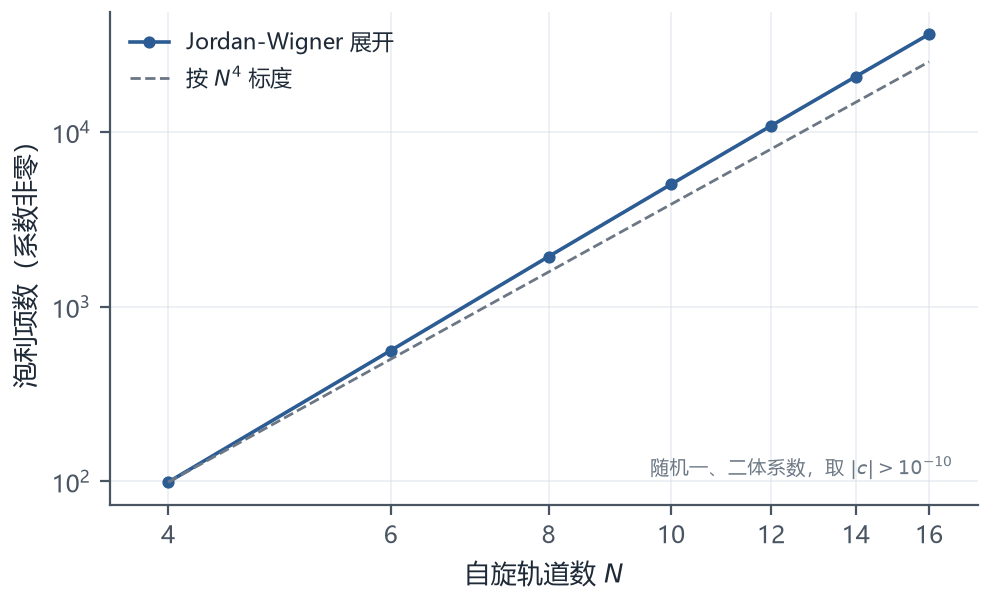
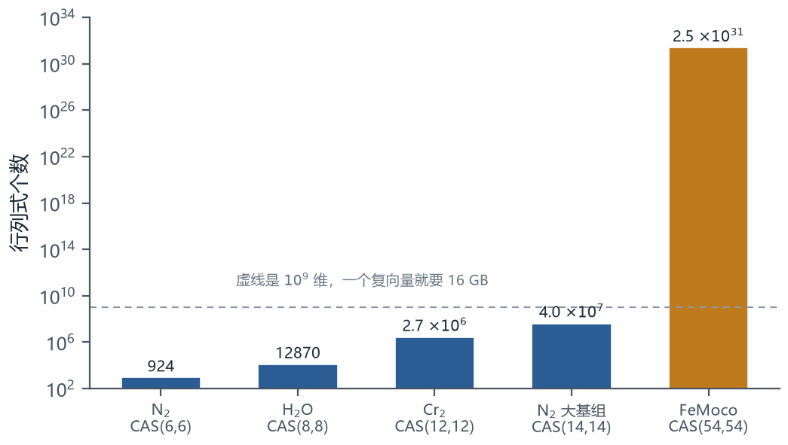

# 第 16 章　量子化学的算法路线

量子模拟最常被提到的应用是量子化学。原因不难理解，分子里的电子是天然的量子系统，电子相关能决定了反应速率、催化活性、材料带隙，而经典方法在这一块一直不轻松。

前两章讲的是“给定哈密顿量怎么演化”，这一章往回走一步，看这个哈密顿量从哪来。化学哈密顿量的形式跟自旋模型完全不同，它是费米子的，项数按轨道数的四次方增长，比特数和精度要求也都高一个档次。把这些弄清楚，才知道前面那些算法到了化学问题上是真的能用，还是只是纸面好看。

## 16.1 分子哈密顿量怎么写

先固定原子核的位置。玻恩与奥本海默在 1927 年指出，原子核比电子重几千倍，运动慢得多，可以把核当成静止的电荷分布，只解电子的薛定谔方程。这一步把问题简化成：给定一组核坐标，求电子的基态能量。

电子的哈密顿量包括动能、电子与核的吸引、电子之间的排斥。把它放到一组基函数上展开，就变成矩阵。基函数通常取原子轨道，每个原子贡献几个，氢原子一个 $1s$，氧原子 $1s$、$2s$、$2p_x$、$2p_y$、$2p_z$ 五个。这套最小的基组叫 STO-3G，水分子用它有 7 个空间轨道。

再乘上自旋，一个空间轨道对应两个自旋轨道，水分子于是有 14 个自旋轨道。这个数字决定了后面所有账目。氮气用同样的基组要 20 个，固氮酶的活性中心要 108 个。量子算法需要的比特数就是这个数，一个自旋轨道一个比特，没有任何压缩的余地。

写成二次量子化的形式，哈密顿量是

$$
H=\sum_{pq}h_{pq}\,a_p^\dagger a_q+\frac{1}{2}\sum_{pqrs}h_{pqrs}\,a_p^\dagger a_q^\dagger a_r a_s
$$

$a_p^\dagger$ 在轨道 $p$ 上产生一个电子，$a_q$ 湮灭一个。第一项是单电子部分，描述电子在核场里的运动，系数来自单电子积分。第二项是双电子部分，描述电子之间的库仑排斥，系数是双电子积分，一共 $N^4$ 个。

这套写法有个好处，它自动满足反对易关系，电子波函数的反对称性不用另外处理。代价是哈密顿量看起来简单，展开成矩阵却很麻烦，需要把产生湮灭算子翻译成量子比特上的操作。

## 16.2 Jordan-Wigner 映射

量子比特是自旋，费米子有反对易关系，两者不是一回事。映射要解决的问题是，用自旋的升降算子模拟费米子的产生湮灭，同时把符号管住。

Jordan 和 Wigner 在 1928 年给出了最直接的方案。把轨道按顺序排成一列，第 $j$ 个轨道的湮灭算子写成

$$
a_j=\left(\prod_{k<j}Z_k\right)\frac{X_j+\mathrm{i}Y_j}{2}
$$

前面那一串 $Z$ 是“宇称串”。它的作用是记录排在前面的轨道上有没有电子，每有一个，就给出一个负号。$X_j+\mathrm{i}Y_j$ 只翻转第 $j$ 个比特，从 $|1\rangle$ 到 $|0\rangle$。

反对易关系就是这样凑出来的。交换两个相邻轨道的算子，两个宇称串会多出一个 $Z$ 和一个 $Z$，它们彼此的交换给出 $-1$，符号正好对上。

代价在项数上。一个 $a_p^\dagger a_q$ 展开成两个泡利串，一个 $a_p^\dagger a_q^\dagger a_r a_s$ 展开成八个。费米子项有 $O(N^4)$ 个，乘上八，泡利项还是 $O(N^4)$，常数因子是八。

宇称串的长度也值得一提。$a_{N-1}$ 带着 $N-1$ 个 $Z$，长度随轨道数线性增长。这意味着一项双电子激发要用一条长串实现，线路深度跟着涨。为此有了 Bravyi-Kitaev 映射，它把宇称信息存在一棵树上，串的长度降到 $O(\log N)$，代价是变换的构造复杂得多。还有 parity 映射和各种对称性约化，利用电子数和自旋守恒，把比特数砍掉两个甚至更多。这些技巧在具体的实现里都会用到，选择哪一种，取决于硬件更怕深度还是更怕复杂度。

图 16-1　随机一、二体系数下，Jordan-Wigner 展开得到的非零泡利项数随自旋轨道数的变化，虚线是按 $N^4$ 的标度

图 16-1 是直接算出来的。取随机的一体、二体张量，按上面的规则展开，统计系数非零的泡利串。$N=14$ 时两万项，$N=16$ 时三万六千项，斜率接近四，跟 $N^4$ 的标度吻合。图里那条虚线是按 $N^4$ 从第一个点外推的，两条线几乎平行，说明决定项数的就是那个四次方。

真实分子比这少一些，因为对称性会让大批系数正好为零，轨道之间的耦合也有稀疏结构。但量级不会变，把一个 54 个轨道的活性空间（108 个自旋轨道）按这个规律外推，项数在 $10^8$ 量级。这就是化学哈密顿量的规模，它比同样比特数的自旋模型大了五六个数量级。

## 16.3 为什么项数这么大

差别来自连接结构。

这一点在估算时最容易被忽略。介绍量子化学算法时，常说“几十个比特就够处理某个分子”，听起来门槛不高。可这几十个比特要跑的门数是按项数算的，项数在几十万到上亿，门数乘上去，就变成了容错机器才能承担的量。比特数小和线路浅是两件不同的事，化学问题在后者上格外吃亏。

一个一百个格点的海森堡链，每个格点只跟左右邻居耦合，项数是几百个，哈密顿量是稀疏的。化学哈密顿量是全连接的，任意两个轨道之间都可能有单电子积分，任意四个之间都可能有双电子积分。电子之间的库仑排斥是长程的，没有“只跟邻居说话”这回事。

这个结构差异直接影响算法选择。第 15 章说过，Trotter 的成本按 $L$ 线性增长，LCU 的 SELECT 也要逐个处理这 $L$ 项。$L$ 从几百变成一亿，所有的常数都跟着放大。这几年化学算法的进展，很大一部分是把 $L$ 压下来，用张量超收缩把双电子积分写成低秩形式，项数从 $O(N^4)$ 降到 $O(N^3)$ 甚至更低。

还有一层结构可以用。化学哈密顿量里，粒子数是守恒的，$N$ 个自旋轨道上的 $n_e$ 个电子只占据维度为 $\binom{N}{n_e}$ 的子空间，比 $2^N$ 小很多。算法层面利用这一点，可以省比特也可以省门，只是线路设计会更麻烦。

## 16.4 VQE 与相位估计的取舍

哈密顿量有了，接下来怎么求基态能量。两条路线的分歧在这里最明显。

变分路线用量子线路制备一个参数化的试探态，测量能量的期望值，把结果交给经典优化器。它的优点是线路浅，不需要相位估计那么深的线路，也不需要纠错。第 13 章讲过它的基本流程，这里补上代价的部分。

代价在测量次数上。能量的期望值是 $L$ 个泡利项之和，每一项都要单独测，每次测量只能给出一个比特的信息。要把某一项的期望值测到精度 $\epsilon$，需要 $1/\epsilon^2$ 次重复。化学精度是 1.6 毫哈特里，相对误差要到 $10^{-3}$ 量级，一万个项乘上一百万次测量，是 $10^{10}$ 次采样。这个数字在当前的设备上要跑很久。

变分路线还有两个麻烦。一个是试探态的表达能力，线路浅了覆盖不到真正的基态，能量偏高，这个偏差没法从数据上看出来。另一个是贫瘠高原，参数一多，梯度就没了，优化器动不了。这两个问题在化学体系上都出现过。

相位估计路线反过来。它把能量编码进相位，测一次就给到 $t$ 位精度，线路深度按 $\lambda t$ 增长，需要纠错。只要机器够好，它的输出是可信的，没有“试探态不够好”这种隐性偏差。第 15 章算过，它的查询次数关于精度只有对数增长。

两条路线之间还有一些折中方案。近几年的“早期容错”算法用比 VQE 深、比完整相位估计浅的线路，配上经典的后处理，在少量逻辑比特上把精度提到化学要求。这类方法的名字很多，本质都是把相位估计拆成多段短线路，用经典计算把信息拼起来。设备处在什么阶段，就选什么阶段的算法，这是工程判断，不是理论优劣。

## 16.5 活性空间怎么选

全空间的电子结构计算很快就不行了。50 个轨道、50 个电子，行列式个数是 $10^{29}$ 量级，任何方法都装不下。

化学上的办法是分层。内层电子紧紧束缚在核附近，几乎不参与成键，可以冻结，用经典方法算出它们的贡献，当成一个常数加进去。最高的一批空轨道对基态影响很小，可以扔掉。中间那一层，能量接近费米面、参与成键和断裂的轨道，才是需要精确处理的，这部分叫活性空间。

活性空间的大小用 CAS$(m,n)$ 表示，$m$ 个空间轨道、$n$ 个电子。这个子空间的维数是 $\binom{2m}{n}$。图 16-2 列了几个常见的例子，数字都是组合数算出来的。

图 16-2　若干典型活性空间的行列式个数，按 $\binom{2m}{n}$ 计算，虚线标出 $10^{9}$ 维的位置

水分子取 CAS(8,8)，一万三千维，笔记本上就能对角化。氮气取 CAS(12,12) 到两百七十万维，需要一点技巧但还能算。固氮酶的活性中心 FeMoco 取 CAS(54,54)，$2.5\times10^{31}$ 维，任何经典机器都放不下，这正是量子算法被寄予希望的地方。

选多大的活性空间是化学判断，不是算法问题。判断的依据是哪些轨道在反应前后占据数变化明显，哪些轨道的占据数接近 0.5。选小了，静态相关能抓不住，结果偏差；选大了，比特数不够用。这个取舍没有通用答案，同一类分子在不同反应里，合适的活性空间也不一样。

基组的选择同样影响结果。STO-3G 只够定性，要定量得用 cc-pVDZ 甚至更大，轨道数翻几倍，比特数跟着翻。很多人算出的“化学精度”其实被基组误差吃掉了，这一项常常比算法误差大一个数量级。

## 16.6 现在的进展与判断

小分子的量子化学演示已经做了不少。氢分子、氢化锂、二氢化铍、水分子，都在几个到十几个比特的设备上算过基态能量，结果跟经典方法对得上。这些工作的意义在于验证流程，不在于超越经典，因为同样的问题，经典的多组态自洽场或者耦合簇方法在笔记本上几秒钟就给出更准的答案。

真正的分水岭在强关联体系。过渡金属配合物、光化学反应里的锥形交叉、高温超导的模型，这些地方的电子关联强，经典近似失效，而全空间又装不下。量子算法如果能在大活性空间上给出可靠的能量，那才有实用价值。

眼下的现实是，量子设备能处理的活性空间还不够大，经典方法在这一区间仍然更准更快。判断一个化学量子算法的价值，要看它瞄准的是哪个区间，是“经典已经能做”的，还是“经典做不动”的。前者只是练习，后者才是目标。

化学这条线讲到这里。下一章换一个方向，看组合优化，那里的目标和化学不同，要的不是精确的能量，而是一个足够好的解。
