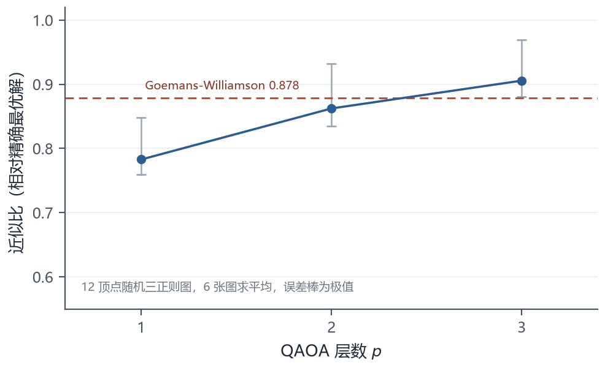
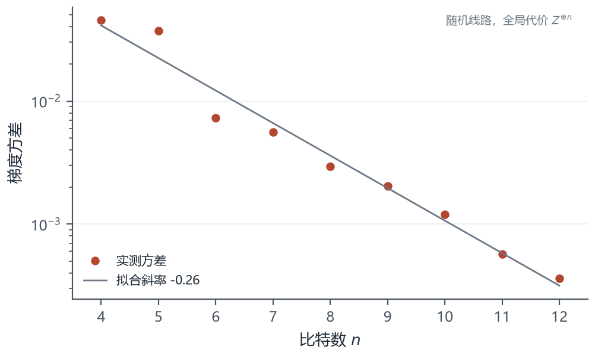

# 第 17 章　量子优化与退火

组合优化是量子计算最早被寄予希望的方向之一，也是争议最多的方向。

希望来自问题的形式。组合优化要在一堆离散的选择里挑一个最好的，状态空间随变量数指数增长，穷举不可能。量子态天然是这些选择的叠加，干涉可以放大好的解，这套说法听上去很顺。

争议来自证据。到现在为止，没有一个组合优化问题被证明有指数加速，连多项式加速都没有。所有声称的优势都是实验层面的，而实验的对岸站着一批越来越强的经典启发式。这一章把两条路线讲清楚，退火和 QAOA，再把贫瘠高原和经典基线摆出来，最后给一个不夸张的判断。

## 17.1 问题怎么写成哈密顿量

组合优化的标准形式是，给定一个代价函数 $C(x)$，在 $x\in\{0,1\}^n$ 里找使 $C$ 最小的那个。

量子算法处理的是哈密顿量，所以先要把 $C$ 写成自旋的形式。取 $z_i=1-2x_i$，取值 $\pm1$，任何一个二次型都能写成

$$
C(z)=\sum_{i<j}J_{ij}z_iz_j+\sum_i h_iz_i
$$

这叫伊辛模型。$J_{ij}$ 是耦合，$h_i$ 是外场。三项以上的项可以通过引入辅助变量降成二次，代价是多几个比特。

写之前还有一步，把变量数与比特数对齐。伊辛模型里每个自旋一个比特，约束用罚项之后可能多出几个辅助比特，但总的量级不变。这一步看起来平常，实际决定了后面所有的资源估算，一个 5000 变量的排班问题，至少要 5000 个比特，还要假设连接不受限制。

拿最大割问题举例。给一张图，把顶点分成两半，让跨越两半的边数最多。每条边 $(i,j)$ 对答案的贡献是 $(1-z_iz_j)/2$，两端在同一边时为零，在两边时为一。总代价于是是

$$
C(z)=\sum_{(i,j)\in E}\frac{1-z_iz_j}{2}
$$

最大化它就行。类似的编码可以处理图着色、旅行商、排班、无线频谱分配。约束条件用罚项处理，违反一次加一个很大的正数，让最优解自己避开违反约束的区域。

有一个前提要先说清楚。这类问题大多是 NP 难的，而量子计算机能高效求解的问题类 $\mathrm{BQP}$ 一般认为不包含 NP 完全问题。所以不要期待量子算法把指数复杂度变成多项式，能期待的最好情况是常数因子或者某些结构上的加速，比如在特定分布上更快找到近似最优解。

## 17.2 绝热定理与退火

退火的思路是连续变形。准备一个容易制备的哈密顿量 $H_0$，它的基态已知，比如所有自旋沿 $x$ 方向排列。再准备目标哈密顿量 $H_P$，它的基态就是优化问题的解。构造插值

$$
H(s)=(1-s)H_0+sH_P,\qquad s=\frac{t}{T}
$$

让 $s$ 从 0 慢慢走到 1。绝热定理说，只要走得足够慢，系统会一直待在瞬时基态上，走到终点就得到了 $H_P$ 的基态。

“足够慢”是有定量条件的。所需时间与最小能隙的平方成反比

$$
T\sim \frac{1}{\Delta_{\min}^2}
$$

$\Delta_{\min}$ 是整个过程里基态与第一激发态的最小能量差。问题就出在这里，很多优化问题在某个中间点会经历一次相变，能隙随变量数指数变小，时间跟着指数变长。这时候退火不比经典算法好，只是换了一种方式做指数搜索。

D-Wave 的机器就是这条路线的硬件实现。用超导磁通比特，耦合用可调的互感，规模已经做到几千个比特。它的连接不是全连接的，早期是 Chimera 图，每个比特只连六个邻居，后来是 Pegasus，连接多一些，但仍然稀疏。要把一个稠密的问题放上去，得先把图嵌入，一个逻辑变量占好几个物理比特，有效规模缩水一大截。这件事在比较性能时必须算进去，标称五千比特的机器，能处理的全连接问题可能只有几十个变量。

绝热路线还有一个变种叫量子随机游走，把退火过程改写成一次长时间的相干演化，理论上在某些构造上能绕开一阶相变。这类改进在论文里有漂亮的例子，落到硬件上仍然要面对能隙和噪声。

性能上的争论集中在 2013 到 2016 年。D-Wave 的研究者在一类专门构造的问题上报告了巨大的加速，随后经典算法一侧用更好的蒙特卡洛和聚类移动把差距追了回来。这些来回不说明量子退火没用，只说明优势声明需要非常小心地选择基线。经典算法在进步，量子硬件的规模也在进步，两边的曲线都在动，谁在前要看是哪一年、哪一类问题。

## 17.3 QAOA 的做法与成绩

另一条路线是变分的。量子近似优化算法用一串交替的酉操作构造试探态

$$
|\psi(\beta,\gamma)\rangle=\prod_{k=1}^{p}\mathrm{e}^{-\mathrm{i}\beta_k B}\,\mathrm{e}^{-\mathrm{i}\gamma_k C}\,|+\rangle^{\otimes n}
$$

$B=\sum_iX_i$ 是混合项，$C$ 是代价算符。每一层先按代价加相位，再用混合项把各个计算基之间的振幅搅动一次。$p$ 层就有 $2p$ 个角度，交给经典优化器调整。

结构上和 Trotter 化退火很像。事实上 $p$ 很大、角度取得很小时，QAOA 就退化成分段常数的绝热演化。区别在于 $p$ 通常只有几层到几十层，线路浅，可以在近期的设备上跑。

$p=1$ 时，三正则图上的最大割有一个漂亮的结果，最优角度下的近似比是 $0.6924$。这个数字低于经典算法，但它是最坏情形下的理论值，具体图上常常更好。

图 17-1　12 顶点随机三正则图上的最大割近似比随层数的变化，六张图求平均，误差棒为极值，虚线是 Goemans-Williamson 的保证值

图 17-1 是我们自己算的。六张 12 顶点的随机三正则图，每张图用精确枚举得到最优割，再跑 $p=1,2,3$ 的 QAOA，取多次随机初值里最好的结果。平均近似比从 $0.78$ 升到 $0.86$ 再到 $0.91$，逐层提升，但提升在变缓。$p=3$ 时的最好一张图到了 $0.97$，最差的一张只有 $0.88$，方差很大。

这个结果比文献里的最坏情形好，原因是图小。12 个顶点的问题，经典算法瞬间就能枚举，QAOA 在这里的表现不能直接外推到大规模。图里那条虚线要单独看，经典 Goemans-Williamson 算法对最大割有 $0.878$ 的最坏情形保证，而且它是多项式时间的，跑一万个顶点也只要几秒。QAOA 要到 $p=3$ 才在平均值上接近这条线，而 $p=3$ 的线路已经有六层两比特门，在真实硬件上误差累积得厉害。

还有更细的分析。近几年有工作系统地算过，三正则图上 QAOA 的近似比随 $p$ 提升得很慢，中等 $p$ 时仍低于 $0.878$，要追平需要相当深的线路。这类结论对“QAOA 能解组合优化”的说法是一个重要限定。

## 17.4 贫瘠高原再访

第 13 章提过贫瘠高原，这里给出量化的图像，因为它是变分类优化算法绕不开的障碍。

做法是这样的。取一条随机线路，深度跟比特数同阶，参数随机取，代价函数取全局的 $Z\otimes Z\otimes\cdots\otimes Z$。对第一个参数做参数平移，得到梯度。换一批随机线路重复，统计梯度的方差。

图 17-2　随机线路下全局代价的梯度方差随比特数的变化，双对数坐标，拟合斜率 $-0.26$

图 17-2 是实测的。方差从 4 个比特的 $4.5\times10^{-2}$ 降到 12 个比特的 $3.6\times10^{-4}$，拟合斜率 $-0.26$，跟 $2^{-n}$ 的理论斜率 $-0.30$ 接近，偏差来自样本量只有 30 条线路。斜率是负的，意味着每加一个比特，梯度方差差不多减半。到 50 个比特，方差就是 $10^{-15}$ 量级，任何有限精度的测量都读不出来。

原因是维数。随机线路把态搅成了近似 2-设计，代价函数在高维球面上几乎是常数，梯度自然趋于零。这不是优化器不行，是地形本身没有坡度。

缓解办法有几类。用局部代价代替全局代价，只测少数几个比特的关联，方差衰减变慢。用问题相关的线路结构，别用通用 ansatz。分层训练，先训浅的再加深。这些办法有效，但都把成本转移到别处，要么是测量次数，要么是线路设计的工作量。对 QAOA 这类有结构的算法，贫瘠高原出现得晚一些，$p$ 大、图稠密时照样会遇到。

## 17.5 经典启发式有多强

比较必须公平，所以要把经典一侧的办法列出来。

最大割有 Goemans-Williamson 的 $0.878$ 保证，实现是半正定规划加随机取整，一万个顶点的图几分钟能解。往上还有 Burer-Monteiro 分解加局部搜索，实践中常常做到最优或接近最优。

一般的整数规划有 Gurobi、CPLEX 这类商业求解器，分支定界加割平面，中等规模的问题（几千个变量）在笔记本上就能解到最优。它们的性能提升速度比硬件规模的增长还快。

退火类启发式也不弱。模拟退火、并行 tempering、禁忌搜索，针对具体问题调好参数，在几万个变量上给出很好的解。D-Wave 的对比实验里，最常被引用的经典对手就是这些方法。

回答质量还有一个维度容易被忽略，可验证性。优化问题给出的解可以直接代入代价函数验算，这一点比采样问题好，采样问题的输出没法核对。可验证意味着优势声明更难含糊过去，算得对不对，一算就知道。这也是优化这条线上争论特别多的原因，两边的结果都摆得出来，谁也藏不住。

这些事实决定了量子优化的处境。要说优势，必须在经典算不动的规模上比，可经典算不动的规模通常是几万到几百万个变量，而量子设备的比特数还停在一千上下，退火机还得为连接图付出嵌入的代价。两边不在同一个赛道上。

## 17.6 该怎么看这条路线

合理的期待有三条。

一条是特定结构。如果问题本身的耦合图跟硬件图匹配，嵌入代价小，退火可能在某些采样任务上有优势，比如从玻尔兹曼分布里采样，这类任务的输出是分布而不是单个解，评价方式不同。

一条是近似质量。有些应用不需要最优解，只要比某个阈值好，量子算法给出的解分布如果更集中在高分区，就有价值。这需要跟经典启发式在同样的时间预算下比较，而不是同样的迭代次数。

一条是与其他方法组合。用量子设备生成候选解，用经典方法精修，这种混合模式在近期比纯量子更现实。

不合理的期待是把量子优化当成万能钥匙。组合优化是 NP 难的，量子计算机不改变这个事实，能争取的只是常数和结构上的好处。任何一个声称指数加速的组合优化方案，都值得先问一句，它的假设是什么，跟哪个经典算法比，规模多大。

优化这条线讲完。下一个被寄予希望的方向是机器学习，那里的争议跟这里很像，证据不少，定论没有。下一章看它。
