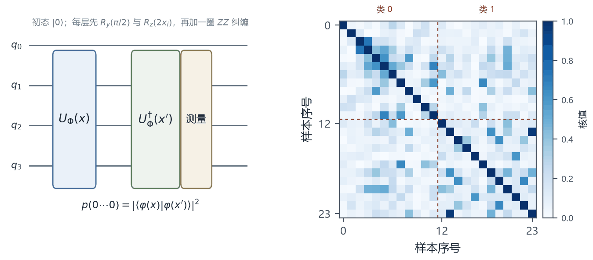
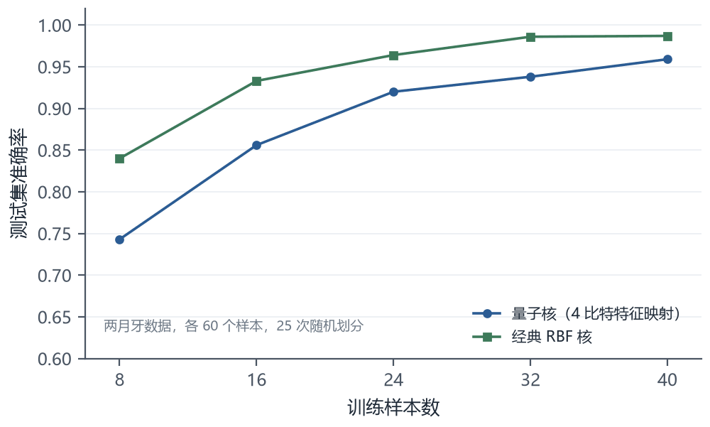

# 第 18 章　量子机器学习的证据与争议

量子机器学习是过去十年论文数量增长最快的方向，也是被“去量子化”打击得最厉害的方向。

它的吸引力很直观。机器学习要处理高维数据，量子态的空间维度随比特数指数增长，看上去天然适合表示高维特征。论文里的说法常常是，把数据映射到 $2^n$ 维的希尔伯特空间，在那里做线性代数，分类和聚类都能指数加速。

问题出在两头。一头是数据怎么进到量子态里，另一头是经典算法在这一块进步得比预想快。这一章把几条主要做法的具体形式讲清楚，然后看证据到底支持什么。

## 18.1 数据怎么放进量子态

任何量子机器学习算法都要先回答这个问题，经典的数据向量怎么变成量子态。

最常用的是振幅编码。把一个 $N$ 维向量归一化后，直接当成 $N$ 个振幅

$$
|x\rangle=\frac{1}{\|x\|}\sum_{i=1}^{N}x_i|i\rangle
$$

$N=2^n$ 时用 $n$ 个比特就装下了整个向量，看上去很省。制备这个态却要 $O(N)$ 个门，因为 $N$ 个振幅是 $N$ 个独立参数，每个都要转出来。$N=10^6$ 就要一百万个门，线路深到无法执行。

另一种是角度编码，把每个特征编码成一个旋转角，一个特征一个比特。制备简单，门数线性于特征数，但比特数也线性于特征数，省不下来。

还有量子随机存取存储器。数据存在一棵树的叶子上，用地址的叠加去寻址，一次查询取出所有地址对应数据的叠加，深度是 $O(\log N)$。这个方案在理论上很漂亮，硬件上却没有人造出过大容量的版本，因为每个节点都要有物理实现，成本从线路转移到了设备。

三种编码各有各的账，共同点是，数据读入从来不是免费的。省下的比特数往往要在门数上还回去，省下的门数又要在硬件上还回去，能不能找到一个平衡点，取决于具体任务，没有通用答案。后面所有的“指数加速”都要先扣掉这一笔。

## 18.2 量子核方法

核方法是最干净的一类量子机器学习算法，因为它把量子部分压缩成了一件事，算内积。

做法是定义一个特征映射，用一个量子线路把数据变成态

$$
|\varphi(x)\rangle=U(x)|0\rangle^{\otimes n}
$$

两个样本的核就是它们在这个空间里的重叠

$$
K(x,x')=\left|\langle\varphi(x)|\varphi(x')\rangle\right|^2
$$

线路结构是这样，先作用 $U(x)$，再作用 $U(x')^\dagger$，最后测所有比特回到 $|0\rangle$ 的概率。概率就是核值。也可以用一个辅助比特做交换测试，代价差不多。

图 18-1　左：计算两个样本核值的线路，先做特征映射再做逆映射，测量全零概率。右：24 个两月牙样本的核矩阵，按类别排序，对角线附近核值高

图 18-1 右边是我们用 4 比特特征映射算出来的核矩阵。对角线上核值接近 1，因为样本跟自己完全重叠；同类的样本之间核值明显高于异类，两个 $12\times12$ 的方块能看出来。这个结构就是分类器能工作的原因，核矩阵把数据映射到了一个更容易分开的空间。

核方法之后接一个经典的支持向量机或者核岭回归，整个流程就完了。量子部分只负责算核，其余交给经典。

代价要先算清楚。$M$ 个训练样本要算 $M(M+1)/2$ 个核值，每个核值是一次线路执行，重复若干次把统计误差压下去。$M=1000$ 就是五十万次线路执行，训练集的规模直接乘在量子资源上。这一点在论文里常被略过，实际排期时躲不掉。

优势的论点是这样的。如果 $U(x)$ 足够复杂，核函数无法在经典计算机上高效计算，那么用量子设备算核、用经典设备做分类，就得到了一条经典拿不到的信息通路。这个论点在逻辑上成立，问题在于前提。大多数被提出的特征映射，比如各种 $ZZ$ 特征映射，其核函数恰好可以被经典方法算出来，用张量网络或者傅里叶展开都行。核算得出来，优势就没了。

2019 年 Havlíček 等人在超导设备上做了一个小规模的核分类演示，用 2 个特征、几个比特，把两类数据分开。这类实验的意义是验证流程能跑通，不是证明优势。随后几年，经典模拟在同一批数据上给出了相同甚至更好的结果。

## 18.3 变分分类器

另一类做法把分类器整个做成参数化线路，用经典优化器训练。

思路是数据重上传。把数据 $x$ 编码进线路的角度，中间夹上可训练的参数，反复上传几轮，最后测一个观测量，把期望值当成分数。训练就是调整参数让分数符合标签。

这套结构跟神经网络的对应很清楚，编码层像输入层，参数层像隐藏层，测量像输出层。表达能力的分析也有现成工具，把它展开成傅里叶级数，频率成分由编码方式决定，系数由参数决定。这个视角解释了一个现象，线路的拟合能力受限于它能产生的频率，加数据重上传的轮数就是加频率。

还有一个更基础的疑问，这类模型到底有没有经典模型替代不了的能力。近两年有分析指出，任何训练好的量子模型，只要它的输出可以被测量，就存在一个经典模型能复现它在测试集上的预测，代价是经典模型要多花一些计算。这个结论不否定量子模型的价值，但它说明“量子模型能表达经典模型表达不了的东西”这句话需要限定，表达能力和可提取的信息是两件事。

困难在训练。第 17 章算过的贫瘠高原在这里同样出现，参数一多，梯度就没了。另外还有泛化问题，训练集只有几十个样本时，一个表达能力很强的线路可以完美拟合训练集，测试集上却不行。这两件事叠加，使得变分分类器在小数据上的实际表现往往不如一个调好参数的核方法。

## 18.4 去量子化

2018 年之后，一批量子机器学习算法被证明可以用经典算法复现，这类工作叫去量子化。

套路是固定的。先看量子算法用到了什么，往往是一个“按重要性采样”的能力，数据存在某种可以快速访问的结构里，算法从中抽取与范数成比例的样本。然后构造一个经典数据结构，实现同样的采样，剩下的步骤全部用经典线性代数完成。结果是复杂度几乎一样，指数加速消失了。

被这样处理过的任务包括低秩矩阵的推荐系统、主成分分析、聚类、部分凸优化。它们的共同点是依赖一个强假设，数据已经以一种特殊形式存在于量子存储器里，读取是免费的。这类论文往往比原论文短，因为把假设拆开之后，剩下的数学不再需要量子力学的语言，只是高维空间里的采样与内积。

去量子化不是否定量子计算。Shor 算法没有被去量子化，Grover 也没有，因为它们不依赖数据读入的假设。被清掉的是一批建立在免费午餐上的方案。这件事对领域的长期健康有好处，它逼着研究者说清楚，加速到底来自量子力学，还是来自那个假设。

## 18.5 数据读入的瓶颈

把前面的线索合起来，会看到一个清晰的分界。

如果数据是经典的，比如图像、文本、表格，那么它必须先被编码成量子态，编码成本通常是 $O(N)$，正好吃掉指数加速。这类任务上，量子算法要么没有优势，要么优势只剩多项式级别。

如果数据本身就是量子的，比如量子实验的输出、量子材料的测量结果、量子模拟器产生的态，那么“编码”这一步不存在，数据已经在量子态里了。这类任务上，优势是有可能的。

2021 年之后，一批工作沿着这条线做出了可证明的结论。有人证明了，在学习“由量子过程产生的数据”的性质时，量子算法相对经典算法有指数级的样本复杂度优势，而且这个优势不依赖任何关于计算复杂度的猜想。条件写得很清楚，数据必须来自量子过程，经典机器只能拿到测量结果。这类结论是目前量子机器学习里最扎实的一批。它们的结构也很清楚，优势不在计算速度，而在样本效率，也就是达到同样精度需要多少次实验。对一个量子系统做测量是昂贵且破坏性的，能用更少的测量学到它的性质，这个价值跟“算得快”是两回事，也更容易站得住。

## 18.6 什么才算真优势

判断一个量子机器学习的结果，可以问三个问题。

数据是哪来的。经典数据要被编码，成本必须计入；量子数据不需要编码，这一条是分水岭。

经典基线是哪一年的。这一块经典算法进步极快，两年前的对比对象已经过时。张量网络、核方法的经典近似、甚至简单的特征工程，常常能在小规模上追平。

任务本身有没有价值。把一个人工构造的数据集分类到 100%，除了证明线路能跑，说明不了什么。有价值的是真实问题上比现有方法更好，或者至少在经典方法失效的规模上给出可用结果。

我们自己做了一个小对照实验，图 18-2 是结果。两月牙数据集，各 60 个样本，4 比特的 $ZZ$ 特征映射加核岭回归，对手是经典的高斯核。

图 18-2　两月牙数据集上量子核与经典 RBF 核的测试准确率随训练样本数的变化，25 次随机划分求平均

结果是经典核全面占优，训练样本 8 个时是 0.84 对 0.74，40 个时是 0.99 对 0.96。这不能说明量子核方法没有前途，4 个比特、两轮映射的表达能力有限，换更深的映射或者别的数据集，结论可能不同。它说明的是另一件事，在小规模上，量子一方没有任何自动的优势，想赢必须拿出具体的设计。

把这三个问题和这个实验放在一起，对量子机器学习的判断就清楚了。它是一个活跃的研究方向，有真实的理论问题，有可证明的样本复杂度结论，也有明确的适用边界。它还不是一个能兑现的技术，宣传里那些“量子加速”的案例，多数在仔细核算之后站不住。

机器学习的争议讲完了。最后一章回到工程，看这些算法到底用什么工具写，在什么机器上跑，跑出来的数字怎么读。
