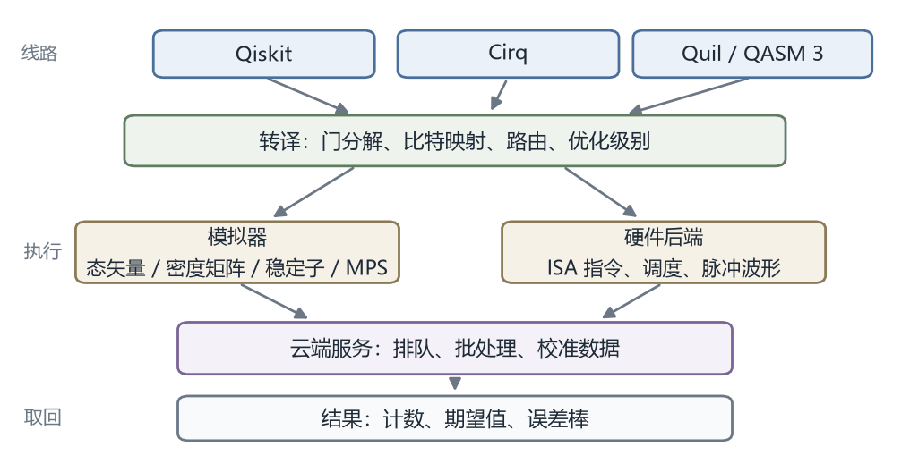
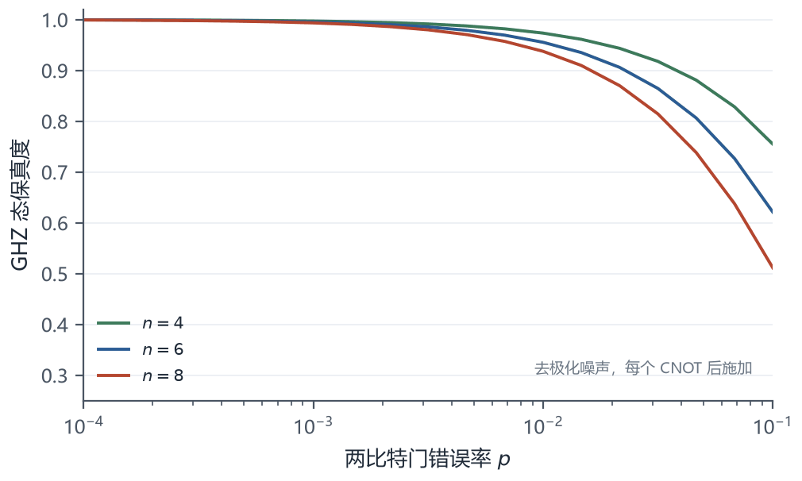

# 第 19 章　编程工具链与云端

前面十八章讲的是原理和算法，真正动手时，面对的是一个 Python 环境、一个网页控制台和一堆校准数字。

工具链这一层看起来琐碎，其实决定了什么能做、什么做不了。同一个算法，在模拟器上跑得通，换到真机就可能因为布局和噪声完全失效；同一个线路，用不同的框架写，能控制的粒度也不一样。这一章按使用者会遇到的顺序讲，先看整体结构，再看三个主流框架的分工，然后是模拟器、编译选项、云端作业和结果解释。

## 19.1 一条线路的四层

从写下第一个门到拿到计数，中间有四层。图 19-1 是这条链的全貌，模拟器和硬件在第三层分成两条路。

图 19-1　从线路描述到结果取回的层次，模拟器与硬件后端是同一层的两条分支

两条分支并不对等。模拟器给出的是精确结果，或者按噪声模型采样得到的结果；硬件给出的是真实物理过程的结果。两者之间的差距，就是这一章后半部分要处理的事。

第一层是线路描述。用户写的是 Python 对象，一个量子线路，里面有一串门，每个门带比特编号和参数。

第二层是转译。硬件的门集只有几种，比特之间不是两两相连，这一层负责把理想线路变成硬件能执行的形式。门要分解成基础门，逻辑比特要映射到物理比特，需要相互作用却不相邻的比特之间要插交换门，最后再做一轮优化。

第三层是执行。走模拟器就是矩阵乘法，走硬件就是把指令翻译成脉冲，按时序打出去。

第四层是取回。硬件返回的是一串比特串的计数，还要配上这一次作业的校准数据，否则没法解释结果。

## 19.2 三个框架的分工

Qiskit 是 IBM 的框架，Python 生态最完整。它的核心是线路对象加转译器，转译器读入后端信息，包括耦合图和基础门集，输出可执行的线路。它的长处在于跟硬件绑得紧，校准数据、作业提交、结果解析都在同一套接口里。2024 年发布 1.0 之后，包结构做了拆分，核心的线路与转译、模拟器、以及面向具体硬件的扩展各自独立，安装时按需选。

Cirq 是谷歌的框架，设计上更贴近硬件时序。它的线路由“时刻”组成，每一时刻是一批并行的门，用户能精确控制谁跟谁同时执行。这个设计对需要精细时序的实验很重要，比如动态解耦、脉冲级校准、跨比特的串扰分析。它的抽象比 Qiskit 低一层，写起来啰嗦一些，换来的是控制力。

Quil 是 Rigetti 的指令集，pyQuil 是它的 Python 接口。它的特点是语言和指令集统一，Quil 本身就是一种带控制流的量子指令语言，扩展版本 Quil-T 支持脉冲级的定时与波形。用它写程序，接近写汇编，适合需要直接操控脉冲的场景。

三者之间有一个共同的交换格式，OpenQASM。第三版支持经典控制流、定时和更丰富的类型，被多数框架接受为导入导出格式。跨框架迁移时，通常走这条路。

选哪个，取决于三件事。后端在哪家，就用哪家的框架，省掉适配的麻烦。要不要脉冲级控制，要就选 Cirq 或者 pyQuil。生态和文档，Qiskit 的教程和第三方库最多，入门最省力。

## 19.3 模拟器

在真机上跑之前，几乎所有的调试都在模拟器上做。

模拟器有几种，代价差别很大。

态矢量模拟器存 $2^n$ 个复振幅，每次门操作是一次线性变换。$n=30$ 就是十亿个复数，十六吉字节，普通工作站的上限大概在这里。它的好处是什么都能算，纠缠、干涉、测量概率，一个不落。

密度矩阵模拟器存 $2^n\times2^n$ 的矩阵，$n=12$ 就是一千六百万个元素，再大就装不下。它能表示混态，所以能模拟噪声，代价是比特数少得多。

稳定子模拟器只能处理 Clifford 门，但它用 $O(n^2)$ 个整数表示态，能算到几千个比特。加进非 Clifford 门之后，成本随这类门的个数指数增长，所以它适合验证纠错线路的表面码，不适合通用算法。

张量网络模拟器按第 14 章的办法压缩态，适合低纠缠的线路，比如一维系统的演化。键维一涨就慢下来，能不能用要看具体线路。

还有一类模拟器专门做噪声采样。它不存密度矩阵，而是维护一个态矢量，按概率随机插入泡利错误，跑很多次取平均。这样每个样本的成本跟态矢量模拟一样，样本数决定精度，比特数能比密度矩阵多一倍。多数云平台的噪声模拟走这条路。

选模拟器是看目的。验证线路逻辑，态矢量最直接。估计噪声的影响，密度矩阵或者带噪声模型的态矢量。测试纠错，稳定子。研究一维动力学，张量网络。

有一个陷阱要提前说。无噪声模拟器给出的结果总是漂亮的，保真度 1.0，期望值精确到小数点后十几位。把这个线路搬到真机上，结果会难看得多。所以流程应该是先在噪声模型上跑一遍，看结果退化到什么程度，再决定要不要上真机。

## 19.4 编译选项怎么选

转译器一般提供几个优化级别，Qiskit 里是 0 到 3，数字越大优化越激进。

级别 0 只做必要的转换，门分解到基础门集，比特按初始布局映射，不做路由优化。级别 1 加一些轻量的合并，把相邻的单比特门合成一个。级别 2 和 3 会尝试多种布局和路由策略，在候选里挑门数或者深度最小的那个。

级别高的不一定好。优化器是启发式的，搜索空间大，编译时间可能从毫秒涨到分钟，而结果有时反而更差，因为它优化的目标和你的目标不一致。默认目标通常是门数或者深度，如果你的线路对两比特门特别敏感，就该把权重调过来。

布局的影响可以用一个数字说明。一条在 127 比特设备上制备全连接的 GHZ 态线路，逻辑上只需要 126 个 CNOT。如果初始映射把相邻的逻辑比特放到图上相隔很远的物理比特，路由器要在中间插入交换门，两比特门的总数会翻几倍，深度也跟着涨。换一个布局策略，同样的线路可能只要多出几十个门。这一块的差异，往往比算法层面的优化更大。

还有一件事容易被忽略，转译结果依赖后端的校准数据。同一段代码，今天和明天编译出来的线路可能不一样，因为耦合图上某些门的错误率变了，布局跟着变。想复现结果，就得把编译后的线路存下来，而不是只存源代码。

## 19.5 云端与作业

真机都在云上。

IBM 的平台把设备按规模分档，免费额度按每月执行时间计，超出要付费。亚马逊的 Braket 是一个聚合平台，背后接了离子阱、超导、中性原子几家厂商的设备，接口统一，按任务和 shots 计费。微软的 Azure Quantum 类似，还提供一些优化求解器。国内的本源量子、国盾、中国电信的天衍等平台也提供云上访问，主要面向教育和科研。

作业模型大同小异。提交一个线路加 shots 数，进入队列，轮到你时执行，返回计数。队列的等待时间从几分钟到几天不等，取决于设备和时段。需要大量小任务时，用批处理或者会话模式，把一批线路打包提交，减少排队开销。

校准数据是这一层最有价值的东西。每台设备每天更新一次，包括每个比特的 $T_1$、$T_2$、读出错误率、单比特门错误率、两比特门错误率，还有耦合图上每条边的错误率。这些数字决定了线路能不能跑，也决定了结果可信到什么程度。写论文时把这些数据一起报出来，是基本要求。

## 19.6 噪声、保真度与结果解释

硬件的噪声有几个来源。能量弛豫，$T_1$ 在百微秒量级；退相位，$T_2$ 通常比 $T_1$ 短；门操作不完美，单比特门错误率在万分之几，两比特门在千分之几到百分之一；测量不完美，读出错误在百分之一上下。

这些数字乘上线路上门的个数，就得到大致的保真度。图 19-2 是一个具体的估算，制备 GHZ 态，每个 CNOT 之后加一层去极化噪声。

图 19-2　去极化噪声下 GHZ 态保真度随两比特门错误率的变化，比特数分别为 4、6、8，用密度矩阵精确模拟

图 19-2 里，门错误率 $10^{-3}$ 时，8 个比特的 GHZ 保真度还有 0.98，4 个比特是 0.99。错误率抬到 $10^{-2}$，8 个比特掉到 0.81，4 个比特还有 0.92。比特越多曲线掉得越快，因为门数按比特数增长。按这个趋势外推，一百个比特的 GHZ 在千分之一的错误率下保真度只有一半左右，这就是为什么大比特数的纠缠态制备是一个里程碑。

读结果时还有统计误差。$N$ 次测量的频率估计，标准差是 $1/(2\sqrt{N})$。想分辨 1% 的概率差，至少要一万次测量。这个量级常常被忽略，一个 0.51 对 0.49 的差异，在一千次测量下完全不显著。

误差缓解是现在常用的一套办法，它处理的是另一类误差，系统的、可重复的偏差。零噪声外推把同一线路在不同噪声水平下跑几遍，把结果外推到零噪声，代价是几倍的 shots。概率误差消除对每个门做准概率分解，理论上能还原无噪声期望值，代价是采样开销随门数指数增长。测量误差缓解用校准矩阵把读出错误反解回去，代价小，效果好。这些方法都能改善数字，但都不能创造信息，缓解之后的误差棒要如实报告。

最后是一条经验。一个漂亮的数字不足以说明算法对。保真度高只说明态制备得好，不说明它算的是你要的东西。判断一个结果，要看它跟理论值的偏离是否在误差棒内，要看换一台设备是否复现，要看经典模拟在同一规模上给出的答案。这三条都过了，才谈得上可信。

工具链讲到这里，这一册也走到了尽头。从态矢量到算法，从算法到模拟，从模拟到工具，这条线走下来会发现一件事，量子计算的门槛不在某一个惊艳的算法，而在每一层的账都要算清楚。比特数、门数、深度、保真度、采样次数，任何一项算错，结论就会反转。能把账算清楚的人，比会背算法名字的人走得更远。
