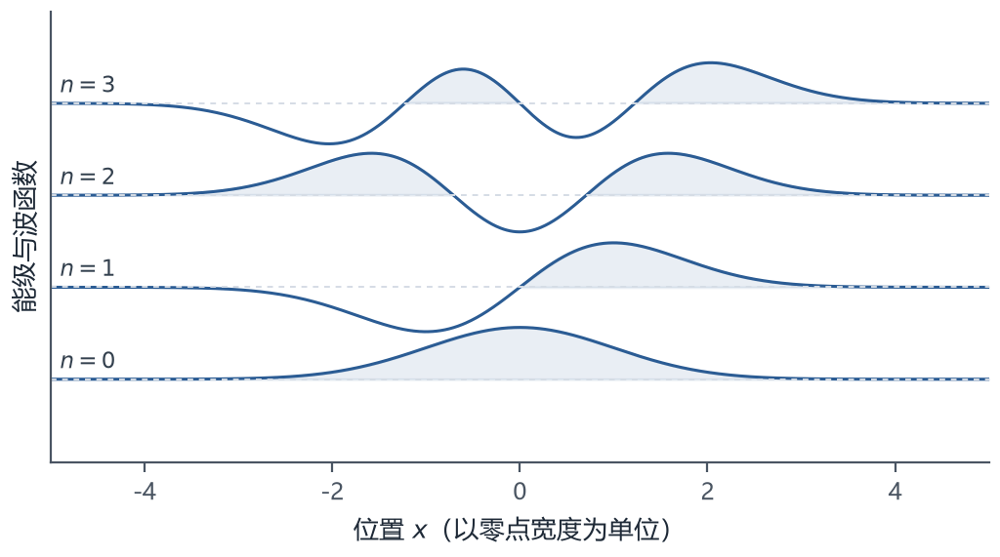
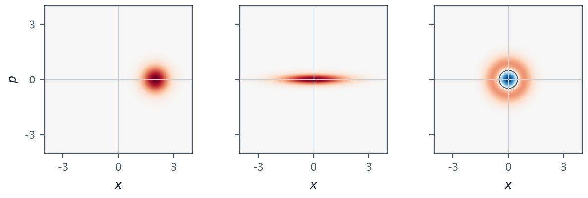

# 第 1 章　光的量子态

激光在大多数场合可以用经典的电磁波描述，振幅、相位、偏振都是连续的数。可一旦要把光当成量子信息载体，就必须把它量子化。这一章讲量子化的光场长什么样，以及它跟经典光有什么不同。

## 1.1 谐振子

电磁场的一个模式，数学上就是一个谐振子。把麦克斯韦方程按模式展开，每个模式对应一个独立的振动，哈密顿量写成

$$
H = \frac{p^2}{2m} + \frac{1}{2}m\omega^2x^2
$$

解这个哈密顿量，能级是等间距的

$$
E_n = \hbar\omega\left(n+\frac{1}{2}\right),\qquad n = 0,1,2,\dots
$$

$n=0$ 是基态，能量并不为零，最低也有 $\frac{1}{2}\hbar\omega$，这就是零点能。

图 1-1　谐振子的前四个能级和对应的波函数，能级等间距，波函数的节点数随 $n$ 增加

## 1.2 升降算符

处理谐振子有一套更简洁的语言，用产生和湮灭算符。

定义

$$
a = \sqrt{\frac{m\omega}{2\hbar}}\left(x + \frac{i}{m\omega}p\right),\qquad
a^\dagger = \sqrt{\frac{m\omega}{2\hbar}}\left(x - \frac{i}{m\omega}p\right)
$$

它们满足对易关系

$$
[a,a^\dagger] = 1
$$

哈密顿量用它们表示，变成

$$
H = \hbar\omega\left(a^\dagger a + \frac{1}{2}\right)
$$

$a^\dagger a$ 叫粒子数算符，记作 $\hat{n}$。它的本征态就是能级 $|n\rangle$，本征值是 $n$。

$a^\dagger$ 作用在 $|n\rangle$ 上，得到 $\sqrt{n+1}|n+1\rangle$，把能级升高一级；$a$ 作用在 $|n\rangle$ 上，得到 $\sqrt{n}|n-1\rangle$，把能级降低一级。这就是“产生”和“湮灭”这两个名字的来源。

在光场里，$|n\rangle$ 表示这个模式里有 $n$ 个光子，这叫光子数态，也叫 Fock 态。

## 1.3 光子数态

Fock 态有几个特点。

光子数完全确定，测量一定得到 $n$。代价是相位完全不确定，因为相位和光子数是一对共轭量，满足类似不确定性关系的约束。

对 $n \geq 1$，电场强度的平均值是零，因为相位随机，各个时刻的场方向互相抵消。可电场强度的平方的平均值不为零，说明场在涨落。

$n=0$ 是真空态，没有光子，但场仍然有零点涨落。这个涨落是激光冷却、卡西米尔效应、自发辐射的根源。

## 1.4 相干态

激光器输出的光，更接近相干态。

相干态记作 $|\alpha\rangle$，它是湮灭算符的本征态

$$
a|\alpha\rangle = \alpha|\alpha\rangle
$$

其中 $\alpha$ 是一个复数，它的模长对应平均光子数，辐角对应相位。

用 Fock 态展开，相干态是

$$
|\alpha\rangle = e^{-|\alpha|^2/2}\sum_{n=0}^{\infty}\frac{\alpha^n}{\sqrt{n!}}|n\rangle
$$

光子数服从泊松分布

$$
P(n) = e^{-\bar{n}}\frac{\bar{n}^n}{n!},\qquad \bar{n} = |\alpha|^2
$$

泊松分布的特征是方差等于均值。平均一百个光子，涨落大约是十个，相对涨落百分之十。平均一万个光子，相对涨落百分之一。光子数越多，越接近经典光。

相干态在相空间里是一个圆形的模糊斑，中心在 $(\mathrm{Re}\,\alpha, \mathrm{Im}\,\alpha)$，宽度由真空涨落决定。

## 1.5 压缩态

量子噪声有一个下限，叫标准量子极限，它来自真空涨落。压缩态可以突破这个下限，代价是另一个共轭量的噪声变大。

数学上，压缩算符作用在真空态上

$$
S(\xi) = \exp\left[\frac{1}{2}\left(\xi^*a^2 - \xi a^{\dagger2}\right)\right]
$$

其中 $\xi = re^{i\theta}$，$r$ 叫压缩因子。压缩以后，一个正交分量的方差缩小 $e^{-2r}$，另一个放大 $e^{2r}$。不确定性关系仍然满足，因为两个方差的乘积没有变小。

压缩态在引力波探测里非常有用。LIGO 的灵敏度受真空涨落限制，注入压缩真空可以把噪声压到标准量子极限以下。2019 年起，LIGO 和 Virgo 常规使用压缩光，灵敏度提升了几个分贝。

图 1-2　三种量子态的维格纳函数，从左到右依次是相干态、压缩真空态和单光子态

## 1.6 维格纳函数

要把量子态画在相空间里，最常用的工具是维格纳函数 $W(x,p)$。

它有几个好性质。对 $p$ 积分得到位置分布，对 $x$ 积分得到动量分布。它是实函数，可以为负。负值区域是量子态非经典性的标志，经典的概率分布不可能为负。

相干态的维格纳函数是一个高斯斑，全为正，中心在 $(\mathrm{Re}\,\alpha, \mathrm{Im}\,\alpha)$，这跟经典图像完全一致。

压缩态的维格纳函数也是一个高斯斑，只是被拉长了，一个方向窄，一个方向宽。

Fock 态的维格纳函数会出现负值。单光子态的中心是负的，周围一圈是正的，这说明它没有经典对应物。实验上测到负值，是量子性的直接证据。

## 1.7 单光子源与压缩源

工程上最关心的两类非经典光源，是单光子源和压缩光源。

单光子源要求每次只出一个光子，判据是 $g^{(2)}(0) < 0.5$。实现方式包括量子点、金刚石色心、参量下转换的预报源。当前最好的单光子源，$g^{(2)}(0)$ 可以做到 $10^{-3}$ 以下，效率超过百分之九十。

压缩光源用非线性晶体里的参量过程产生。连续变量量子密钥分发、量子精密测量、光量子计算都用它。当前的压缩度可以做到十五分贝以上，也就是噪声压到原来的三十分之一。

这些光源是光量子技术的基础设施。没有它们，量子密钥分发、线性光学量子计算、引力波探测都无从谈起。

## 1.8 从模式到比特

一个光场模式可以承载一个量子比特，编码方式有好几种。

偏振编码用水平偏振和竖直偏振作为 $|0\rangle$ 和 $|1\rangle$，优点是简单，可以用波片操作，缺点是光纤里的偏振会漂移。

路径编码用两条波导或者两条路径作为 $|0\rangle$ 和 $|1\rangle$，在集成光路里很自然，缺点是需要稳定的干涉。

时间编码用早时间窗口和晚时间窗口作为 $|0\rangle$ 和 $|1\rangle$，在光纤里传播稳定，适合长距离。

频率编码用两个不同的频率作为 $|0\rangle$ 和 $|1\rangle$，抗干扰能力强，缺点是频率转换难。

编码方式的选择，取决于传输距离、器件成熟度、以及与后续操作的兼容性。这是光量子工程里最实际的权衡之一。

真实系统不会这么干净，环境总在伸手，噪声迟早要进方程。
