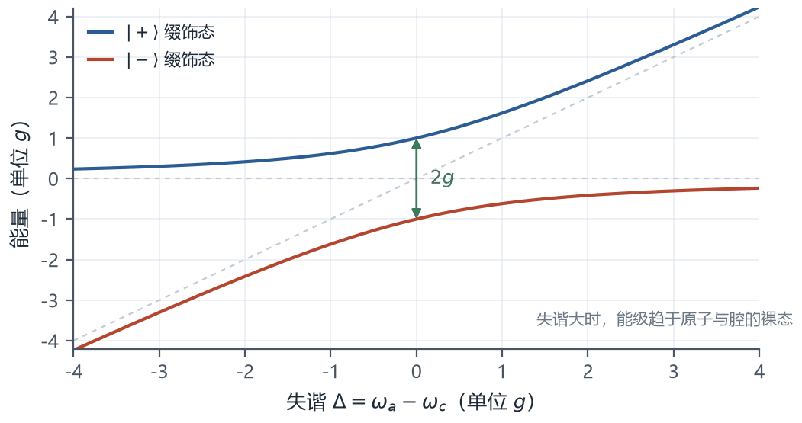
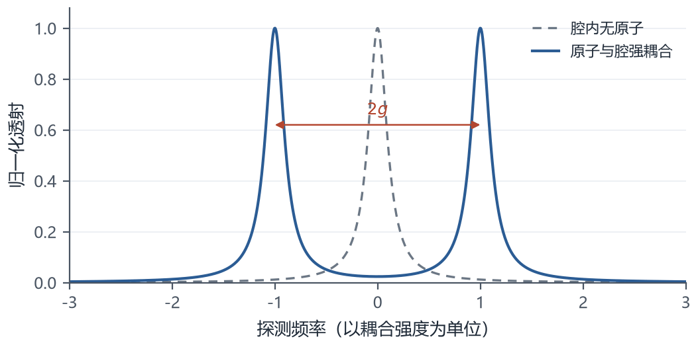

# 第 3 章　光与物质的强耦合

把单个原子放进一个由两面镜子构成的小腔里，会发生一件很有意思的事。原子不再只是自己发光，它跟腔里的光场成了一个整体，共享能量，共享相位，形成新的本征态。这个系统叫腔电动力学，是量子光学最有成果的分支之一。

这一章讲它的核心模型，以及它在量子计算里的用处。

## 3.1 一个二能级原子加一个腔模

把原子简化成二能级系统，能级差 $\hbar\omega_a$，用升降算符 $\sigma_+$、$\sigma_-$ 描述。把腔简化成单模光场，频率 $\omega_c$，用 $a^\dagger$、$a$ 描述。

两者的耦合来自电偶极相互作用。在旋转波近似下，哈密顿量写成

$$
H = \hbar\omega_c a^\dagger a + \frac{\hbar\omega_a}{2}\sigma_z + \hbar g\left(a^\dagger\sigma_- + a\sigma_+\right)
$$

这个哈密顿量叫 Jaynes-Cummings 模型，1963 年由 Jaynes 和 Cummings 提出。

耦合项有两种过程。$a^\dagger\sigma_-$ 表示原子从激发态掉到基态，同时腔里多一个光子，这是自发辐射。$a\sigma_+$ 表示原子吸收一个光子跳到激发态，这是吸收。两个过程都严格守恒能量，一进一出，所以叫旋转波项。

另外两种过程，同时产生光子和激发原子，或者同时湮灭光子和退激发，能量不守恒，在旋转波近似里被丢掉了。

## 3.2 缀饰态

JC 模型有一个很好的性质，它可以在激发数守恒的子空间里精确求解。

考虑总激发数为 1 的子空间，基矢是 $|e,0\rangle$ 和 $|g,1\rangle$。在这个子空间里，哈密顿量写成矩阵

$$
H_1 = \hbar\begin{pmatrix}\omega_a/2 & g\\ g & \omega_c - \omega_a/2\end{pmatrix}
$$

对角化得到两个本征态，叫缀饰态

$$
|+\rangle = \cos\frac{\theta}{2}|e,0\rangle + \sin\frac{\theta}{2}|g,1\rangle,\qquad
|-\rangle = -\sin\frac{\theta}{2}|e,0\rangle + \cos\frac{\theta}{2}|g,1\rangle
$$

其中 $\tan\theta = 2g/\Delta$，$\Delta = \omega_a - \omega_c$ 是失谐。

本征值是

$$
E_\pm = \hbar\left[\frac{\omega_a+\omega_c}{2} \pm \sqrt{\frac{\Delta^2}{4}+g^2}\right]
$$

图 3-1　缀饰态能量随失谐的变化。共振时两条曲线分开 $2g$，失谐大时趋于原子与腔的裸态

这张图的关键是共振点 $\Delta = 0$。如果没有耦合，两条曲线会在这一点交叉；有了耦合，它们互相排斥，分开一段距离 $2g$。这个现象叫避交叉，是强耦合的直接标志。

## 3.3 真空拉比分裂

避交叉在光谱上的表现是真空拉比分裂。

腔里没有原子时，透射谱是一个单峰，中心在腔频。放入原子并调到共振，单峰裂成两个峰，间距 $2g$。这个分裂不需要任何外加光子，它是原子与真空涨落的耦合，所以叫“真空”拉比分裂。

图 3-2　腔的透射谱。无原子时是单峰，强耦合时裂成两个峰，间距由 $2g$ 决定

这个实验在 1990 年代由 Kimble 小组在原子束上做出来，后来在单个原子上重复，成为腔电动力学的标志性结果。分裂的大小直接给出了耦合强度 $g$，也给出了系统是否进入强耦合区的判据

$$
g \gg \kappa,\ \gamma
$$

其中 $\kappa$ 是腔的线宽，$\gamma$ 是原子的自发辐射速率。只有耦合强于两者的损耗，光子才能在原子和腔之间来回交换很多次，形成真正的相干振荡。

## 3.4 色散区

如果失谐很大，$|\Delta| \gg g$，系统进入另一个有用的区域，叫色散区。

在这个区域，原子和腔几乎不交换能量，但会互相改变对方的频率。做微扰展开，哈密顿量近似为

$$
H \approx \hbar\left(\omega_c + \frac{g^2}{\Delta}\sigma_z\right)a^\dagger a + \frac{\hbar}{2}\left(\omega_a + \frac{g^2}{\Delta}\right)\sigma_z
$$

第一项说明，腔的频率依赖原子的状态。原子在基态时，腔频偏移 $-g^2/\Delta$；原子在激发态时，偏移 $+g^2/\Delta$。

这个依赖关系是量子比特读出的基础。把量子比特耦合到一个谐振腔，用微波探测腔的透射或者反射，就能判断比特处在哪个态。因为两个态对应的腔频不同，反射的相位不同，测量相位就测出了比特状态。

这种读出方式叫色散读出，是超导量子计算的标准手段。它的优点是速度快、保真度高、对量子比特的扰动小。

## 3.5 电路 QED

腔电动力学的原理，在超导电路里实现得最好。

把超导量子比特（一个非线性谐振子）耦合到一个共面波导谐振腔，两者的耦合通过电容或者电感实现。这个系统叫 circuit QED，2004 年由 Blais、Huang、Wallraff 等人在理论上提出，同年 Wallraff 等人在实验上实现。

电路 QED 的优势在于，耦合强度可以做得很强。因为电路的面积大，偶极矩大，$g/2\pi$ 可以做到一百兆赫兹以上，比原子腔系统高几个数量级。腔的线宽可以做到几百千赫兹，比特的线宽在一百千赫兹量级，所以 $g \gg \kappa,\gamma$ 很容易满足。

更强的耦合叫超强耦合，$g$ 跟频率本身可比，这时的物理更复杂，旋转波近似失效，会出现 Bloch-Siegert 频移等新效应。这个区域在 2010 年代被实验达到，是当前的研究热点。

## 3.6 腔的其他用处

腔不只是读出的工具，它还是量子网络的关键部件。

量子网络需要把静止的量子比特和飞行的光子连接起来。腔可以把比特的状态转换成光子的状态，也可以把光子接收下来写进比特。这个转换叫量子态转移，效率取决于耦合与损耗的比值。

腔还可以做单光子源。把一个比特激发，让它把能量发射进腔里，腔再把光子送进光纤，这样的单光子源在频率、带宽、方向性上都可以做得很干净。

腔还可以做量子存储器。光子在腔里来回反射，停留时间可以到毫秒，这比直接让光子在光纤里绕圈要紧凑得多。

## 3.7 一个模型的普适性

JC 模型的适用范围，比它的名字暗示的宽得多。

半导体里的激子与光子耦合，形成极化激元，用的是同一个模型。机械振子与超导比特耦合，形成机电系统，也是同一个模型。甚至核自旋与谐振腔的耦合，也可以写成类似的形式。

这是因为，任何两个能级接近的谐振系统，弱耦合时都归结为同一个数学结构。这个结构简单到可以手算，又丰富到能描述很多现象，是理论物理里少见的“好用又好看”的模型。

下一章进入超导量子比特的内部，看这个非线性谐振子是怎么造出来的。
