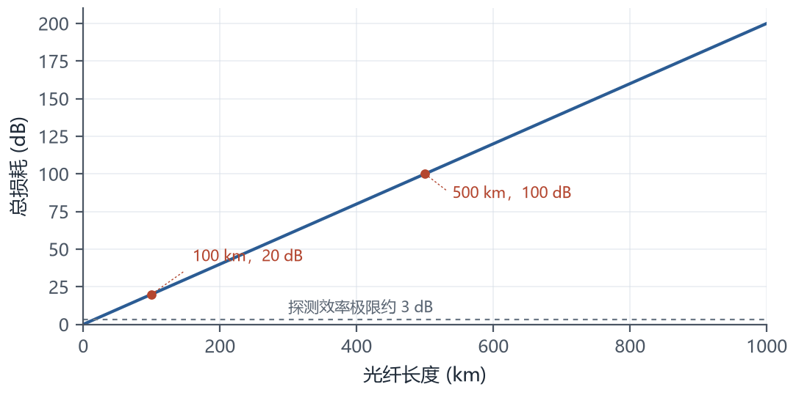
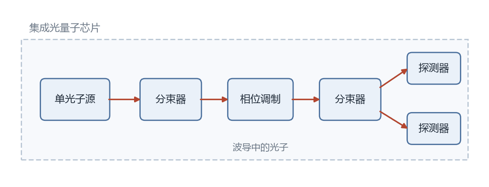

# 第 6 章　光子平台

光子是最早被用来演示量子信息的载体。1990 年代，量子密钥分发、量子隐形传态、线性光学量子计算的第一个实验，用的都是光子。三十年后，光子路线在通信领域已经落地，在计算领域还在寻找自己的位置。

## 6.1 光子为什么合适

光子有几个天生的优点。

它不跟环境强耦合。电荷会被电场扰动，自旋会被磁场扰动，光子几乎只受折射率的影响。一根光纤里传播一百公里，光子的相位还能保持得不错。

它跑得快，而且不需要低温。一台光量子实验装置，大部分部件工作在室温。

它的操控元件成熟。分束器、波片、相位调制器、单光子探测器，这些器件在光通信产业里已经批量生产了几十年。

缺点也很清楚。光子之间几乎不直接相互作用，做两比特门要靠干涉加测量，成功概率低。光子会丢失，丢了就没了，没法像电子那样保存。光源和探测器的效率、纯度，都还有改进空间。

## 6.2 线性光学元件

线性光学量子计算只用三类元件。

分束器，把一束光按比例分成两路，或者把两路合成一路。数学上它是一个幺正变换，作用在两个模式的产生算符上

$$
a^\dagger \to \cos\theta\,a^\dagger + \sin\theta\,b^\dagger,\qquad
b^\dagger \to -\sin\theta\,a^\dagger + \cos\theta\,b^\dagger
$$

相位移，给一个模式加一个相位

$$
a^\dagger \to e^{i\varphi}a^\dagger
$$

这两个操作合起来，可以构造任意单模的幺正变换。多模的情况要用到 Reck 或者 Clements 结构，用一系列分束器和相位移组成一个干涉网络。

波片是偏振版本的分束器和相位移。半波片改变偏振方向，四分之一波片在圆偏振和线偏振之间转换。

这些元件都是被动的，不需要供电，损耗很低，在集成光路里可以做到片上的分束器和调制器。

## 6.3 光源与探测器

光子路线的性能，很大程度上取决于光源和探测器。

单光子源要求每次只出一个光子。判据是二阶关联函数 $g^{(2)}(0)$ 远小于一。当前最好的方案是半导体量子点，在低温下用脉冲激发，可以做到确定性出光，效率超过百分之九十，纯度也很高。另一种是自发参量下转换的预报源，用探测一个光子来预报另一个光子的存在，简单可靠，但是概率性的。

单光子探测器主要有两类。雪崩光电二极管，工作在盖革模式，效率在百分之七十左右，暗计数低，时间分辨率在百皮秒。超导纳米线探测器，效率可以超过百分之九十五，时间分辨率在十皮秒，但需要液氦温度。两者各有各的用途。

## 6.4 线性光学量子计算

2001 年，Knill、Laflamme 和 Milburn 证明，只靠线性光学元件、单光子源和探测器，加上后选择测量，可以实现通用量子计算。这个方案叫 KLM 方案。

难点在于两比特门。在线性光学里，两个光子之间没有直接相互作用，只能通过干涉产生关联。KLM 用一个辅助光子、几个分束器和后选择测量，实现了一个概率性的控制相位门，成功概率只有几分之一。

概率性的门意味着计算会失败，需要重试。重试要消耗资源，所以 KLM 方案的门数一多，辅助光子的需求就指数增长。后来的改进用簇态和纠错码把这个开销降下来，但仍然很大。

## 6.5 玻色采样

2010 年，Aaronson 和 Arkhipov 提出了一个更简单的任务，玻色采样。

把 $n$ 个全同光子送进一个 $m$ 模的干涉网络，测量输出端的光子分布。这个分布由网络的幺正矩阵的积和式决定，而积和式的计算在经典计算机上是 #P 难问题。所以采样本身可能无法被经典计算机高效模拟。

这个任务不需要通用量子计算，只需要单光子源、干涉网络和探测器。它成了光量子优势的第一个目标。

2019 年，中科大潘建伟团队用 20 个光子输入、60 个模式输出的干涉仪，完成了玻色采样。2020 年，该团队又用 76 个光子，在几分钟内完成了经典超级计算机需要数亿年才能完成的任务。

这类实验的意义在于证明“量子系统能做出经典系统做不到的事”，但它们不是通用计算机，不能运行 Shor 算法，也不能做数据库搜索。

## 6.6 损耗是最硬的墙

光子路线最大的障碍是损耗。

标准单模光纤在 1550 纳米的损耗是每公里 0.2 分贝。这个数字听起来不大，可累积起来很吓人。一百公里损耗 20 分贝，只剩百分之一；一千公里损耗 200 分贝，剩下的是 $10^{-20}$，一个光子都剩不下。

图 6-1　标准光纤的损耗随距离累积，按每公里 0.2 分贝计算

损耗对计算也有影响。一个光量子线路里，每个元件都有一点损耗，几十个元件串起来，总损耗就可能超过一半。要纠错，需要大量的冗余光子，而冗余又带来更多损耗。

解决方向有几个。降低元件损耗，把片上波导的损耗做到每米零点几分贝；用频率转换把光子搬到通信波段；用量子中继分段传输；用纠错码容忍损耗。

## 6.7 集成平台

把光学元件做到芯片上，是规模化的前提。

硅光平台用绝缘体上硅，折射率差大，波导可以做得很小，弯曲半径几微米，适合高密度集成。缺点是损耗偏高，双光子吸收在通信波段之外比较明显。

氮化硅平台损耗低，透明度好，适合做低损耗的延时线和干涉网络，缺点是折射率差小，器件尺寸大。

铌酸锂平台电光系数大，调制速度快，适合做高速相位调制和频率转换。薄膜铌酸锂在近几年成熟起来，成了高速光量子器件的热门材料。

三种材料各有优势，实际系统往往是混合集成，用不同的材料做不同的功能，再通过键合或者倒装焊连起来。

图 6-2　集成光量子芯片的功能构成，单光子源、分束器、相位调制和探测器集成在同一块芯片上

## 6.8 位置

光子路线在量子通信上是主力，在量子计算上是挑战者。

通信方面，量子密钥分发已经商用，骨干网在多个国家建成。光子是唯一能长距离传输的量子载体，这一点没有替代方案。

计算方面，光子路线的优势是可以在室温工作，可以用成熟的半导体工艺，可以做模块化扩展。劣势是两比特门慢而且概率性，需要大量的光子资源。

PsiQuantum 走的是大规模集成路线，计划用百万量级的光子做容错计算。Xanadu 走的是测量型量子计算，用压缩态和簇态。两家都在 2020 年代拿到了大额融资，但离实用还有距离。
