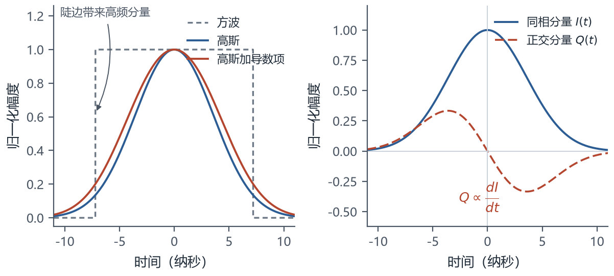
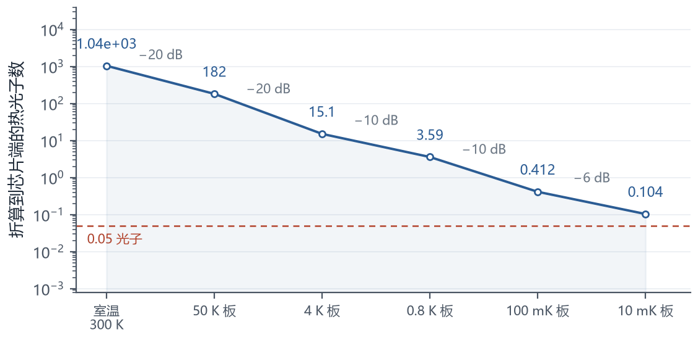

# 第 7 章　测控与读出电子学

前面几章讲的是比特本身。一个 transmon 挂在蓝宝石片上，频率 5 吉赫兹，寿命一百微秒，看起来是个安静的小东西。可它自己什么也不会做。要让它翻转，得在二十纳秒里把一束频率精确、相位干净的微波送到它门口；要知道它翻没翻，得从反射回来的信号里分辨出千分之一量级的变化。这两件事都靠一整套电子学。

这一章讲这条链，从室温的机箱到稀释制冷机底部的芯片，中间发生了什么。

## 7.1 比特对仪器提了什么要求

先算两个数。

比特频率 5 吉赫兹，周期 200 皮秒。驱动脉冲的频率如果偏了 1 兆赫，在 20 纳秒里累积的相位误差是 $2\pi\times10^{6}\times20\times10^{-9}\approx0.13$ 弧度。这个误差已经比门操作允许的大两个数量级。要把相位误差压到 $10^{-3}$ 弧度以下，频率稳定度得在 10 千赫兹以内，相对稳定度 $2\times10^{-6}$。

第二个数是幅度。拉比频率正比于驱动幅度，$\pi/2$ 门的旋转角由脉冲面积决定。幅度抖动 $10^{-3}$，旋转角抖动 $10^{-3}$，对应门错误率 $10^{-6}$ 量级，还算宽裕；抖动放到百分之一，错误率爬到 $10^{-4}$，预算就吃掉一半。输出幅度的长期漂移要盯在千分之一。

这两个数解释了测控设备为什么比普通射频仪器贵。难的不是产生 5 吉赫兹的正弦波，而是在几十纳秒里精确控制包络、相位和频率，还要同时管几十个通道，时序对齐到皮秒。

## 7.2 任意波形发生器与 IQ 调制

产生任意形状的微波包络，最直接的办法是用数模转换器。可 5 吉赫兹的载波要满足奈奎斯特定理，采样率得在 12 GSa/s 以上，这样的转换器功耗高、价格贵，每个比特配一个并不现实。

实际做法分两步。先让数模转换器产生基带信号，带宽几百兆赫兹，采样率 1 到 2 GSa/s，分辨率 14 位；再用 IQ 混频器搬到射频。

IQ 调制用两个混频器，本振相同，相位差 90 度。同相支路乘 $\cos\omega_{LO}t$，正交支路乘 $\sin\omega_{LO}t$，两路相减

$$
s(t) = I(t)\cos\omega_{LO}t - Q(t)\sin\omega_{LO}t
$$

取 $I=\cos\omega_{IF}t$，$Q=\sin\omega_{IF}t$，输出只剩 $\cos(\omega_{LO}+\omega_{IF})t$ 一项，另一个边带被抵消。这个技巧叫单边带调制。

抵消得不干净，是因为两路的幅度和相位不可能完全对称。设幅度失配 $\varepsilon$，相位失配 $\phi$，镜频与主频的幅度比约为 $\tfrac{1}{2}\sqrt{\varepsilon^{2}+\phi^{2}}$。幅度差百分之一、相位差一度，镜频抑制约 40 分贝。镜频落在哪里很要命，正好压在邻近比特的频率上就会造成串扰。所以矢量信号源出厂前都要做 IQ 校准，逐台测出失配再补偿。

## 7.3 脉冲整形

有了任意波形的能力，接下来的问题是波形该长什么样。

最朴素的想法是方波。打开，等 20 纳秒，关掉。可方波的两个陡边在频域里变成 sinc 函数的旁瓣，按 $1/f$ 衰减，第一个旁瓣只比主瓣低 13 分贝。超导比特的非谐性只有 200 兆赫，$|1\rangle\to|2\rangle$ 的跃迁就在旁边，旁瓣够强时会把布居数推上去，这叫泄漏。泄漏的错误不进二能级模型，纠错码也抓不住，只能从源头压掉。

改用高斯包络，频谱是高斯，尾巴掉得极快。代价是脉冲变长，因为时域上宽，频谱才窄。这个取舍绕不开，脉冲越短，占的带宽越宽。

DRAG 是 2010 年前后由 Motzoi 等人提出的办法，短脉冲和低泄漏可以兼得。做法是给正交通道加一项，正比于同相分量的时间导数

$$
\Omega(t)\;\longrightarrow\;\Omega(t)+i\,\frac{\beta}{\alpha}\,\dot{\Omega}(t)
$$

$\alpha$ 是非谐性，$\beta$ 是可调系数，实验上取 0.5 附近。这一项在比特看来是一个额外的相位推动，恰好抵消掉脉冲边缘引起的、指向 $|2\rangle$ 的那部分演化。图 7-1 左边是三种包络的对比，右边是 DRAG 的两个分量。正交分量在上升沿为正、下降沿为负，形状像一阶导数，名字就是这么来的。

图 7-1　方波、高斯、高斯加导数项的包络对比，以及 DRAG 脉冲的同相与正交分量

## 7.4 FPGA 与时序

波形是数字算出来的，算的地方是 FPGA。它管三件事。产生波形数据流，把算好的包络送到数模转换器；管时序，什么时候发脉冲，什么时候开采样窗；做实时判决，读出信号进来，几百纳秒内判断比特是 0 还是 1，再决定下一个脉冲。

时序这件事比想象的难。两比特门要求两个通道的脉冲同时到达，差一纳秒门就做不干净。每条线从机箱到芯片长度不同、接头不同，延迟差几纳秒很正常。系统要逐通道标定再补偿，办法是扫描相对延时，看纠缠态的对比度什么时候最高。

时钟质量直接影响相位误差。参考时钟的相位噪声在频域上是一片裙边，离载波 1 兆赫处的噪声会调制到脉冲上，所以抖动要压到皮秒量级，这决定了时钟板的设计。

## 7.5 低温布线

信号从室温进到 10 毫开尔文，要穿过多层冷板，每层都在漏热，也往信号里掺噪声。

热噪声的源头是黑体辐射。一个温度 $T$ 的负载，在频率 $f$ 上的平均光子数是

$$
n_{\mathrm{th}} = \frac{1}{e^{hf/k_BT}-1}
$$

室温下，6 吉赫兹对应的 $hf/k_B$ 约 0.29 开尔文，$n_{\mathrm{th}}$ 高达一千。这样的噪声直接送到芯片上，比特会被不停激发，什么相干性都留不下。

办法是逐级衰减。每级冷板装一个衰减器，把上一级来的噪声压下去，自己也只贡献本级温度下的噪声。图 7-2 是按这个模型算的一条链。室温一千个光子，经过 50 开尔文和 4 开尔文各 20 分贝、0.8 开尔文和 100 毫开尔文各 10 分贝、末端 10 毫开尔文的 6 分贝，到芯片端只剩 0.1 个光子。

图 7-2　一条输入线从室温到 10 毫开尔文的噪声演化。按 $n=1/(e^{hf/k_BT}-1)$ 与逐级衰减模型计算，频率取 6 吉赫兹

0.1 还不够低，理想值远小于一。实际系统在最冷一级再加低通滤波器挡高频噪声，线缆用不锈钢同轴以减小导热，外面包吸波材料挡住从窗口漏进来的红外光。红外光子能量高，一个就能打散超导配对，产生准粒子，让 $T_1$ 掉下去。

输出方向是另一回事。信号从芯片出来时只有几个光子，必须先放大，否则会被室温放大器的噪声淹没。第一级通常是工作在 4 开尔文的 HEMT，噪声温度约 5 开尔文，折算到输入端是十几个噪声光子。这个数字比信号大得多，读出信噪比先天受限。改进的办法是在更冷的地方放一个参量放大器，把噪声压到量子极限附近，代价是带宽窄、要泵浦。

## 7.6 频分复用

一个比特一条读出线，一千个比特就是一千条线，制冷机装不下，频分复用是标准答案。

每个比特耦合一个微波谐振器，谐振频率彼此错开。所有谐振器挂到同一条公共传输线上，测量时发一个含多个频率的宽带脉冲，反射信号里每个频率对应一个比特。用数字下变频把它们分开，所有比特同时读完。

谐振器之间的间隔要大于线宽加调制带宽，通常取 20 到 40 兆赫，一条线上挂十几个，总带宽几百兆赫。谐振器里的光子数也要控制，太多触发非线性让频率漂移，太少信噪比不够。多个强驱动同时存在还会四波混频，把能量搬到别的频率，形成虚假信号。

## 7.7 读出链与信噪比

色散读出的原理很简单。比特和谐振器耦合，处在 $|0\rangle$ 和 $|1\rangle$ 时谐振器频率差一个 $2\chi$，典型值一到几兆赫。往谐振器打一个靠近共振的微波，反射信号的相位就带着这个信息。

信噪比取决于三件事，探测光子的数量、积分的时间、系统噪声离量子极限有多远。光子多、时间长，信噪比就高，两样都有上限。光子多了会扰动比特，等效于一次弱测量，把态往某个方向拉；时间长了，比特在测量中就衰减了。最优积分时间大致是 $T_1$ 的几分之一。

现在最好的单发读出保真度在 99.5% 以上，配合参量放大器能到 99.8%。这个数字对纠错很关键，读出错误会直接变成数据错误，表面码阈值对测量错误同样敏感。

## 7.8 反馈延迟

收尾的一环是反馈。

量子纠错不是算完再检查，而是在线路中间不断测量辅助比特，据结果改后面的操作。这类协议对延迟要求很硬，信号出芯片到反馈脉冲回芯片，来回最好在几百纳秒内完成。比特寿命只有一百微秒，一个纠错周期里要留出足够多次测量。

延迟由几段拼成。电缆里走一趟几十纳秒，放大器和滤波器几十纳秒，数字化和判决在 FPGA 流水线里几十到一百纳秒，再加上产生反馈波形的时间。两三百纳秒是现在的水准，再快就要把判决逻辑做进芯片旁边的低温电路，这是第 9 章的话题。

电子学听起来不如比特物理有意思，可它决定了纸面上的保真度能不能变成机器上的保真度。一个 $10^{-4}$ 的两比特门，配上 $10^{-3}$ 的读出错误和三百纳秒的反馈延迟，整机表现会差出好几倍。器件与仪器，从来不是一边强就够。
