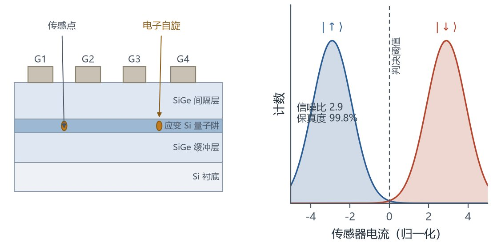
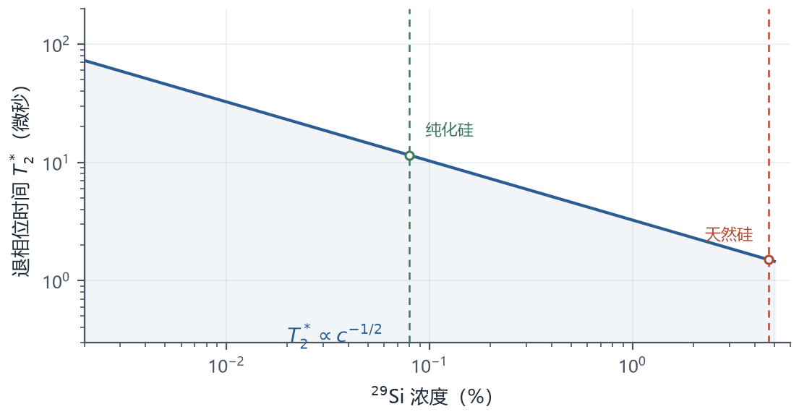

# 第 8 章　半导体与拓扑量子比特

超导比特要在洁净室里一层层镀膜、刻蚀、封装，做一颗芯片得专门建一条工艺线。半导体走的是另一条路。硅里的电子自旋也能当量子比特，而硅的工艺全世界已经投了几千亿美元。

1998 年，Loss 和 DiVincenzo 提出把电子自旋关在量子点里做量子比特。当时没人当真，读出单个自旋太难。二十多年过去，单比特门保真度做到 99.9% 以上，两比特门做到 99.5%，已经有人在 300 毫米晶圆线上批量制造。

另一条更远的路是拓扑量子比特。它不追求把噪声挡住，而是把信息存进一种对局部扰动不敏感的结构里。这条路好看，也难走，至今还在争论。

## 8.1 自旋为什么是个好比特

一个电子有自旋，自旋有两个取向，这本来就是二能级系统。放在磁场里，两个取向的能量分裂

$$
\Delta E = g\mu_B B
$$

$\mu_B$ 是玻尔磁子，$g$ 在硅中约为 2。1 特斯拉的磁场对应 28 吉赫兹的分裂，正好落在微波波段，可以用和超导比特差不多的手段驱动。

自旋与环境耦合弱。电荷一动就被电场噪声抓住，自旋只在有磁场梯度或者自旋轨道耦合时才感受到环境。硅里这两样都小，相干时间可以做得极长，$T_2$ 已经测到毫秒量级，比超导比特长三个数量级。

坏处也来自这里。耦合弱，驱动就难，门就慢。这个矛盾贯穿整章。

## 8.2 量子点是怎么造的

量子点是一个把电子关在纳米小盒子里的势阱。半导体里的做法很优雅，不用刻蚀台阶，只用栅极加电压。

Si/SiGe 异质结里，两种材料的晶格常数不同，应变让硅层成为电子势阱。表面铺一排金属栅极，各加负电压，把界面处的电子往旁边挤，两个栅极之间留下一个小坑。坑里能放几个电子，由栅压精确控制。坑足够小，充电能就到毫电子伏量级，比热涨落大得多，电子数一个个锁定。

两个相邻的量子点之间有一个势垒，加电压可以调它的高度。势垒低，电子能在两个点之间隧穿，两个自旋通过交换作用耦合。这个交换能 $J$ 是两比特门的基础，开关靠电压，速度快，不需要微波。

量子点的尺寸有讲究。硅的导带底有六个谷，电子会在谷之间散射，形成谷分裂。点太小，谷分裂的随机性让能级乱掉；点太大，充电能不够。实际器件直径在几十纳米。

图 8-1　左侧是 Si/SiGe 量子点的截面，栅极在界面处压出势阱，边上那个点兼作电荷传感器。右侧是单发读出的直方图，按两个高斯分布、信噪比 2.9 的模型计算，判决保真度约 99.8%

## 8.3 用电压转动自旋

自旋泡在恒定磁场里，翻转它要靠一个垂直于磁场的振荡场。麻烦在于自旋与电场几乎不耦合，而纳米尺度上产生局域微波磁场很难。

工程上的办法有两个。一个是在量子点旁边放一块钴或者铁的小磁体，它产生的磁场在空间上不均匀，梯度可以做到每微米零点一特斯拉。电子在电场驱动下稍微移动一点位置，感受到的磁场就变了，等效于经历一个振荡磁场。这叫电偶极自旋共振，简称 EDSR。

这个方案的美妙之处在于控制全走栅极电压。电压加在金属上，用同轴电缆从室温送到低温，不必把微波送到芯片表面。片上磁体是死结构，不供电，也不发热。

驱动效率取决于磁体梯度。梯度每微米零点一特斯拉时，激励幅度只要毫特斯拉量级，拉比频率就有几十兆赫，$\pi$ 门时间在几十到几百纳秒。比超导的二十纳秒慢，但比离子阱的微秒快，卡在中间。

## 8.4 读出要把自旋变成电荷

自旋能级差在微电子伏量级，直接测几乎不可能。能测的是电荷，所以第一步是转换。

最常用的机制叫泡利自旋阻塞。两个电子占据两个点，自旋构成单态时电子可以隧穿过去，构成三重态时隧穿被禁止。自旋状态决定了电荷能不能流动，测电流就知道自旋。这个机制区分单态和三重态几乎完美，缺点是只能测相对取向。

单个自旋的读出用另一种办法。把目标点的自旋通过交换作用转移到旁边的传感点，传感点是一个单电子晶体管或射频谐振器，电荷变化会改变它的电导或反射相位。射频反射计的时间分辨率到微秒，足够在自旋弛豫之前测完。图 8-1 右边是一次单发读出的计数分布，两个峰对应两个自旋方向，分得越开，判决越准。

图 8-2　核自旋浴引起的退相位时间随 $^{29}$Si 浓度的变化。按 $T_2^* \propto c^{-1/2}$ 的标度计算，曲线以天然硅约 1.5 微秒的典型值锚定

## 8.5 同位素纯化

硅有三种稳定同位素。$^{28}$Si 占 92.2%，核自旋为零；$^{29}$Si 占 4.7%，核自旋 1/2；$^{30}$Si 占 3.1%，核自旋也为零。

那 4.7% 的 $^{29}$Si 是麻烦的来源。每个核自旋都是一个随机取向的小磁针，电子在它旁边感受到的磁场就带着随机涨落。涨落的幅度不大，但电子自旋的进动频率对它敏感。整片样品里成千上万个核自旋的叠加，让不同位置的电子进动频率各不相同，系综一平均，相位就散了。

核自旋越多，频散越大，退相位时间按 $T_2^* \propto c^{-1/2}$ 缩短。图 8-2 画的就是这条曲线。天然硅的 $T_2^*$ 在一微秒量级，浓度降到 800 ppm，涨了将近十倍。

同位素分离用离心机，原理和浓缩铀一样，只是级数更多。俄罗斯和德国的几家企业能提供 99.9% 以上的 $^{28}$Si，价格不便宜，晶圆尺寸也受限。用纯化硅做的器件，$T_2^*$ 到几十微秒，$T_2$ 到毫秒，已经超过大多数超导比特的回波相干时间。

## 8.6 现在的水平

硅自旋比特的指标已经进了第一梯队。

单比特门保真度 99.9%，用 EDSR 驱动，门时间几百纳秒。两比特门用交换耦合，保真度 99.5%，门时间几十纳秒。读出保真度 99% 以上，用射频传感点。这些数字和超导比特在同一量级，个别指标更好。

还有一个优势，工作温度。自旋能级分裂大，热激发小，器件在 1 开尔文以上还能工作，有人在 4 开尔文演示过相干操作。制冷可以用脉冲管制冷机，不必上稀释制冷机，省下的不只是钱，还有冷量预算。

## 8.7 马约拉纳与拓扑量子比特

拓扑量子比特的想法完全不同。它不指望把比特和环境隔开，而是把信息编码成一种全局性质，局部扰动改不了它。

最具体的方案是 Kitaev 在 2001 年提出的一维拓扑超导线。半导体纳米线贴在超导体上，加外磁场，线两端各出现一个马约拉纳零能模。两个模在空间上离得很远，动一个不改变系统的费米宇称，只有同时作用于两端才能破坏信息。这就是拓扑保护。

马约拉纳模还满足非阿贝尔统计。交换两个模的位置，量子态做一个受拓扑保护的变换，结果只取决于交换的次序，与快慢、路径无关。用这种交换做逻辑门，错误率天生就低。

实验上找这个模，用的是隧道谱。超导针尖靠近纳米线末端，测微分电导随偏压的变化，理论上零偏压处该出现一个峰。2012 年，代尔夫特的研究组在 InAs 纳米线上报道了这个峰，之后多个小组跟进。

问题出在这个峰不唯一。量子点里的安德烈夫束缚态、无序引起的弱反局域化，都能在零偏压产生类似的峰。2018 年《自然》上的一篇论文声称拿到了确凿证据，几年后被撤稿，理由是数据处理有问题。整个领域由此冷了下来。

2025 年，微软发布了基于 InAs 纳米线和铝的拓扑核心芯片，声称实现了马约拉纳器件的大规模制造。学界依然谨慎，判断拓扑比特是否成立的标准不是看到一个峰，而是演示编织，让两个模交换位置并测出由此产生的变换。这一步至今没有公开、可重复的结果。

## 8.8 半导体路线的分量

抛开争议，半导体路线的产业意义是清楚的。

硅自旋比特的尺寸在百纳米量级，占地比超导比特小两三个数量级。工艺与 CMOS 兼容，可以用 300 毫米晶圆，在晶圆上做电学测试，良率和成本都按半导体产业的规律来。英特尔、imec、CEA-Leti 都在推进，Diraq 和 Quantum Motion 这类初创公司也在做。

难点也真实。每个比特的栅极都要单独引线，密度一高，布线同样成瓶颈；器件一致性依赖工艺控制，阈值电压漂移会改变工作点；低温电路模型还不成熟，设计工具远不如微波工程那一套。

半导体比特和超导比特的关系，很像当年的集成电路和分立器件。前者起步慢，指标不占优，可一旦工艺走通，成本曲线会把差距抹平。是不是这样，还要看接下来几年。
