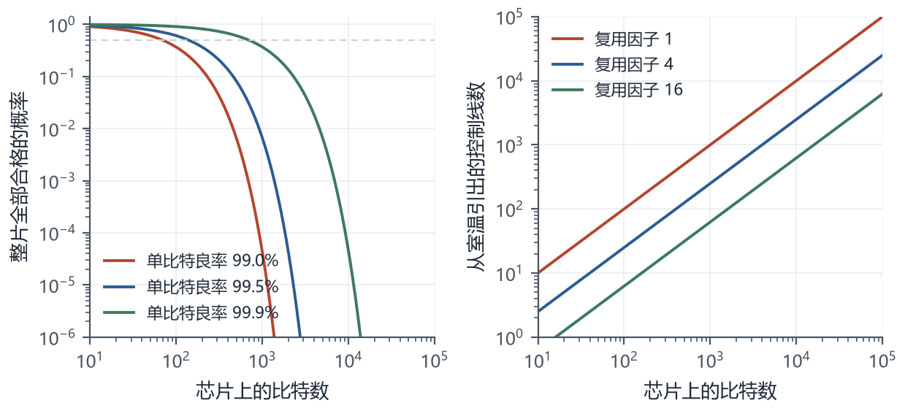
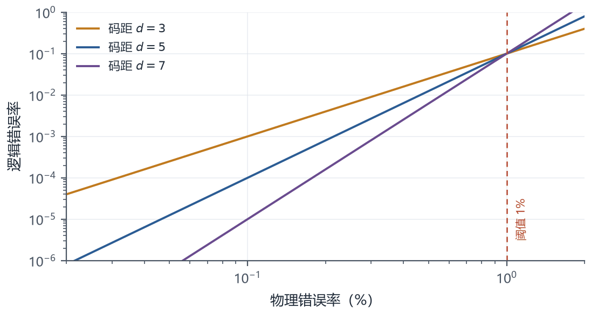

# 第 9 章　规模化架构

一百个比特的机器和一万个比特的机器，差别不是一百倍。

前面八章谈的都是单点指标，一个比特能活多久，一个门错多少，一个读出信号有多干净。这些指标在实验室里用一台仪器、几根电缆就能测出来。规模一上去，仪器变成系统，电缆变成线束，决定成败的东西也换了，布线、串扰、良率、冷量、封装、测试，每一样都能把进度拖住半年。

这一章讲这些约束的算术，以及从百比特走到万比特，工程上要做哪几件事。

## 9.1 先算三条硬账

第一个数是线。一个超导比特至少要一条微波驱动线，通常还要一条磁通偏置线，读出线可以共用。几百个比特的芯片，引出的同轴线是四位数。

第二个数是冷量。商用稀释制冷机在 10 毫开尔文级的冷量在二十微瓦量级，4 开尔文级在一瓦量级。一条同轴线穿到最冷级，沿途做过热锚定，仍要耗散几十纳瓦。一千条线乘上去就是二十到五十微瓦，预算满了，还没算放大器和电子学。

第三个数是良率。假设每个比特有 99.9% 的概率合格，一千个比特的芯片全部合格的概率是 $0.999^{1000}$，约 37%。一万个比特是 $0.999^{10000}$，十万分之四。图 9-1 左边画的这条曲线，是所有规模化方案背后的推手。

图 9-1　按 $P=y^{N}$ 计算的整片良率（左）与控制线数（右），复用因子指一条线携带的比特数

三条账放在一起，结论很清楚，扩规模不是把比特摆得更密，而是把每个比特消耗的资源压下去。

## 9.2 串扰是隐形的墙

比特多了，彼此之间的干扰就成了主要误差来源。

最直接的一种是残余耦合。两个比特设计上应该独立，实际总有几十千赫的交换耦合，表现为一个条件相位，叫 ZZ 项。做单比特门时，邻居在做什么会影响到它。这个效应随间距指数衰减，可芯片面积有限，间距压不下去。

第二种是频率碰撞。比特频率要在 4 到 8 吉赫兹之间分配，每个比特的脉冲带宽几十兆赫，两侧留保护带，一个吉赫兹的窗口只放得下十几个。一千个比特只能分成许多组，再用空间隔离或动态调频避免撞车。调频本身又会带来串扰，因为磁通线是共用的。

第三种是包络串扰。脉冲从一条线漏到相邻的线上，靠的是封装里的寄生电容和芯片上的耦合。抑制到负六十分贝以下才能接受，布线层之间要加屏蔽，接头处要接地，封装从一开始就得当射频器件来设计。

## 9.3 模块化与光子互联

既然单片做不大，就把大问题拆成小片。每片几百个比特，片内保真度做到最好，片间用某种方式连起来。

最省事的连法是微波同轴。可同轴线有热负载，一根线穿过冷板就占冷量，能连的通道很少，距离一长损耗也上去了，微波电缆的衰减是每米一分贝量级。

更有想象力的是把微波转成光。光纤的损耗是每公里零点二分贝，用它连接两个低温模块，距离不再是问题。难点在转换本身。微波光子的能量比光光子低四个数量级，转换需要一个强泵浦和一个非线性介质，还得让噪声低于一个光子。

现在最好的微波光转换效率在千分之一到十万分之一之间。这个数字意味着，一个纠缠态跨模块传输的成功率是效率的平方，也就是百万分之一。要让它可用，效率得提高三个数量级，同时把附加噪声压到量子极限以下。全世界有十几个小组在做这件事，还没有突破性的结果。

## 9.4 把电子学搬到冷的地方

线的数量是硬约束，解决办法是让一条线干更多活。频分复用已经在做，多路复用器把一路宽带信号拆成几十路，送到不同的比特。下一步是把整个控制电路搬进制冷机。

所谓低温 CMOS，就是用硅锗工艺做的集成电路，在 4 开尔文下工作。它可以在低温端产生基带波形、做数字调制、完成多路复用，把室温机箱和冷头之间的线从一万根减到一百根。代价是功耗，4 开尔文级的冷量只有一瓦，每个通道的功耗得压在毫瓦以下，一千个通道就是一瓦。

这条路已经有人走通一半。几家公司做出了在 4 开尔文工作的多路复用芯片，功耗和噪声都可接受。难的是可靠性，低温下的晶体管模型与室温不同，电路要在几十毫开尔文的温差里长期工作，一次热循环就可能让参数漂移。

再往冷走一步，有人把超导单磁通量子电路放到毫开尔文级做数字逻辑，速度几十吉赫兹，功耗极低，缺点是每个门都要电感电容，占面积，时钟分配也复杂。

## 9.5 封装与倒装焊

封装在量子芯片里不是配角。

传统做法是引线键合，用金丝把焊盘接到电路板上。一根丝几百微米长，寄生电感一纳亨量级，在 6 吉赫兹上是不小的阻抗，丝与丝之间的串扰也难控制。一颗千比特芯片要打几千根丝，耗时，良率还随根数下降。

倒装焊是替代方案。两片芯片面对面，用铟或者锡的凸点对准压合。凸点间距可以做到二十到五十微米，一个指甲盖大小的面积上放几千个连接点。控制线路做在上片，比特做在下片，中间只隔一层凸点，寄生参数小，屏蔽也好做。片上还要打通硅通孔，把信号从背面引出来。

对准精度要求在一微米以内，热膨胀系数要匹配，否则降温到毫开尔文时两层芯片的收缩量不同，凸点会被剪断。这些是半导体封装行业已有的本事，只是精度要求比消费电子高一个档次。

## 9.6 怎么衡量一台机器

比特数是最容易宣传的指标，也是最不说明问题的指标。要比较两台机器，得看基准测试。

随机基准是最基础的一种。随机选一串门，末尾加反向补偿门让序列回到初态，测保真度随长度的衰减，拟合出每门的平均错误率。它能把制备和测量误差扣掉，是目前最通行的指标。

量子体积是 IBM 提出的综合指标。取一组方形线路，深度逐级增加，找到能可靠执行的最大深度，取 $2^{n}$ 作为量子体积。它把比特数、连通性、门和读出保真度揉在一起，比单看比特数公道，但依赖具体的线路集合。

层保真度是近几年流行的做法。把一层典型的并行门当整体来测，得到这一层的错误率。算法里门是并行执行的，串扰的影响会落在这里，所以它更接近真实情况。配合每秒线路层数，可以估出一台机器在给定时间能跑多深。

## 9.7 从百到万的路径

把这些拼起来，路线大致清楚。

几百比特的阶段靠频分复用和倒装焊，把线数压到冷量允许的范围。目标不是算得对，而是把系统跑稳，把校准自动化，把开机时间从几天压到几小时。

几千比特的阶段，要靠低温电子学。控制电路下沉到 4 开尔文，线数再降一个数量级，同时开始跑码距 5 到 7 的表面码。图 9-2 说明了这个阶段的关键，物理错误率必须压到阈值以下，否则码距越大错得越多。百分之零点几的门错误率，对应的逻辑错误率在 $10^{-6}$ 量级，够做几十步的算法。

图 9-2　表面码的逻辑错误率随物理错误率的变化。按 $p_L=0.1\,(p/p_{\mathrm{th}})^{(d+1)/2}$ 估算，阈值取 1%，码距越大，阈值以下的压制越陡

上万比特的阶段，单片做不下，必须模块化。模块之间用什么连，是这条路线上唯一没有定案的选择。微波互联简单但笨重，光子互联优雅但效率不够，两条路都在走。

再往上是百万比特，那是容错计算的门槛。表面码的开销是每个逻辑比特对应几百到一千个物理比特，具体数字取决于错误率和码距。到了那一步，制冷、布线、封装、测试的成本模型都要重写。

工程史上有过类似的情形。早期的计算机用继电器和电子管，一台机器占一间屋子，可靠性靠冗余和巡检。后来集成电路把这些都变成了印刷电路板上的一个元件。量子计算现在还在电子管的阶段，所有人都在找自己的晶体管。第 7 章讲的仪器，第 8 章讲的材料，最终都要服从这一章的算术。
