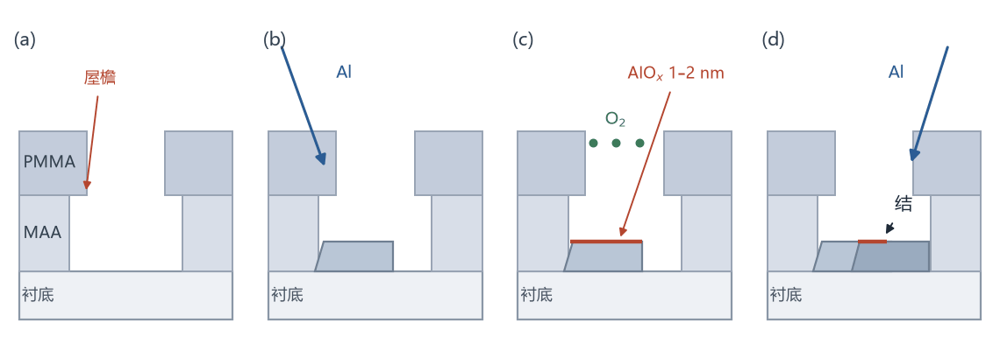
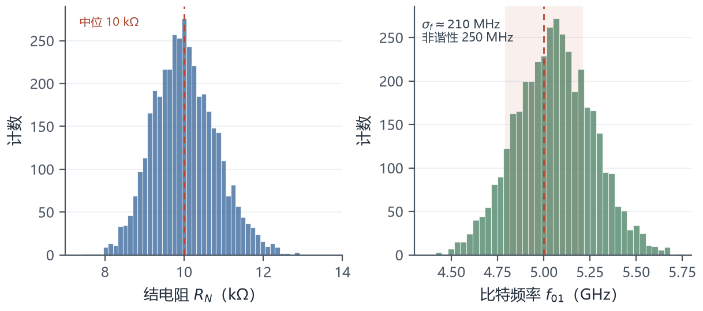

# 第 10 章　超导薄膜工艺与材料

第 4 章讲 transmon 的时候，约瑟夫森结是一个理想元件，两条能级，一个非谐性，参数写在纸上。真做出来是另一回事。一块蓝宝石片上要长出几百纳米厚的超导膜，膜上刻出电容、电感、传输线，再在几十微米见方的地方叠两层金属，中间夹一层不到两纳米厚的氧化层。这一层氧化层的厚度差半个纳米，比特频率就偏几百兆赫。

这一章讲这些膜和氧化层怎么来，也讲为什么同一张图纸，不同工厂做出的比特寿命能差十倍。

## 10.1 材料先划出上限

超导比特的相干时间有个天花板，由材料决定，不由图样决定。

芯片上的金属都是超导体，电流没有电阻，能量耗散只能发生在介质里。介质包括衬底、金属表面的氧化层、金属与衬底的界面，还有封装里的胶。微波电场在这些地方有分布，每个光子都有一小部分能量漏进去，被缺陷吸收。缺陷在低温下是一群两能级系统，总有几个正好和比特共振。

选材料的第一个标准是损耗，第二个是能隙。能隙越大，热激发和非平衡准粒子越少，比特越不容易被扰动。第三个标准是工艺，能不能蒸、能不能刻、能不能承受后面的高温步骤，这些在实验室里往往比前两条更卡人。

常用的材料就三种，铝、铌、氮化钛。

## 10.2 铝的便宜与代价

铝最早用在超导量子电路上，现在也用得最多。

它的好处几乎都在工艺上。铝在硅和蓝宝石上附着牢，蒸上去就是致密的膜，不需要缓冲层。它熔点低，蒸一百纳米只要几分钟。它的氧化物是天然的绝缘体，铝放在氧气里，表面自己长出一到两纳米的三氧化二铝，均匀、致密、针孔少，正好当隧道势垒。整个约瑟夫森结产业就是靠这个性质立起来的。

代价是能隙小。铝的临界温度 1.2 开尔文，能隙 0.18 毫电子伏，对应频率 87 吉赫兹。这个能隙在十毫开尔文下足以压制热激发，可它对高能事件没办法。一个红外光子，一次宇宙射线，就能把库珀对打散，产生的准粒子寿命在毫秒量级，因为能隙小，复合得慢。这段时间里比特的 $T_1$ 是垮的。

铝还有两个实际问题。它软，引线键合的超声能量容易把焊盘打穿。熔点低，镀完不能再做高温退火，表面处理的手段受限。有些工艺在铝上面盖一层薄薄的铌或氮化钛，做硬掩模和布线，就是为了绕开这两条。

## 10.3 铌的能隙与氢

铌的临界温度 9.2 开尔文，能隙 3 毫电子伏，比铝大八倍。对应 35 开尔文，热准粒子在液氦温度下可以忽略，对红外光子和宇宙射线的耐受也强得多。铌膜硬，耐腐蚀，可以承受四百度的退火，也能做多层布线。

麻烦出在氧化层上。五氧化二铌介电常数高、损耗大，做隧道势垒不行，做表面钝化也不划算。所以铌结不能直接用铌的氧化层，标准做法是铌打底，中间蒸一层几纳米厚的铝，氧化，再盖铌。这就是所谓 Nb/Al-AlOx/Nb 结，1980 年代就成熟了，现在射频超导和超导量子电路都还在用。

第二个麻烦是氢。溅射铌的时候，真空腔里的残余水汽会分解，氢原子溶进膜里，形成氢化铌。氢化铌的临界温度低，还会引入额外的损耗。腔体烘烤、用高纯气体、控制溅射速率，都是为了把氢压下去。同一台设备在不同的水汽本底下镀出来的铌膜，谐振器品质因数能差一个数量级，差别就在这几十个 ppm 的氢上。

铌膜的应力也大，镀在蓝宝石上有几个吉帕的压应力，厚度一上去就翘。刻蚀铌要用含氟等离子体，侧壁容易长聚合物残留，洗不干净就是损耗源。

## 10.4 氮化钛的另一个位置

氮化钛不是用来替代铝和铌的，它补的是另一块空缺。

它的临界温度可以调，从 0.5 开尔文到 5 开尔文，取决于氮的含量。化学计量比接近一比一时最高，氮多一点少一点都往下掉。这个可调性让它能做两种很不一样的东西。临界温度低的做成高阻薄膜，方阻几百欧，动能电感大，用来做高阻抗传输线和行波参量放大器。临界温度高的做低损耗谐振器。

氮化钛的化学稳定性好，表面只长一层很薄的自然氧化层，不像铌那样怕氢，也不像铝那样软。它可以高温沉积，和硅工艺的后道兼容，这一点在把量子芯片往晶圆厂搬的时候很重要。

缺点是工艺窗口窄。反应溅射时氮的分压决定化学计量，偏一点，临界温度和方阻就变。靶材的氮化程度还会随时间漂移，同一批片子前后两片可能就不一样。所以用氮化钛做器件，在线监测比别的材料更要紧。

## 10.5 一个结是怎么长出来的

约瑟夫森结的制备用的是一个叫影子蒸发的办法，1977 年由 Dolan 提出，到今天基本没变。

先在衬底上涂两层电子束胶，下层是 MMA 共聚物，上层是 PMMA。电子束曝光以后显影，下层胶的显影速度快，横向溶解得多，于是形成一个悬空的屋檐，上层胶的开口比下层窄。这个结构叫双层掩模，屋檐是关键。

样品放进电子束蒸发台，倾斜一个角度，蒸第一层铝。掩模悬空，铝只能从开口斜着落下，在衬底上留下一片偏在一侧的岛。蒸完转正，通一点氧气，让铝表面氧化，形成隧道势垒。再倾斜到相反角度蒸第二层铝，这一层从另一侧落下来，和第一层在中间搭接。搭接的那一小块，上下是铝，中间是氧化层，就是约瑟夫森结。

结的面积由角度、胶厚和开口宽度决定。角度越大，投影越偏，搭接区越窄，典型面积在 0.01 到 0.1 平方微米，比一个细菌还小。电流密度由氧化条件决定，分压和时间的乘积越大，氧化层越厚，隧穿电流越小。临界电流密度能从每平方厘米十安培调到上千安培，结电阻从几十千欧到几百欧。

结电阻和临界电流由一个关系锁在一起

$$
I_c R_N = \frac{\pi \Delta}{2e}
$$

这就是 Ambegaokar-Baratoff 关系。铝的能隙代进去，$I_cR_N$ 约 0.28 毫伏。测一个结的室温电阻，就能反推出临界电流，再算出约瑟夫森能量，也就知道这个比特大致工作在什么频率。产线上的快速筛选全靠这一步。

图 10-1　双层胶掩模下的双角度影子蒸发，从左到右依次为悬空掩模、第一角度蒸铝、原位氧化、第二角度蒸铝搭接成结

## 10.6 界面上的两能级系统

膜的损耗主要不在膜里，在界面上。

一块共面波导，电场集中在中心导体和地之间的缝隙里，缝隙下面是衬底表面，上面是空气。电场还会钻进金属表面那一层几十纳米的范围。这三处地方都有缺陷，都有两能级系统。

两能级系统的模型很简单。非晶介质里一小群原子有两个几乎等价的平衡位置，中间隔一个势垒，低温下只能在两个位置之间隧穿。间隔由势阱的不对称和隧穿矩阵元决定，这两个量都是随机的，能级间隔在几个吉赫兹范围内几乎是平的。总有几个缺陷和比特对上。

耦合强度由电场在缺陷位置的强度决定。界面层只有几纳米厚，却紧贴金属，电场很强，参与比能到千分之一到百分之一。界面损耗因此常常盖过衬底本身。

处理办法只有一个方向，把界面弄干净、弄少。镀膜前用缓冲氧化物刻蚀液去掉自然氧化层，随即进真空，用氩离子轻微溅射清洗。镀完做低温退火，让金属和衬底贴得更紧。刻蚀后残留的胶要用等离子体灰化加溶剂洗净，一点残留就够把 $T_1$ 拉下来一半。

图 10-2　结电阻与比特频率的统计分布，按 10 千欧中位值、相对标准差 8% 的对数正态分布抽样，再由 $I_cR_N=\pi\Delta/2e$ 与 transmon 频率公式换算，取铝能隙 0.18 毫电子伏、$E_C/h=250$ 兆赫，阴影为 $\pm1\sigma$

## 10.7 衬底与封装也管 T1

衬底的选择余地不大，主流是高阻硅和蓝宝石。

高阻硅用区熔法长，电阻率高于一万欧姆厘米，损耗低，晶圆大，和半导体工艺兼容。它的介电常数 11.7，共面波导可以做得紧凑。麻烦在表面，硅放在空气里几分钟就长一层自然氧化层，二氧化硅的损耗比硅大得多，厚度还不可控。

蓝宝石的介电常数 9.3，损耗更低，机械强度好，导热也比硅好，能把芯片上的热更快带走。缺点是贵，尺寸受限，不容易做大规模晶圆工艺。它还是各向异性的，切向不同，微波性质略有差别。

封装是另一半。芯片装进一个金属腔，腔本身是谐振器，会在几个吉赫兹上有模式。某个腔模正好落在比特频率附近，比特的能量就通过腔壁漏掉，$T_1$ 掉一个数量级。做法是把腔做小，让最低模式高于所有比特频率，或者在腔里贴吸收材料把模式压死。吸收材料贴得离芯片太近，又会引入新的损耗。

封装材料也有讲究。电路板用聚四氟乙烯或者陶瓷，不用环氧玻璃布板，后者的损耗角正切高两个数量级。焊料用铟，铟在 3.4 开尔文以下也是超导体，焊点不引入损耗。芯片和腔体之间的缝隙要压紧，缝隙会形成寄生波导，把能量带出去。

## 10.8 一致性与良率

一个比特合格不算本事，一千个比特都一样才算。

参数分布的第一个来源是结面积。电子束光刻的线宽控制在一纳米，可结面积是两个蒸镀投影的重叠，受胶厚、角度、准直度影响，一致性在百分之五左右。第二个来源是氧化层厚度，分压和时间的控制精度有限，厚度差半个纳米，隧穿电流就差一倍。

两个来源叠起来，结电阻的分布一般在百分之八，比特频率的分布跟着在百分之四，也就是两百兆赫。这个数字和 transmon 的非谐性差不多大，意味着同一批芯片上，有些比特的 $|1\rangle\to|2\rangle$ 跃迁已经压到 $|0\rangle\to|1\rangle$ 附近，门的泄漏会明显变差。

解决办法一半在工艺，一半在设计。频率可以靠磁通偏置挪开，也可以留出频率窗口。更徹底的做法是在晶圆上先测一遍结电阻，把数据反馈给氧化步骤，下一批调整时间。这种闭环控制在半导体厂是常规操作，在量子芯片线上才刚开始。

良率的账第 13 章算过，单比特合格率 99.9%，一千个比特整片合格只有三成多。所以工艺的目标不是把最好的比特做到极致，而是把最差的拉到平均线以上，同时剪掉分布的尾巴。颗粒、短路、桥塌陷、氧化针孔，这些失效模式听着琐碎，却决定了这条路能不能往大规模走。
