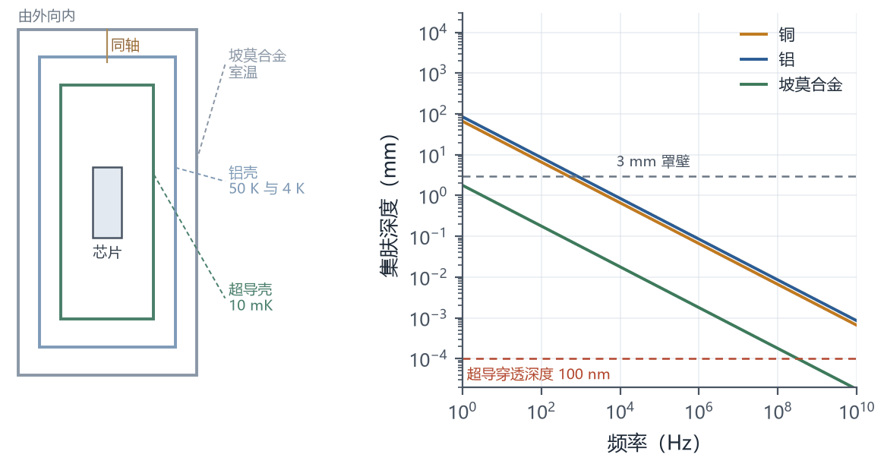
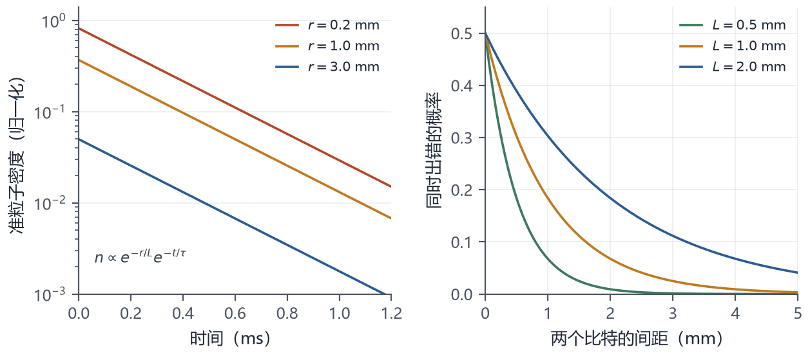

# 第 11 章　封装、屏蔽与干扰

比特做出来，参数也达标，装进机器里却可能完全不能用。同样一颗芯片，在测试台上 $T_1$ 两百微秒，换一个样品盒掉到五十，再换个房间变成二十。参数没变，变的是环境。

环境干扰进来有四条路，电磁辐射、高能粒子、机械振动、电气接地。四条路的作用方式不同，结果都是同一件事，把相位打乱。这一章逐条讲它们怎么进来，用什么挡，挡的时候要付出什么代价。

## 11.1 误差预算里看不见的那一半

一个超导比特的错误来源，一半在芯片上，一半在外。外面这一半常被忽略，因为不好测，它表现为 $T_1$ 在一天里慢慢变差，某个比特每隔几分钟抽一次，某些比特同时出错。

判断的办法是看统计。把每个比特的错误按时间排开，看有没有相关性。错误集中在几十微秒的窗口里，空间上相邻的一批比特同时出错，那不是热噪声，是某个事件一次性影响了一片区域。错误率跟着房间里的设备开关变化，那是接地或者电源的问题。这些诊断不写论文，却是实验室的日常。

## 11.2 磁屏蔽的两套办法

地磁场在地面上约 50 微特斯拉。对一个超导环来说这个数字够呛。取一百平方微米的环路，磁通是 $BA$，地磁场对应 $5\times10^{-3}$ 个磁通量子。任何一点涨落，隔壁电梯启动，有人推金属车走过，都会变成磁通噪声。

transmon 本身对均匀磁场不敏感，但它的磁通偏置线和 SQUID 环敏感。磁通噪声按 1/f 进来，频率越低越强，正好落在工作频段上。

挡磁场的办法有两种，原理完全不同。

第一种是高磁导率合金，坡莫合金是代表，相对磁导率几万。磁力线更愿意走这种材料，绕开里面的空间，等于把磁场分流。它室温就能用，可以做成大罩子把整台机器包住。缺点是不能承受强磁场，几个毫特斯拉就饱和。它还怕机械应力，弯折、钻孔都会降低磁导率，罩子做好要退火。

第二种是超导屏蔽。超导体在临界温度以下把磁力线排斥在外，迈斯纳效应，原理上比高磁导率材料彻底。穿透深度只有一百纳米，一层铌膜就够。问题是缝隙，超导屏蔽要形成闭合的壳，任何一条缝、一个通孔，磁通就从那里钻进来。

两种屏蔽通常叠着用。最外层坡莫合金把地磁场降到微特斯拉以下，往里是 50 K 和 4 K 的铝壳，靠涡流挡高频，最里面是超导壳，把剩下的低频磁场挡掉。降温时还要注意，超导壳穿过临界温度那一刻会把当时的磁场冻在里面，这叫俘获磁通。冻进去的量每个降温循环都不一样，所以降温前要先用线圈退磁。

图 11-1　左为逐层屏蔽的结构，右为铜、铝与坡莫合金的集肤深度随频率的变化，按 $\delta=\sqrt{2/\mu\sigma\omega}$ 计算，坡莫合金取相对磁导率五万

## 11.3 红外与微波的缝

辐射的漏洞不在屏蔽层，在缝。同轴线从室温穿到十毫开尔文，每一层冷板都要开孔，开孔就是天线，波长比孔径小的电磁波直接过去。几十吉赫兹的毫米波、几百吉赫兹的远红外，就这样顺着孔和同轴外导体爬进最冷级。

进来以后麻烦很大。一个远红外光子几个毫电子伏，比铝的超导能隙大一个数量级，被金属吸收后打散库珀对，$T_1$ 立刻掉下去，几十微秒到几毫秒后才恢复。这类事件在时间上随机，空间上成片，是比特出错的主要来源之一。

挡的办法有几层。同轴线上装低通滤波器，把高频滤掉，滤波器贴着最冷一级的冷板装，自身热导要小。冷板开孔处加截止波导，一段内径很小的金属管，电磁波在里面指数衰减。腔体盖板用导电垫圈压紧，缝隙宽度要小于最高工作频率对应波长的百分之一。

腔里还可以贴吸波材料。含碳泡沫或磁性吸收体贴在腔壁上，把腔模压死，把残余毫米波吸收掉。它自身在低温下有介电损耗，贴的位置要离芯片远，面积要控制，否则就成了热源。

## 11.4 宇宙射线与同位素

海平面上，每平方厘米每分钟大约有一个 μ 子穿过。它来自大气层顶部的宇宙射线簇射，能量几个吉电子伏，混凝土也挡不住。

μ 子穿过芯片时沿途电离，在硅里每毫米损失零点二兆电子伏。这些能量最终变成声子和电子空穴对，声子沿衬底传播，被超导膜吸收，打散库珀对。几百微米厚的芯片里，一次事件能产生上万个准粒子，分布在几个毫米范围内。

后果是同时出错，图 11-2 画的就是这个范围。准粒子扩散到邻近比特，把它们的 $T_1$ 一起拉低，几十毫秒内一片区域都在出错。对纠错码这是灾难。表面码假设错误独立同分布，一旦出现空间相关的错误团簇，解码器就判错，逻辑错误率跳升。

按面积算，一平方厘米的芯片每分钟一个量级。千比特芯片几十平方厘米，事件率就是每秒几个，乘上单比特错误率，决定了整机能不能跑长线路。

对策有几条。搬到地下，几十米岩层把 μ 子通量降两三个数量级，最直接，代价是搬家。芯片做薄，减小相互作用体积。背面镀金属或做粗糙化，让声子提前散射。再一条是在解码器里显式处理关联错误，给事件打标记，让解码器知道这一片不可信。

封装材料里的放射性同位素是另一个来源。钾-40 在玻璃、陶瓷、焊料里都有，半衰期十二亿年，放出一兆多电子伏的电子。连铅都有问题，普通铅含微量铅-210，它是镭衰变链的子体，半衰期二十二年。低本底实验用古代铅，罗马时代的铅锭沉在海里两千年，铅-210 早衰变完了。量子芯片的封装也开始讲究，用高纯铜、低放射铅、石英，把本底压下去。

图 11-2　高能粒子穿过芯片后准粒子密度的衰减（左，按扩散长度 1 毫米、寿命 0.3 毫秒的指数模型计算）与两比特同时出错的概率随间距的变化（右，三条曲线对应不同扩散长度）

## 11.5 声子与机械振动

芯片是固体，固体能传声。

声子在衬底里的速度是几千米每秒，频率可以到太赫兹。热声子在十毫开尔文下很少，非热声子却随时产生，每一次粒子事件、红外吸收、同轴线放电，都会造出一批高能声子。它们来回反射，直到被金属膜或者封装材料吸收。

声子的平均自由程在纯净硅里可以到毫米量级，跟芯片尺寸差不多，所以声子不会被限制在事件附近。把芯片边缘切出粗糙的斜角，或者在背面镀一层声学失配的材料，可以让声子提前散射出去。

机械振动是另一条路。脉冲管制冷机的冷头以几赫兹的频率抖动，位移几个微米，通过冷板、支撑杆、同轴线传到芯片。对超导比特，振动的影响是间接的，它调制电容间隙、接头接触电阻、磁通线的位置，表现为频率噪声。对离子阱和光镊，振动是致命的，光路一偏，焦点就跑掉。

隔振的做法是在冷头和冷板之间加弹簧或者波纹管，把机械路径断开，用编织铜带做热链接，铜带柔软，传热好但不传力。整台机器还可以放在主动隔振台上，把地面的低频振动压下去。

## 11.6 接地与地环路

电学上的干扰，一半来自地。

理想的地是一个零电位的点，所有地线都接到那里。实际的地是一张网，每段导线都有电阻和电感，电流流过就有压降。两台设备插在不同插座上，地之间可能差几十毫伏，这个差值就是干扰源。

地环路是最常见的形式。信号线和屏蔽层构成一个环，环里有变化的磁场，就感应出电动势。工频磁场来自变压器和电缆，感应电压可以到几十微伏，正好落在测量带宽里。屏蔽层两端都接地，环闭合，干扰更大；只接一端，屏蔽在高频上又失效。折中的办法是一端通过电容接地，低频断开，高频短路。

接地拓扑也有讲究。星形接地，所有地线汇到一个点，避免地电流在信号地线上流动。机壳地、模拟地、数字地分开，再单点相连。低温端和室温端的地隔着几米同轴线，电位不一样，共模噪声从这里进来。差分驱动、隔离变压器、光纤传输，都是为了切断这条路径。

## 11.7 串扰与隔离度

串扰是比特之间的相互影响，在封装里被放大。

芯片上两个相邻比特，设计上隔着几十微米，电场还是有一点交叠，耦合几十千赫。这表现为 ZZ 项，一个比特的状态改变另一个的频率。做单比特门时，邻居在做什么会影响到它，误差随并行门数量上升。

键合线是另一个途径。一根金丝几百微米长，自感一纳亨，两根并排走，互感是自感的十分之一量级。五吉赫兹上一纳亨的阻抗是三十欧，互感的耦合有几个欧，信号从一条线漏到另一条，隔离度只有三四十分贝。

封装腔体也会串，腔是谐振器，信号从一条线进去，激起腔模，再从另一条线出来。腔模品质因数高，串扰在这个频率上被放大十几分贝。办法是在腔里加隔墙，用一排过孔分成小格，或者贴吸波材料。

频分复用的读出对隔离度要求最高。一条线上挂十几个谐振器，间隔几十兆赫，理想情况下互不干扰。可谐振器的裙边有泄漏，强驱动一个时邻近的会被带动，读出相位就偏了。测量隔离度用矢量网络分析仪，看 $S_{21}$ 在相邻通道之间的抑制，工程上要求负六十分贝以下。

## 11.8 屏蔽是系统设计

把这些拼起来，屏蔽不是加一个罩子，而是一套设计。

顺序大致是先挡磁场，用坡莫合金和超导壳；再挡红外，用滤波器和截止波导；再挡粒子，用低本底材料和地下实验室；再隔振动，用弹簧和柔性热链接；然后理地线。每一步都有代价，坡莫合金占体积，滤波器加热阻，地下实验室花钱，弹簧降低机械稳定性。

判断哪一步有效只能靠测量。改一个条件，看错误率怎么变。换一批低本底材料，看关联错误少没少；把机器搬到地下，看事件率降了多少；拔掉一根地线，看工频边带有没有消失。这些实验不优雅，却可靠。

量子芯片的噪声是系统属性。不属于比特，也不属于某一台设备。想把 $T_1$ 从一百微秒做到五百微秒，剩下的那一截往往不是靠改进比特本身，而是靠把看不见的漏洞一个个堵上。
