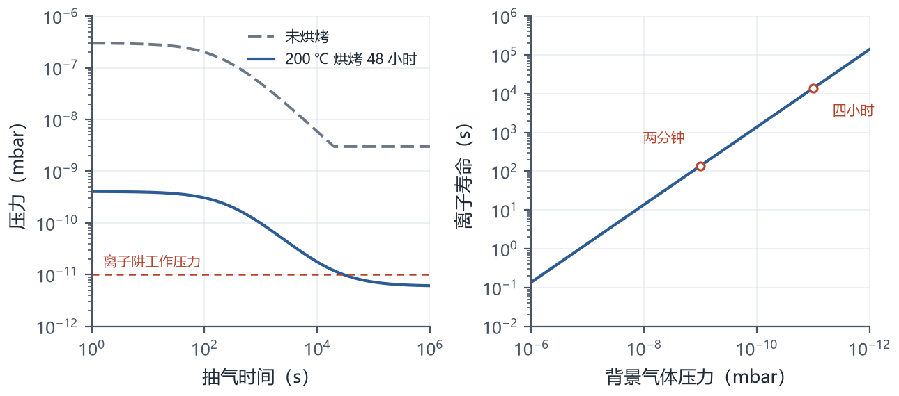
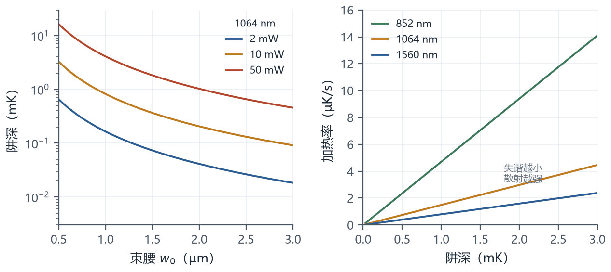

# 第 12 章　激光、真空与光学工程

超导比特靠电，离子和原子靠光。

一台几十个离子的量子处理器，旁边摆着几张光学平台，上面几百个镜片、波片、声光器件、光纤耦合头，占满一间屋子。激光要稳到赫兹，光路要对准到微米，真空要抽到 $10^{-11}$ 毫巴。这些听着像另一个学科，其实是离子阱和中性原子路线的命门。比特的保真度再高，激光一漂，门就做不准。

这一章讲这套系统的几个关键环节，激光、稳频、调制、光纤、真空，以及光镊的光路。

## 12.1 激光要干的四件事

离子阱里，一束激光要同时承担四项任务。

第一项是冷却。离子在阱里振动幅度比波长还大，多普勒冷却用一束略低于跃迁频率的激光，让离子只在迎面运动时吸收光子，反冲把速度降下来，到毫开尔文。第二项是光抽运，把离子从亚稳态捞回来，否则它掉进暗态就不再发光。第三项是门操作，用两束相位锁定的激光驱动拉比振荡，门的时间由脉冲面积决定。第四项是读出，用冷却光激发，收集荧光，亮是一个态，暗是另一个态。

中性原子的任务差不多，手段不同。原子先用磁光阱冷却到微开尔文，再用光镊一个个抓住排成阵列。里德堡激发用两束激光级联，一束到中间态，一束到高激发态。

四种任务对光的要求不一样。冷却是功率和频率的问题，门操作是相位和线宽的问题，读出是收集效率的问题，光镊是聚焦和稳定性的问题。一套系统要同时满足，只能在光源和光路上做分工。

## 12.2 波长从哪来

波长由原子决定。

钙离子的冷却和读出用 397 纳米，从基态到第一激发态；从亚稳态回来的抽运用 866 纳米；门操作用 729 纳米的四极跃迁，这条线很弱，需要窄线宽激光；还有一条 854 纳米的抽运线。镱离子用 369 纳米冷却，935 纳米抽运，435 纳米做光钟。铷原子的冷却用 780 纳米，光镊用 1064 纳米或者 813 纳米，里德堡激发用 480 纳米加 780 纳米两级。

这些波长大多不是半导体激光器的本征波长。397 纳米靠 794 纳米的激光倍频，729 纳米靠钛宝石或者 1458 纳米倍频，480 纳米靠 960 纳米倍频。倍频要用非线性晶体，铌酸锂或者硼酸铋，放在共振腔里，效率做到一半就算好。倍频后功率只有几百毫瓦，还要分给十几路光路，每路余量很小。

功率的需求跨度很大。冷却光几毫瓦就够，散射率已经饱和；光镊要几十毫瓦到几瓦；里德堡激发在几十毫瓦量级，但要求光束质量好，焦点小。

## 12.3 线宽与稳频

自由运转的半导体激光器，线宽在兆赫量级。这个数字对冷却是够的，对门操作远远不够。

离子阱的两比特门靠激光的相位累积。门时间几百微秒，线宽一兆赫的话，这段时间里相位漂移上百弧度，门就废了。要把相位误差压到毫弧度量级，线宽得在赫兹量级，比自由运转窄六个数量级。

稳频靠锁腔。把激光耦合进一个高精细度法布里-珀罗腔，两块超低膨胀玻璃或者单晶硅镜子，腔长十厘米，精细度十万，线宽一万五千赫兹。激光扫过共振峰时，反射光里出现色散形状的误差信号，叫 PDH 信号，用它反馈激光电流或者腔长，把频率钉在峰上。

锁定之后的线宽由腔决定，也由腔的稳定性决定。镜子镀在超低膨胀玻璃上，热膨胀系数在某个温度附近过零，把腔放在这个温度上，温度影响就小。腔还要抽真空、放隔振台，否则地面振动会让腔长抖动几个皮米，频率跟着抖几百赫兹。

两台激光之间还要锁相。门操作的两束光来自不同激光器，相位差必须稳定。两束光在探测器上拍频，得到一个射频信号，用它反馈其中一台的频率，把相位差钉住。

## 12.4 声光与电光

激光的频率、相位、功率、开关，都靠调制器。

声光调制器是一块二氧化碲或者石英晶体，一头粘着压电换能器。射频驱动换能器，在晶体里激起声波，造成周期性的折射率变化，形成移动的光栅。光进去被衍射，方向偏一个角度，频率也移了射频的量。衍射效率能到百分之八十以上，射频一断，衍射光就消失。开关速度由声波穿过光束的时间决定，光束直径五十微米，声速每秒四千米，上升时间十几纳秒，实际用几十纳秒。

声光器件的用途很多。可以当开关做脉冲门，可以当移频器把两束光错开几十兆赫，做拍频和锁相，还可以调射频功率控制衍射效率，当可变衰减器。

电光调制器用铌酸锂晶体，加电场改变折射率，直接调相位。速度比声光快，能到吉赫兹，适合边带调制和快速相位反馈。半波电压几伏。光纤型的把波导做在铌酸锂里，半波电压更低，插损也小。

调制器的指标里，消光比常被低估。开关的消光比只有三十分贝，关断时还有千分之一的光漏过去。对门操作来说，这点光在几百微秒里持续照射，会造成可观的误差。重要的开关要两级串联，或者用机械快门兜底。

## 12.5 光纤分发与相位稳定

自由空间光路会漂。镜子热胀冷缩，支架蠕动，气流扰动，几小时后光路就偏了，得重新对准。把光送进光纤，从激光台送到阱边，问题换了一种形式。

光纤稳定、干净、省空间，坏处是相位。光在光纤里传播，长度和折射率都随温度变。一米光纤温度变一开尔文，光程变八微米，对一千纳米的波长，相位变五十弧度，比门操作允许的大四个数量级。直接拿光纤传门操作的光是不行的。

解决办法是主动补偿。把光纤缠在压电陶瓷上，在远端放一个反射镜，取一点光和参考光干涉，测出相位差。相位偏了，反馈给压电陶瓷，拉伸或压缩光纤，把相位拉回来。环路带宽在千赫兹量级，压掉大部分慢漂移，残余相位误差做到几十毫弧度。

还有偏振。普通光纤的双折射随温度变，偏振态在光纤出口转来转去。门操作要求两束光的偏振一致，所以要么用保偏光纤，要么在出口加偏振补偿。保偏光纤的代价是损耗和成本，长距离传输时更明显。

## 12.6 真空不是背景

离子悬在真空里，背景气体是它的敌人。

一个离子和背景气体分子碰撞，会发生电荷交换，离子变成中性原子，从阱里掉出去。真空度决定离子的寿命。$10^{-9}$ 毫巴下，寿命两分钟；$10^{-11}$ 毫巴下，四个小时。做实验的时间尺度是分钟到小时，所以真空度必须到 $10^{-11}$。

抽到这么低的压力，靠的不是泵，是表面处理。腔的内表面积是体积的几十倍，气体主要从表面脱附，不是漏进来的。不锈钢未烘烤时的出气率在 $10^{-8}$ 毫巴升每秒每平方厘米量级，主要是水。加热到两百度烘烤两天，水被赶走，出气率降到 $10^{-12}$，剩下主要是氢。

烘烤之后，腔体不能再随便打开。每次开门，表面吸附一层水，又要重新烘烤。离子阱的装配要求在洁净环境里做，零件先超声清洗，再用等离子体处理，装好立刻抽真空。

表面还有更深一层的影响。电极表面的吸附物会带电，形成斑驳的补丁电位，离子感受到的电场不均匀，加热率上升。补丁电位还会随时间跳变，一个分子吸附或者脱附，附近的电场就变一次。低温阱把整个结构冷到几开尔文，表面吸附物被冻住，补丁电位稳定下来，加热率降一个数量级。代价是要把阱装进制冷机，结构复杂很多。

图 12-1　抽气过程中压力随时间的变化（左，按出气主导、$P=Q/S$ 的模型计算，对比未烘烤与烘烤后的水、氢两种成分）与离子寿命随背景气体压力的变化（右，按 $\tau=1/(n\sigma v)$ 计算，取电荷交换截面 $10^{-18}$ 平方米、分子速度 300 米每秒）

## 12.7 光镊的光路

中性原子的光镊，是一束聚焦得很紧的激光。

原子在远失谐的光场里，偶极能移正比于光强，反比于失谐。红失谐时能移为负，原子被拉向光强最大的地方，也就是焦点。阱深可以写成

$$
U_0=\frac{3\pi c^{2}}{2\omega_0^{3}}\frac{\Gamma}{\Delta}\cdot\frac{2P}{\pi w_0^{2}}
$$

$\omega_0$ 是原子的共振频率，$\Gamma$ 是自然线宽，$\Delta$ 是失谐，$P$ 是功率，$w_0$ 是束腰。阱深正比于功率，反比于束腰平方，也反比于失谐。

取铷原子，波长 1064 纳米，功率 1 毫瓦，束腰 1 微米，代入算出阱深八十微开尔文。这个深度能抓住微开尔文的原子，但抓不牢，实际的实验用十毫瓦到一瓦，阱深到毫开尔文量级。

代价是加热。原子在光镊里会散射光子，每散射一个，反冲给原子一点动能。散射率正比于阱深，也正比于 $\Gamma/\Delta$。阱深越深，散射越快，加热也越快。图 12-2 画的是这两个量随参数的变化。要减少加热，可以把波长移得更远，失谐变大，散射率按平方下降，可阱深也按一次方下降，要用更高的功率补回来。

光镊阵列靠扫描或者全息。声光偏转器让光束两维偏转，一束光时分复用到几十个位置，每处停留几微秒，原子感受的是平均势。空间光调制器把一束光分成几十个子光束，同时成阵，效率低些但不需时分。两种办法都要保证每个光镊功率均匀，否则阱深不一致，损失率也不一样。

图 12-2　光镊阱深随束腰与功率的变化（左）与散射加热率随阱深的变化（右），按铷原子 780 纳米跃迁、远失谐偶极势公式计算，取自然线宽 6 兆赫、反冲能量 0.1 微开尔文

## 12.8 一间屋子的工程

把这些拼起来，是一间光学实验室。

几十个离子需要十几路激光，每路都要稳频、调制、分束、监控。光学平台上有几百个元件，每个元件都要固定、对准、锁死。温度要稳定在一度以内，气流要挡住，声音要隔掉，否则干涉仪的条纹会晃。激光安全也是真问题，几百毫瓦的可见光，一反射就能伤眼睛，光路要加挡板，房间要联锁。

这套系统的成本不比稀释制冷机低。一台窄线宽钛宝石激光器几十万，几台倍频激光器又是几十万，光学和真空系统各占一块。更要紧的是人，光路每天查，激光每周调，真空每月记。保真度最高的路线，代价是这些看不见的劳动。

规模化的方向是把光学系统集成。光纤器件、集成波导、片上分束器，把桌面上的光路搬到芯片上。这条路和超导的倒装焊、光子的集成平台在往同一个方向走。量子硬件的下一步，拼的不再是单个器件的指标，而是这些支撑系统能不能做得又小又稳。
