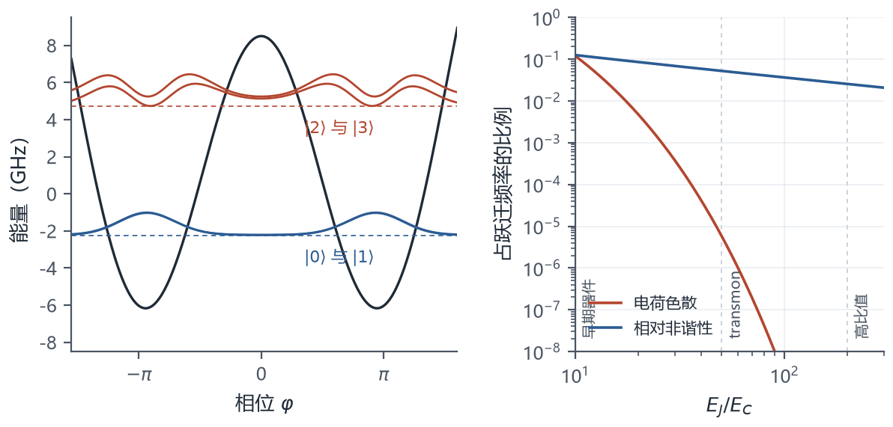
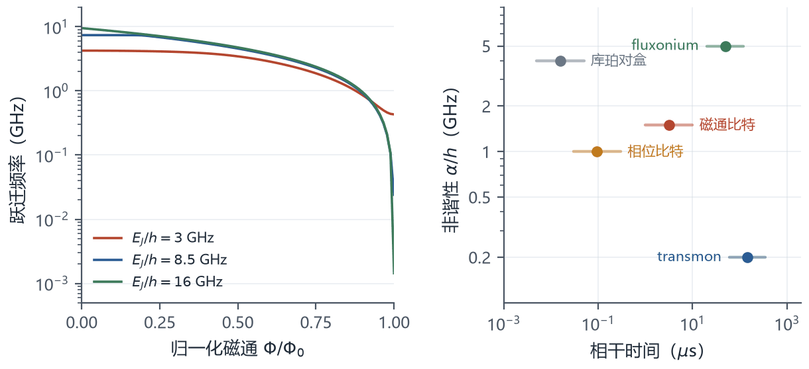

# 第 14 章　超导比特的家族

第 4 章把 transmon 讲成了一条顺理成章的路：把 $E_J/E_C$ 提高，电荷噪声被指数压住，非谐性掉到两百兆赫，代价可以接受。这条路今天确实赢了，几乎所有商用的超导处理器都用它。

可它不是唯一的路。在 transmon 成为标准件之前，至少有四五个家族并行存在过，各有各的道理，也各有各的死法。有些死得很干脆，比如相位比特，几年之内就没人做了。有些一直活到今天，还能在某些指标上压过 transmon，比如 fluxonium 的相干时间。

这一章把这些家族摆在一起看。不是为了讲历史，而是为了看清一个问题，超导电路里一个量子比特的好与坏，到底是被哪几个数字决定的。

## 14.1 三个能量决定一切

任何一个超导量子比特，都由电容、电感、约瑟夫森结这三样东西搭出来。写成量子哈密顿量，只有三项

$$
H = 4E_C\hat n^2 - E_J\cos\hat\varphi + \frac{E_L}{2}\hat\varphi^2
$$

$\hat n$ 是跨越结的库珀对数目，$\hat\varphi$ 是两边的相位差，两者的对易关系是 $[\hat\varphi,\hat n]=i$，跟位置和动量一样。三个系数各有物理含义。$E_C=e^2/2C$ 是充电能，电容越小它越大。$E_J$ 是约瑟夫森能量，正比于结的临界电流。$E_L=(\Phi_0/2\pi)^2/L$ 是电感能，电感越小它越大。

第一项是动能，第二项是周期性的势能，第三项是抛物线的势能。三种比特的差别，全在这三个数的大小关系里。

这个式子还直接告诉我们每种比特怕什么噪声。电荷噪声通过 $\hat n$ 进来，所以 $E_C$ 大的电路怕它。磁通噪声通过 $\hat\varphi$ 进来，因为外磁通就是加在相位上的偏置。临界电流噪声通过 $E_J$ 进来，表现出来是频率的慢漂移。一个比特不可能同时对三种噪声都免疫，因为要压住一种，就得让某一项在哈密顿量里占主导，而一旦某一项占主导，对应的那个变量就变得敏感。

家族的分化就是这么来的。设计的本质是在三种噪声里挑一个最能忍的，然后付代价。

## 14.2 相位比特，最早的那个

最早的超导比特不是库珀对盒，而是相位比特。2000 年前后，几家公司同时在推。

它的结构最简单，一个电流偏置的约瑟夫森结，势能是余弦加一个斜坡

$$
U(\varphi) = -E_J\cos\varphi - I\Phi_0\varphi/2\pi
$$

斜坡把余弦的一边压下去，在某个局部极小值附近形成一个浅阱。阱里只放得下三四个能级，相邻能级间距在十吉赫兹量级，非谐性大到几百兆赫兹甚至吉赫兹，比 transmon 高一个数量级。非谐性大意味着泄漏几乎不存在，脉冲形状可以很粗糙，门做得又快又简单。

读出也很直接。相位比特的阱很浅，势垒只有几个能级高，测量时给一个强微波脉冲，让原子从阱里逃出去，再看结上的电压有没有跳变。这种破坏性读出简单、信号大、保真度高，当时是它的招牌。

问题也出在这个浅阱上。势垒低，热激发和噪声都能把态踢出去，逃逸率决定了比特的寿命。更麻烦的是介质损耗，结的势垒用电容旁路，旁路电容的介质损耗直接吃掉了相干性。相位比特的 $T_2$ 只有几十到几百纳秒，比后来的 transmon 差三个数量级。

还有一个工程上的死结。每个比特要一条独立的电流偏置线，偏置电流的噪声直接调制频率，而且这条线又粗又多，做几十个比特就布不下。扩展性差加上相干时间差，2005 年之后这条路基本停了。

## 14.3 磁通比特，双阱里放两个态

磁通比特换了个思路。它不看单个结的相位，而是看一个超导环路里流动的持久电流。

最经典的版本由三个结组成，其中两个参数相同，第三个的临界电流是它们的 $\alpha$ 倍，$\alpha$ 通常取 0.7 附近。环路里加半个磁通量子的时候，势能出现两个极小值，分别对应顺时针和逆时针的持久电流。两个极小值之间的势垒由第三个结的 $E_J$ 决定，隧穿把它劈成一个能隙，两个能级就架在这个能隙上。

非谐性在这里是吉赫兹量级，比 transmon 大一个数量级，门可以做得很快，两比特门也能几十纳秒完成。量子态是宏观电流的方向，抗局部扰动的能力看起来不错。

代价是磁通。两个势阱的位置由外磁通决定，外磁通偏一点，两个阱的高度就不一样，比特频率跟着变。在半磁通点上，频率对磁通是一阶敏感，磁通噪声直接变成频率噪声。实验室里要拿到 $10^{-6}\Phi_0$ 量级的磁通稳定性，靠的是超导屏蔽加磁屏蔽，一层铌、一层坡莫合金，再套一层铝。

磁通比特的 $T_2$ 通常在几微秒，比 transmon 差十倍以上，但比相位比特好得多。它在 2000 年代中期是主流之一，后来被 transmon 超过，现在还在一些特殊场合用，比如需要强耦合或者需要快速磁通调节的实验。

## 14.4 fluxonium，用大电感换相干

fluxonium 是同一个思路推到极致的结果。它不看单个结，也不看三个结的环路，而是在一个结上并一个大电感。

大电感把 $E_L$ 压到零点几吉赫兹，比 $E_J$ 小一个数量级。这时候抛物线变得很平，余弦的周期性充分展开，势能里出现一长串几乎等高的极小值，相邻两个之间隔着 $2\pi$ 的相位。偏置在半磁通点上，其中两个极小值高度相同，各自对应一个磁通量子穿过电感的状态。

图 14-1 左边画的就是这个势能。横轴是相位，竖轴是能量，两个阱在 $\pm\pi$ 处，中间隔着一道十几吉赫兹高的势垒。阱里最低的两个态是一对，能量差只有几十兆赫兹，它们才是比特。再往上是等离子体振荡，频率在八吉赫兹上下，跟比特隔得很远。

图 14-1　左：fluxonium 的势能与最低四个能级，$E_J/h=8.5$ GHz、$E_C/h=1.0$ GHz、$E_L/h=0.5$ GHz，按相位方程数值对角化计算，曲线为 $|\psi|^2$。右：电荷色散与相对非谐性随 $E_J/E_C$ 的变化，按 Koch 等人的渐近公式计算

这个结构给出的东西很有意思。比特的两个态是磁通子的对称与反对称组合，波函数分布在整个阱里，对局部的电荷涨落几乎无感。同时它的 $T_1$ 可以做到几百微秒，最好的样品接近一毫秒，比 transmon 高一个数量级。原因不是材料更好，而是跃迁矩阵元小，同样的介质损耗谱密度，落在比特频率上的耦合弱。

代价有三条。大电感要用超电感阵列实现，几百个结串起来，占几百微米见方的面积，比比特本身大得多。比特频率低，只有几百兆赫兹，这就要求读出和控制链在这个频段的噪声也足够低，低频的 $1/f$ 噪声是个麻烦。门速度也慢，单比特门几十纳秒，两比特门要几百纳秒。

图 14-2 左边是 fluxonium 的磁通色散。三条曲线对应不同的 $E_J$，横轴是归一化磁通，纵轴是跃迁频率，用对数轴。在半磁通点上，曲线扎下去，$E_J$ 越大扎得越深。$E_J/h=16$ 吉赫兹时，半磁通点的频率只有一兆赫兹出头，对磁通的敏感度低到可以忽略。这就是所谓的重 fluxonium，用更大的 $E_J$ 换取对磁通噪声的免疫。图的右边把几个家族放在了非谐性与相干时间这两个坐标上，后面还会用到。

图 14-2　左：fluxonium 的跃迁频率随磁通的变化，$E_C/h=1.0$ GHz、$E_L/h=0.5$ GHz，三条曲线对应不同的 $E_J$，按相位方程数值计算。右：几个家族在非谐性与相干时间平面上的典型位置，数值取自公开报道的范围，仅表示量级

## 14.5 0-π 比特与保护的思路

前面几种比特都在跟噪声搏斗，想办法把噪声挡在外面。0-π 比特想的不是这个，它想让噪声在原理上就没法作用。

做法是在环路里放一个特殊的结，它的基态电流关系整体反了个相位，也就是所谓 π 结。铁磁材料夹在两层超导体之间就能做出这种结，交换场让库珀对的自旋极化，基态的相位差从 0 变成 $\pi$。环路里放一个 π 结加一个普通结，两个结的相位要求互相补充，系统在零外磁通下就自然处在半量子的偏置点上，两个势阱天然等高，不需要精细调磁通。

这一步很关键。磁通比特的对称性靠外加磁通维持，磁通一漂，对称性就破。0-π 比特的对称性由结构保证，磁通漂移只是二阶效应。

另一条实现路径不用铁磁材料，用所谓第二谐波元素。两个约瑟夫森结串在一个小环路里，环路的电感很小，把两个结的自由度锁在一起，等效的电流相位关系里出现了 $\cos 2\varphi$ 这一项。$\cos 2\varphi$ 的周期是 $\pi$ 而不是 $2\pi$，整个势能的周期减半，两个简并的基态自动出现。

这条路的实验进展不慢。用第二谐波元素做的比特，$T_1$ 报到过几百微秒，$T_2$ 上百微秒，退相位对磁通和电荷都不敏感。难点在参数窗口窄，环路的电感、两个结的比值、外磁通都要落在很窄的范围内，工艺偏差一大就退化。铁磁那条路的材料损耗还没解决，磁滞和涡流会直接吃掉相干性。

## 14.6 保护到底是什么

说到保护，容易含糊。很多人以为保护就是相干时间长，其实不是。相干时间长只是结果，保护的实质是噪声算符在计算子空间里没有矩阵元。

用数学说，如果噪声耦合写成 $\hat{H}_N = \lambda\hat{A}\otimes\hat{B}$，保护的意思是 $\hat{A}$ 在计算子空间里的投影是一个常数乘以单位矩阵。单位矩阵不改变态，只给一个整体相位，不构成错误。要达到这一点，两个态必须在某个守恒量上差得很远，比如磁通子数差一个，电荷数差两个，光子数差很多。

按这个标准，几个家族的保护强度可以排一排。库珀对盒没有保护，电荷噪声一阶耦合。transmon 有弱保护，电荷色散被指数压住，但对磁通和临界电流没有保护。磁通比特在 sweet spot 上有二阶保护，对磁通的一阶导数在特定点为零。fluxonium 在重参数下有更强的保护，磁通色散是指数小的。0-π 比特的保护来自对称性，结构保证的简并没有可调参数。

还有一条完全不同的路，把信息编码到谐振子的连续变量里，就是所谓 GKP 态。它的保护不靠能级结构，而靠态的周期性，小位移噪声只要小于某个阈值就可以被纠正。这条路需要极高的谐振器品质因数和极低的热噪声，工程上比前几种都难。

## 14.7 取舍怎么算

把这些放在一张图上，就是图 14-2 右边那张。横轴是相干时间，纵轴是非谐性，两个轴都是对数。库珀对盒在左上角，非谐性大但相干时间只有几十纳秒。相位比特在它下方，磁通比特往右挪了一点。transmon 在右下角，相干时间上百微秒，非谐性只有两百兆赫兹。fluxonium 在右上，两个指标都好，代价是面积和速度。

图上没有哪个点全面占优。这说明一件事，比特的设计是一个多目标的取舍，不存在单一最优。选哪一个，要看整个系统还缺什么。如果控制线紧张，需要强驱动和短门，就偏向非谐性大的。如果读出链的噪声压不下去，需要长积分时间，就偏向相干时间长的。如果面积紧张，离不开片上电容和电感，那 fluxonium 那种大电感就没法用。

有一个指标可以把这些揉在一起，就是相干时间内能做的门数。粗略地写成

$$
N_{\mathrm{gate}} \approx \frac{T_2}{t_{\mathrm{gate}}}
$$

transmon 的 $T_2$ 是两百微秒，门时间二十纳秒，算出来一万。fluxonium 的 $T_2$ 是一百微秒，门时间五十纳秒，算出来两千。数字上 transmon 反而赢，因为它快。这解释了为什么工程界选了它，尽管它的相干时间只有 fluxonium 的十分之一。

不过这个估算很粗。真正的限制往往不是相干时间，而是两比特门的错误率、读出的串扰、以及校准漂移的速度。一台几百比特的机器，每天要跑几千次校准，参数稳定比指标漂亮更重要。transmon 赢的地方，很大程度上是它的参数散度小、调控手段成熟、周边器件配套齐全。

所以这一章列出的家族，不是一份排名表，更像一份工具箱。真正的选择发生在系统层面，由布线、冷量、封装、控制电子学这些看起来不性感的约束决定。第 15 章换一条完全不同的路线，那里没有超导电路，也没有毫开尔文的稀释制冷机，取而代之的是一间布满激光的房间和几百个悬在真空里的原子。
