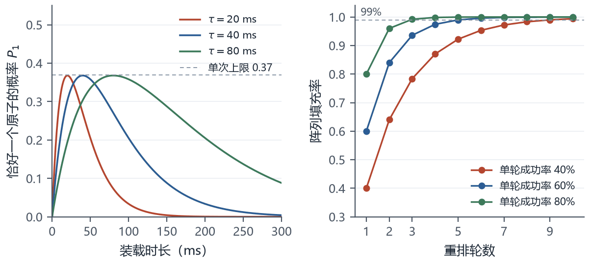
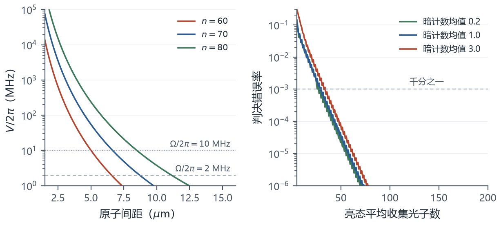

# 第 15 章　中性原子与里德堡阵列的工程

第 5 章讲过中性原子的物理。一团铷原子冷却到微开尔文，用光镊一个个抓住，排成阵列，再把其中某几个激发到里德堡态，让它们互相作用。原理干净，图像漂亮。

把它做成一台能跑算法的机器，是另一回事。真空腔要抽到 $10^{-11}$ 托，激光要稳到千赫兹，光路要有几百个元件，时序要精确到纳秒。原子本身不花钱，装它的这套系统要几千万。

这一章讲这套系统。重点不在物理原理，而在几个具体的工程问题：原子怎么装进去，装不满怎么办，里德堡激光怎么稳，邻居之间怎么不打架，最后怎么把结果读出来。

## 15.1 一台机器由哪几块组成

先说全貌。一台中性原子量子计算机，物理部分可以分成四层。

最里面是真空腔，压力在 $10^{-11}$ 托量级，比大气压低十四个数量级。原子在里面飞行几秒钟才会撞上残余气体分子，这个时间决定了比特的寿命上限。往里送原子的是一套激光冷却系统，铷或者铯的蒸气在磁光陷阱里被冷却到几十微开尔文，形成一个几毫米大小的冷原子云。

再往上是光镊阵列。一束或者几十束红外激光经过声光器件或者空间光调制器分成几百上千个焦点，排成方格或者任意图形，焦点的束腰一微米左右，间距三到五微米。最外层是里德堡激发和成像，两束激光把原子送到高主量子数的激发态，另一套光路收集荧光，判断每个位置上有没有原子、处在什么态。

四层之间靠时序咬合。一次完整的实验循环，从装载到读出，快的几赫兹，慢的不到一赫兹。这个循环率是中性原子路线最现实的软肋。

## 15.2 光镊阵列怎么排出来

光镊阵列的排布有两种主流做法，声光偏转和全息。

声光偏转器是一块晶体，加射频信号后把光束偏转一个角度，角度正比于射频频率。两个偏转器正交摆放，就能把一束光在平面内任意定位。要做一百个光镊，就让频率在一百个值之间快速切换，每个位置停留几微秒。原子运动慢，跟不上微秒级的开关，感受到的是时间平均的势。这种做法简单稳定，缺点是同一时刻只有一个光镊在出力，平均功率被摊薄。

全息用空间光调制器，一块液晶面板，每个像素可以独立改变相位。把一束光打上去，反射出来的光场就是几百个子光束的叠加，所有光镊同时存在，功率不摊薄。缺点是衍射效率只有百分之几十，亮度不均匀，需要事先标定补偿。

不管用哪种办法，有一个指标绕不过去，就是功率均匀性。阱深正比于局域光强，两个光镊的功率差百分之十，阱深就差百分之十，原子在这两个位置的寿命和门保真度就不一样。整个阵列的保真度由最差的那个位置决定，所以实际系统都有一套逐点标定的流程，测每个位置的阱深，反过来修正调制器的输入。

## 15.3 装载，以及装不满怎么办

原子从冷云里被抓住的概率不是一。一个光镊的尺寸只有一微米，如果两个原子同时进去，光辅助碰撞会给它们足够的动能，让它们一起跑掉。结果是一个光镊里要么没有原子，要么最多一个。

按泊松统计，平均进入 $\mu$ 个原子时，恰好留下一个的概率是

$$
P_1 = \mu e^{-\mu}
$$

这个式子在 $\mu=1$ 处取极大值 0.37。不管怎么优化装载，一次装载的成功率最高只有百分之三十七。这是中性原子路线里最出名的一个数字，也是所有工程手段要绕开的起点。

图 15-1　左：碰撞阻塞下恰好装入一个原子的概率随装载时长的变化，按 $P_1=\mu e^{-\mu}$、$\mu=t/\tau$ 计算。右：多轮重排后的阵列填充率，按 $1-(1-p)^k$ 计算，$p$ 为单轮把空缺补上的成功率

装不满不要紧，补上就行。这就是所谓重排。

做法是在装载和成像之后，把每个位置的状态读出来，得到一张有原子的位置图。然后让声光偏转器把有原子的光镊沿着路径搬到空缺的位置，搬完再成像确认。每次搬动耗费几十毫秒，原子在搬运过程中会略微加热，损失率在百分之一量级。

一轮重排能把空缺填掉一半到八成，几轮之后填充率就到百分之九十九以上。单轮成功率百分之八十时三轮就到百分之九十九，只有百分之四十时要六七轮。代价是时间，每一轮都要成像，而成像是循环里最慢的一步，轮数一多循环率就掉下来。

## 15.4 里德堡激光

把原子激发到里德堡态，需要的光波长和基态跃迁完全不同。铷的路线是两步激发，先用 780 纳米把原子从基态送到中间态 $5P$，再用 480 纳米送到主量子数五六十以上的里德堡态。两步的好处是每一步的波长都在半导体激光器能覆盖的范围，坏处是中间态有自发辐射，原子在那里停留的时间越长，损失越大。所以第二步激光要强，脉冲要短，几百纳秒以内完成。铯的做法类似，用 852 纳米和 1013 纳米，第二束光在近红外，光纤传输方便。

里德堡态的寿命是这套系统的核心限制之一。按黑体辐射估算，室温环境下主量子数 70 的里德堡态寿命只有一百微秒左右，因为 300 开尔文的腔壁不断辐射中红外光子，把原子从高激发态又推回附近的态。把腔体降温到 77 开尔文能延长到毫秒，但低温工程又带来新的复杂度。

频率稳定是另一件事。里德堡态之间的能级差对电场极其敏感，斯塔克效应按 $n^7$ 增长，主量子数 70 时，一个每厘米几毫伏的杂散电场就能让能级移动几兆赫。实验室里的电荷积累、介质表面、甚至操作者身上的静电都会造成漂移。实际系统要在腔体里加一层透明的导电膜，把电场屏蔽掉，同时激光要用边带锁频，把线宽压到十千赫兹以内。

## 15.5 串扰从哪里来

里德堡原子之间的相互作用是范德瓦尔斯型，按距离的六次方衰减

$$
V = \frac{C_6}{r^6}
$$

$C_6$ 随主量子数增长得很快，大约按 $n^{11}$ 走。铷的 $n=70$ 时，$C_6/h$ 约等于 862 吉赫兹乘微米的六次方。这个数字看起来很怪，但很好用，把它除以距离的六次方，直接得到以赫兹为单位的相互作用能。

图 15-2 左边画的就是这个关系。横轴是间距，纵轴是相互作用能，三条曲线对应三个主量子数。当相互作用能等于驱动强度 $\Omega$ 时，对应的距离叫阻塞半径。取 $\Omega/2\pi=5$ 兆赫，$n=70$ 时阻塞半径在七点五微米上下。

这个数字和阵列间距放在一起就有意思了。间距是四微米，阻塞半径是七点五微米，一个原子被激发时，周围两圈内的原子都被阻塞。做两比特门时我们只想让目标那一对原子耦合，不希望第三、第四个原子参与，阻塞半径大于间距，就必然有额外的原子被卷进来。

这就是中性原子系统里最主要的串扰来源。它不像超导那样来自电磁场的泄漏，而是来自相互作用的远程性。办法有几种。一是增大间距，把阻塞半径压到只有最近邻，代价是耦合变弱、门变慢。二是减小驱动强度，阻塞半径按 $\Omega^{-1/6}$ 变化，要缩小一半半径得把 $\Omega$ 降六十多倍，不现实。三是用补偿脉冲，把被误激发的邻居用相反的脉冲推回去，这是现在的主流做法，能把串扰压到千分之几。

还有两种量级更小的串扰。寻址光束经过物镜后边缘有衍射环，会照到邻居；读出一个原子时，它散射的荧光会被邻近的像素收到。这两种靠光路设计解决。

图 15-2　左：里德堡相互作用能随间距的变化，按 $V=C_6/r^6$ 计算，$C_6$ 由铷 $n=70$ 的 862 GHz·$\mu$m$^6$ 按 $n^{11}$ 标度外推。右：荧光读出的判决错误率随收集光子数的变化，按泊松统计、阈值取亮暗两态中点计算

## 15.6 阵列重构不只是搬原子

中性原子最吸引人的地方是连接可以重构。超导芯片上哪两个比特能耦合，在流片的时候就定死了，中性原子阵列想让哪两个原子耦合，就把它们搬到相邻位置，或者把激光指向它们。工程上这件事没那么自由。

搬动一个原子，是把光镊的焦点从 A 移到 B。移动速度受阱深限制，太快原子会被甩出去，太慢则耗时。典型的加速度在几千个重力加速度量级，四微米的距离要走上百微秒。同时搬几十个原子时，路径不能交叉，否则两个光镊靠近时势场叠加，原子可能交换位置或者一起跑掉。这就变成了一个路径规划问题，和仓库里调度搬运机器人是同一类问题，只是尺度小了一万倍。

阵列的几何也有限制。二维阵列受物镜景深限制，焦点偏离焦平面几微米，束腰就变大，阱深变浅。现在能做的双层阵列，层间距两三微米，已经能演示一些三维格点模型。重构之后还要重新校准，阱深、相位、邻接关系都变了。一台机器如果每跑一个线路就重构一次，校准开销会盖过计算本身。

## 15.7 成像与读出

中性原子的读出几乎都用荧光。把原子照射在共振光上，它会持续散射光子，每秒几百万个，相机曝光十几毫秒就能收到足够多的光子，判断这个位置上有没有原子。保真度现在能到百分之九十九点五以上。

限制在哪里可以算。假设亮态平均收到 $\bar N$ 个光子，暗态的平均计数 $\bar d$ 来自杂散光和相机噪声，阈值取两者中点，错误率由两个泊松分布的尾部给出

$$
\epsilon = \frac{1}{2}\left[P(k<k_{\mathrm{th}}|\bar N) + P(k>k_{\mathrm{th}}|\bar d)\right]
$$

图 15-2 右边是这条曲线。要压到千分之一，亮态需要一百个以上的光子。这个数字决定了曝光时间和激光功率，也就决定了整个循环的节奏。

读出还有一个更麻烦的问题，就是它会破坏态。散射光子的过程会不断扰动原子，把它踢出原来的态。荧光读出只能读出计算完成后的结果，中途读一次就得重新制备。想要中途读出，得把信息转移到另一个态，或者用腔增强提高收集效率。

并行读出是中性原子的优势。所有原子同时被照亮，一台相机一次拍完，不像离子阱要逐个扫描。代价是像素要和光镊位置对齐，间距四微米时一个原子只占几个像素，串扰和像素间的不均匀都得靠标定解决。

## 15.8 现在的水平与真正的瓶颈

到 2020 年代中期，中性原子阵列的规模做到了几千个原子，单比特门保真度百分之九十九点九，两比特门百分之九十九点五上下，读出百分之九十九以上。这些数字和超导、离子阱在同一梯队。

瓶颈不在这些指标上。真正卡住的是三件事。

第一件是循环率。一次装载、重排、计算、读出的完整循环，快的一赫兹，慢的零点几赫兹。超导机器跑一次线路是微秒级，一秒能跑上万次。这个差距意味着中性原子在做需要大量重复采样的任务时处于劣势，比如变分算法或者统计采样。

第二件是激光系统的体积和稳定性。一间屋子的光学平台，几百个调整架，每天要检查，每周要优化。任何一块镜片松动，整个阵列的均匀性就变。这套系统的成本和工作量跟稀释制冷机在一个量级上，麻烦程度也不遑多让。

第三件是里德堡态的寿命和串扰。这两个限制叠在一起，决定了能跑多深的线路。门与门之间的间隔不能太长，否则原子衰变；又不能太短，否则邻居的残余激发还没退掉。

下一章换到另一个极端。那里没有真空腔，没有激光，只有一块硅片，上面刻着几百个波导和耦合器，光在里面走，损耗按每厘米零点几分贝算。集成光子做的事情，说到底就是把第 12 章里那些占满一间屋子的光学系统，压缩到指甲盖大小的芯片上。
