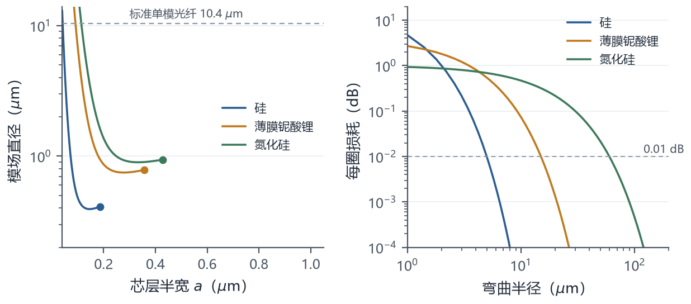
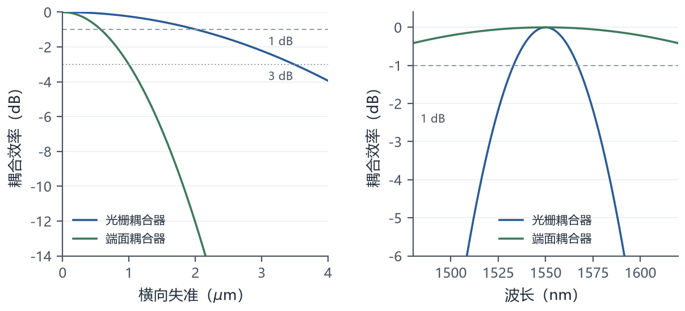

# 第 16 章　集成光子工艺与封装

第 12 章讲过光学工程的麻烦。几十路激光，几百个镜片，一张三米长的光学平台，温度要稳，气流要挡，任何一个螺丝松动都可能让整台机器跑不出结果。这样的系统能做出很好的物理，做不成产品。

集成光子的想法很直接。把分束器、相位调制器、延时线、干涉仪全部刻到一块芯片上，用光刻定义几何，用波导传光，用外部的电信号调相位。元件的位置由掩模决定，误差在纳米量级，而且一次可以做几千个。

这条路在光通信里已经走了二十年。数据中心里的收发模块，绝大多数是硅光芯片。量子计算借用这套工艺，省掉了重新发明一遍的麻烦，也继承了它的限制。

## 16.1 三种材料各管一段

集成光子没有一种材料能全包，现在的主流是三种材料分工。

硅是最成熟的。绝缘体上硅的芯层折射率 3.48，包层是二氧化硅的 1.44，折射率差大，波导可以做到五百纳米宽、二百二十纳米厚，弯曲半径五微米。尺寸小意味着密度高，一块芯片上可以放几千个元件。

硅的损耗不算低，单模波导在通信波段是每厘米一到三分贝。这个数字放在通信里可以接受，放在量子里就是灾难，因为量子线路里光的传播路径往往有几厘米，损耗直接吃掉成功率。硅还有一个麻烦，它不发光，发光效率极低，光源只能从外面引进来，或者贴一颗 III-V 芯片上去。

氮化硅补的正是损耗这一块。它的折射率 2.0 左右，跟二氧化硅的差小，波导尺寸要大一些，弯曲半径几十微米，密度低。代价换来的是极低的损耗，工艺好的氮化硅波导可以做到每米零点几分贝，比硅低三个数量级。延时线、参量放大器、光频梳，都建在这种材料上。

薄膜铌酸锂管的是调制。铌酸锂的电光系数大，加电场直接改变折射率，响应速度快到几十吉赫兹，而且几乎没有损耗。把几百纳米厚的铌酸锂薄膜键合到二氧化硅上刻成波导，就得到所谓薄膜铌酸锂平台，调制带宽可以做到一百吉赫兹以上。

图 16-1 左边把三种材料的模场尺寸画在一起。横轴是芯层半宽，纵轴是模场直径，曲线的右端点是单模条件的上限。硅的模场只有半微米，氮化硅一微米，薄膜铌酸锂介于两者之间。图上那条虚线是标准单模光纤的十点四微米。

图 16-1　左：模场直径随芯层半宽的变化，按 $V$ 数与 Marcuse 经验公式估算，圆点为单模截止点。右：弯曲损耗随半径的变化，按指数模型拟合公开报道的量级，参考点取 0.01 dB 对应的半径

这张图说明了一个绕不过去的矛盾。波导要小，才能把光关得紧、弯得急、集成得密。光纤要大，才能和外面的世界对接。两者差二十倍，光从光纤进芯片，就像从广场走进一条小巷，绝大部分会被反射或者辐射掉。后面讲的耦合器，全是在解决这个矛盾。

图 16-1 右边是弯曲损耗。硅的曲线在五微米以内急速上升，小于三微米就没法用，氮化硅要一百微米以上才敢弯。这个差别决定了芯片密度，硅光芯片上可以放几千个器件，氮化硅芯片上只能放几百个。

## 16.2 光怎么进出芯片

耦合器有两种主流做法，垂直的和端面的。

光栅耦合器做在芯片表面。在波导上刻一圈周期性的浅槽，光沿着波导走到这里，被周期性结构散射，方向偏转九十度，从表面射出。射出的角度由光栅周期和波长决定，通过设计周期可以让光垂直出射，正对着放在上方的光纤。

好处是可以在晶圆上任何位置放一个耦合器，测试时探针从上面对准就行，不需要划片和抛光。一块晶圆上做几百个器件，可以逐个测。缺点是带宽窄，一个分贝带宽通常只有三十到四十纳米。它还挑偏振，横电和横磁的耦合角不一样。

端面耦合器做在芯片边缘。把波导的宽度逐渐收窄成一个锥尖，模场被挤出波导，扩散到几个微米的范围，正好和光纤匹配。或者反过来，用一段尺寸渐变的聚合物波导做模场转换。

好处是带宽宽，一百纳米范围内效率几乎不变，偏振也不敏感。缺点是要把芯片切开、抛光，光纤从侧面顶上来，对准精度要求更高。图 16-2 把两者放在一起比。

图 16-2　左：耦合效率随横向失准的变化，按高斯模场重叠 $\exp(-(\Delta x/w)^2)$ 计算，$w$ 取 4.2 与 1.2 $\mu$m。右：耦合效率随波长的变化，光栅耦合器取 25 nm 的高斯宽度，端面耦合器取 160 nm

左边的图说明了对准的难度。光栅耦合器的模场大，横向挪两微米才掉一个分贝，用普通的六轴位移台手动都能对上。端面耦合器的模场小，挪半个微米就掉一个分贝，得用压电位移台加自动寻优。右边的图说明了带宽。光栅耦合器在正负二十五纳米之外就掉得厉害，端面耦合器在整个波段几乎是平的。

实际系统里两种都用。研发阶段用光栅，方便测试；产品阶段用端面，追求带宽和效率。也有把两者结合的，先用光栅做晶圆级测试，封装时再改用端面耦合。

## 16.3 光纤阵列

一根光纤不够用。一个光子芯片上往往有几十路输入输出，全都要接光纤。

单根光纤一根根对准，几十根就是几十次操作，每次都要亚微米精度，生产效率无法接受。工业上的办法是光纤阵列，把几十根光纤按固定间距排在一块玻璃基板的 V 型槽里，端面一起抛光，形成一个整体。对准一次，几十路同时接通。

间距通常是二百五十微米，跟光纤的涂覆层直径一致，也有用一百二十七微米的，密度高一倍。V 型槽的加工精度在亚微米，光纤放进去靠重力或者压板固定，位置由槽决定，不需要逐根调。

芯片这边的耦合器阵列也要按同样的间距排。两边的间距误差要小于零点五微米，否则边缘的几路就对不上。芯片的热膨胀系数和玻璃基板不一样，温度变化几十度，累积的位置偏差就能吃掉对准余量。所以阵列式的封装要做温度循环测试，反复验证。

对准之后用紫外固化胶固定。胶的收缩会带来几十纳米的位移，收缩量随温度变化，长期还会蠕变。这些细节决定了封装的成品率，也决定了整机几个月后的性能是不是还和出厂时一样。

## 16.4 损耗预算

光子路线最硬的墙是损耗。这一点第 6 章已经说过，这里算一笔具体的账。

一个中等规模的光子线路，光要走过的路径包括，从光纤进来一到两分贝，经过十几个分束器和相位调制器，每个零点一到零点五分贝，中间还有几厘米的波导，硅的话一到三分贝，然后从芯片出去又是一两分贝。全部加起来，二十到三十分贝。

这个数字意味着什么。三十分贝是一千倍，进去一千个光子，出来一个。量子线路里每个光子都携带信息，丢一个就是一次错误。经典通信可以靠放大补偿，量子态不能放大，这是原理性的限制。

所以光子路线对损耗的要求，比通信严三个数量级。通信模块的插损三分贝算优秀，量子线路要的是整个芯片零点几分贝。这就是为什么氮化硅这么受重视，也是为什么光子芯片的封装比芯片本身更难。

有一个缓解办法，是把损耗转成擦除。如果知道哪个模式丢了光子，就可以把这个模式标记为丢失，交给纠错码处理，不需要当成错误来纠正。擦除的阈值比错误高得多，容忍度好一个数量级。代价是要有办法检测丢失，也就是每个模式后面都得挂探测器，资源开销上去了。

## 16.5 温度为什么这么要紧

光子芯片对温度极其敏感，这一点常常被低估。

硅的热光系数是每开尔文一点八乘十的负四次方，折射率随温度线性变化。一个波导的相位延迟等于折射率乘长度乘波数，长度一毫米，温度变一开尔文，相位就变零点几个弧度。干涉仪要稳定在千分之一弧度，温度就得稳到毫开尔文。

氮化硅好一些，热光系数小一个数量级，但也好不到可以不管的程度。铌酸锂的热光系数也小，可是它的电光效应对偏压漂移敏感，同样要控温。

实际系统的做法是把整块芯片贴在一个热电制冷器上，用热敏电阻反馈，把温度稳在正负一毫开尔文。芯片和制冷器之间要涂导热胶，厚度均匀，否则芯片上有温度梯度，不同位置的相位漂移不一样，干涉仪的对比度就掉。
功耗是另一个约束。一个光子芯片上几百个相位调制器，每个都要独立的电信号，热光调制器的功耗在毫瓦到几十毫瓦。几百个加起来是几瓦，热电制冷器要把这几瓦抽走，自身还要多消耗几倍的电。到了低温环境，这个账更算不过来，所以低温下的光子芯片倾向于用电光调制而不是热光。

## 16.6 探测器和光源

光子芯片还需要两样东西，探测器和光源。这两样都很难和波导做在一起。

探测器的首选是超导纳米线单光子探测器。一条几十纳米宽、几百微米长的氮化铌细线，偏置在临界电流附近，一个光子打上去，局部变成常态，电阻突变，产生一个脉冲。效率可以做到百分之九十以上，暗计数每秒几个。指标好得没话说，但它要在一到三开尔文工作。

把探测器集成到光子芯片上，意味着整块芯片要放进制冷机。这和超导量子芯片的处境类似，只不过温度要求松一些，用液氦或者脉冲管制冷机就够。光纤要从室温引到冷端，热噪声和机械振动都跟着进来，这是工程上的难点。

光源更难。硅不发光，氮化硅也不发光，铌酸锂也不发光。要用单光子源，得贴量子点或者金刚石色心，或者用参量下转换在片外产生再引进来。异质集成是现在的方向，把 III-V 材料的量子点外延生长在硅上，或者用微转印把做好的光源薄膜贴到波导上。这条路的成品率还在爬坡。

## 16.7 工艺借用与产业现实

集成光子的一个优势是可以用现成的产线。

硅光芯片的工艺和 CMOS 高度兼容，氧化、光刻、刻蚀、离子注入，全套设备都是现成的。全球有几家开放的硅光代工厂，提供多项目晶圆服务，一次流片可以拼几十个设计，分摊掩模成本。一个研究组花几万美元就能拿到一批芯片，这在超导里是不可想象的。

氮化硅的低损耗工艺要求高，氢含量、侧壁粗糙度、退火温度都影响损耗，能做到每米零点一分贝的产线不多，这也是低损耗氮化硅进度慢的原因。

薄膜铌酸锂的难点在键合和刻蚀。把几百纳米厚的铌酸锂薄膜从体材料上剥离，键合到二氧化硅上，要控制应力和气泡。刻蚀铌酸锂的侧壁容易粗糙，散射损耗大。这几年进步很快，几家初创公司和研究机构已经把插损压到零点一分贝每厘米。

封装是成本的大头。一颗光子芯片本身可能几十美元，加上光纤阵列、对准、固化、测试，成本翻十倍。这个比例和传统半导体正好相反，光子路线的产业化，很大程度上是封装工艺的产业化。

回到量子计算本身。光子路线的目标是百万量级的光子，这意味着百万个元件、几万根光纤、几千个探测器。这个规模下的封装、测试、良率、成本，没有现成的答案。第 17 章换一种材料，同样是硅，但不做波导，而是在硅里挖出一个个小坑，把电子关进去，用自旋存信息。
