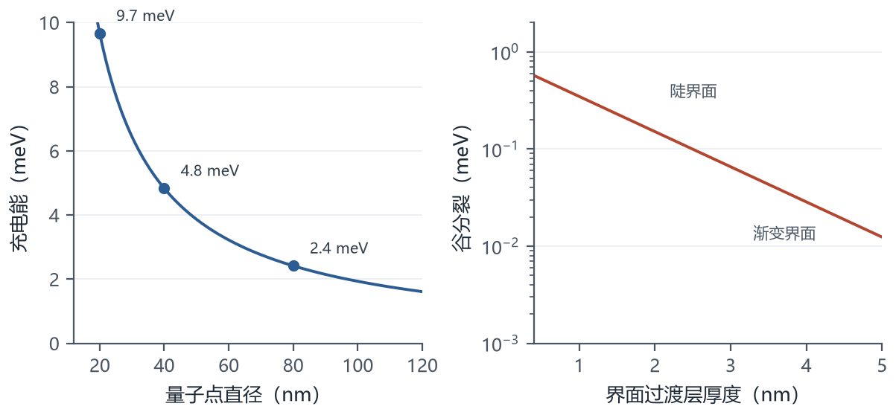
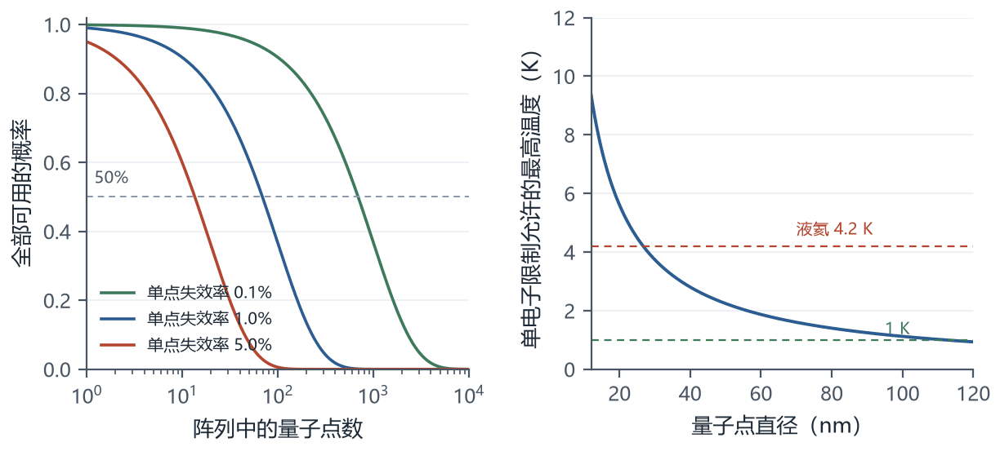

# 第 17 章　半导体量子点的材料与工艺

第 8 章讲过硅自旋比特的物理。一个电子关在量子点里，自旋朝上朝下就是两个能级，用微波或者电偶极自旋共振翻转它，用泡利阻塞或者射频传感点读出它。相干时间毫秒量级，比超导长三个数量级。

真做出来，麻烦全在材料上。量子点的尺寸只有几十纳米，电子的波函数铺在里面的每一处，界面上一个原子层的起伏、硅里一个同位素原子的核自旋、栅极下面一处电荷陷阱，都会改变这个电子的能量。同一张图纸，同一台设备，做出来的两个点可能一个能用，一个不能用。

这一章讲材料与工艺。为什么选硅，应变怎么来，界面要平到什么程度，同位素怎么纯化，栅极怎么定义，最后是与 CMOS 产线打交道时那些说不清的麻烦。

## 17.1 三个材料参数

硅自旋比特的性能，主要由三个材料参数决定。

第一个是应变。硅和硅锗的晶格常数差百分之四，两种材料叠在一起，界面处的硅被压缩，能带结构随之改变，电子占据哪个能谷由它决定。

第二个是界面质量。量子点靠栅极在界面处压出势阱，电子就住在界面下几纳米的地方。界面的粗糙度、过渡层的厚度、悬挂键的密度，直接决定谷分裂和电荷噪声。

第三个是同位素纯度。天然硅里有百分之四点七的硅 29，核自旋是二分之一，每一个都是一颗随机取向的小磁针，它产生的磁场涨落是退相干的主要来源。

这三件事都不是设计能改的，只能靠长材料、做工艺。这一章剩下的部分，就是围绕它们展开。

## 17.2 应变从哪里来

硅的导带底在布里渊区的六个等价点上，也就是六个谷。体材料里这六个谷能量相同，电子可以占据任意一个。到了量子点这种受限结构里，限制势把六个谷分成两组，一组两个，一组四个，两组之间有一个能量差，叫谷分裂。

发射要在两谷之间发生，需要动量，而动量守恒让这种跃迁非常慢。这是好事，谷自由度不会像电荷那样快速退相干。坏处是两组谷的存在让能级结构复杂，如果谷分裂太小，电子会同时占据两组谷，量子点就变成了一个多能级系统，读出和门都做不干净。

应变的作用是把这个分裂做大。在硅锗衬底上生长一层硅，硅的晶格被压小，二重简并的那组谷能量下移，四重的上移。应变足够大时，电子只占据最低的二重谷，问题就简化成两能级。

应变量由锗的浓度决定。硅锗合金里锗占三成时，晶格常数比纯硅大百分之一点二，应变就在这个量级。锗浓度越高，应变越大，谷分裂越大，但缺陷也越多。三成是一个折中值，工业界用的多是这个数。

还有一种做法不用硅锗，直接在绝缘体上硅的薄膜上做。这种结构的应变来自氧化层的热失配，量小一些，但工艺简单，和主流 CMOS 完全兼容。

## 17.3 尺寸决定能量尺度

量子点的尺寸不是随便选的，它决定了三个能量尺度的比例。

充电能是往点上加一个电子所需的能量，$E_C=e^2/2C$，$C$ 是点的电容。把点看成一个半径 $a$ 的圆盘，电容近似等于 $8\varepsilon_r\varepsilon_0 a$，于是充电能反比于半径。图 17-1 左边画的就是这个关系，直径四十纳米的点在硅里的充电能接近五毫电子伏，直径八十纳米掉到二点四毫电子伏。

图 17-1　左：充电能随量子点直径的变化，按圆盘电容 $C=8\varepsilon_r\varepsilon_0 a$、$\varepsilon_r=11.7$ 估算。右：谷分裂随界面过渡层厚度的变化，按指数衰减模型计算，以陡界面的公开报道值为锚点

五个毫电子伏对应五十八开尔文，看起来余量很大。但单电子限制的要求不止是充电能大于热能，还要大于温度的二十倍，才能保证电子数不因热涨落而跳动。按这个标准，五毫电子伏只支持到三开尔文左右。图 17-2 右边画的这条线，说明了为什么硅自旋比特可以在一点五开尔文甚至四开尔文工作，而超导比特必须待在十毫开尔文。

代价在另一边。点越小，充电能越大，可限制能也越大，电子的波函数被压得越紧，对界面缺陷越敏感，谷分裂的随机性也越大。直径小于三十纳米的点，充电能很好看，但一致性极差，每个点的谷分裂都不一样。

## 17.4 界面是全部麻烦的来源

硅和二氧化硅或者硅锗的界面，不是一个原子级平整的面。

硅被氧化的时候，氧化层会往硅里咬进去一点，形成一个一到两纳米厚的过渡层，里面的成分从纯硅渐变到二氧化硅。这个过渡层的厚度和粗糙度，决定了谷分裂的大小。

道理不难理解。谷分裂来自两个谷的波函数在界面处的干涉，界面越陡，干涉越强，分裂越大。界面模糊了，两个谷的波函数在界面处的差别被抹平，分裂就指数衰减。图 17-1 右边是这条曲线，过渡层从一纳米增到四纳米，谷分裂掉一个数量级。

实际器件的谷分裂在零点一到一毫电子伏之间，散布很大。同一片晶圆上，有的点零点五，有的点零点一。要保证所有的点都能工作，工艺上要把过渡层控制在一纳米以内，这需要低温氧化、原位退火、以及一层薄薄的硅帽层。

界面还带来另一种麻烦，电荷噪声。界面上总有一些悬挂键和缺陷，它们能俘获和释放电子，每次俘获都改变局部的电场，让量子点的能量跳一下。这种噪声的谱是 $1/f$ 型，低频成分很强，正好落在量子点的工作频段上。它是硅自旋比特退相位的主要来源之一，和同位素带来的核自旋噪声并列。

## 17.5 同位素纯化

天然硅的成分是硅 28 占 92.2%，硅 29 占 4.7%，硅 30 占 3.1%。硅 29 的核自旋是二分之一，会形成局部的磁场。

一个量子点里的电子感受到的核磁场，是周围成千上万个核自旋的叠加。取向随机，叠加的结果是一个随机游走的有效磁场。电子在这个磁场里进动，不同位置的频率不同，系综平均下来相位就散了。

浓度降到八百个 ppm，核自旋的数目少六十倍，退相干时间涨将近八倍。实际测到的 $T_2^*$ 从一微秒涨到几十微秒，回波相干时间到毫秒。

纯化靠离心分离，原理和浓缩铀一样，只是级数更多，因为硅 28 和硅 29 的质量差只有百分之三点六。能稳定供货的只有少数几家，产量有限，晶圆尺寸也停在 150 毫米。价格是天然硅的几十倍，一片六英寸的纯化硅片要几千美元。

要不要用纯化硅，取决于做什么。演示一个单比特的门，天然硅就够了。要做几十个比特跑算法，相干时间不够，纯化是必须的。这个选择在产业化的账本上很尴尬，因为纯化硅的供应能力跟半导体产业惯用的规模经济完全不匹配。

## 17.6 栅极怎么定义

量子点的栅极是金属电极，做在硅表面，靠电场在界面处压出势阱。

一个典型的器件有三层栅极。最上面一层是积累栅，把界面的电子吸引过来，形成一个二维电子气。中间一层是势垒栅，把二维电子气切断，形成一维通道。最下面一层是柱塞栅，在通道上压出一个个小坑，每个坑就是一个量子点。

栅极的间距决定量子点的尺寸和耦合强度。间距二十到四十纳米是现在的主流，这个尺度用深紫外光刻能做，但要到二十纳米以下，就得用电子束光刻或者极紫外光刻。后两者成本高、速度慢，只在研发阶段用。

栅极的排布还要考虑串扰。一个栅极上加电压，影响的不只是正下方那个点，旁边的点也会感受到。这个耦合矩阵是稠密的，标定时要测出来，然后在控制软件里做解耦，否则调一个点会把别的点弄乱。

栅极材料也有讲究。铝是最常用的，工艺成熟，和硅的接触好。但铝在一点二开尔文以下变成超导体，这在某些测量里会造成麻烦，比如需要给点加一个大的偏压时，超导体会把电压钉住。有的工艺改用钛或者钯，或者用重掺杂的多晶硅。

## 17.7 和 CMOS 产线打交道

硅自旋比特最诱人的地方，是它可以用现成的 CMOS 产线制造。

材料是硅和硅锗，工艺是外延、光刻、刻蚀、蒸发、退火，全套都是半导体产业做了几十年的东西。三百毫米晶圆，二十二纳米节点，全世界有几十条线能做。英特尔、imec、CEA-Leti 都已经在量产级的线上做出了量子点器件。

麻烦在三个地方。

第一是低温模型。CMOS 的设计工具里，晶体管的模型是在室温到一百二十五度之间标定的。到了一开尔文，掺杂冻析、能带尾态、界面态的行为全变了，器件的工作点和室温下完全不同。现在还没有一个被广泛接受的低温 PDK，设计基本靠经验和实测。

第二是测试。一个量子点要在毫开尔文或者一点五开尔文下工作，晶圆级的测试没法做。量产线上千个器件，只能抽几十个下线测试，良率数据是统计出来的。

第三是一致性。图 17-2 左边画的是阵列良率，横轴是量子点数，纵轴是全部可用的概率。单点失效率百分之一时，一百个点的阵列只有三成七能用，一千个点就几乎为零。硅自旋比特的单点失效率现在在一到五个百分点之间，离大规模集成还差得远。

图 17-2　左：阵列全部可用的概率随点数的变化，按 $(1-p)^N$ 计算，$p$ 为单点失效率。右：单电子限制允许的最高温度随量子点直径的变化，按 $E_C=20k_BT$、图 17-1 的充电能估算

## 17.8 一致性是一道工程题

一致性差，本质上是因为量子点的能量尺度对几何尺寸极其敏感。

充电能反比于半径，半径差百分之十，充电能就差百分之十。栅极的线宽、侧壁的角度、氧化层的厚度，任何一处偏差都会传导到能量上。更麻烦的是无序，硅锗合金里锗的分布是随机的，界面上的台阶位置是随机的，这些随机性没法通过提高光刻精度消除。

工程上的应对有三条。一是可调性，每个栅极都能独立加电压，工作点可以在一定范围内调，这需要一套自动化的调参流程。二是冗余，多做一些点，把坏的标记出来不用，纠错码本身就能处理缺失的比特。三是接受，有些团队干脆放弃大规模阵列，转做少数精心调校的比特，用在量子模拟或者精密测量上。

## 17.9 现在的水平

到 2020 年代中期，硅自旋比特的指标已经进了第一梯队。单比特门保真度百分之九十九点九，两比特门百分之九十九点五，读出百分之九十九以上，这些数字和超导、离子阱在同一量级。

工艺上的进展也很实在。三百毫米晶圆上的量子点器件已经演示，工业级的互补金属氧化物半导体产线能做出可用的器件，同位素纯化硅的供应虽然紧张但稳定。英特尔用三百毫米线做的自旋比特阵列，已经能跑简单的算法。

差距在系统层面。硅自旋比特需要低温，需要大量的直流偏置线，需要高灵敏度的射频反射计，这些配套的电子学还没有像超导那样成熟。一个几百比特的硅系统，线数比超导还多，因为每个栅极都要独立的偏置。

下一章讲拓扑器件。那里的材料更复杂，不是硅和硅锗，而是半导体纳米线贴在超导体上，或者二维电子气加上超导接触。那里的争论也更大，因为判断一个器件是否真的产生了马约拉纳模，比测一个比特的相干时间难得多。
