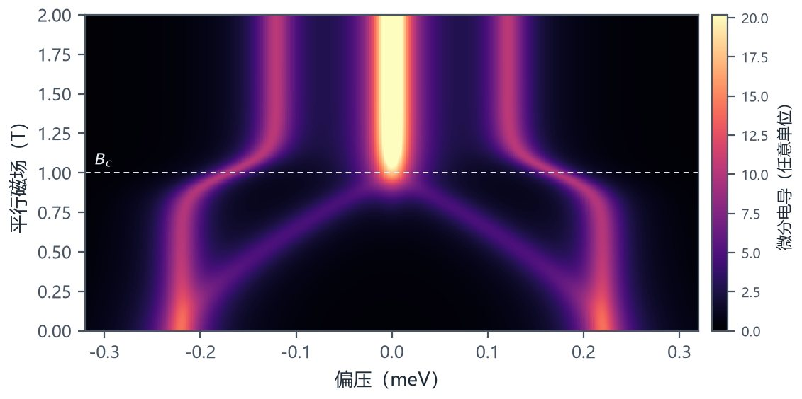
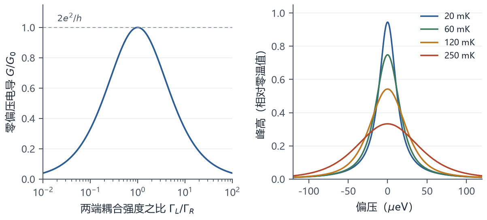

# 第 18 章　拓扑器件的实验现状

第 8 章末尾提到过马约拉纳，也提到过那条被撤稿的《自然》论文。那是这个领域最尴尬的一页，一个看上去确凿的证据，几年后被发现数据处理有问题，整个方向跟着冷了下来。

冷下来不等于停下来。这几年器件的质量在实实在在地提高，测量手段也越来越严。微软在 2025 年发布了一块叫 Majorana 1 的芯片，声称做出了八个拓扑比特。学界的态度依然是谨慎，因为缺一个东西，编织。

这一章讲实验。器件怎么做出来，测到什么算证据，为什么同样的曲线可以被解读成两种完全不同的东西，以及那条判断标准现在走到了哪一步。

## 18.1 一个器件长什么样

拓扑超导最常用的实现方式，是半导体纳米线加超导覆盖层。

纳米线用砷化铟或者锑化铟，直径一百纳米左右，长几微米，外延生长在磷化铟衬底上。这两种材料的选择有讲究。铟砷的电子有效质量小，自旋轨道耦合强，g 因子大，这几个性质都是拓扑相变需要的。锑化铟的 g 因子更大，能隙更小，两者各有取舍。

超导覆盖层用铝，蒸在纳米线的一个侧面上，厚度十纳米左右。铝在一点二开尔文以下超导，能隙零点二毫电子伏。覆盖的那一段，纳米线里的电子被超导近邻效应感染，产生诱导能隙。没覆盖的那一段留着做隧道接触。

器件做好之后放进稀释制冷机，降到二十毫开尔文，外加一个平行于纳米线的磁场。磁场的方向很关键，要垂直于自旋轨道耦合等效磁场，这样塞曼分裂才能有效打开拓扑相。

测量用隧穿谱。在纳米线一端做一个隧道势垒，加直流偏压，测微分电导随偏压的变化。如果拓扑相成立，零偏压处应该出现一个峰。

## 18.2 一张图看懂整个过程

先把这个过程画出来。图 18-1 是微分电导随偏压和磁场的变化，横轴偏压，纵轴磁场，颜色是电导。

磁场小的时候，能谱里有两个硬能隙边缘，在正负零点二毫电子伏附近，对应超导能隙。能隙里面还有两条线，随磁场增强向内收，这是安德烈堡束缚态，是近邻效应在有限长度器件里的必然产物。它们的能量随塞曼能线性下降，因为磁场在压缩能隙。

到了临界磁场，大约一特斯拉，两条线在零偏压处汇合，能隙闭合。再往上加磁场，能隙重新打开，但打开的方式变了，零偏压处出现一条亮线，一直延伸到高磁场。这条线就是马约拉纳零能模的信号。

图 18-1　隧穿微分电导随偏压与磁场的变化，按诱导能隙 0.22 meV、临界场 1 T、束缚态能量随塞曼能线性下降的模型计算。虚线标出能隙闭合处，上方为零偏压峰出现的区域

这张图是理想化的，但它把三个特征讲清楚了。能隙先闭合再打开，零偏压峰只在闭合之后出现，峰的位置不随磁场移动。真实的实验图要脏得多，能隙边缘模糊，峰的高度随门电压剧烈起伏，很多器件根本走不到第三条。

## 18.3 判据是什么

一个零偏压峰不能说明问题，因为很多不是马约拉纳的东西也能产生它。所以要有一组判据，全部满足才算数。

第一条是电导量子化。理论上，一个干净的马约拉纳模，两端耦合对称时，零偏压电导应该是 $2e^2/h$，正好是一个量子化平台。图 18-2 左边画的是耦合不对称时的情况，横轴是两端耦合强度之比，纵轴是归一化电导。只有在比值等于一的时候，曲线才碰到 1，偏离一点就掉下来。

第二条是温度依赖。峰高应该随温度下降得很慢，因为马约拉纳模没有能隙，热展宽只是在把峰抹平，不是把峰压下去。图 18-2 右边是这个效应，横轴偏压，纵轴峰高，四条线对应四个温度。二十毫开尔文时峰高接近理论值，两百五十毫开尔文时掉到三分之一。

第三条是磁场方向。马约拉纳模只在塞曼场垂直于自旋轨道等效场时才出现，所以旋转磁场方向，峰应该周期性地出现和消失，周期对应自旋轨道场的取向。这条判据在实验上很有说服力，因为安德烈堡束缚态不一定有这种各向异性。

图 18-2　左：零偏压电导随两端耦合强度之比的变化，按 $G/G_0=4\Gamma_L\Gamma_R/(\Gamma_L+\Gamma_R)^2$ 计算。右：零偏压峰高随温度的变化，洛伦兹峰与费米分布导数卷积，峰宽取 12 $\mu$eV

第四条是门电压扫描。改变栅压，化学势扫过整个子带，拓扑相应该出现在一段连续的门电压区间里，而不是单点。峰的消失和重现应该和理论预测的相图对应。

第五条是非局域测量。在一端注入，在另一端探测。马约拉纳模分布在纳米线两端，两端之间有相干联系，所以非局域电导应该有信号。安德烈堡束缚态是局域的，非局域信号应该没有。

这五条都满足的器件，到现在还没有公开报道过。有的器件满足两三条，有的满足四条但第五条不行。

## 18.4 争议的根源

争议的核心是一件事，同样的曲线可以被两种物理机制解释。

安德烈堡束缚态是超导体和半导体界面上的正常态束缚态，它的能量可以落在能隙里，也可以在特定条件下落在零偏压。无序、界面粗糙、费米速度失配，都能让它的能量精确地落在零。这时候测出来的零偏压峰和马约拉纳峰长得一模一样。

更麻烦的是量子点。纳米线里的无序会自然形成一个个小势阱，电子被关在里面，形成一个人造原子。人造原子的能级在磁场下移动，也可能在某个磁场值穿过零偏压，产生一个尖峰。这种峰的宽度和温度依赖都和马约拉纳的像。

2018 年的撤稿事件就是因为这个。论文声称在两个器件上看到了硬能隙和量子化电导，后来被发现原始数据里有多个未披露的器件，而只展示了好看的那几个。这不是造假，是选择性报告，但对领域的伤害一样大。

之后几年的变化是测量标准的收紧。现在的论文要求报告所有测过的器件，要求给出隧道势垒的独立性，要求磁场方向的完整扫描，要求非局域测量。这些要求让发表变难，但让结果可信。

## 18.5 微软的路线图

微软是这个方向投入最大的公司，路线也最激进。

2018 年，他们报道了砷化铟纳米线加铝的器件，用的是选择性区域生长，能在同一片衬底上做出阵列。这是工程上的关键一步，因为之前的器件都是单个手工做的。

2022 年，他们发表了所谓拓扑能隙协议。做法是系统地扫描门电压和磁场，在每一个点测隧穿谱，然后判断这个点是否满足一组条件，能隙、零偏压峰、峰的稳定性。用这套协议筛出的器件，据说良率有明显提高。学界对这套协议的评价是方法本身合理，但判据仍然依赖对安德烈堡束缚态的排除，而这恰恰是没有定论的地方。

2025 年，他们发布了 Majorana 1 芯片。芯片上有八个所谓的拓扑比特单元，每个单元是一段纳米线，两端各有一个马约拉纳模，两个模构成一个费米宇称。读出用微波反射测量一个双点系统的电容，门操作靠把两端靠近让模耦合，也就是编织的一种实现。

宣传材料里的说法很激进，说这是第一个容错的量子处理器。学界的反应是等论文。到 2026 年，关于编织的完整数据还没有公开，所以外部的判断只能停在器件做得好、工艺有突破、物理结论待定这三句话上。

## 18.6 其他材料体系

砷化铟纳米线不是唯一的平台。

二维电子气加超导是另一条路。在砷化铟或者汞碲的量子阱上蒸铝，靠门电压在二维面上划出通道，通道的两端可以放马约拉纳模。好处是可以用平面工艺，容易做大阵列。坏处是二维体系的界面更难控制，无序更多。

拓扑绝缘体的纳米带也有人做。铋系拓扑绝缘体的表面态是狄拉克型的，加超导覆盖后理论上是天然的拓扑超导。实验上一直不太顺，因为体材料的缺陷会掺杂，把费米能级推离狄拉克点。

铁基超导加拓扑表面态是最近的尝试。铁基超导的临界磁场高，能隙大，理论上更耐受无序。2020 年代有几个组报道了零偏压峰，但同样面临安德烈堡束缚态的质疑。

每个体系都有自己的优势，也都有自己的麻烦。没有哪个已经跑出来。这也是这个领域和超导不同的地方，超导在 2010 年之后基本统一到 transmon，拓扑到现在还是几路并进。

## 18.7 一个比特需要什么

把器件做成比特，比看到零偏压峰要难得多。

一个拓扑比特的编码，是一对马约拉纳模构成的费米宇称。宇称是奇是偶，就是比特的零和一。这个编码天然抗局部噪声，因为局部扰动只能同时移动两个模，不能只动一个。

要往这个比特上写信息，需要改变宇称，也就是让两个模耦合。做法是把它们靠近，或者通过一个量子点中介。要读信息，需要测宇称，做法是让一个模和一个量子点耦合，宇称影响电子的隧穿路径，进而影响电导或者电容。

门操作的理想方式是编织，也就是把两个模在空间上交换。交换两次回到原状，交换一次得到一个非阿贝尔变换。这个变换只取决于交换的次序，不取决于路径和速度，所以对控制误差天然免疫。

问题是编织至今没有可信的演示。这不是技术细节，是整个领域的核心目标。没有编织，就只是一个好看的零偏压峰，谈不上拓扑量子计算。

## 18.8 怎么看待这条路

拓扑路线的价值在于它的上限。如果成功，比特的错误率可以被指数压制，纠错的开销比表面码低两三个数量级，一台容错的机器可能只需要几百个比特。这个前景太诱人，值得投入。

风险在于它的下限。到现在为止，一个可重复、可验证、被广泛接受的两模系统都还没有。器件用的是新材料、新工艺、新测量方法，每一个环节都可能出问题，而且问题的表现和马约拉纳的信号难以区分。

时间的判断，业内的共识是比超导晚十年以上。超导在 1999 年做出第一个比特，2019 年做出量子优越性，二十年。拓扑现在大概在超导 2005 年前后的位置，有信号，有争议，没有比特。

下一章回到工程。不管哪条路线，最后都要面对同一件事，怎么把几百上千个比特管起来，怎么在有限的时间里把它们校准到能用的程度。这是低温电子学和自动化标定要解决的问题。
