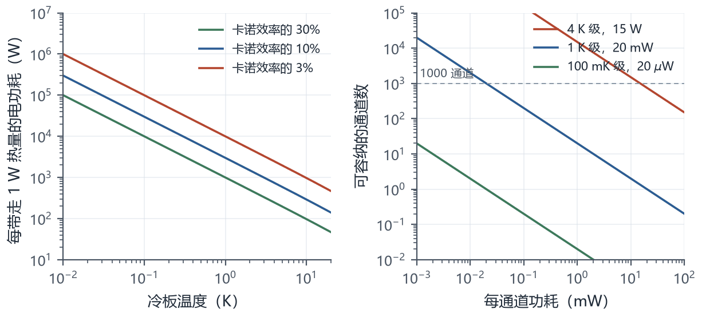
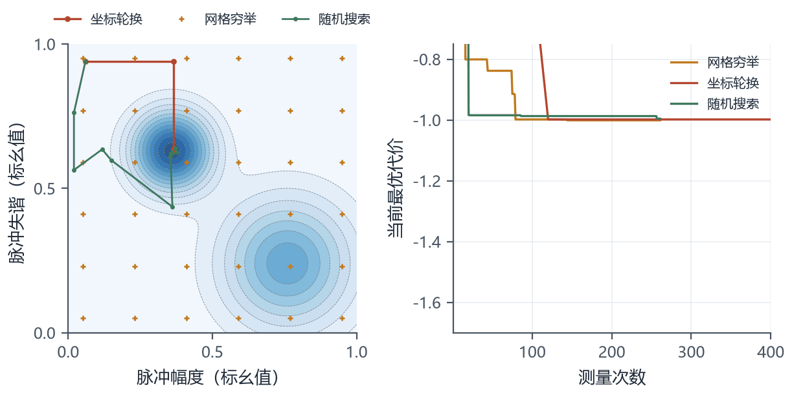

# 第 19 章　低温电子学与自动化标定

一台量子计算机里，真正待在十毫开尔文的东西只有芯片本身，其余全在给它送信号、收信号、供电、散热。这些外围设备的功耗和体积，正在成为规模化最硬的约束之一。

这一章讲两件事，冷端的电子学怎么做，以及为什么标定会变成一项需要算法的工作。

## 19.1 冷量是硬通货

稀释制冷机的冷量按温度分级，越冷越贵。

一台商用机型在 4 K 级能提供一到两瓦的制冷功率，在 1 K 级只有几十毫瓦，到了 100 mK 级往往只剩几十微瓦。这三个数字决定了每一级能挂多少设备。

代价还不止冷量本身。带走一瓦热量要消耗多少电，由卡诺效率决定。4 K 冷板相对室温的理论效率约百分之一，实际机器只有理论值的百分之几到百分之十，于是一瓦热量要几百瓦电。100 mK 级更夸张，一瓦要几万瓦电。所以制冷机的压缩机功耗在几十千瓦，比整台计算机的其他部分加起来还多。

图 19-1　左图是每带走一瓦热量所需的电功耗，按卡诺效率的不同比例计算；右图是各级冷量下可容纳的控制通道数，虚线标出一千个通道的位置

右图值得细看。一千个通道，如果每个通道在 4 K 级耗 1 毫瓦，只需要一瓦，四 K 级完全撑得住。可如果这条线一直拉到 100 mK 级，每个通道只能用二十纳瓦，没有任何室温电子学能做到。这就是为什么大家拼命把电子学往冷端搬，又只能搬到 4 K 或 1 K。

## 19.2 把电子学搬进冷端

把放大器、混频器、数模转换器做到 4 K 工作，好处很直接，线短了，热负载小了，噪声也低了。

难点在晶体管。硅 CMOS 在 4 K 下仍然能工作，但阈值电压漂移，跨导下降，噪声系数变差。设计上要重新做模型，不能直接拿室温的库来仿真。业界的做法是专门流片，把功耗压到每通道几十微瓦到一毫瓦，同时保证带宽和线性度。

另一个方向是超导电子学。用约瑟夫森结做逻辑，功耗可以低到纳瓦，但工艺复杂，密度低，离大规模集成还有距离。单磁通量子电路是这条线的代表，速度快、功耗小，难点在存储和扇出。

现在最现实的方案是混合。室温机箱里放高精度的大件，4 K 级放多路复用和初级放大，1 K 级放低噪声放大器，100 mK 级只留最必要的无源器件。每一级的分工由热预算倒推。

## 19.3 光链路

用光纤把信号送进冷端，是绕开热传导的一个办法。

电信号走同轴线，铜的导热会把热量一路带下去。换成光纤，热导率低几个数量级，一根光纤的热负载可以做到微瓦量级。信号在室温端转成光，在冷端用光电探测器转回电。

代价是转换效率。电光调制器和光电探测器都有插入损耗，探测器的功耗也要算进冷端预算。激光本身的加热也不能忽略，哪怕只有一毫瓦的光功率，落到冷端就是实打实的热。

光链路目前主要用在读出上，把冷端的信号带上来比把控制信号送下去更容易做。控制方向的难点是调制器的功耗和消光比。

## 19.4 控制系统的规模

一台中等规模的超导机器，背后是几十台机架。

每台任意波形发生器有几十个通道，每个通道要有独立的相位和幅度校准。所有通道要在皮秒级对齐，否则两比特门的相位会漂。时钟分发、触发同步、数据回传，每一样都是工程问题。

数据量也不小。一次读出要采集一段中频信号，解调、积分、判决，一千个比特每秒测一次，就是每秒几十兆字节的原始数据。要在毫秒内完成解码和反馈，FPGA 的流水线要设计得很紧。

## 19.5 标定为什么成了瓶颈

一个超导比特要标定的参数有十几个，频率、驱动幅度、相位偏移、读出功率、读出频率、耦合强度、门时长、DRAG 系数。乘上一百个比特，就是上千个参数。

这些参数还会漂。温度变化、磁场漂移、介质缺陷的跳跃，都会让频率慢慢挪。今天标好的脉冲，明天可能就偏了。

人工标定的速度是每天几个比特。这个速度在实验室够用，在机房里不够。一台机器停机一天，损失的是整机的利用率。

## 19.6 把标定写成优化问题

自动标定的思路，是把每个参数看成优化变量，把某个指标看成代价函数，然后用搜索算法去找。

代价函数可以是门保真度、读出保真度、或者某个可测量的间接指标。搜索空间是一串超参数的范围，噪声来自测量本身的统计涨落。

最朴素的办法是网格穷举。维度一高就爆炸，十个参数每个取十档，就是一百亿个点。

坐标轮换每次只优化一个方向，收敛快，但容易陷进局部最优，尤其是参数之间有耦合的时候，比如脉冲幅度和失谐会互相补偿。

随机搜索在高维空间里往往比网格更有效，因为它不会把预算浪费在无关维度上。更聪明的做法是贝叶斯优化，用高斯过程拟合代价函数的形状，每一步都挑最有信息量的点去测。

图 19-2　左图是脉冲幅度与失谐的代价地形，三种搜索路径叠在上面；右图是收敛曲线，纵轴为当前最优代价。按二维高斯型代价函数模拟，测量带噪声

图上的地形有两个谷，一个深一个浅。网格穷举均匀撒点，最后落在浅谷；坐标轮换沿轴向移动，被第一个方向的局部极小卡住；随机搜索碰巧进了深谷。这个结果不能说明随机搜索总是更好，它说明的是地形形状决定了策略。

工程上的做法通常是组合。先用粗网格找到大概区域，再用坐标轮换或贝叶斯优化细化，最后用多次重复测量抑制噪声。并行化也很重要，多个比特可以同时标定，只要它们的频率不冲突。

## 19.7 从标定到运维

标定不是一次性的工作，是持续的过程。

一台机器上线后，需要定期检查每个比特的健康状况，跟踪参数漂移，发现突然变差的比特并及时隔离。这套流程和半导体产线的设备维护很像，只是被维护的对象从机器变成了量子态。

更远一点看，自动标定会变成机器的一部分。芯片上集成传感器，实时监测温度和磁场，控制系统根据反馈自动调整脉冲。到这个程度，量子计算机才真正具备可运维性，而不只是实验室里的一台装置。
