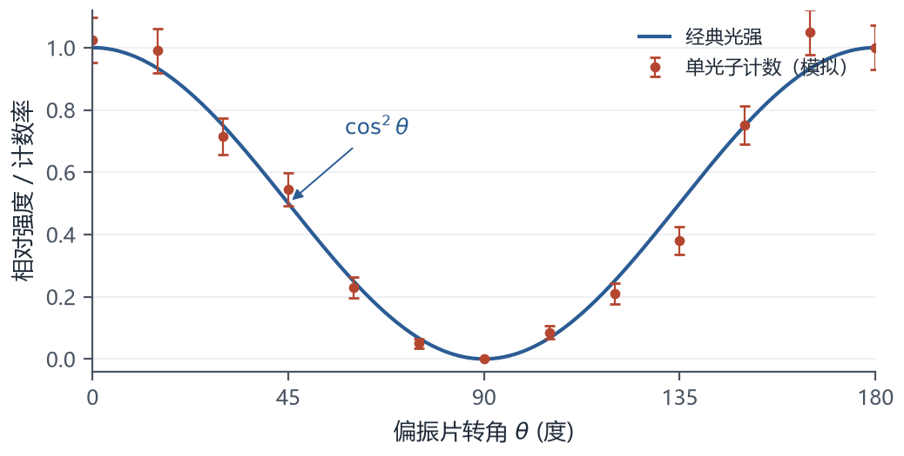
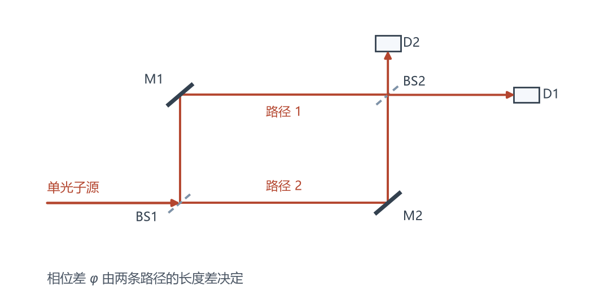
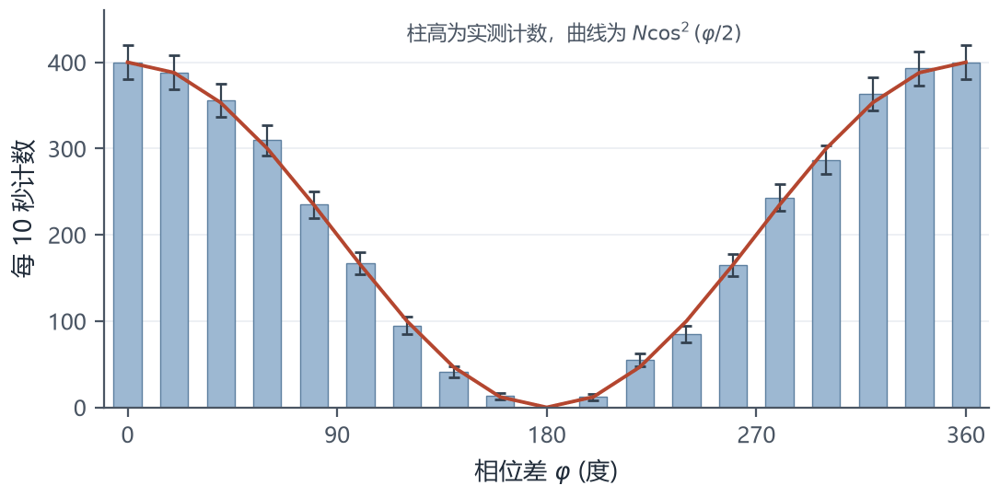

# 第 9 章　单个光子

前面的章节里，光要么是波，要么是能量为 $h\nu$ 的一份。这一章把这两件事放在同一个实验里看。实验的对象只有一个光子，一个不能被切开、不能被复制、打上去只能响一声的东西。

## 9.1 怎么弄出一个光子

普通的激光不是单光子源。一束功率一毫瓦的激光，每秒放出的光子数是 $10^{15}$ 量级，即使用衰减片把它减到平均每秒一个光子，光子到达的时间仍然是随机的，服从泊松分布。这意味着有些时间间隔里会出现两个光子，有些间隔里一个都没有。对很多实验来说，这不够干净。

真正的单光子源要满足一个条件，一次只出一个。检验的办法是拿一个分束器把光分成两路，每路接一个探测器，同时计数。如果光源每次只出一个光子，两个探测器不可能同时响。这个测量的量叫二阶关联函数 $g^{(2)}(0)$，单光子源的 $g^{(2)}(0)$ 接近零，激光的等于一。

常见的单光子源有三类。一类是衰减的激光加门控，简单但不纯。一类是单个原子、离子或者分子，它们每次跃迁只放一个光子，纯净但要复杂的真空和激光系统。还有一类是半导体量子点，用光或者电泵浦，在低温下工作，可以做到很高的效率，是当前集成光量子芯片里最常用的一种。

另一条路是自发参量下转换。把一束紫外光打进非线性晶体，一个小概率事件会发生，一个紫外光子分裂成两个红外光子，能量守恒要求两个光子的频率加起来等于原来的频率，动量守恒要求它们的方向满足相位匹配。这两个光子是同时产生的，一个被探测到，就意味着另一个一定存在，这叫预报式单光子源。它的光子数分布不是严格的单光子，但用一路预报另一路，效果很好。

## 9.2 偏振是最简单的量子比特

光子有一个很方便的性质，偏振。它只有两个独立的状态，水平偏振和竖直偏振，任何偏振态都可以写成这两个的叠加

$$
|\psi\rangle = \alpha|H\rangle + \beta|V\rangle,\qquad |\alpha|^2+|\beta|^2 = 1
$$

这就是一个量子比特。$|H\rangle$ 和 $|V\rangle$ 是基矢，$\alpha$ 和 $\beta$ 是复系数。

用一块偏振片去测，光子要么通过，要么被挡住。通过的概率是 $|\alpha|^2$，也就是偏振方向在水平方向上的投影的平方。这个规律叫马吕斯定律

$$
I = I_0\cos^2\theta
$$

$\theta$ 是偏振片的透光轴与光子偏振方向的夹角。在经典光学里，这条定律描述的是光强的衰减；在单光子实验里，它描述的是单个光子通过的概率。

图 9-1　偏振片转角与透过率的关系。曲线是 $\cos^2\theta$，点是按同一概率抽样的单光子计数

把偏振片转到 45 度，一个 $|H\rangle$ 光子有一半概率通过。这跟“光子的一部分通过”不是一回事，通过的光子还是完整的，能量一点没少，只是数目少了。单个光子在偏振片面前，只能做出通过或者不通过的选择。

## 9.3 一个光子，两条路

马赫-曾德尔干涉仪是光学里最常见的器件，由两个分束器和两面镜子组成。光从一端进入，被第一个分束器分成两路，走不同的路径，在第二个分束器重新汇合，然后从两个端口出来。

图 9-2　马赫-曾德尔干涉仪的结构。两条路径的长度差决定汇合时的相位差

把光源换成单光子源，事情就变得有趣了。一个光子进入干涉仪，被第一个分束器分成两路，这在经典图像里意味着“一半在这里，一半在那里”。可探测器从来没有测到过半个光子，它要么在 D1 响，要么在 D2 响，从不同时响。

改变一条路径的长度，让两条路的相位差从零变到 $\pi$，D1 的计数从最大变到最小，D2 的计数反过来。计数随相位的变化是

$$
P_1 = \cos^2\frac{\varphi}{2},\qquad P_2 = \sin^2\frac{\varphi}{2}
$$

单个光子的落点是随机的，但统计起来，分布严格按这个公式走。

图 9-3　固定相位差下累计十秒的单光子计数，柱高是实测值，曲线是 $N\cos^2(\varphi/2)$

这个实验说明，单个光子确实“同时”经历了两条路径。如果它只走一条，相位差不会影响它，因为只有一条路的长度变了。可实验里相位一变，计数就变，说明光子感受到的是两条路的长度差。同时，它又只在某一个端口出现，说明测量时它落定成了一个整体。

## 9.4 两个光子撞在一起

单光子干涉已经够奇怪，两个光子相遇的实验更奇怪。

把两个全同的光子同时送进一个 50:50 分束器，一个从左边进，一个从右边进。按经典想法，两个光子各自有一半概率透射、一半概率反射，所以两个探测器同时响的概率应该是二分之一。实际测量，这个概率是零。两个光子总是同时从同一个端口出来，要么都在 D1，要么都在 D2。

这个现象叫洪-欧-曼德尔干涉，1987 年由洪、欧和曼德尔在罗切斯特大学测到。

原因在于光子的全同性。两个光子如果频率相同、偏振相同、到达时间相同，它们在分束器上无法区分。量子力学要求，不可分辨的全同粒子，其波函数必须按照统计性质对称化或反对称化。光子是玻色子，波函数对称，两条“各走一边”的振幅在分束器输出端反相，正好抵消。

这个效应是线性光学量子计算的基础。它提供了一种只靠分束器和相位就能实现的两比特操作，不需要强的非线性。玻色采样实验也正是靠这个效应，让经典计算机难以模拟。

## 9.5 光子为什么受欢迎

在量子技术的各种载体里，光子有几个别人比不了的优点。

它跑得快，在光纤里每秒二十万公里，适合做长距离传输，量子密钥分发就是靠这个。

它不容易退相干。光子跟环境的耦合很弱，一个光子在光纤里传一百公里，相位还能保持得相当好。超导量子比特的相干时间在微秒量级，光子在同样时间里走了几十公里。

它可以在室温下工作，不需要稀释制冷机。这一点对工程化非常重要，一台超导量子计算机的大部分体积和成本都花在制冷上。

它的操控手段成熟。分束器、波片、相位调制器、单光子探测器，这些器件在光通信产业里已经批量生产，价格便宜，性能稳定。

缺点也很明显。光子之间几乎不相互作用，做两比特门要靠干涉和测量，效率低、概率性强。光子一旦丢失就没了，没法像电子那样保存起来备用。单光子探测器的效率、暗计数、时间分辨率，都还在改进中。

这些优缺点决定了光量子技术最适合的场景，长距离通信、特定采样问题的计算、精密测量。它在通用量子计算上要跟超导、离子阱竞争，胜负未定。

## 9.6 本章小结

到这里，关于光和量子的实验图像大致成形了。

光有波的一面，有粒子的一面，两面的关系由普朗克常数连接。能量是一份一份的，能级是分立的，跃迁发射的光子带着能级差的信息。微观客体用波函数描述，波函数给出概率，测量的结果是概率的一次实现。位置和动量不能同时确定，这不是仪器的问题，是状态本身的性质。宏观世界看不到这些效应，因为退相干把叠加抹掉了。单个光子能同时走两条路，两个全同光子能在分束器上互相抵消。

这些内容不需要高等数学就能理解，代价是有些地方只能停在“图像”层面。波函数为什么是复数，测量为什么会坍缩，纠缠在数学上是什么，这些问题用文字说只能说到某个程度。

下一章先不急着换写法，换一个对象。光只有两个偏振态，这已经像一个开关了，可它毕竟还是光。电子身上也长着一个只能取两个值的东西，叫自旋，它不依赖电子往哪儿跑，也不怕被挡住。1922 年那束银原子穿过磁铁时留下的两条斑，第一次把它暴露了出来。
