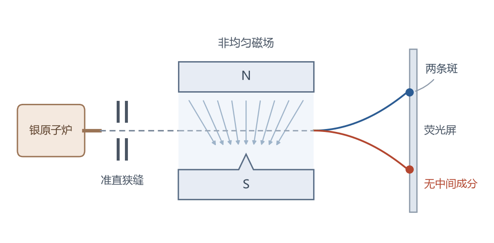
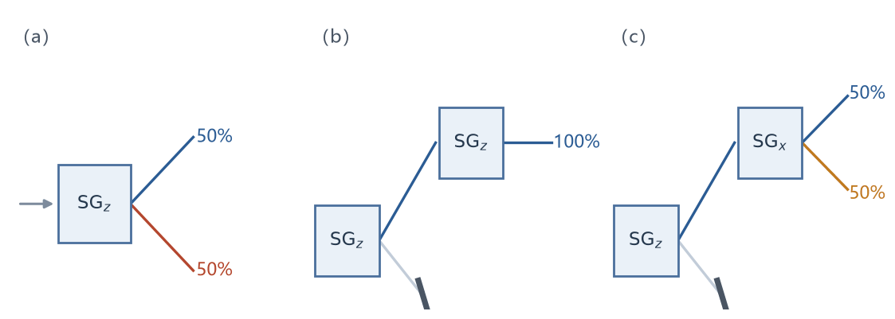

# 第 10 章　电子自旋与斯特恩-格拉赫

1922 年，法兰克福的两个年轻人做了一件很简单的事。他们把银放进炉子里烧到一千多度，让银原子从小孔里喷出来，穿过几道狭缝，变成一束很细的原子流，再让这束原子从两块磁铁中间穿过去，落在身后的玻璃板上。两块磁铁里有一块磨出了尖棱，中间的磁场很不均匀。

按当时的想法，这束原子应该在玻璃板上留下一片模糊的痕迹，中间深，两边浅。实际留下的是两条清清楚楚的斑，中间干干净净。这个结果后来被追认为量子力学最直接的证据之一，而它引出的东西，比实验本身的名字要有名得多。

## 10.1 一条本该连续的痕迹

装置里每一步都有讲究。炉温决定了原子的速度，银在 1300 K 左右蒸发，出来的原子平均速度约 500 米每秒。狭缝把方向收窄，让原子几乎沿着一条直线飞。磁场区域长几厘米，原子在里面待上万分之一秒。

银原子为什么会被磁铁偏转。因为它身上带着磁矩，可以想成一根极小的指南针。磁矩放在均匀磁场里只会转，不会平移，受力为零。可磁场一旦不均匀，两端受力不等，就会有一个净的推力

$$
\mathbf{F} = \nabla(\boldsymbol{\mu}\cdot\mathbf{B})
$$

推力的大小跟磁矩在磁场方向上的分量成正比。分量大的原子偏得多，分量小的偏得少，分量反过来的原子往另一边偏。

十九世纪的物理学家对磁矩的方向没有任何限制。一根经典的小指南针可以指向任意角度，银原子从炉子里出来时方向杂乱，各个分量都有。玻璃板上得到的应该是一条连续的带子，两端稀，中间密。

斯特恩和格拉赫看到的是两条。

## 10.2 方向被限制成几个

这件事之所以重要，是因为它正好撞上了玻尔-索末菲理论里一个不太起眼的预言，空间量子化。

按那个理论，角动量在磁场方向的投影不能连续变化，只能取若干个分立值。轨道角动量 $l$ 给出 $2l+1$ 个投影，$l=1$ 是三个，$l=2$ 是五个。投影分立，磁矩的分量就分立，偏转量也分立，屏上就出现若干条分开的斑。

斯特恩和格拉赫本来想验证的就是这一条。看到两条斑，他们以为成了。

麻烦在于数目。$2l+1$ 永远是奇数，三条、五条、七条都可能，两条不可能。他们猜中间那条也许太弱，没留下痕迹，这个解释后来被证明是错的。

第二个麻烦是大小。用原子的速度、磁场梯度、飞行距离反推偏转量，得到的磁矩差不多是一个玻尔磁子

$$
\mu_B = \frac{e\hbar}{2m_e} = 9.27\times10^{-24}\ \mathrm{J/T}
$$

一个玻尔磁子对应 $l=1$、$m=\pm1$ 的情形，可那种情形应该有三条斑。数目说二，大小说一，两条线索指向两个不同的 $l$，怎么凑都凑不齐。

图 10-1　斯特恩-格拉赫装置。银原子束穿过非均匀磁场后被分成两束，在屏上留下两条斑，中间没有成分

## 10.3 一个自转的电子

1925 年，莱顿大学两个刚毕业的年轻人，乌伦贝克和古兹密特，提出一个大胆的假设。电子除了绕核运动，自己还带一个角动量，叫自旋。

他们给的量子数是 $s=1/2$，投影只有两个值，$\pm\hbar/2$。磁矩跟角动量的比例是

$$
\boldsymbol{\mu} = -g\,\frac{\mu_B}{\hbar}\,\mathbf{S}
$$

其中 $g$ 叫朗德因子，对自旋取 2。把 $s=1/2$ 代进去，磁矩的投影是 $\mp\mu_B$，正好一个玻尔磁子。

这一下两个麻烦同时解决了。投影数是 $2s+1=2$，所以两条斑；因子 $g=2$ 让一个 $\hbar/2$ 的角动量产生一个玻尔磁子的磁矩，所以偏转量对得上。数目和大小来自同一个 $s=1/2$，不需要再凑。

这个故事有个小插曲。两人把稿子交给导师埃伦费斯特时，只写了 $g=1$，寄出以后才意识到应该是 2，想追回来改，稿子已经走了。

自旋这个名字容易让人以为电子真的在转。可以算一下这个图像有多离谱。取经典电子半径 $2.8\times10^{-15}$ 米，要让一个均匀小球带上 $\hbar/2$ 的角动量，赤道上的线速度大约是 $5\times10^{10}$ 米每秒，是光速的一百七十倍。所以“自转”只是一种说法，不是机制。

真正给自旋一个位置的是狄拉克。1928 年他把相对论和量子力学拼在一起，写出的方程自动包含一个两分量的内禀角动量，$g$ 也自动等于 2。后来更精确的测量给出 2.002319，跟 2 的差来自电子与自身辐射场的相互作用，这个差值算得准到小数点后十二位，是物理学里精度最高的检验之一。自旋不是硬加上的补丁，它是相对论性量子理论的组成部分。

## 10.4 换一个方向再问一次

自旋到底“指向”哪里，这个问题可以用斯特恩-格拉赫装置本身来追问，办法是把几台装置串起来。

第一台测 $z$ 方向，出来两束，一束自旋向上，一束向下，各占一半。把向下的那束挡住，只让向上的进入第二台。

如果第二台也测 $z$，结果只有一束，全部从向上的出口出来。第一次的答案被完整保留，重复测量不改变结论。

如果第二台转 90 度，测 $x$ 方向，出来的又是两束，各占一半。再在后面接第三台测 $z$，结果还是各占一半。中间那次 $x$ 方向的测量，把第一次辛苦选出来的 $z$ 值彻底抹掉了。

图 10-2　顺序斯特恩-格拉赫实验。（a）未极化的束被分成两束。（b）同方向再测一次，结果完全重复。（c）换成垂直方向，原来的信息丢失，又分成两束

这个结果说明，自旋的 $z$ 分量和 $x$ 分量不能同时有确定值。测准了一个，另一个就变成完全随机。

有人会说，也许自旋本来就指向某个斜方向，两台装置只是从不同角度看了它一眼。这个说法可以被排除。假设自旋真的指向某个确定方向 $\mathbf{n}$，那么沿着 $\mathbf{n}$ 测应该百分之百从一个口出来。可实验里，对 $z$ 方向制备好的态，无论把第二台转到哪个方向，只要不是 $z$ 或 $-z$，结果都是一半一半，没有任何一个方向能让它全部通过。所以不存在那个预先存在的斜方向。

这个性质和偏振片完全一样，第 9 章用它做过量子比特。区别只在载体，偏振用光子的振动方向，自旋用电子的磁矩。两个系统都只有两个正交的基态，都能制备、旋转、测量，这就是量子比特最朴素的样子。

## 10.5 朗德因子与光谱的分裂

自旋一进来，原子光谱里那些多出来的线就有了着落。

原子有轨道角动量 $\mathbf{L}$ 和自旋 $\mathbf{S}$，两者合成总角动量 $\mathbf{J}$。磁矩跟总角动量的比例不再是 1 或 2，而是介于两者之间的一个数，由投影的平均决定

$$
g_J = 1 + \frac{J(J+1)+S(S+1)-L(L+1)}{2J(J+1)}
$$

纯轨道，$S=0$，$J=L$，公式给出 1。纯自旋，$L=0$，给出 2。钠原子的 $3p$ 态分裂成两个能级，$^2P_{1/2}$ 和 $^2P_{3/2}$。前者的 $g$ 是 $2/3$，后者是 $4/3$，都不等于 1。

把原子放进磁场，能级按 $m_J$ 分裂，间距是

$$
\Delta E = g_J\,\mu_B B\,m_J
$$

换算成频率，一个玻尔磁子对应的频率是 14 吉赫兹每特斯拉。钠的黄光双线在 1 特斯拉的磁场里会分成好几条，间距各不相同，因为上下两个能级的 $g$ 因子不同。

1896 年塞曼在磁场里看到钠的谱线分成三条，洛伦兹用经典电子给出了解释，两人因此拿了 1902 年的诺贝尔奖。可后来在别的元素上看到的谱线越来越怪，有的分成四条，有的六条，间隔也不均匀。这些“反常塞曼效应”困扰了物理学二十多年，直到自旋和朗德因子出现。所谓反常，其实是常态，正常的三重线只是 $S=0$ 这个特例。

同一个 $g$ 因子还解释了另一件事。自旋和轨道都带磁矩，两个磁矩会互相作用，能量里多出一项正比于 $\mathbf{L}\cdot\mathbf{S}$。这一项让同一个 $n$、$l$ 的能级裂开，裂开的量级是精细结构常数平方乘以能级差，大约是万分之一电子伏特。第 7 章提到的钠双线，波长只差 0.6 纳米，就是这一项的直接结果。

## 10.6 让自旋在磁场里转起来

自旋放在磁场里不会老老实实待着，它会绕磁场方向进动，像陀螺在重力里那样。进动频率叫拉莫尔频率

$$
\omega_L = \gamma B,\qquad \gamma = \frac{g\mu_B}{\hbar}
$$

对电子，$\gamma/2\pi$ 约 28 吉赫兹每特斯拉。地磁场大约半高斯，对应的频率是 1.4 兆赫，落在无线电波段。

如果再加一个垂直于主磁场的微弱射频场，并且让它的频率正好等于拉莫尔频率，事情就变得有意思。自旋会一边进动一边被这个射频场推着翻，翻转概率随脉冲时长振荡

$$
P_{\downarrow}(t) = \sin^2\frac{\Omega t}{2},\qquad \Omega = \gamma B_1
$$

$\Omega$ 叫拉比频率，由射频场的幅度 $B_1$ 决定。脉冲持续到 $\Omega t = \pi$，自旋完全翻过来，这叫 $\pi$ 脉冲。持续到一半，自旋被送到上下两个态的等量叠加，这叫 $\pi/2$ 脉冲。

1938 年，拉比在哥伦比亚大学用分子束做了这个实验，测出的核磁矩精确到千分之一。1946 年，布洛赫和珀塞尔各自在凝聚态样品里看到了核磁共振。今天医院的磁共振成像用的就是这套原理，质子的拉莫尔频率是 42.58 兆赫每特斯拉，一台 3 特斯拉的机器工作在 128 兆赫附近。

对量子技术来说，这件事的意义比它的应用更大。它说明一个量子态可以被外场精确地旋转到任意指定的方向，而且转多少度由脉冲时长决定。量子计算里的单比特门，本质上就是这种脉冲，只不过要求更短的时长和更高的精度。

## 10.7 为什么自旋适合做比特

把自旋当成量子比特，有几条别人比不了的好处。

它天然是二能级的，不需要像超导电路那样费力地把高能级推开。它的相干时间很长，金刚石里的电子自旋可以到毫秒，核自旋可以到秒甚至更长，比超导比特高好几个数量级。它可以被安置在很小的空间里，半导体量子点里关一个电子，金刚石里造一个氮-空位色心，都能得到一个孤立的电子自旋。

氮-空位色心值得一提。金刚石晶格里去掉一个碳原子，换成氮，旁边留下一个空位，这个缺陷俘获的电子自旋可以在室温下用激光初始化、用微波操控、用荧光读出。2015 年那批关闭了所有漏洞的贝尔实验，有一路用的就是它。

缺点也很清楚。磁矩小，跟外界耦合弱，这既是长相干时间的原因，也是门操作慢的原因。两个自旋之间的相互作用随距离迅速衰减，想把几十个自旋耦合起来做多比特门，比超导电路难得多。规模化和高保真度，目前还是两条互相牵制的指标。

不管工程上走多远，自旋在概念上的地位是稳的。它是最接近教科书里那个抽象量子比特的实物，只有两个态，没有多余的自由度，可以被制备、旋转、读出。往后讲量子门、讲纠缠、讲测量，最省事的例子都是自旋。
