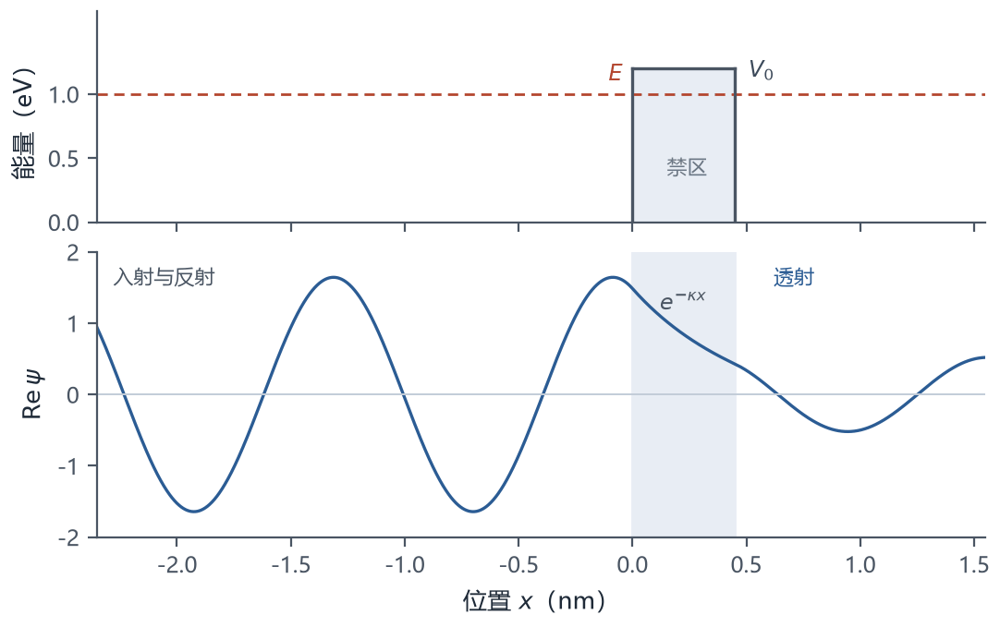
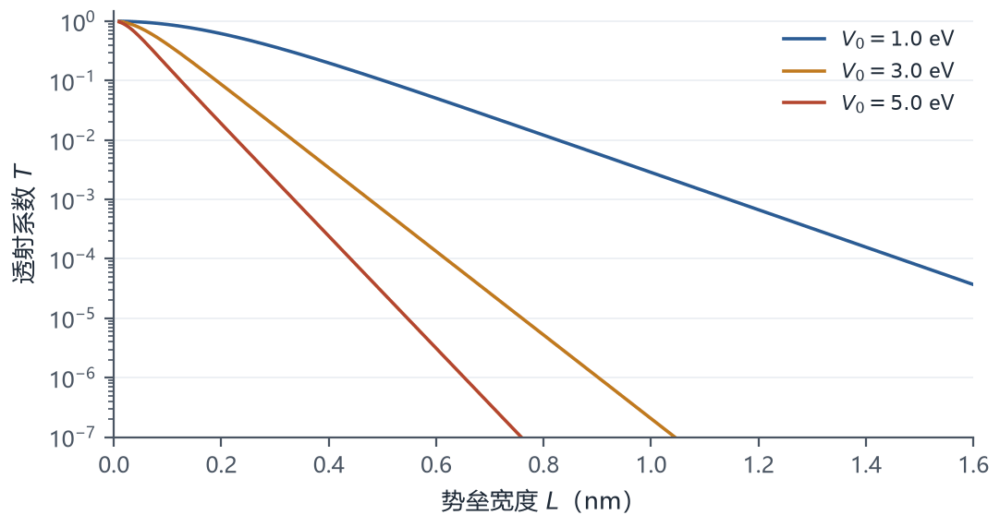

# 第 11 章　穿过不该穿过的墙

小时候玩弹珠，把它从碗底往上推，力气不够，弹珠滚到一半就退回来，来来回回，永远出不了碗。这个画面在经典力学里是铁的规则，动能不够，就翻不过那道坎。

微观世界不遵守这条。一个电子撞上一道比自己能量还高的墙，有相当大的机会出现在墙的另一边，好像墙上有个洞。这个现象叫隧穿，它是量子力学最不像话、也最有用的预言之一。扫描隧道显微镜、闪存、太阳发光，都靠它。

## 11.1 一个不许通过的禁区

先看一道最简单的墙。一个矩形势垒，高度 $V_0$，宽度 $L$。粒子从左边来，能量 $E$ 小于 $V_0$。

经典力学在这里没什么可算的。粒子进入墙内，动能变成 $E-V_0$，是个负数。负的动能没有意义，所以粒子根本进不去，只能原路返回。反射系数等于一，透射系数等于零。

量子力学换了一个问法。它不问“能不能进去”，它问波函数在墙里长什么样。

在墙外，波函数是振荡的，形如 $e^{ikx}$，$k=\sqrt{2mE}/\hbar$。在墙内，能量减去势能是负的，把薛定谔方程整理一下，二阶导数前面的系数换了符号

$$
\frac{d^2\psi}{dx^2} = \kappa^2\psi,\qquad \kappa = \frac{\sqrt{2m(V_0-E)}}{\hbar}
$$

这个方程的解不是正弦，而是指数

$$
\psi(x) = A e^{-\kappa x} + B e^{\kappa x}
$$

指数衰减的波不振荡，它只是往下掉。掉得多快，由 $\kappa$ 决定。取 $V_0-E = 1$ 电子伏特，电子的 $\kappa$ 是 5.1 每纳米，衰减长度 $1/\kappa$ 只有 0.2 纳米，大约一个原子的直径。

关键在于，指数函数不会在半路上突然变成零。墙再高，墙里的波函数也只是很小，不是没有。墙的另一边，波函数接上一个振幅更小的振荡波，那就是透射波。粒子过去了。

有一类流行的说法，讲粒子“先向真空借一份能量，越过墙再还回去”，借的时间短到不确定性关系允许。这个说法当作记忆口诀还行，当机制就错了。粒子在墙里没有变成负动能的状态，它只是不再是一个位置确定的点，而是一段衰减的波。墙内没有粒子“经过”的轨迹，也没有哪一刻它“拥有”了多余的能量。

图 11-1　方势垒与波函数的实部。上图画出势能与入射能量的位置，下图是精确解算出的波函数。墙内按 $e^{-\kappa x}$ 衰减，墙外右侧振幅变小但仍在振荡。参数取 $E=1.0$ eV、$V_0=1.2$ eV，宽 0.45 nm

## 11.2 有多大的概率过去

透射系数可以精确算出来。把墙内墙外三段波函数在两侧边界上接起来，要求函数值和导数都连续，解一个四元一次方程组，得到

$$
T = \left[1+\frac{V_0^2\sinh^2(\kappa L)}{4E(V_0-E)}\right]^{-1}
$$

墙比较厚的时候，$\sinh(\kappa L)\approx e^{\kappa L}/2$，公式化简成

$$
T \approx \frac{16E(V_0-E)}{V_0^2}\,e^{-2\kappa L}
$$

这个式子把事情的要点全说出来了。透射概率由一个指数因子主导，指数上是墙的厚度乘以衰减常数，再乘二。前面的系数只跟能量和墙高有关，量级在 1 附近，不起决定作用。

代几个数看看。电子，$E=1$ 电子伏特，$V_0=2$ 电子伏特，$\kappa=5.1$ 每纳米。墙厚 0.3 纳米，$2\kappa L=3.07$，$T=0.17$，六个电子里过去一个。墙厚加倍到 0.6 纳米，$2\kappa L=6.15$，$T=0.0086$，一百多个才过去一个。厚度只加了一倍，概率掉了二十倍。

这就是指数敏感。墙厚每增加 0.1 纳米，概率乘上 $e^{-2\kappa\times 0.1}$，对 1 电子伏特的势垒高度，这个因子是 0.36。墙稍微厚一点，透射就几乎归零；稍微薄一点，透射就上来了。

能量也有影响，而且影响的方向符合直觉。入射能量越接近墙顶，$\kappa$ 越小，衰减越慢，透射越大。能量超过墙顶以后，墙就不再是墙，粒子直接飞过去，$T$ 在 1 附近振荡。

图 11-2　透射系数随势垒宽度的变化，入射能量 0.5 eV，按方势垒公式计算。纵轴是对数刻度，三条曲线对应的势垒高度不同

## 11.3 一根针看见原子

1981 年，IBM 苏黎世实验室的宾尼希和罗雷尔做了一个装置，把隧穿变成了眼睛。

装置的核心是一根金属针尖，磨到只有一个原子那么尖，悬在样品表面上方不到一纳米。针尖和样品之间是真空，按理说电子过不去。加一个不大的电压，比如 0.1 伏特，隧道电流就出现了，量级在皮安到纳安。这个电流对间距的依赖是指数的

$$
I \propto e^{-2\kappa z}
$$

金属的功函数大约 4.5 电子伏特，对应的 $\kappa$ 是 11 每纳米。针尖抬高 0.1 纳米，电流降到原来的十分之一左右。这个灵敏度就是扫描隧道显微镜的本钱。

工作的时候，一根压电陶瓷管带着针尖在样品上方扫描，同时用一个反馈回路调节针尖高度，让电流保持不变。针尖的升降就记录了表面的起伏。垂直分辨率可以到 0.01 纳米，横向能分辨出衬底上的单个原子。

1986 年，两人因此拿了诺贝尔物理学奖。1990 年，IBM 的另一组人在镍表面把 35 个氙原子一个个摆成了三个字母，用的是同一个装置，只不过这次不是看，是推。扫描隧道显微镜后来还发展出隧道谱，改变电压测电流的导数，可以探到表面的电子态，超导能隙最早就是这样在实空间里被看到的。

## 11.4 阿尔法粒子怎么离开原子核

隧穿最漂亮的一次胜利不在实验室，在原子核里。

放射性元素放出的 α 粒子，是两个质子和两个中子绑成的小团。它被核力关在核内，外面是质子的库仑排斥。对铀这样的重核，库仑势垒的高度在 30 兆电子伏特以上，而放出来的 α 粒子能量只有 4 到 9 兆电子伏特。按经典力学，它绝对出不来。

1928 年，伽莫夫给出解释。α 粒子在核内不停地撞墙，每次碰撞有一定概率穿出去，穿出去的概率由势垒的形状决定。单位时间逃逸的概率等于碰撞频率乘以透射系数

$$
\lambda = \frac{v}{2R}\,T
$$

碰撞频率是每秒 $10^{21}$ 次量级，铀-238 的透射系数只要在 $10^{-39}$ 上下，算出来的半衰期就是四十五亿年。

库仑势垒不是方的，是一个从核半径向外缓慢下降的斜坡。隧穿要穿过这个斜坡，指数因子算出来跟 α 能量的平方根成反比。能量稍微大一点，指数上的数就小很多，半衰期跟着暴跌。这个规律叫盖革-努塔尔定律，它解释了一个困扰放射化学很久的现象，不同核素的半衰期可以相差二十多个数量级。

铀-238 的 α 能量是 4.2 兆电子伏特，半衰期 45 亿年。钋-212 的 α 能量是 8.95 兆电子伏特，半衰期 0.3 微秒。能量只差一倍多，寿命差了二十四个数量级。这种极端敏感，只有指数关系能给出。

## 11.5 隧道二极管与闪存

隧穿在电子学里也有直接用处，只是早年被当成麻烦。

1957 年，江崎玲于奈在研究重掺杂的锗 pn 结时发现，正向偏压很小的时候，电流先上升，然后反而下降，出现一段负的微分电阻。原因是掺杂太重，耗尽层只有十纳米左右，电子不需要爬过势垒，直接隧穿到对面的空态里。偏压升高，两边的能带错开，可用的空态反而变少，电流就降下来。这个器件叫隧道二极管，江崎因此在 1973 年获得诺贝尔奖。它的开关速度极快，七十年代用在微波电路和高速脉冲里。

更贴近日常的是闪存。手机里的存储卡、固态硬盘，存电荷的地方叫浮栅，一个被绝缘层包住的导电层。浮栅和控制栅之间隔着一层十纳米左右的氧化硅，这层就是隧道墙。

写入的时候，控制栅上加十几伏的电压，氧化层里的电场达到每厘米一千万伏量级，能带被拉成三角形，电子从硅的导带直接隧穿进浮栅。这种机制叫福勒-诺德海姆隧穿。撤掉电压以后，电子被十纳米的氧化层关在里面，室温下的热激发根本翻不出去，电荷能存十年以上。擦除时反向加电压，电子再隧穿回去。

同一个物理过程，在写入时要求它足够快，在保存时要求它足够慢。工程上的办法是调节电场，电场强时墙的有效厚度变薄，电场弱时墙恢复原样。闪存的微缩一直卡在这层氧化层上，做薄了保存不住，做厚了写不进去，十几纳米差不多是这条路的尽头。

超导电路里的约瑟夫森结也是隧穿，库珀对整对穿过去，这里不展开。

## 11.6 太阳也靠它点火

还有一个例子离日常生活最远，也最重要。

太阳核心的温度是 1500 万开尔文，对应的热能 $kT$ 只有 1.3 千电子伏特。两个质子要发生聚变，得靠得足够近，让核力起作用，这个距离对应的库仑势垒大约是 1 兆电子伏特。两者差了将近一千倍，按经典统计，能翻过势垒的质子比例是 $e^{-1000}$，太阳根本不该发光。

实际发生的聚变速率比这个估算高很多个数量级，原因还是隧穿。质子的波函数可以伸进库仑势垒内部，在势垒的斜坡上找到一条通道。有效反应发生在能量比势垒低得多、但比 $kT$ 高一些的位置，物理上叫伽莫夫峰。太阳的亮度，本质上是量子隧穿和引力压缩之间达成的平衡。

化学里也有类似的事。质子转移反应的速率常常比经典预期快，把氢换成氘，速率明显下降，这个差异叫动力学同位素效应，一部分就来自隧穿。酶的活性中心里，氢原子的转移也有隧穿的成分。

回到开头那颗弹珠。它翻不过碗沿，是因为它的波长小到 $10^{-34}$ 米，隧穿概率小到宇宙年龄里也碰不上一次。电子能穿墙，是因为它的波长跟墙的厚度在同一个量级。同一套规则，尺度不同，结论就完全不同。下一章换一个角度，看当许多粒子挤在一起时，这些规则会叠加出什么。
