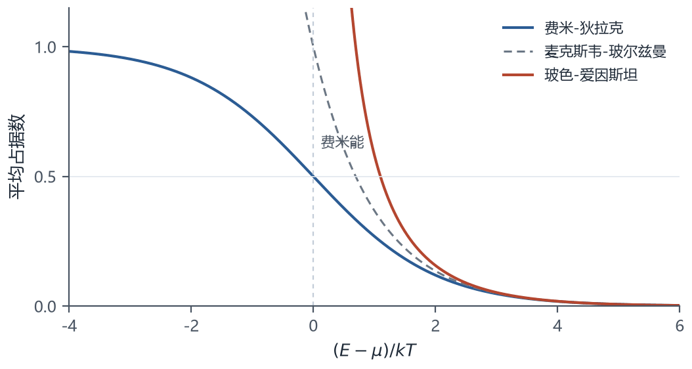
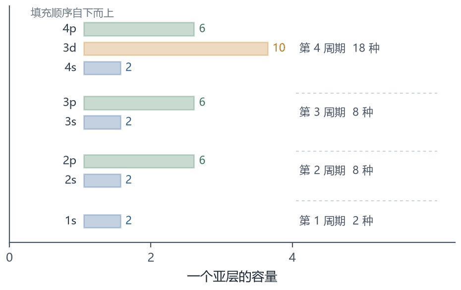

# 第 12 章　全同粒子与统计

把两枚一模一样的硬币放在桌上，你可以盯着它们看，记住左边那枚有一道划痕，右边那枚没有。过一会儿有人把它们换了个位置，你一看就知道换了。即使两枚硬币真的分毫不差，你也总可以给它们编号，一路跟踪它们的轨迹。

电子做不到这件事。两个电子不只是长得像，它们连“这一个”和“那一个”的区别都没有。你把其中一个挪到别处，没有任何测量能告诉你挪的是哪一个。这不是仪器不够好，是这件事本身没有意义。

这一章讲这个看似哲学的区别怎么变成了可测量的物理。它会解释金属为什么导热却不怎么存热，解释元素周期表为什么长成那个样子，也解释一颗恒星烧完之后靠什么撑住自己。

## 12.1 没有名字的粒子

经典力学里，粒子的“身份”由轨迹定义。两颗台球相撞，撞完以后哪颗往哪走，看轨迹就清楚。哪怕它们完全一样，轨迹是连续的，你可以一路追下去。

量子力学没有轨迹。粒子从一个地方到另一个地方，中间没有一条可以跟踪的线，只有波函数的演化。当两个粒子的波函数在空间上重叠，你就再也说不出哪一个在哪里。

这件事的严格表述是一条对称性要求。把两个全同粒子的坐标互换，物理状态不能变。用 $\psi(x_1,x_2)$ 表示两粒子波函数，互换以后

$$
\psi(x_2,x_1) = e^{i\varphi}\,\psi(x_1,x_2)
$$

互换两次回到原样，所以 $e^{2i\varphi}=1$，相位只能是 $+1$ 或 $-1$。于是全同粒子的波函数只能分两类

$$
\psi(x_2,x_1) = +\psi(x_1,x_2) \quad\text{或}\quad \psi(x_2,x_1) = -\psi(x_1,x_2)
$$

前一类叫对称，后一类叫反对称。这个正负号不是数学游戏，它决定了后面所有的物理。

## 12.2 两种性格

哪一类粒子用哪个符号，由自旋决定，这条规则叫自旋统计定理，是 1940 年泡利从相对论性量子场论里证出来的。

自旋是整数的粒子，波函数对称，叫玻色子。光子、声子、氦-4 原子都属于这一类。自旋是半整数的粒子，波函数反对称，叫费米子。电子、质子、中子、氦-3 原子属于这一类。

复合粒子的统计由总自旋定。氦-4 有两个质子、两个中子、两个电子，都是费米子，但成对的自旋可以抵消，总数是整数，整个原子表现为玻色子。氦-3 少一个中子，总自旋是半整数，表现为费米子。两个同位素只差一个中子，低温下的行为却天差地别，液氦-4 在 2.17 开尔文变成超流，液氦-3 要到 2.5 毫开尔文才有类似的转变。

反对称性还有一个不太显眼的后果，叫交换能。两个电子的自旋同向排列时，自旋部分对称，空间部分就必须反对称，两个电子倾向于互相避开。自旋反向排列时，空间部分对称，它们可以靠得更近，库仑排斥更大，能量更高。这个由对称性带来的能量差，比两块小磁铁之间的相互作用大好几个数量级，铁磁体为什么会自发磁化，靠的就是它。

第 9 章讲过的洪-欧-曼德尔效应，就是这条规则的光学版本。两个全同光子进分束器，两条“各走一边”的振幅在输出端反相，正好抵消，所以两个探测器从不一起响。如果光子是费米子，符号反过来，结果会完全相反。

## 12.3 泡利不相容

反对称性有一个直接的推论。让两个费米子占据同一个单粒子态，波函数变成 $\psi(x,x)$。可是反对称要求 $\psi(x,x)=-\psi(x,x)$，唯一的解是零。

波函数处处为零，这个态不存在。这就是泡利不相容原理，两个全同费米子不能占据同一个量子态。

对称的情形完全相反。玻色子的波函数在 $x_1=x_2$ 处取极大，两个玻色子挤在同一个态里不但允许，而且概率被放大。这个差别是两种统计的根源。

泡利原理听起来像一条禁令，实际上它是物质结构的支柱。原子里的电子是费米子，同一个轨道上最多放两个，自旋相反，因为自旋也是态的一部分。第三个电子只能往更高的能级去。于是原子有了壳层，有了大小，有了一把椅子能被坐住而不塌进地板。

## 12.4 金属里的费米海

把一块铜里的自由电子拿出来看。一立方厘米里有 $8.5\times10^{22}$ 个，密度是 $8.5\times10^{28}$ 每立方米。它们都是费米子，都要找位置坐下。

绝对零度时的填充方式很清楚。从最低的能级开始，一个态放一个电子（自旋算两个态），一个个往上排，排到最后一个电子的能量叫费米能 $E_F$。这个填充起来的“海”叫费米海。

费米能和密度之间有一个简单关系。把动量空间里被占满的球体积换算成粒子数，得到

$$
E_F = \frac{\hbar^2}{2m}\left(3\pi^2 n\right)^{2/3}
$$

代入铜的密度，$E_F = 7.0$ 电子伏特，对应的温度是 8 万开尔文，对应的速度是 $1.6\times10^6$ 米每秒。即使把铜冷到绝对零度，电子还在以每秒一千六百公里乱跑。这不是热能，是泡利原理逼出来的零点运动。

费米海最要紧的后果是，只有海面附近的电子能参与反应。室温的 $kT$ 只有 0.026 电子伏特，比费米能小两百多倍，深处的电子想被激发出来，得先找到空位，而头顶全是占满的态。能够吸收热量、能够被电场加速的，只有海面下薄薄一层，厚度约 $kT$。

所以金属的电子比热比经典预期小得多，只有百分之几。这在十九世纪是个谜，经典理论算出来的值大了两个数量级。泡利原理一出来，谜就解了。

图 12-1　三种统计的平均占据数，横坐标是能量相对化学势的位置，按基本分布公式计算。费米分布在海面处由 1 陡降到 0，玻色分布在低能端发散

## 12.5 壳层与元素周期表

原子里的电子也是费米子，按同样的规则往上排，只不过束缚在库仑势里，能级是分立的。

能级的标记用 $n$ 和 $l$，$n$ 是主量子数，$l$ 是角量子数，取 $0,1,2,\dots$ 分别记作 $s,p,d,f$。一个 $(n,l)$ 亚层能放 $2(2l+1)$ 个电子，$s$ 亚层 2 个，$p$ 亚层 6 个，$d$ 亚层 10 个。

填充顺序不是简单的 $n$ 从小到大。电子之间有排斥，内层电子会屏蔽核电荷，让外层电子感受到的有效电荷变小。结果是 $4s$ 的能量比 $3d$ 低，先填 $4s$ 再填 $3d$。这个顺序让周期表在第四周期出现了十种过渡金属。

按这个顺序排下去，每一层填满就是一段周期的结束。第一周期填满 $1s$，两种元素；第二周期填 $2s$、$2p$，八种；第三周期填 $3s$、$3p$，八种；第四周期填 $4s$、$3d$、$4p$，十八种。周期长度 2、8、8、18、18、32，全部可以从亚层容量直接算出来。

图 12-2　电子亚层的填充顺序与容量。右侧按填充顺序分组，每组的容量就是该周期的元素数

化学性质的周期性，就是这件事的直接后果。最外层电子数相同的元素，化学性质相似。氦、氖、氩最外层是满壳层，几乎不反应。锂、钠、钾最外层只有一个 $s$ 电子，容易丢掉，都是活泼金属。

门捷列夫在 1869 年排出周期表的时候，完全不知道电子和自旋。他看到的是化学性质的重复，而重复的根源是泡利原理加上能级顺序。这是量子力学少有的、在它诞生之前就已经被实验摆好的胜利。

## 12.6 玻色子抱团

玻色子的方向相反。它们不但可以同态，而且偏爱同态。一个态里已经有 $n$ 个玻色子，再放一个进去的概率被放大 $n+1$ 倍。这个因子来自波函数的对称性，是受激辐射的根源，也是激光能相干放大的原因。

温度降到足够低，这个偏好会变成集体行为。当热运动的能量小于能级间距，宏观数量的粒子会一起掉进最低的态，形成一个宏观上可以观测的量子态。这叫玻色-爱因斯坦凝聚，1924 年由玻色和爱因斯坦在理论上提出，隔了七十年才在实验里做出来。

1995 年，科罗拉多的一组成员用激光冷却和蒸发冷却，把大约两千个铷-87 原子冷到 170 纳开尔文，看到了凝聚。几个月后，麻省理工的另一组用钠原子重复了这个结果。2001 年的诺贝尔物理学奖给了这三个人。

凝聚体的行为像一个巨大的波。两个凝聚体撞在一起，会出现干涉条纹，条纹的间距由它们的相对相位决定。它还能被用来做原子干涉仪，测重力、测转动、测基本常数，精度比光学干涉仪高好几个数量级。

## 12.7 星星的结局

泡利原理在宇宙尺度上也在起作用。

一颗恒星烧完燃料，核聚变撑不住引力，核心开始塌缩。电子被挤得越来越紧，按泡利原理，它们不能进入同一个态，密度越高，动量越大，压强越大。这个压强叫电子退化压，它跟温度几乎无关，是纯粹的量子效应。

白矮星就是引力与电子退化压平衡的产物。太阳这样的恒星，最终会变成一颗地球大小、密度每立方米十亿吨的星体，靠的就是这层压强。钱德拉塞卡在 1930 年算出，这个平衡有个上限。质量太大时，电子被迫接近光速，退化压的增长赶不上引力，星体继续塌缩

$$
M_{\mathrm{Ch}} \approx 1.4\,M_\odot
$$

超过这个极限，电子被压进质子，变成中子和中微子，星体塌成中子星。中子也是费米子，中子的退化压接着顶住引力。中子星的质量上限在 2 个太阳质量附近，2017 年的双中子星并合，加上后来的 X 射线观测，给这个数字定了很紧的界限。

再往上，没有任何已知的压强能顶住引力，星体塌成黑洞。

一颗恒星的结局，由它内部的粒子是玻色子还是费米子、自旋是半整数还是整数决定。这条规则写在 1925 年的一篇论文里，五年后就被用来判断一颗恒星的死活。物理学的尺度跨度，有时候大得不像话。
